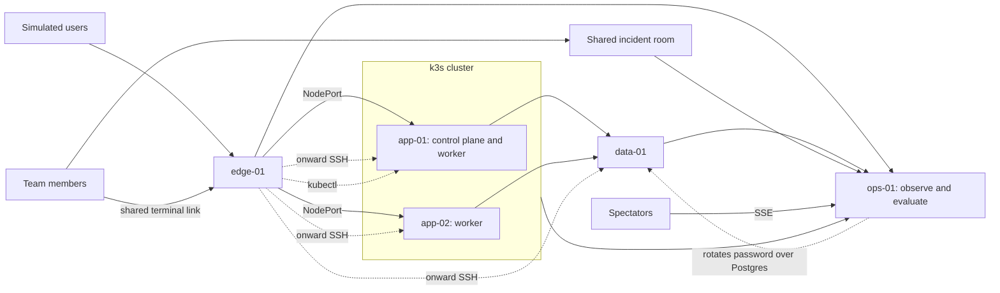

# Break Team: a collaborative incident lab (discussion draft)

## The experience to build

A team starts and joins one disposable iximiuz Labs playground from the browser, with no facilitator or outside tooling. It contains a small, working service spread across several VMs. The system runs real background traffic and produces a steady stream of routine events. After the team starts its shift and a healthy baseline is visible, the lab applies one fault. Participants receive a believable symptom, investigate together, make a repair through a terminal or a delivery workflow, and watch the system recover. A separate evaluator confirms sustained recovery and explains what it observed. The team can replay the incident timeline afterward.

The aim is to practice **incident response as a team**: noticing impact, building a shared picture, coordinating changes, checking the result, and communicating resolution. The lab should make a fix possible without making the answer visible in the alert.

This is still a discussion draft, not an implementation specification. Items under **Decisions so far** are settled; anything marked **Proposed** is the current direction and remains open. The first release should be a credible, repeatable five-VM incident with a modest visual room. More faults, workflows, and richer visualization can follow once that experience is convincing.

## Decisions so far

- **Self-serve, with no facilitator by default.** A team runs the whole lab from the browser. Nothing depends on a command run on someone's laptop or on a separate system.
- **No scoring.** A time-based leaderboard may come later.
- **First fault: a rotated database password.** A secrets manager on `ops-01` rotates it at a random point 2 to 4 minutes after the team presses **Start shift**.
- **No SSH for fault injection.** Ordinary SSH can stay for everything else, including terminal access.
- **Platform web terminals with a name pool.** The owner shares one terminal link on `edge-01` for a shared login account. Each session gets a random name from a pool and its own Linux user, and onward SSH to the other VMs keeps the name. There is no custom terminal gateway.
- **Routine noise in the inbox.** A steady stream of events, most of them safe to ignore, makes the stable period feel like production.
- **PostgreSQL 18** on `data-01`.
- **The shop runs on a multi-node k3s cluster, and the lab's own machinery does not.** Customers reach small services in Go, Python, and TypeScript, running as Kubernetes deployments with different replica counts, so the system looks like a live production ecosystem. The secrets manager, fault injection, evaluator, room, and monitoring stay as systemd services on `ops-01`, outside the cluster, where a team working in the cluster cannot damage or read them. PostgreSQL stays on `data-01` and the edge proxy on `edge-01`, also outside the cluster, like a managed database and a cloud load balancer.
- **The MVP ends after one fix.** When the fix is confirmed, a resolved notification reaches every relevant interface, including the separate spectator web app.
- **MVP spectator app over SSE, with no streaming.** Connected web clients see what is currently happening through simple 2D shapes for each VM, with colors for CPU, memory, and similar stats. They also see whether the system is degraded and how, from simple SLOs such as error rate and latency on user-facing endpoints, and they see the fixed notification. This will be elaborated later.
- **Post-MVP: random breakages after each fix.** Each confirmed fix leads to another randomly chosen fault.

## What the existing projects teach us

| Reference | Useful observation | Implication for Break Team |
| --- | --- | --- |
| [Grafana Alerts Lab](../grafana-alerts-lab/README.md), its [manifest renderer](../grafana-alerts-lab/playground/iximiuz/render_manifest.py), and [alert receiver](../grafana-alerts-lab/app/alert_viewer.py) | A `flexbox` playground already runs services over two VMs, can render a two-to-five-VM layout, and places Grafana, Prometheus, an alert inbox, and terminals in browser tabs. Grafana webhooks can reach an in-playground inbox and optional user destinations. | Reuse the pattern of an observable system and an in-playground incident surface. Alerts should come from measured impact, not directly from the fault switch. Do not reuse its service, whose fault is a boolean that makes three of four requests return 503 and leaves nothing real to repair. |
| [Linux Performance Detective](../perf-labs-iximiuz/README.md), its [playground manifest](../perf-labs-iximiuz/playground/manifest.yaml), [scenario controller](../perf-labs-iximiuz/scripts/perf-lab), and [tutorial](../perf-labs-iximiuz/tutorial/index.md) | Cases have explicit start, status, stop, preflight, resource limits, cleanup, and checks that distinguish a correct observation from a plausible but irrelevant answer. Its 2-vCPU/3-GiB guest was tested with BPF tooling. | Give every fault a bounded lifecycle and verify the learner's outcome against live behavior. Use BPF only where it adds diagnostic value and passes a guest capability check. These performance cases diagnose faults; Break Team must also make remediation meaningful. |
| [Manifest Dojo challenge](../iximiuz-challenges/manifest-dojo-c295a939/index.md) and its [configuration chooser](../iximiuz-manifest-dojo/scripts/configure.py) | One target manifest file is chosen at startup; all configured substitutions in that file take their bad values, so one selected target can contain several wrong fields. The challenge waits for breakage, then checks for stable pod readiness. | Begin with one randomly selected, known-solvable causal incident. Extend the catalog across VM, network, data, delivery, and service boundaries, and judge user-visible behavior in addition to component readiness. |
| [Live Linux Lab Visualization plan](LAB_VISUALIZATION_PLAN.md) | A shared scene, distinct player identities, event stream, snapshots and deltas, live terminal views, and replay can make human actions visible. The plan also notes event-volume and attribution limits. | Start with an incident topology and timeline that answer operational questions. Treat its filesystem/process world as an optional drill-down; do not make a full 3D filesystem a prerequisite for a useful incident lab. |

`labctl playground catalog` and `labctl playground manifest flexbox` currently describe FlexBox as supporting **up to five VMs** on custom local networks. The [multi-machine docs](https://labs.iximiuz.com/docs/custom-playgrounds/multi-machine-playgrounds) (undated) give limits of 2 vCPU/4 GiB per VM and 5 vCPU/8 GiB per playground on the free tier, and 4 vCPU/10 GiB per VM and 10 vCPU/16 GiB per playground on paid plans. Requests over budget are scaled down proportionally, so a preflight should measure what it actually received. The docs read so far state no tier limits on session length or public exposure. Because the lab is self-serve, the person starting it may be on the free tier. We should measure cold-start time, memory headroom, and workload overhead with `labctl playground start --as-free-tier-user` before fixing a resource budget.

## A first system that fits one playground

| VM | Job | Why it matters to the incident |
| --- | --- | --- |
| `edge-01` | User entry point, load balancer into the cluster, synthetic clients, and the shared terminal login | Gives the team an external view of availability and latency, and keeps entry working if a cluster node fails. |
| `app-01` | k3s control plane and worker node | Provides deploy, configuration, process, and performance faults, and hosts the Kubernetes API the team repairs through. |
| `app-02` | k3s worker node | Spreads replicas across a second machine, so a failure can be partial and teammates can look in different places. |
| `data-01` | PostgreSQL 18 database, used as the first queue | Creates dependencies where a healthy pod can still serve failed transactions. |
| `ops-01` | Metrics, alerts, incident room, scenario control, secrets manager, and protected evaluation | Keeps the investigation surface available while the application is damaged, and keeps scenario logic off the VMs the team controls. |

These five VMs are the platform's limit, and they use the whole free-tier budget: 1 vCPU each, with 1 GiB on `edge-01` and `data-01`, 2 GiB on `app-01`, 1.5 GiB on `app-02`, and 2.5 GiB on `ops-01`, for a total of 5 vCPU and 8 GiB. Measured on free-tier VMs with k3s v1.37 and its optional add-ons turned off, an idle control plane node uses about 375 MiB above the base system and an idle agent about 200 MiB. `ops-01` drops from 2 vCPUs to 1, but during a full incident its CPU stayed near 3%, and the busiest VM, `app-01`, used about 800 MiB of its 2 GiB. Networking two or three playgrounds remains a fallback whose reachability, session ownership, lifetime, and teardown would need proof first.

The service need only be complex enough to produce useful causal paths. Every scenario starts from a verified healthy state.

| Deployment | Language | Replicas | Job | Reached by |
| --- | --- | --- | --- | --- |
| `storefront` | TypeScript | 2 | Serves the storefront page. Uses no database. | `GET /` |
| `catalog` | Python | 2 | Lists products from PostgreSQL. | `GET /products` |
| `orders` | Go | 3 | Writes orders to PostgreSQL. | `POST /orders` |
| `fulfilment` | Python | 1 | Background worker that claims and finishes pending orders, using a PostgreSQL table as the queue. | Nothing directly |

The shop's manifests and container images are baked into the root filesystem, so a session needs no registry to start. These rules follow from testing on real VMs:

- **Manifests are applied once at first boot, not through the k3s auto-deploy directory.** Auto-deploy re-applies its files whenever k3s restarts. In a test, this silently put a Secret back to its original value after a team had changed it, so a reboot of `app-01` would have undone a correct repair.
- **`kubectl` is a separate binary.** The copy built into k3s unpacks a data directory into each user's home on first use, which would happen for every name in the pool.
- **Prometheus on `ops-01` scrapes pods through the Kubernetes API,** using a read-only token that cannot read Secrets. The cluster needs no monitoring components and no extra routes, and nothing the lab depends on runs inside it.
- **Traefik, ServiceLB, metrics-server, and the local-path provisioner are off.** `edge-01` proxies to NodePort services on both nodes. This saves memory and start time on small VMs, and a production-style ingress could be added once there is a scenario for it.

Participants can view the operations surfaces, but the scenario selector, answer key, secrets manager credentials, and evaluator stay out of their reach. **Proposed:** set `noSSH: true` on `ops-01`, which the [docs](https://labs.iximiuz.com/docs/custom-playgrounds/multi-machine-playgrounds) describe for verifier machines, so hiding the evaluator does not need a fifth VM. The spike must confirm that this blocks SSH from the other VMs while `ops-01` can still reach them and expose ports. A platform task is not a stronger boundary by itself, because it runs on a named machine.

**Proposed trust model:** prevent accidental spoilers rather than stop a determined team. There is no scoring, and the VMs are disposable. Give participants full sudo on the workload VMs, because a scoped list limits valid repairs and acts as a hint. The stock Ubuntu base image already gives `laborant` passwordless sudo.

The diagram shows the experience, not a required network or software deployment. In particular, people need distinct identities for an accurate action timeline even if they work on the same VM.

## The incident loop

1. **Baseline:** Participants join and see the topology, the service's customer-facing checks, routine inbox events, and a short healthy history. Anyone can press **Start shift** once the team has gathered. A preflight confirms the playground is ready before a fault is armed.
2. **Impact:** After a random delay (2 to 4 minutes for the first fault), the scenario changes one part of the system. Synthetic transactions expose its effect. An alert or inbox entry describes symptoms, affected user journeys, and the first observed time; it does not name the injected cause. Routine noise continues unchanged.
3. **Triage:** Team members claim roles, inspect dashboards and terminals, record hypotheses, and link evidence in a shared incident room. The room shows which host or service each person is investigating.
4. **Repair:** Participants change the relevant configuration or code, deploy it, or run an operational command. The first release can support terminal repairs; a Git delivery path should be an intentional scenario mode, not a forced step for every problem.
5. **Verification:** The evaluator runs independently of the damaged path. It checks user-visible transactions and the affected dependency over a stability window. The room reports what has recovered, what is still failing, and whether the result is conclusive. Once recovery is sustained, the resolved notification goes out to every relevant interface.
6. **Debrief:** The team sees the alert, actions, changes, measurements, and recovery in order. A short prompt asks what evidence justified each decision and what communication was missing.

The incident room can have four compact panels: **system map**, **impact and alerts**, **team activity and notes**, and **recovery checks**. Grafana remains a deeper investigation tool; the room gives a shared operational picture.

## Design choices worth exploring

### How people learn that something is wrong

| Route | Value | Tradeoff / suggested use |
| --- | --- | --- |
| In-playground incident inbox | Reliable shared starting point, easy to replay, no external account needed | Use in the first release. Show alert state and customer impact, with links to supporting dashboards. It also carries routine noise. |
| Grafana dashboards and alert rules | Lets participants discover trends, compare hosts, and inspect alert logic | Use from the start, but do not make the dashboard the only notification surface. |
| Browser notification or optional webhook/phone page | Makes the interruption feel real and supports an on-call role | Add as opt-in after delivery and duplicate handling are tested. Never silently send a real page during a practice run. |
| Facilitator inject or chat message | Supports narrative and human communication failures | Not part of the default flow. Could support an optional hosted mode later, and should be distinguished from measured telemetry. |

The existing Grafana lab proves an inbox and optional destinations are feasible. Break Team should preserve alert provenance: measured signal, rule, delivery, acknowledgement, and resolution are separate events. A broken monitoring path is an advanced scenario because it can make the incident room itself misleading.

### Routine noise in the inbox

The inbox starts at boot and carries a steady stream of events, so the stable period feels like production, where things are constantly happening and most can be safely ignored. This also gives the real cause somewhere to hide in plain sight. The details below are **proposed**.

| Source | Examples | Suggested use |
| --- | --- | --- |
| Real routine jobs | Backup finished, log rotation, vacuum, harmless credential rotations | Core of the feed. |
| Real but noisy alert rules | A latency alert that flaps with traffic jitter, a low-threshold disk warning | Core of the feed. |
| Real brief blips | A small traffic bump, a worker retry | Some, kept below customer impact. |
| Notices about things outside the playground | Vendor maintenance, a planned marketing email | A little, labelled by source. |
| Scripted alerts that are not true | "Disk 91%" when it is not | Reject. It teaches the team that the inbox lies. |

These rules keep the noise fair:

- **It ignores the fault.** Rate and mix stay the same before, during, and after the incident, so neither a change in the feed nor an all-clear gives anything away.
- **The rotation is just another event.** It reads like the harmless rotations around it, for example `secrets: rotated orders-db-password (v2)`. The debrief can then show that it appeared before the first alert.
- **Severity is not a shortcut.** An occasional brief critical alert resolves on its own, so filtering on `critical` does not find the real incident.
- **It never affects the verdict.** Noise must not trip customer checks, breach an SLO, or disturb the evaluator's stability window. Noisy alert thresholds sit below the SLO targets.
- **All history is real.** Noise starts at boot, so the team sees real events from before they joined. Pre-filled history would contradict Prometheus, which starts empty.
- **It varies by seed.** Each run gets a different mix and timing but can still be replayed.

Build a new inbox rather than extending `alert_viewer.py`, which has fault on/off endpoints and no acknowledgement. Grafana webhooks and small job wrappers can feed one event table that records each event's source. Start at about one item every 15 to 30 seconds and tune from there, keeping the jobs small enough for the workload VMs' limited CPU.

### How people can repair the system

| Mode | What it teaches | Good initial scenarios |
| --- | --- | --- |
| Terminal operations on a VM | Fast diagnosis, commands, service and network state, rollback | Restart a stuck worker, restore a firewall rule, repair a configuration value. |
| Edit and deploy from a shared Git repository | Change review, coordination, rollout, rollback, and drift between desired and running state | Bad application config, wrong route, faulty release; best after the base experience works. |
| UI or control panel action | Accessible for less experienced participants and useful for incident commander actions | Acknowledge, assign, annotate, request verification; avoid a one-click “fix” for the primary fault. |

The team needs one clear rule per scenario: where the durable source of truth lives and how a valid change reaches the running system. If Git is the source of truth, a manual hotfix may be acceptable for immediate mitigation but should be followed by a committed repair. If manual operations are the exercise, do not grade a commit. A disposable in-playground Git service would keep the exercise self-contained; an external repository would feel closer to many workplaces but add account and delivery dependencies. Shared Git work also needs a clear way to avoid conflicting edits and to attribute changes to people.

### What counts as fixed

The evaluator should answer three separate questions: **Did the customer journey recover? Is the recovery sustained? Is the system in an acceptable state?** A green process or ready pod alone cannot answer all three. For example, checkout should complete through the edge and app, write the expected data, and stay healthy for a short window. The evaluator should also detect “fixes” that merely disable alerts or synthetic traffic, return canned success, or bypass the required dependency.

Feedback should be layered: current symptoms and component checks are visible during work; a **Verify recovery** action gives an immediate explanation of passed and failed checks; a final result appears only after the stability window. Keep the answer key and fault selector out of participant views. If a check is unavailable, say **unknown** rather than **healthy**. The scenario author should test that both the intended repair and at least one plausible wrong repair produce the expected result.

**Proposed:** run the evaluator from `ops-01` through `edge-01`, rather than from `edge-01`, because the team can change that VM. It traces a unique order end to end and confirms the result with a separate read-only database role. It also requires the SLOs to stay within target for the whole stability window, so the evaluator and the spectator app agree on what recovered means. It fails closed: an empty or garbled response counts as **unknown**, never as passed. An earlier GraphQL lab poller read an empty response as secure.

With no facilitator, the room also needs timed hints and an explicit give-up option that leads to the debrief.

### Announcing the fix

In the MVP, one confirmed fix ends the incident. The evaluator alone decides that, after the stability window. A Grafana alert returning to normal is a separate event and must not read as the incident being fixed. The details below are **proposed**.

| Interface | What it shows |
| --- | --- |
| Room | A banner, the final recovery checks, and the move to debrief |
| Inbox | An entry clearly distinct from an alert resolving |
| Terminals | A short notice printed to open sessions, such as with `wall`, because the page around the terminal has no controls |
| Grafana | An annotation on the dashboards |
| Spectator app | A fixed notification, from an `incident.resolved` event over SSE |

These rules keep the interfaces consistent:

- **One event, many readers.** Every interface reads the same event from the evaluator, so they cannot disagree. A stable `incident_id` makes duplicates safe.
- **Late readers still find out.** A state endpoint and event replay cover anyone who connects or reconnects after the fix.
- **The SSE stream is spoiler-free.** It carries VM stats, SLO values, status, and timing, but no cause, participant names, commands, team code, or terminal link.
- **Nothing is announced early.** A failure during the stability window restarts the window without any notification.
- **Clients are optional.** None is required, and a disconnected client never affects the verdict.
- **Resolved stays resolved.** The evaluator keeps watching, and a later failure is a new event rather than a retraction.

Server-sent events are one-way and browser-native, with built-in replay on reconnect, and `doom-perf` already uses `EventSource` through an iximiuz `http-port` tab. The endpoint can share the room's exposed port, so it needs no extra owner click. Streaming services are out of scope for the MVP.

### How the breakage is created

Use a small catalog of **fault contracts**. Each contract states its healthy baseline, injected change, expected external symptom, likely evidence, allowed repair paths, independent recovery checks, bounds, and reset behavior. On each start, choose one contract and record a seed privately for reproducibility. Validate the healthy system, apply the change, and confirm that a real customer-facing check fails before declaring the scenario live. If injection fails, say so in the room and direct the team to a fresh playground; never ask a team to solve an unverified incident.

Each contract must also state whether the fault survives a service restart and a reboot, and whether either counts as a fix. Init tasks do not re-run after an in-session reboot, so nothing re-applies a fault automatically. Nothing on a VM should have a name that gives the scenario away, such as `fault-07`, and injection logic should not stay on a workload VM. Ordinary forensics such as `find -mmin` and the journal remain fair investigation.

The default trigger is self-serve: noise runs from boot, any participant presses **Start shift** once the team has gathered, and the fault follows after a random delay. Timing from boot would not work, because teammates may still be joining. A scheduled second event could test handoff and communication later.

**Proposed reset path:** for the first slice, start a fresh playground from the browser, which also covers a participant accidentally cutting off their own access. `labctl` lists stop, restart, and destroy commands but no snapshot command. Random breakages after each fix need a different approach, covered in the post-MVP roadmap.

| Candidate fault | Visible symptom | Likely investigation and repair |
| --- | --- | --- |
| Edge route or firewall blocks app traffic | Elevated gateway errors while app appears healthy locally | Compare edge and app views; restore routing or firewall state. |
| App-to-data address or credential drifts | Login or checkout fails while unrelated endpoints work | Follow one transaction; repair configuration and restart or redeploy. |
| Worker enters a bounded busy loop | Queue lag and latency grow, CPU rises | Distinguish useful work from CPU activity; repair worker code/config or deploy a known good version. |
| Bad rollout or wrong upstream port | One endpoint or replica fails after a change | Compare versions and service targets; rollback or fix and redeploy. |
| Disk or queue pressure | Requests may pass at first, then time out or backlog | Find the constrained component; restore capacity or drain safely. |
| Alerting misroutes a page while service stays degraded | Detection and response lag, conflicting signals | Advanced exercise in observability and incident command; requires independent impact checks. |

For the first catalog, prefer one primary fault with small, bounded variation such as target host, service, parameter, or time of onset. Randomize **which diagnosis** is needed, not whether the exercise is solvable. Avoid stacking unrelated faults until single-fault fairness, reset, and grading are reliable. Routine noise is part of the base experience; later modes could add a deliberately timed benign distraction, a second consequence of the same cause, or a timed follow-on fault. Keep the seed for replay and postmortem, hidden from participants until the debrief.

### Options for the injected change

Chaos tools test whether a system survives a fault and then revert it. This lab needs a fault that stays until a person diagnoses and repairs it, so the underlying primitives are more useful than the frameworks. The chaos tool details below come from general knowledge and have not been tested here.

| Option | Examples | Weakness | Suggested use |
| --- | --- | --- | --- |
| Routine change that goes wrong | A rotation or maintenance job changes something and logs it | Needs a believable change channel | **First fault** |
| Config change | Env file, upstream, pool size | Recent-file searches can find it, which is fair investigation | Early |
| Bad release | Versioned directory and symlink | Needs a deploy path; rollback may be too easy | Early |
| Network or kernel state | `nftables`, `tc netem`, routes | A reboot may clear it, and it can cut off monitoring | Early, made persistent |
| Resource pressure | `MemoryMax`, filling a dedicated scratch drive | Needs load calibration on small VMs | Early; the perf lab already has this pattern |
| Latent defect plus trigger | Expiring certificate, missing index with a growing table | Harder to tune; timing varies | Early; most realistic, with no injector footprint |
| In-app fault flag | The Grafana lab's boolean | The repair is flipping a flag | Harness testing only |
| Syscall interception | `LD_PRELOAD`, BPF override, `dm-flakey` | Invisible to normal tools; depends on kernel support | Avoid, except possibly `dm-flakey` for a failing disk |
| Chaos frameworks | Toxiproxy, chaosd, Chaos Mesh | The "fix" is removing the tool's fault | Skip; use the primitives directly |
| Human adversary | A rival team breaks the system | Fairness, and needs a more general evaluator | Possible later mode |

### Options for delivering it

| Option | Tradeoff | Status |
| --- | --- | --- |
| A system component on `ops-01`, using normal interfaces | No scenario logic on VMs the team controls, and the change looks like ordinary operations | **Chosen for the first fault**, through the secrets manager |
| Chosen at boot by an init task (Manifest Dojo) | Simple, but gives no healthy baseline unless the fault stays latent | Not chosen |
| Root agent on each VM | Always visible, and the fault can damage it | Not chosen |
| Platform task with `needs:` | Good for sequencing, but start and retry behavior for non-init tasks is undocumented | Possible for later faults |
| SSH push from `ops-01` | Simple, but injection over SSH is ruled out | Ruled out |
| `labctl ssh` from a laptop | Keeps the answer key out of the playground, but is not self-serve | Ruled out |

The password can be rotated over Postgres, but app and edge faults such as a bad upstream or a firewall rule cannot. They need their own non-SSH path, which remains open.

### First fault: rotated database password

The secrets manager on `ops-01` rotates several harmless credentials as routine work, and each rotation appears in the inbox. At a random point 2 to 4 minutes after **Start shift**, it also rotates the order database password with `ALTER ROLE` over a normal Postgres connection, using a dedicated privileged role. The `orders`, `catalog`, and `fulfilment` deployments still get the old password from a Kubernetes Secret, which they read as an environment variable when a pod starts. State lives on `ops-01`, so the rotation happens once and a `data-01` reboot cannot re-fire it after a repair.

Options considered for performing the rotation:

| Option | Advantage | Problem | Status |
| --- | --- | --- | --- |
| Secrets manager on `ops-01` runs `ALTER ROLE` | No scenario logic on VMs the team controls, unaffected by `data-01` reboots, and can wait for the team | Needs a privileged database role reachable from `ops-01`, which the team can see | **Chosen** |
| systemd timer on `data-01` | Simple, with no network involved | Starts from boot, and a reboot can re-fire it after a repair unless guarded | Not chosen |
| Platform task with `needs:` and a sleep | Needs no unit baked into the image | Start and retry behavior for non-init tasks is undocumented, and a retry could rotate twice | Not chosen |
| `pg_cron` inside Postgres (not tested) | No job on the host | Adds an extension, needs a computed schedule, and is an unusual way to rotate | Not chosen |
| `VALID UNTIL` expiry instead of rotating | Nothing runs when it fails, and the log clearly names an expired password | The repair is one change on `data-01`, so it is less of a cross-host fix | Candidate second variant |

Behavior tested on PostgreSQL 16 and 18 in a throwaway local container:

- **Live connections survive.** A session opened before a rotation or expiry keeps working; only new connections fail.
- **Log evidence is indirect.** A failed login shows only the failure and the matching `pg_hba` line. The clues are the `ALTER ROLE` log line, which needs `log_statement=ddl`, and the inbox event.
- **The password need not leak.** Sending a pre-hashed password puts only the hash in the log.
- **A bypass is detectable without host access.** A non-superuser role can read `pg_hba_file_rules` after a grant.

Because live connections survive, the app's connection handling decides when the incident starts. A new connection per request fails immediately and totally. Having the rotator kill existing sessions also fails immediately, and the kills are a tell. **Proposed:** use a pool with a maximum connection lifetime of 60 to 90 seconds. Failures build up as connections expire, replica by replica, and a reflexive restart should turn a partial outage into a full one. The first customer alert would arrive roughly 3 to 6 minutes after **Start shift**, to be tuned in testing. The confirmation step must wait for connections to expire before deciding that injection failed.

Readiness and liveness probes check only that the process is running, so pods stay `Running` and `Ready` while customers fail. A database check in the readiness probe would stall a bad rollout and hide this. The plan's rule that a green process or ready pod cannot answer whether the system is fixed is the point of the exercise.

**Proposed:** the secrets manager offers the current password through a room page or CLI, and each reveal goes on the timeline.

| Team action | Proposed result |
| --- | --- |
| Copy the new password from the secrets manager into the Kubernetes Secret and restart all three deployments | Intended fix |
| Set a new password on both sides | Accepted |
| Put the old password back on the database | Service recovers, but the room flags that the stored secret no longer matches |
| Set `trust` in `pg_hba.conf` | Rejected |
| Restart the deployments only | Does not help, and turns a partial outage into a full one |
| Update the Secret but restart nothing | Does not help, because running pods keep the old value |
| Update the Secret and restart only some deployments | Partial recovery. The incident stays open until the customer journeys and the order worker all recover |
| Scale a failing deployment to zero | Rejected, because the customer journey stays broken |

## Making the social and visual parts useful

**MVP spectator app:** a separate read-only web app, connected over SSE, lets anyone with its link see what is currently happening. It starts very simply, with a 2D shape for each VM and colors for CPU, memory, and similar stats. It also shows whether the system is degraded and how, using simple SLOs on user-facing endpoints, and it shows the fixed notification. The remaining details are **proposed**:

- **Hosting:** it has its own path on the room's exposed port, so it needs no extra owner click and no team code. It has no write actions.
- **Data:** `ops-01` reads the stats from Prometheus, using the `node_exporter` that the dashboards need anyway, so the visualization adds no agent of its own.
- **Updates:** each client gets a full snapshot on connecting and then a new one every few seconds, which also keeps the connection active.
- **Unknown values:** missing data shows as gray and **unknown**, never as healthy.
- **Readability:** each shape shows its numbers as well as its color.

These starting SLOs share placeholder targets of under 1% errors and a p95 latency under 500 ms over a rolling 60-second window. The spike should replace those numbers using a measured healthy baseline.

| User-facing endpoint | Why it is included |
| --- | --- |
| `GET /` storefront page | Does not touch the database, so it shows how far the damage reaches |
| `GET /products` | A database read |
| `POST /orders` | A database write, and the journey that matters most |

The synthetic clients on `edge-01` measure each endpoint through the edge, as a customer would, and export the results to Prometheus. This keeps working when the edge proxy itself is failing. Traffic must be steady enough to fill the window.

The app shows how the system is degraded through the affected endpoint, the measured value against its target, and how long it has been out of target, for example `POST /orders: 62% errors (target under 1%) for 2m 10s`. It never names the cause.

| State | Meaning | Source |
| --- | --- | --- |
| Healthy | All SLOs are within target | SLO metrics |
| Degraded | At least one SLO is out of target | SLO metrics |
| Recovering | SLOs are back within target, but the fix is not yet confirmed | SLO metrics and evaluator |
| Fixed | The evaluator confirmed sustained recovery | `incident.resolved` event |
| Unknown | SLO data is missing or has too few samples | SLO metrics |

Two rules keep these states honest:

- **Nothing changes before measured impact.** The rotation itself is not shown, so neither spectators nor the team get an early warning.
- **Only the evaluator can show Fixed.** SLOs returning to target alone show Recovering, including after a rejected repair such as setting `trust`. If an SLO breaches again after a fix, the app shows Degraded again.

A password fault barely changes CPU or memory, so the VM shapes can stay green while customers fail. Showing both side by side makes that visible.

The visual should then grow into a **live service map**: VM and service nodes, dependency edges, current impact, and recent changes. A person can select a node to see its metrics, logs, recent commands or deployments, and who is working there. The **incident timeline** overlays alerts, participant notes, investigations, changes, verification runs, and recovery. This directly answers “What changed?”, “Who is doing what?”, and “Are we closer to recovery?”

The [visualization plan](LAB_VISUALIZATION_PLAN.md) suggests a richer world of avatars, directories, process objects, file activity, network arcs, and click-to-view terminals. Its player attribution, snapshot/delta, and replay ideas are valuable here. The main incident view should stay at **system scale**; optional host/process exploration can use the richer model when a scenario benefits from it. A clear 2D topology may teach more than a full 3D world in the first release. A 3D overview or animated network flows are worth trying only if a small pilot can read cause and effect faster with them.

Useful collaboration features are named presence, an incident commander or coordinator role, a place to assign investigative threads, a shared hypothesis/evidence log, and a short status update field. Participants should be able to link a metric, host, command result, or commit to a note. The activity view should distinguish **observed actions** from **someone's interpretation** and should admit gaps: terminal capture or eBPF can enrich the timeline, but neither automatically reveals every human intention. A deliberately small set of structured events (deployment, service state change, verification run, alert transition) may deliver most of the value without tracing every syscall.

There are two audience modes worth keeping distinct. **Participants** can investigate and change the system. **Spectators** can follow the map and timeline, perhaps open an explicitly broadcast terminal, but cannot change the playground. A team can also use its own voice call while the incident room holds the durable record. Public terminal viewing and replay should only use disposable lab content and should be obvious to participants.

The largest product assumption to test early is whether multiple people can enter **the same iximiuz playground session** with distinct, attributable terminal identities and suitable access rights. The docs describe [Share Terminal](https://labs.iximiuz.com/docs/playgrounds/share-terminals) and [Expose Port](https://labs.iximiuz.com/docs/playgrounds/expose-http-ports) buttons that work without `labctl`. Both are private to the owner by default, and public links are open to anonymous users. The pages read so far describe no per-person identity, no manifest field that makes a port public, and no `labctl` inside a VM. Identity is therefore ours to build, and a small number of owner clicks probably remain. Do not infer multi-user collaboration merely from the presence of multiple terminal tabs.

**Proposed self-serve flow:**

1. The owner starts the playground in the browser, and the room opens in a tab.
2. The room walks the owner through two clicks: **Expose Port** with public access for the room and spectator app, and **Share Terminal** with public access for the shared account on `edge-01`.
3. The owner sends the terminal link to teammates privately. It never appears on the room or spectator pages, because those are public and the link grants a shell with sudo. The spectator link can go to anyone.
4. Each teammate opens the terminal link and gets a name. The login banner also shows a team code, which the room asks for before actions such as **Start shift**, so holding the terminal link is what proves someone is on the team.
5. Preflight, baseline, rotation, and failure confirmation run automatically, followed by timed hints, a give-up option, and the resolved notification.

**Terminals and names:** the shared account's login shell gives each new session an unused name from a pool, then switches to a real Linux user with that name and passwordless sudo. Someone opening a second tab can type their existing name to keep it. Onward SSH to the other VMs keeps the name by default, using keys baked into the image, and a shell hook records commands by name for the timeline. A local prototype on the iximiuz Ubuntu base image showed these behaviors through a real SSH login on one host, including 20 simultaneous logins with no duplicate names and Ctrl-C at the prompt leaving no shell as the shared account. The web terminal path is untested.

These limits are accepted for the MVP:

- **Names belong to sessions, not people.** A second tab means a second name unless the person retypes theirs.
- **Names are not released.** Each refresh that takes a new name uses one up, so the pool should hold 30 to 50 names.
- **Command records are light.** A command appears only once it finishes, there is no full transcript, and anyone with sudo could tamper with the records.
- **Entry depends on `edge-01`.** A later fault there could block entry until the owner shares a link from another VM.

Names are not assigned by IP address. The terminal connection reaches the VM through the platform, so the login shell is unlikely to see the browser's address, and seeing it would take a proxy much like the gateway this design avoids. Teammates on the same network would also share an address, and one person's address can change.

If the web terminal cannot run the name-pool login, a gateway in the room is the fallback. It would connect over ordinary SSH from `ops-01` and would need WebSockets through the exposed port. Fault injection must not use that SSH access.

The base image's SSH socket also listens on vsock. If the web terminal uses that path, a firewall fault should not cut off the terminal itself, but onward SSH between VMs still runs over the guest network.

## Suggested first slice

Build one repeatable incident on the five-VM topology: a customer request crosses edge, cluster, and data; the injected fault breaks that path; Grafana and the inbox show impact; two participants investigate on different hosts; one repairs it; the evaluator checks a real transaction for sustained recovery; the resolved notification reaches every relevant interface; the room shows the sequence of actions. The fault is the rotated database password, whose correct repair is clearly observable and whose monitoring stays available.

Then add catalog variety and collaboration depth in this order:

1. **Prove the substrate:** work through the spike checklist below, covering cold start, healthy baseline, multi-person access, identity, browser tabs, resource headroom, and a fresh-start reset in one playground.
2. **Prove the loop:** Start shift, routine noise, one fault, alert, shared timeline, manual repair, independent verification, timed hints, resolved notification, a simple spectator app with SLOs, and replayable debrief.
3. **Broaden the catalog:** several distinct fault families with seeded selection, an author-facing answer key, wrong-fix checks, and random breakages after each fix.
4. **Offer a delivery scenario:** shared Git change, deploy or rollback, action attribution, and durable-state grading.
5. **Test richer visual and social modes:** actor presence, terminal or process drill-down, optional paging, spectator view, and a pilot with real teams.

Success for the first slice means a team can start a session from the browser without outside help, see an authentic symptom, coordinate work across at least two hosts, restore the customer journey, receive accurate recovery feedback, see the resolved notification on every relevant interface, and explain the incident from the timeline. Track where teams get stuck and whether the visual room improves their shared understanding; do not optimize for scenario count first.

## Spike checklist

The spike may use `labctl` for convenience, but the resulting lab must not depend on it.

1. Can two people use a public terminal link at once? What happens when a second signed-in account opens a private link?
2. Can the owner expose the room and share a public terminal link using only the browser, including on the free tier?
3. Does `noSSH` block SSH from other VMs while `ops-01` can still reach them and expose ports?
4. Does the platform's web terminal start the selected user's login shell, so the name-pool login runs? Does onward SSH keep the name across real VMs? What client address does the login shell see? The local prototype worked over SSH on one host but has not been tried through the web terminal.
5. Do web terminals survive a guest firewall drop? The base image's SSH socket also listens on vsock, which suggests they might, but that is untested. Onward SSH between VMs would still use the guest network.
6. What are the cold-start time and memory headroom with PostgreSQL 18 and Grafana, using `--as-free-tier-user`?
7. What session lifetime limits apply, especially on the free tier?
8. Do long-lived SSE connections work through a public exposed port? `doom-perf` uses `EventSource` through an `http-port` tab, but no local lab yet shows this through a public port.
9. What do error rate and latency look like on a healthy baseline, so the SLO targets can come from measurements?
10. Does a multi-node k3s cluster fit on free-tier VMs alongside the operations stack, and can `ops-01` observe it from outside? Measured: yes, with 1 vCPU per VM. The measurements and test method are in `breakteam/docs/spike-results.md`.

## Post-MVP scenario roadmap

The fault table above is a pool of ideas; this is a proposed order for turning distinct failure modes into tested scenarios. Add them one at a time after the MVP loop works. The MVP uses the rotated password, so start with **worker progress**, **edge routing**, and **database connection saturation**. Faults outside the database also need a non-SSH delivery path, which remains open. A different target host or parameter is useful variation within a scenario, not a new scenario by itself.

| Candidate | Injected change and customer symptom | Investigation, repair, and recovery evidence |
| --- | --- | --- |
| Worker alive but not progressing | A bounded worker configuration fault stops order processing while the API still accepts requests; queue age and pending orders grow. | Compare accepted requests with completed work, repair the worker configuration, and confirm old and new orders complete without loss or duplicate effects as the backlog drains. A process restart alone should not pass if the fault remains. |
| Edge route or firewall failure | A wrong upstream target or narrow firewall rule makes customer requests fail at the edge while the app is healthy when reached locally. | Compare external and internal requests, restore the route or rule, and verify real transactions through the edge without bypassing the app. |
| Database connection saturation | A deliberately low connection limit or bad app pool setting causes intermittent transaction errors under steady load. | Correlate app errors with database connections, repair the limiting configuration, and show sustained successful transactions at the same load without exhausting the pool. Calibrate the load so failure and recovery are repeatable. |
| Data-host disk pressure | A bounded fill operation reduces free space until writes fail, while some reads still work. | Find the constrained filesystem, recover space safely, and verify new writes and previously committed data. Reset must remove only the lab's injected files. |
| Bad rollout with partial impact | One of two app instances serves a faulty version, producing intermittent failures after a deploy. | Compare versions and request paths, coordinate rollback or redeployment, and verify all instances serve correct transactions with the durable source of truth updated. Requires two app instances and a working delivery path. |
| Latency regression | A slow query or similarly bounded change raises transaction latency while responses remain mostly successful. | Follow the slow path, repair the cause, and verify correctness and latency against the latency SLO. |
| Expired database password | The role's `VALID UNTIL` passes with no job running, so new connections fail while live ones continue. | Find the expiry in the database log, extend it or set a new password, and verify sustained transactions. A cheap variant of the first fault, with less cross-host repair. |

Later, consider a **poisoned queue item** that requires safe quarantine and replay, a **data correctness regression** that returns success with wrong results, and an **alert delivery failure during real service degradation**. These need stronger independent checks; the alert case also introduces more than one simultaneous problem. Do not use them to test the first catalog's injection, reset, or grading machinery.

Before promoting any candidate into the playable catalog, write its fault contract and demonstrate four things: measured customer impact after injection; a repair that persists for the scenario's intended workflow; a plausible wrong repair that the evaluator rejects; and a clean reset to the verified baseline. Prefer scenarios that give teammates genuinely different evidence to investigate across the existing hosts.

### Random breakages after each fix

After the MVP, a confirmed fix leads to another randomly chosen fault instead of ending the run. The details below are **proposed**.

1. The evaluator confirms sustained recovery, and the resolved notification goes out as in the MVP.
2. A quiet period of random length follows, with routine noise continuing.
3. The controller checks that the system is fully healthy and chooses a fault whose preconditions still hold, avoiding repeats until the catalog is exhausted.
4. The fault goes through the same failure confirmation as the first one. Faults never stack.
5. The loop continues until the team presses **End shift** or the session ends. The debrief then covers every incident.

The main design question is what state the next fault starts from:

| Option | Advantage | Problem | Status |
| --- | --- | --- | --- |
| Keep the team's repaired state, with preconditions on each fault | Realistic, with no visible reset, and earlier repairs stay meaningful | An accepted workaround can change how a later fault behaves, so fault pairs need testing | **Suggested** |
| Reconcile to a known state before each fault | Predictable starting point | Silently overwrites the team's work, its restarts signal that something is coming, and it needs its own delivery path | Not suggested |
| Undo each fault separately | Simple for one fault | Fragile after people have edited things | Not suggested |

This scope has some consequences:

- **Delivery:** faults across several VMs make a non-SSH path for app and edge faults a prerequisite.
- **Catalog:** random selection needs several distinct, tested faults. A second password rotation could be one of them, because it breaks a hand-edited fix again and rewards a durable one.
- **Replay:** the seed only picks among faults that still apply, so the timeline must record the sequence actually chosen.
- **MVP preparation:** every event carries an `incident_id`, and the run is modelled as states, so `resolved` can lead to the debrief now and the next fault later. The MVP needs no fault-selection engine.

## Decisions to leave open for now

- **Optional hosted mode:** self-serve is the default. Is a facilitated mode ever worth adding? The amount of narrative, pacing, and spectator support would change accordingly.
- **Attribution beyond the MVP:** names from the pool belong to sessions. Is that enough once real teams use it, and how should Git actions be attributed? Validate web terminal access in the spike before promising multiplayer.
- **Primary repair workflow:** the first fault uses terminal repairs. Should later scenarios use terminal operations, Git delivery, or a mix? Each fault should have one clear intended path.
- **Visibility level:** topology and structured action events alone, or host-level terminal/process capture? This affects overhead, privacy expectations, and visualization scope.
- **Live telemetry broadcast:** the MVP uses only the SSE endpoint. Is a later Twitch livestream of the system map worth it? From general knowledge, Twitch takes video rather than events, and encoding inside the playground would compete for a CPU budget with no spare, so a read-only page captured with a streamer's own tools, such as OBS, may be a better option. Keep participant activity and lab details out of any public feed.
- **Discord incident channel:** should a session connect to a Discord server and create a temporary channel for incident coordination? Decide how messages enter the incident timeline and how the channel is retired after the exercise. It would also consume the resolved notification.
- **Feedback disclosure:** how much should the evaluator reveal during an incident without giving away the cause?
- **Hints and pacing:** what should the timed hints say, and when should they appear? What are the target run length and team size? The draft assumes 2 to 4 people.
- **Scenario SLOs:** the MVP uses simple SLOs on user-facing endpoints. Should later scenarios add their own targets or error budgets?
- **Config-driven scenarios:** should one general system hydrate a scenario from JSON, YAML, or similar configuration that declares its components, injected breakage, and remediation checks? Determine which parts can be shared across fault families without obscuring the causal story.
- **Resource envelope:** the five VMs use the entire free-tier budget of 5 vCPU/8 GiB, which leaves no room for a third cluster node. Measured use is well below that budget, so memory could move between VMs if a later scenario needs it.
- **Second playground:** only reconsider if a measured limitation or a particular fault requires it, after checking cross-playground networking and shared lifecycle.
- **Fault delivery beyond the database:** random breakages make this a post-MVP prerequisite. App and edge faults need a non-SSH path, such as a configuration channel that is part of the system, or platform tasks once their behavior is tested.
- **Time-based leaderboard:** if added later, measure from first customer failure to sustained recovery, because the start delay is random. Random fault sequences also make run totals hard to compare. The timeline should record both times from the start. A leaderboard would need a service outside the playground, and teams have root on the workload VMs, so results would rely on trust unless `ops-01` signs them.
