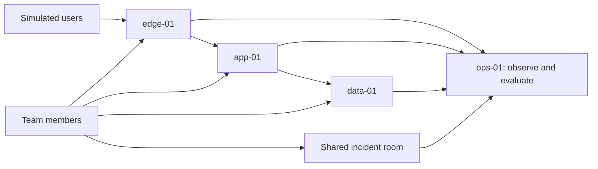

# Break Team: a collaborative incident lab (discussion draft)

## The experience to build

A team joins one disposable iximiuz Labs playground that contains a small, working service spread across several VMs. The system runs real background traffic. After a healthy baseline is visible, the lab selects and applies one fault. Participants receive a believable symptom, investigate together, make a repair through a terminal or a delivery workflow, and watch the system recover. A separate evaluator confirms sustained recovery and explains what it observed. The team can replay the incident timeline afterward.

The aim is to practice **incident response as a team**: noticing impact, building a shared picture, coordinating changes, checking the result, and communicating resolution. The lab should make a fix possible without making the answer visible in the alert.

This is an options paper, not an implementation specification. The first release should be a credible, repeatable four-VM incident with a modest visual room. More faults, workflows, and richer visualization can follow once that experience is convincing.

## What the existing projects teach us

| Reference | Useful observation | Implication for Break Team |
| --- | --- | --- |
| [Grafana Alerts Lab](../grafana-alerts-lab/README.md), its [manifest renderer](../grafana-alerts-lab/playground/iximiuz/render_manifest.py), and [alert receiver](../grafana-alerts-lab/app/alert_viewer.py) | A `flexbox` playground already runs services over two VMs, can render a two-to-five-VM layout, and places Grafana, Prometheus, an alert inbox, and terminals in browser tabs. Grafana webhooks can reach an in-playground inbox and optional user destinations. | Reuse the pattern of an observable system and an in-playground incident surface. Alerts should come from measured impact, not directly from the fault switch. |
| [Linux Performance Detective](../perf-labs-iximiuz/README.md), its [playground manifest](../perf-labs-iximiuz/playground/manifest.yaml), [scenario controller](../perf-labs-iximiuz/scripts/perf-lab), and [tutorial](../perf-labs-iximiuz/tutorial/index.md) | Cases have explicit start, status, stop, preflight, resource limits, cleanup, and checks that distinguish a correct observation from a plausible but irrelevant answer. Its 2-vCPU/3-GiB guest was tested with BPF tooling. | Give every fault a bounded lifecycle and verify the learner's outcome against live behavior. Use BPF only where it adds diagnostic value and passes a guest capability check. These performance cases diagnose faults; Break Team must also make remediation meaningful. |
| [Manifest Dojo challenge](../iximiuz-challenges/manifest-dojo-c295a939/index.md) and its [configuration chooser](../iximiuz-manifest-dojo/scripts/configure.py) | One target manifest file is chosen at startup; all configured substitutions in that file take their bad values, so one selected target can contain several wrong fields. The challenge waits for breakage, then checks for stable pod readiness. | Begin with one randomly selected, known-solvable causal incident. Extend the catalog across VM, network, data, delivery, and service boundaries, and judge user-visible behavior in addition to component readiness. |
| [Live Linux Lab Visualization plan](LAB_VISUALIZATION_PLAN.md) | A shared scene, distinct player identities, event stream, snapshots and deltas, live terminal views, and replay can make human actions visible. The plan also notes event-volume and attribution limits. | Start with an incident topology and timeline that answer operational questions. Treat its filesystem/process world as an optional drill-down; do not make a full 3D filesystem a prerequisite for a useful incident lab. |

`labctl playground catalog` and `labctl playground manifest flexbox` currently describe FlexBox as supporting **up to five VMs** on custom local networks. The live catalog's FlexBox example has two 4-vCPU/1.5-GiB VMs; `mini-lan-ubuntu-docker` shows four 2-vCPU/4-GiB VMs. These are example configurations, **not a confirmed quota for this account or a simultaneous total**. The Grafana lab's two-VM default uses 2 vCPUs/3 GiB for monitoring and 1 vCPU/1 GiB for the other host. We should measure the actual account tier, cold-start time, memory headroom, and workload overhead before fixing a resource budget.

## A first system that fits one playground

| VM | Job | Why it matters to the incident |
| --- | --- | --- |
| `edge-01` | User entry point and synthetic clients | Gives the team an external view of availability and latency. The evaluator can test from here. |
| `app-01` | API and background worker | Provides deploy, configuration, process, and performance faults. |
| `data-01` | Database or queue | Creates dependencies where a healthy process can still serve failed transactions. |
| `ops-01` | Metrics, alerts, incident room, scenario control, and protected evaluation | Keeps the investigation surface available while the application is damaged. |

This is a **starting layout**, not a fixed product architecture. A fifth VM could hold a second app replica for failover scenarios or separate the evaluator from observability. A rough first sizing question is whether the three workload VMs can run near 1 vCPU/1 GiB each while the operations VM runs near the Grafana lab's 2 vCPU/3 GiB. Those numbers are a candidate experiment, not a claimed platform allowance. Keep all five or fewer VMs in one playground unless a tested scenario truly needs another failure domain or more capacity. Networking two or three playgrounds remains a fallback whose reachability, session ownership, lifetime, and teardown would need proof first.

The service need only be complex enough to produce useful causal paths: for example, a storefront or order API where a request crosses edge, app, and data, with a background worker processing orders. The workload should be small and steady enough for clear metrics. Every scenario starts from a verified healthy state.

Participants can view the operations surfaces, but the scenario selector, answer key, and evaluator need separate control from the parts they may repair. If that boundary is not credible on the same VM, the optional fifth VM or iximiuz's task engine is a better home for evaluation.

The diagram shows the experience, not a required network or software deployment. In particular, people need distinct identities for an accurate action timeline even if they work on the same VM.

## The incident loop

1. **Baseline:** Participants see the topology, the service's customer-facing checks, and a short healthy history. A preflight confirms the playground is ready before a fault is selected.
2. **Impact:** The scenario changes one part of the system. Synthetic transactions expose its effect. An alert or inbox entry describes symptoms, affected user journeys, and the first observed time; it does not name the injected cause.
3. **Triage:** Team members claim roles, inspect dashboards and terminals, record hypotheses, and link evidence in a shared incident room. The room shows which host or service each person is investigating.
4. **Repair:** Participants change the relevant configuration or code, deploy it, or run an operational command. The first release can support terminal repairs; a Git delivery path should be an intentional scenario mode, not a forced step for every problem.
5. **Verification:** The evaluator runs independently of the damaged path. It checks user-visible transactions and the affected dependency over a stability window. The room reports what has recovered, what is still failing, and whether the result is conclusive.
6. **Debrief:** The team sees the alert, actions, changes, measurements, and recovery in order. A short prompt asks what evidence justified each decision and what communication was missing.

The incident room can have four compact panels: **system map**, **impact and alerts**, **team activity and notes**, and **recovery checks**. Grafana remains a deeper investigation tool; the room gives a shared operational picture.

## Design choices worth exploring

### How people learn that something is wrong

| Route | Value | Tradeoff / suggested use |
| --- | --- | --- |
| In-playground incident inbox | Reliable shared starting point, easy to replay, no external account needed | Use in the first release. Show alert state and customer impact, with links to supporting dashboards. |
| Grafana dashboards and alert rules | Lets participants discover trends, compare hosts, and inspect alert logic | Use from the start, but do not make the dashboard the only notification surface. |
| Browser notification or optional webhook/phone page | Makes the interruption feel real and supports an on-call role | Add as opt-in after delivery and duplicate handling are tested. Never silently send a real page during a practice run. |
| Facilitator inject or chat message | Supports narrative and human communication failures | Useful for hosted events, but should be distinguished from measured telemetry. |

The existing Grafana lab proves an inbox and optional destinations are feasible. Break Team should preserve alert provenance: measured signal, rule, delivery, acknowledgement, and resolution are separate events. A broken monitoring path is an advanced scenario because it can make the incident room itself misleading.

### How people can repair the system

| Mode | What it teaches | Good initial scenarios |
| --- | --- | --- |
| Terminal operations on a VM | Fast diagnosis, commands, service and network state, rollback | Restart a stuck worker, restore a firewall rule, repair a configuration value. |
| Edit and deploy from a shared Git repository | Change review, coordination, rollout, rollback, and drift between desired and running state | Bad application config, wrong route, faulty release; best after the base experience works. |
| UI or control panel action | Accessible for less experienced participants and useful for incident commander actions | Acknowledge, assign, annotate, request verification; avoid a one-click “fix” for the primary fault. |

The team needs one clear rule per scenario: where the durable source of truth lives and how a valid change reaches the running system. If Git is the source of truth, a manual hotfix may be acceptable for immediate mitigation but should be followed by a committed repair. If manual operations are the exercise, do not grade a commit. A disposable in-playground Git service would keep the exercise self-contained; an external repository would feel closer to many workplaces but add account and delivery dependencies. Shared Git work also needs a clear way to avoid conflicting edits and to attribute changes to people.

### What counts as fixed

The evaluator should answer three separate questions: **Did the customer journey recover? Is the recovery sustained? Is the system in an acceptable state?** A green process or ready pod alone cannot answer all three. For example, checkout should complete through the edge and app, write the expected data, and stay healthy for a short window. The evaluator should also detect “fixes” that merely disable alerts or synthetic traffic, return canned success, or bypass the required dependency.

Feedback should be layered: current symptoms and component checks are visible during work; a **Verify recovery** action gives an immediate explanation of passed and failed checks; a final result appears only after the stability window. Keep the answer key and fault selector out of participant views. If a check is unavailable, say **unknown** rather than **healthy**. The scenario author should test that both the intended repair and at least one plausible wrong repair produce the expected result.

### How the breakage is created

Use a small catalog of **fault contracts**. Each contract states its healthy baseline, injected change, expected external symptom, likely evidence, allowed repair paths, independent recovery checks, bounds, and reset behavior. On each start, choose one contract and record a seed privately for reproducibility. Validate the healthy system, apply the change, and confirm that a real customer-facing check fails before declaring the scenario live. If injection fails, reset and choose again; never ask a team to solve an unverified incident.

Timing can vary by event format: an automatic surprise after preflight suits self-paced teams; a facilitator trigger suits a live exercise; a scheduled second event can test handoff and communication later. All modes need a facilitator reset path outside the damaged service, including when a participant accidentally cuts off their own access.

| Candidate fault | Visible symptom | Likely investigation and repair |
| --- | --- | --- |
| Edge route or firewall blocks app traffic | Elevated gateway errors while app appears healthy locally | Compare edge and app views; restore routing or firewall state. |
| App-to-data address or credential drifts | Login or checkout fails while unrelated endpoints work | Follow one transaction; repair configuration and restart or redeploy. |
| Worker enters a bounded busy loop | Queue lag and latency grow, CPU rises | Distinguish useful work from CPU activity; repair worker code/config or deploy a known good version. |
| Bad rollout or wrong upstream port | One endpoint or replica fails after a change | Compare versions and service targets; rollback or fix and redeploy. |
| Disk or queue pressure | Requests may pass at first, then time out or backlog | Find the constrained component; restore capacity or drain safely. |
| Alerting misroutes a page while service stays degraded | Detection and response lag, conflicting signals | Advanced exercise in observability and incident command; requires independent impact checks. |

For the first catalog, prefer one primary fault with small, bounded variation such as target host, service, parameter, or time of onset. Randomize **which diagnosis** is needed, not whether the exercise is solvable. Avoid stacking unrelated faults until single-fault fairness, reset, and grading are reliable. Later modes could add a benign distraction, a second consequence of the same cause, or a timed follow-on fault. Keep the seed available to a facilitator for replay and postmortem, hidden from participants until the debrief.

## Making the social and visual parts useful

The first visual should be a **live service map**: VM and service nodes, dependency edges, current impact, and recent changes. A person can select a node to see its metrics, logs, recent commands or deployments, and who is working there. The **incident timeline** overlays alerts, participant notes, investigations, changes, verification runs, and recovery. This directly answers “What changed?”, “Who is doing what?”, and “Are we closer to recovery?”

The [visualization plan](LAB_VISUALIZATION_PLAN.md) suggests a richer world of avatars, directories, process objects, file activity, network arcs, and click-to-view terminals. Its player attribution, snapshot/delta, and replay ideas are valuable here. The main incident view should stay at **system scale**; optional host/process exploration can use the richer model when a scenario benefits from it. A clear 2D topology may teach more than a full 3D world in the first release. A 3D overview or animated network flows are worth trying only if a small pilot can read cause and effect faster with them.

Useful collaboration features are named presence, an incident commander or coordinator role, a place to assign investigative threads, a shared hypothesis/evidence log, and a short status update field. Participants should be able to link a metric, host, command result, or commit to a note. The activity view should distinguish **observed actions** from **someone's interpretation** and should admit gaps: terminal capture or eBPF can enrich the timeline, but neither automatically reveals every human intention. A deliberately small set of structured events (deployment, service state change, verification run, alert transition) may deliver most of the value without tracing every syscall.

There are two audience modes worth keeping distinct. **Participants** can investigate and change the system. **Spectators** can follow the map and timeline, perhaps open an explicitly broadcast terminal, but cannot change the playground. A hosted team could also use an existing voice call while the incident room holds the durable record. Public terminal viewing and replay should only use disposable lab content and should be obvious to participants.

The largest product assumption to test early is whether multiple people can enter **the same iximiuz playground session** with distinct, attributable terminal identities and suitable access rights. If the platform's session model does not provide this directly, the incident room and a team terminal gateway might supply it. Do not infer multi-user collaboration merely from the presence of multiple terminal tabs.

## Suggested first slice

Build one repeatable incident on the four-VM topology: a customer request crosses edge, app, and data; the injected fault breaks that path; Grafana and the inbox show impact; two participants investigate on different hosts; one repairs it; the evaluator checks a real transaction for sustained recovery; the room shows the sequence of actions. Choose a fault whose correct repair is clearly observable and whose monitoring stays available, such as an app-to-data configuration error or a wrong upstream port.

Then add catalog variety and collaboration depth in this order:

1. **Prove the substrate:** cold start, healthy baseline, multi-person access, identity, browser tabs, resource headroom, and clean reset in one playground.
2. **Prove the loop:** one fault, alert, shared timeline, manual repair, independent verification, and replayable debrief.
3. **Broaden the catalog:** several distinct fault families with seeded selection, an author-facing answer key, and wrong-fix checks.
4. **Offer a delivery scenario:** shared Git change, deploy or rollback, action attribution, and durable-state grading.
5. **Test richer visual and social modes:** actor presence, terminal or process drill-down, optional paging, spectator view, and a hosted team pilot.

Success for the first slice means a team can start a session without facilitator repair, see an authentic symptom, coordinate work across at least two hosts, restore the customer journey, receive accurate recovery feedback, and explain the incident from the timeline. Track where teams get stuck and whether the visual room improves their shared understanding; do not optimize for scenario count first.

## Post-MVP scenario roadmap

The fault table above is a pool of ideas; this is a proposed order for turning distinct failure modes into tested scenarios. Add them one at a time after the MVP loop works. If the MVP uses the app-to-data configuration fault, start with **worker progress**, **edge routing**, and **database connection saturation**. If the MVP uses an edge routing fault, use the app-to-data configuration fault in that second slot instead. A different target host or parameter is useful variation within a scenario, not a new scenario by itself.

| Candidate | Injected change and customer symptom | Investigation, repair, and recovery evidence |
| --- | --- | --- |
| Worker alive but not progressing | A bounded worker configuration fault stops order processing while the API still accepts requests; queue age and pending orders grow. | Compare accepted requests with completed work, repair the worker configuration, and confirm old and new orders complete without loss or duplicate effects as the backlog drains. A process restart alone should not pass if the fault remains. |
| Edge route or firewall failure | A wrong upstream target or narrow firewall rule makes customer requests fail at the edge while the app is healthy when reached locally. | Compare external and internal requests, restore the route or rule, and verify real transactions through the edge without bypassing the app. Use this only if the MVP fault does not already teach the same diagnosis. |
| Database connection saturation | A deliberately low connection limit or bad app pool setting causes intermittent transaction errors under steady load. | Correlate app errors with database connections, repair the limiting configuration, and show sustained successful transactions at the same load without exhausting the pool. Calibrate the load so failure and recovery are repeatable. |
| Data-host disk pressure | A bounded fill operation reduces free space until writes fail, while some reads still work. | Find the constrained filesystem, recover space safely, and verify new writes and previously committed data. Reset must remove only the lab's injected files. |
| Bad rollout with partial impact | One of two app instances serves a faulty version, producing intermittent failures after a deploy. | Compare versions and request paths, coordinate rollback or redeployment, and verify all instances serve correct transactions with the durable source of truth updated. Requires two app instances and a working delivery path. |
| Latency regression | A slow query or similarly bounded change raises transaction latency while responses remain mostly successful. | Follow the slow path, repair the cause, and verify correctness and latency against a stable scenario baseline. Whether that baseline is expressed as an SLO remains an open design choice. |

Later, consider a **poisoned queue item** that requires safe quarantine and replay, a **data correctness regression** that returns success with wrong results, and an **alert delivery failure during real service degradation**. These need stronger independent checks; the alert case also introduces more than one simultaneous problem. Do not use them to test the first catalog's injection, reset, or grading machinery.

Before promoting any candidate into the playable catalog, write its fault contract and demonstrate four things: measured customer impact after injection; a repair that persists for the scenario's intended workflow; a plausible wrong repair that the evaluator rejects; and a clean reset to the verified baseline. Prefer scenarios that give teammates genuinely different evidence to investigate across the existing hosts.

## Decisions to leave open for now

- **Audience and format:** self-paced team challenge, facilitated live incident, or both? The amount of narrative, pacing, and spectator support changes accordingly.
- **Team entry and identity:** how does one shared playground session admit multiple people and attribute terminal and Git actions? Validate this before promising multiplayer.
- **Primary repair workflow:** terminal operations first, Git delivery first, or a mix by scenario? The initial fault should have one unambiguous intended path.
- **Visibility level:** topology and structured action events alone, or host-level terminal/process capture? This affects overhead, privacy expectations, and visualization scope.
- **Live telemetry broadcast:** could we automate a Twitch livestream of the system map and telemetry for spectators? Test whether it adds to a hosted exercise and how to keep participant activity and lab details out of the public feed.
- **Discord incident channel:** should a session connect to a Discord server and create a temporary channel for incident coordination? Decide how messages enter the incident timeline and how the channel is retired after the exercise.
- **Feedback disclosure:** how much should the evaluator reveal during an incident without giving away the cause?
- **Scenario SLOs:** should each scenario have a baseline service level objective, with an explicit measure of impact and recovery, or would simpler customer-facing checks teach the first incidents more clearly?
- **Config-driven scenarios:** should one general system hydrate a scenario from JSON, YAML, or similar configuration that declares its components, injected breakage, and remediation checks? Determine which parts can be shared across fault families without obscuring the causal story.
- **Resource envelope:** which account tier and VM shapes can run the full stack with headroom? The catalog examples are evidence of shapes, not a quota commitment.
- **k3s substrate:** would running the service on k3s make the scenarios simpler and pedagogically stronger, or would Kubernetes add concepts that distract from the incident being taught? Compare it with the VM-based first slice on setup cost, fault variety, and clarity of repair.
- **Second playground:** only reconsider if a measured limitation or a particular fault requires it, after checking cross-playground networking and shared lifecycle.
