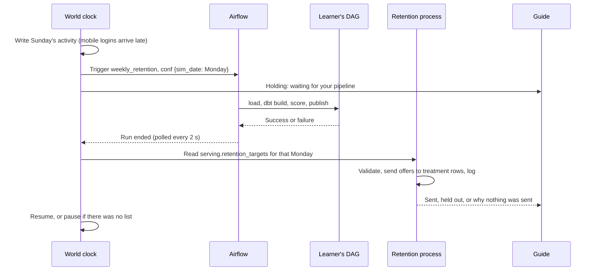
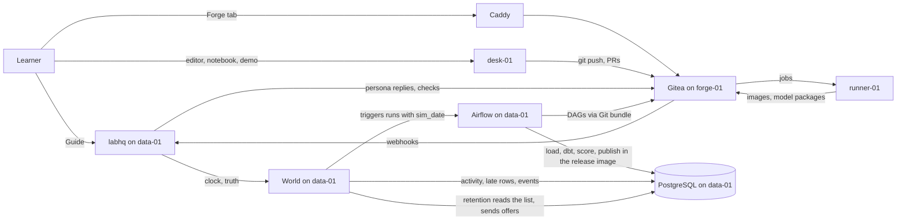

# Design to Deployment: a full-stack data science lab (implementation guide)

**Status:** an implementation guide, revised on 2026-11-22 from the discussion draft. Lap 1 is the MVP, and this guide specifies it for building. Lap 2 is outlined in §14 and gets its own specification after the MVP's tester run. Items marked **Spike** are facts to confirm in the first days of the build. Each has a fallback, so no milestone waits on one.

The lab recreates the journey in the article *Why I Hire Full-Stack Data Scientists in the Age of AI* (Appendix A) inside one iximiuz Labs playground. A learner takes a stakeholder's vague request through problem framing, data, modelling, engineering, deployment, operations, and impact. They use the real tools: Gitea, dbt, Airflow, Streamlit, Docker, and CI. They finish by measuring whether anyone was actually kept.

## What changed from the discussion draft

The draft settled *what* the lab recreates. This revision settles *how it feels to use*, and turns the plan into build steps.

- **One home tab.** A **Guide** tab always answers four questions: where am I, what do I do next, is it working, and if not, why. The work still happens in the real tools, and the Guide only points at them (§3).
- **No logins and no setup.** Every tab opens signed in. The repository is cloned, the environment built, and the notebook kernel registered before the learner arrives (§9.3).
- **Fewer tabs.** A browser VS Code, the **Workbench**, holds the editor, notebooks, terminal, and git. Jupyter notebooks inside it replace marimo, because data scientists already know them.
- **The learner owns the clock.** The business stays paused until the first deployment. After that, the learner plays, fast-forwards, or pauses it. The clock waits for every pipeline run it starts, so a slow machine never makes a list late (§3.3).
- **Green from the first minute.** The starter repository passes CI before the learner changes anything. Code is left unwritten only where the article's judgment lives, and everything else works (§6).
- **Feedback comes from the world first.** Personas reply in the forge, in character. The Guide shows the same result in plain words, with evidence and three levels of hints. A **Pair with Dana** option opens a reference pull request for the learner to review (§3.4).
- **The point-in-time control is a time-travel test.** The training set is rebuilt from only the data known on each date, and it must not change. The assistant's pull request in stage 4 now also quietly weakens that test.
- **The constraint after the demo is genuinely new.** Priya says 500 offers a week in stage 1, and the number drops to 300 after the demo.
- **The MVP is smaller.** It has four VMs. k3s, Prometheus, and a fifth VM arrive with lap 2. dbt runs inside the release image, so one digest pins the SQL, the code, and the model. DuckDB, MLflow, Evidently, and pandera leave the core.
- **Gitea 28.** Gitea changed its version numbering after 1.27, and the current release is 28.4.0. The runner is v6.
- **LTS versions everywhere they exist.** Ubuntu 26.04, Prometheus 3.13, Node.js 26, and containerd 2.3 are LTS lines. Everything without one uses its latest stable release, except where Appendix D gives a reason: Python stays on 3.14 for Airflow, dbt stays on v1 for PostgreSQL, PostgreSQL stays on 18 by choice, and Gitea has no LTS line.
- **TypeScript and uv.** The Guide's browser code is TypeScript, compiled at build time. Every Python environment is a uv project with a committed lockfile, and nothing in the lab uses pip.

## Decisions

Settled, and not to be reopened without a reason from the spike or the tester run:

- **One premium iximiuz playground,** with four VMs for lap 1 and five for lap 2 (§9.1).
- **The article's seven stages, with its loop, are the structure.** Its three delivery levels are the progression: a Streamlit demo, a production pipeline the learner owns, and then a business-critical service built with a platform engineer.
- **The tools the article names are used for real:** Streamlit, dbt, Airflow, Docker, and CI/CD. Gitea is the spine, and every stage leaves an issue, a pull request, a CI run, or a registry entry behind.
- **Impact is a core stage,** measured by a randomized holdout that the learner designs in stage 1.
- **A world with a known truth.** A seeded generator knows the true churn probabilities and the true offer effect, so the lab can prove leakage and grade the impact estimate (§5).
- **The Guide is the home. The real tools are where the work happens** (§2).
- **The learner controls the simulated clock, and the clock waits for the runs it triggers** (§3.3).
- **The learner writes the controls:** the point-in-time features, the quality gate, the holdout assignment, the drift check, and the impact estimate. The lab writes the plumbing.
- **Scripted personas,** driven deterministically by Gitea webhooks. No LLM is needed.
- **Lab services are Go 1.27, the Guide's browser code is TypeScript, and the learner's code is Python 3.14.**
- **uv for every Python environment:** the learner's `.venv`, the CI image, the release image, Airflow, the notebook fallback, and the robot learner. Each is a uv project with a committed `uv.lock`, installed with `uv sync --frozen`. Nothing uses pip.
- **No cost modelling.** Outcomes are counted in customers retained.
- **LTS lines where they exist, and otherwise the latest stable release.** Appendix D lists each component, and explains the exceptions.

## 1. The learner's experience

### 1.1 Who it is for

The learner is a data analyst or junior data scientist who can write pandas and fit a scikit-learn model, and who has never shipped one. They need no experience with Airflow, dbt, Docker, or CI, because the lab introduces each tool where the journey needs it. Experienced data scientists can start at a later chapter (§3.5).

### 1.2 The first ten minutes

1. **Start.** The learner presses Start on the playground page. The Guide is the first tab, so it is what they see. While the VMs boot, it shows "Opening Larkspur Meals", with one line for each part: the database, two years of history, the forge, the workbench, the pipeline platform, and the dashboards. Each line changes from *starting* to *ready* and shows how long it took.
2. **Choose a start.** **Start from the beginning** is the default. Two quieter options sit below it: **Start at a later chapter** and **Continue from a save file** (§3.5).
3. **Welcome.** One card of under 100 words:
   - You are Larkspur Meals' new data scientist, and Larkspur delivers meal kits to about 20,000 subscribers.
   - Your teammates are in the Forge.
   - The business clock is paused until you ship something.
   - Nothing here is a quiz. The lab looks at the same evidence your team would, and tells you what it sees.

   One optional field asks "What should your teammates call you?" It sets the learner's display name in the forge and their git author name.
4. **The first step.** The card says: "Priya from Product has asked for something. Read issue #1 in the Forge, and reply there." One button opens the issue. The **Done when** list shows four empty checks, each with a one-line description.
5. **The request.** Priya's issue asks for an AI model that predicts churn with 95% accuracy. The learner asks questions in comments, and Priya answers within three seconds. Each answer also appears in the Guide's inbox, so a learner who has not refreshed the issue still sees it.
6. **The Workbench.** When the learner opens the Workbench tab, VS Code is already open on the `churn` repository. Its README says what the repository is, lists the `make` commands, and says "Start with `docs/design.md`".

By minute ten, the learner has asked Priya a question and seen the design template without typing a password or running a setup command.

### 1.3 The shape of the lab

| Chapter | Stages | Typical time | Ends with |
| --- | --- | ---: | --- |
| 1. Framing and data | 1–2 | 60–90 min | A merged design and tested staging models |
| 2. Modelling and the demo | 3 | 60–90 min | A chosen model, a demo Priya has seen, and Priya's new constraint absorbed |
| 3. Engineering and the pipeline | 4–5 | 60–90 min | A tested image, and a live weekly pipeline that retention consumes |
| 4. Operations and impact | 6–7 | 45–75 min | Two incidents handled, and a measured result with a decision |
| 5. Learn and go again (after the MVP) | Lap 2 | 2–3 h | A real-time service that has passed an architecture review |

Lap 1 takes 4–6 hours, which fits the premium session's 480 minutes. These times are estimates, to be replaced with measurements from the tester run (M7 in §11).

## 2. UX rules

Every component follows these rules. When a design question comes up during the build, they settle it.

1. **One home.** The Guide is the first tab. It always shows the current step, the next action, the state of the step's checks, and the state of the business. A learner who is lost goes back to the Guide.
2. **Real work in real tools.** The Guide links, explains, and checks. It never edits the learner's code, merges for them, or replaces a tool's own UI. **Pair with Dana** opens a pull request, and the learner still merges it.
3. **No logins and no setup.** Lap 1 has no password prompt, no token to copy, and no install step.
4. **Green before the learner starts.** On a fresh start, CI passes, the DAG folder imports, and the notebook runs. Steps the learner has not reached report "not yet" and pass. Every red the learner sees comes from a change they made or from an event in the world.
5. **One next step.** The Guide shows one main action at a time. The later tabs (Demo, Pipeline, Dashboards) exist from the start, but the Guide introduces each one when it is first needed, with one sentence on what it is for.
6. **Time moves when the learner is ready** (§3.3).
7. **Every check explains itself.** A failing check says what it saw, where (with a link to the evidence), and what that means, in one or two sentences. It never just says "failed".
8. **Never stuck.** Every check has three levels of hints, and every step that involves writing code has **Pair with Dana**. The debrief records their use, and nothing penalizes it.
9. **Answers within seconds.** Personas reply within 3 s. Checks re-run on the events that could change their result (a push, a merge, the end of a run), not on a timer.
10. **Unknown is not a pass.** A check that cannot get its evidence shows *Unknown*, with the reason. Graders fail closed (Appendix C).
11. **Honest about the lab.** The Guide is plainly a lab tool, not part of Larkspur. Where the lab bends reality, such as the clock waiting for runs or the scripted colleagues, the Guide says so once, in one sentence.
12. **Readable and accessible.** Every colour and icon comes with text, everything works from the keyboard, and the layout works from 900 px wide, because the iximiuz pane is often narrower than the screen.

## 3. The screens

### 3.1 Tabs

| Tab | Machine and port | What it is | Introduced at |
| --- | --- | --- | --- |
| Guide | `data-01:8080` | `labhq`: steps, checks, clock, inbox, debrief | Start |
| Workbench | `desk-01:8443` | code-server: editor, Jupyter notebooks, terminal, git | Stage 1 |
| Forge | `forge-01:3080` | Gitea, behind a Caddy proxy that signs the learner in | Stage 1 |
| Demo | `desk-01:8501` | The learner's Streamlit app | Stage 3 |
| Pipeline | `data-01:8081` | The Airflow UI | Stage 5 |
| Dashboards | `data-01:3000` | Grafana | Stage 6 |
| Terminal | `desk-01` | A plain shell, in case the Workbench misbehaves | Never: it is a fallback |

All tabs are `access: private`, so only the session owner can open them. That is what makes no-login tools safe (§9.5).

**Every tab is a frame.** The platform shows each `http-port` tab inside a frame on `https://labs.iximiuz.com`. A tool that refuses to be framed shows a blank tab. The RStudio lab had to set RStudio's frame origin to that address, Break Team turned on Grafana's `allow_embedding`, and the GitLab lab in `~/projects/gitlab-k8s` opens GitLab in a separate window because GitLab refuses frames. Every tool here must therefore allow that one origin:

| Tab | Setting |
| --- | --- |
| Guide | `labhq` sends `Content-Security-Policy: frame-ancestors https://labs.iximiuz.com` |
| Forge | Gitea 28 sends `X-Frame-Options: SAMEORIGIN` by default, so set `[security] X_FRAME_OPTIONS = unset`. Caddy adds the same `frame-ancestors` header. Gitea's own default policy has no `frame-ancestors` rule. |
| Dashboards | `[security] allow_embedding = true`, as in Break Team |
| Workbench, Pipeline, Demo | code-server, Airflow 3.4's API server, and Streamlit send no frame-blocking header that a source search found. Confirm in S1. |

A tool that still cannot be framed falls back to `target: window` (a separate browser window), as gitlab-k8s does for GitLab.

Until the learner starts the Streamlit app, the Demo tab shows the platform's "nothing listening" page. The Guide warns about this when it introduces the tab: "Run `make demo` in the Workbench first."

**Deep links (Spike S2).** The Guide's buttons should open the exact page: issue #1, a DAG run, or a dashboard. If the platform's tab addresses follow a pattern that the Guide's page script can derive from its own address, the buttons open the page directly in a new browser tab. Otherwise each button becomes a path with a copy button, such as "Forge tab → `larkspur/churn/issues/1`". Files always appear as paths with a copy button, because VS Code opens them with Ctrl+P.

### 3.2 The Guide

```
┌─ Larkspur Meals · lab guide ──────────────────────────────────────────────────────┐
│ Mon 2 Mar 2026 · Paused at launch. The clock starts when you ship (stage 5).      │
│ Retention: using today's renewal-date rule                                        │
├──────────────┬──────────────────────────────────────────────────┬─────────────────┤
│ LAP 1        │ STAGE 3 · MODELLING                              │ INBOX           │
│ ✓ 1 Framing  │ "The right statistical, ML or optimisation       │ Priya · 1 min   │
│ ✓ 2 Data     │  method"                                         │ "Had a look —   │
│ ▸ 3 Modelling│                                                  │  nice! Two      │
│   4 Engineer │ NEXT  3.1 Build a point-in-time training set     │  things…"       │
│   5 Deploy   │ Each row may use only what Larkspur knew on its  │ [Open in Forge] │
│   6 Operate  │ scoring date. Write the features in              │                 │
│   7 Impact   │ dbt/macros/features.sql              [copy]      │ Dana · 12 min   │
│              │ then run  make pit-test              [copy]      │ approved #6     │
│ Chapter 2    │                                                  │                 │
│ 35 of ~75 min│ DONE WHEN                                        │ YOUR SYSTEM     │
│              │ ✗ M1 Point in time                               │ product DB  ✓   │
│ [Save my     │   412 rows dated Mon 5 Jan 2026 change when data │ warehouse   ✓   │
│  work]       │   that arrived later is removed (logins_28d).    │ dbt models  ✓   │
│              │   [Evidence] [Hint 1] [Hint 2] [Pair with Dana]  │ model       ·   │
│              │ ○ M2 No leak: waits for your evaluation          │ pipeline    ·   │
└──────────────┴──────────────────────────────────────────────────┴─────────────────┘
```

- **Header:** the simulated date, the clock's state, and one line about the business. The mockup shows stage 3, before the clock exists for the learner. From stage 5 the header adds the controls (⏸ Pause, ▶ Play, ⏩ Faster, ⏭ Next Monday; §3.3), and the business line shows the last Monday's result, such as "Retention: 240 offers sent this Monday from your list, 60 held out".
- **Stage rail:** the seven stages, each marked done, current, or not started, plus the chapter and its elapsed and estimated time. Selecting a finished stage shows its steps and checks, read-only.
- **Step card:**
  - the stage's question from the article, in quotes;
  - the current step's title;
  - two or three sentences on why and what;
  - file paths and commands, each with a copy button;
  - links into the tools;
  - and below them, **Done when**: the step's checks.
- **Inbox:** the latest persona messages, each showing who, when, the first line, and a link. New messages appear live.
- **Your system:** a small fixed diagram of the pipeline's parts: the product database, warehouse, dbt models, model, image, pipeline, retention, and monitoring. Each part is shown as *not built*, *built*, *live*, or *failing*, in words as well as colour. It fills in as the learner goes, which is what the article means by end to end.
- **Save my work** (§3.5), and after stage 7, **Debrief**.

Below 900 px wide, the inbox and the system diagram move under the step card.

The Guide is server-rendered HTML from `labhq`, with a small TypeScript client for server-sent events, the clock controls, copy buttons, and deep links. `tsc` type-checks the client and compiles it to ES modules at build time, and the output is embedded in the Go binary with `go:embed`. Node.js and npm exist only in the build stage, so no VM runs Node.

### 3.3 The business clock

The world runs on simulated days. The learner sees one date and one set of controls.

| State | Speed | When |
| --- | --- | --- |
| Paused at launch | None | From boot until the learner first presses ▶. History ends on Sunday 1 March 2026. |
| Running | 1 simulated day per 10 s | The default once started. A week takes 70 s plus pipeline time. |
| Faster | 1 day per 2 s | For waiting on labels in stage 7 |
| Paused | None | Whenever the learner presses ⏸, and automatically when a Monday list is missing |
| Holding | None | While a pipeline run that the world started is still running |

- **Nothing happens before the learner ships.** Stages 1–4 work on frozen history, so the data never changes under a notebook. The Guide offers ▶ **Open for business** at step 5.3, once the first release is merged.
- **⏭ Next Monday** runs at the faster speed to the next Monday, then pauses after that day's retention run.
- **The clock waits for runs.** Every Monday the world triggers `weekly_retention`, holds until the run ends, and then lets retention read the list. Monitoring runs on Thursdays in the same way. The Guide says this once: "Real businesses don't wait for your pipeline. This one does, so a slow machine never makes your list late. A list is late only if its run fails or takes more than 10 minutes."
- **A missing list pauses the clock.** Retention's message says what it found. The Guide then offers **Retry this Monday**: once the learner has fixed the problem, the world triggers the run again for the same date, and retention reads the list again. This keeps stage 5's planted mistake (§4) a lesson rather than a lost week.
- **Silent problems do not pause the clock.** Drift and data bugs in stage 6 leave the lists flowing. Only the learner's own monitoring can catch them, which is the point of stage 6.



### 3.4 Checks, hints, and pairing

| Check state | Meaning |
| --- | --- |
| Not yet | Its step has not started, or the evidence does not exist yet ("waits for your evaluation") |
| Passing | The evidence meets the rule |
| Failing | The evidence breaks the rule. A message and a link to the evidence are shown. |
| Unknown | The evidence could not be read. The reason is shown, and the check retries by itself. |
| Assisted | Passed after **Pair with Dana** |

A failure message says what was seen, where, and what it means. For example:

- **M3:** "Your evaluation window starts on Mon 3 Nov 2025, but your training rows go up to Mon 24 Nov 2025. A model evaluated on dates it trained on looks better than it will be. Evaluate on dates strictly after training."
- **P2:** "Retention found no rows for `week_start` = Mon 2 Mar 2026. Your table's newest `week_start` is 23 Nov 2026, which is today's real date. Retention runs on Larkspur's calendar."

Each check has three levels of help:

1. **Nudge:** a question that points at the concept. For example: "When would Larkspur have learned about Saturday's logins from the Android app?"
2. **Pointer:** where to look (a table, column, or file) and the name of the idea. For example: "Compare `logins.day` with `logins.ingested_at` for the mobile platforms, and look up 'point-in-time join'."
3. **Pair with Dana:** Dana, the team lead, opens a pull request with the reference implementation for the step, written as a teaching diff with comments. The learner reviews it and merges it, and the step's checks show *Assisted*.

Hints are free and always available. The debrief lists which ones were used, because "where did you need help, and how did you get it" is one of the article's interview questions.

### 3.5 Starting, saving, and resuming

iximiuz sessions do not persist, so the boot screen offers three ways to start:

- **From the beginning.**
- **At a later chapter.** `labhq` restores a checkpoint: the state the robot learner (§13) reached by following the reference solution to the start of that chapter. A checkpoint includes the forge's history (issues, conversations, merged pull requests, and packages), the warehouse, Airflow's metadata, and the world. Restoring takes about one to two minutes (Spike S13).
- **From a save file.** **Save my work** downloads a small file holding the learner's `churn` repository (a git bundle of every branch) and their check history. On a later start, the learner chooses a chapter to resume at and uploads the file. The checkpoint is restored first. The learner's branches then appear as `saved/<branch>`, and the Guide says: "Your saved work is on `saved/main`. Merge what you want to keep."

A full personal save would need the forge's history, the registry's images, and the world's offer log. That makes the file hundreds of megabytes, and rebuilt images would get new digests. A code-only save is small and honest about what it holds, and the checkpoint supplies the rest.

### 3.6 Writing the lab's text

- Use the second person and the present tense, in sentences under 25 words.
- Use the stage names and questions exactly as the article's diagram gives them.
- Define every term the learner may not know in one line where it first appears, as a hover in the Guide. The glossary covers AUC, recall at k, point in time, holdout, PSI, DAG, digest, and lockfile.
- Give numbers with units. Give dates in Larkspur's calendar ("Mon 9 Mar 2026"), never real dates, except where a real date is the bug.
- Avoid "simply", "just", and "obviously". Never blame: write "The list wasn't consumed", not "You broke the pipeline".
- End every failure message with what the learner can do next.
- Write personas as colleagues: short, friendly, and specific. They never quiz the learner.

## 4. The journey, step by step (lap 1)

Each stage gives the article's question, then the Guide's steps. **Provided** is what the lab hands over working. **They write** is the learner's part. Check IDs refer to §8.2.

### Stage 1. Problem framing: "Is data science the right tool?" (about 30 min)

| Step | The learner | Provided | They write | Done when |
| --- | --- | --- | --- | --- |
| 1.1 Read Priya's request | Reads issue #1 in the Forge | The issue, and the handbook page "How Larkspur works" | Nothing | None |
| 1.2 Ask before you propose | Asks questions in comments on #1 | Priya's answers (§7.3) | Their questions | F1 |
| 1.3 Agree on what success looks like | Makes sure the target measures what Priya needs | Nothing | Their argument | F2 |
| 1.4 Write the design | Fills in `docs/design.md`, sizes the experiment with `make power`, and opens a pull request | A template with a decision record at the top (§6.4), and the power calculator | The design | F3, F4 |

- **Wording:** step 1.3's card does not mention accuracy. It says: "Priya asked for a number. Before you commit to it, make sure it measures what Priya needs."
- **Personas:** Priya answers by topic, and accepts push-back that comes with a reason. As the CODEOWNER of `docs/`, Priya reviews the design pull request, asks in plain language for anything missing, and approves when it is complete. After the merge, Dana turns the design into a milestone, **Lap 1: churn**, with one issue for each remaining stage and a project board with one column per stage.
- **Judgment:** whether a model is needed at all. The renewal-date rule is the baseline the model must beat (M4).

### Stage 2. Data: "How it's generated and where it breaks" (45–60 min)

| Step | The learner | Provided | They write | Done when |
| --- | --- | --- | --- | --- |
| 2.1 Learn where the data comes from | Reads the handbook page "Where our data comes from" | One paragraph per table on what produces it and when, in Larkspur's own words. It states facts that imply the breakages, such as "the mobile app uploads when it next connects" and "the payment provider retries on timeout", without calling them problems. | Nothing | None |
| 2.2 Load the warehouse | Runs `make load`, then opens `notebooks/01_explore.ipynb` | The load step (`src/churn/load.py`), and a notebook connected to the warehouse with a first query for each table | Nothing | None |
| 2.3 Find where it breaks | Explores the data | A checklist in the notebook of questions worth asking of any new source: duplicates, renamed categories, accounts that are not customers, late arrival, and columns whose meaning changes over time | Their exploration | None |
| 2.4 Fix it in staging | Writes staging models and tests, runs `make dbt`, and opens a pull request | `stg_customers` with its tests, as a worked example. The other staging models are stubs, with comments that say what each must produce but not how. | The staging SQL and its tests | D1–D4 |

- **Personas:** Dana approves pull requests whose checks pass.
- **Judgment:** trusting the data because it loaded. Every planted breakage passes a naive `SELECT`.

### Stage 3. Modelling: "The right statistical, ML or optimisation method" (60–90 min)

| Step | The learner | Provided | They write | Done when |
| --- | --- | --- | --- | --- |
| 3.1 Build a point-in-time training set | Writes the features once, as a macro used by both the training set and the scoring set. Runs `make pit-test`. | `date_spine`, the `training_set` and `scoring_set` models (thin wrappers around the macro), the label, the `as_of` source filter, and the time-travel test | `dbt/macros/features.sql`: one row per spine row of (customer, date), using only data ingested by that date | M1 |
| 3.2 Compare methods out of time | Sets the training and evaluation windows in `config.toml`, implements the candidates, and runs `make evaluate` | The renewal-date rule as a candidate, and the evaluation harness. The harness writes `reports/evaluation.md` and `reports/evaluation.json`, covering AUC, recall at the budget, calibration, and slices. | Logistic regression and LightGBM in `src/churn/candidates.py`, and the windows | M2, M3, M4 |
| 3.3 Freeze the training data | Runs `make snapshot` and commits the manifest | The snapshot tool: it exports Parquet, uploads it to the forge's package registry, and writes `data/snapshots/<name>.json` | The cutoff | M5 |
| 3.4 Build a demo | Completes `demo/app.py`, runs `make demo`, and opens the Demo tab | A Streamlit app that runs, with three empty sections | The three views: the risk distribution, who the budget reaches, and how that differs from the rule's list | None |
| 3.5 Show Priya | Comments on the Modelling issue that the demo is ready | Nothing | Nothing | M6 |
| 3.6 Absorb the change | Re-evaluates at 300 offers, drops `region`, and updates `MODEL_CARD.md` | The model card template | The changes | M7 |

- **Personas:**
  - Priya opens the demo and replies with a new constraint: "Had a look, nice! Two things changed since we talked. Retention lost a person, so it's 300 offers a week from now on, sent on Mondays. And legal says we can't target offers by region. Can you rework it for that?"
  - If `reports/evaluation.json` in a pull request shows an AUC above the lab's ceiling, Dana comments: "0.97 on churn? That's better than anything I've seen. What does the model know at scoring time that it won't know in production?"
- **Why one macro:** the training set and the scoring set share their feature logic by construction, so training/serving skew cannot creep in. The Guide says this in one sentence at step 3.1.
- **Judgment:** leakage, a random split on time-ordered data, and a metric with no link to the decision. These are the article's examples, almost word for word.

### Stage 4. Engineering: "Tested, maintainable, reproducible code" (about 60 min)

| Step | The learner | Provided | They write | Done when |
| --- | --- | --- | --- | --- |
| 4.1 Test what you wrote | Adds tests for their feature logic and candidates, and watches CI train from the snapshot | The package layout, pytest configuration, example tests, and the whole CI workflow (§6.3) | `tests/test_features.py` | E1 |
| 4.2 Write the Dockerfile | Writes `Dockerfile`, then runs `make image` and `make image-check` | The pinned base image, already in the local Docker store. `make image-check` runs the same checks as E2. | The Dockerfile | E2 |
| 4.3 Write the quality gate | Implements `src/churn/gate.py`, which CI already calls | A harness that loads the candidate's metrics and those of the model last published from `main` (the renewal-date rule before the first publish) on the same window, plus the CI step and its comment | The rule that decides | E3 |
| 4.4 Review Jordan's pull request | Reviews the assistant's pull request | Nothing | Their review | E5 |
| 4.5 Reproduce | Nothing. The lab rebuilds the model from a clean checkout and compares the metrics. | `reproduce.yml`, dispatched by the lab | Nothing | E4 |

- **The Dockerfile:** the article says a data scientist "who's never written a Dockerfile can get one working in an afternoon, as long as they understand what it does." Assistants are welcome here, and the checks test understanding: the base image is pinned by digest, uv is copied from the pinned uv image, dependencies are installed only with `uv sync --frozen` and never with pip, the process runs as a non-root user, no credentials are left in any layer, the image stays under the size limit, and a dry run of the entry point succeeds.
- **Personas:**
  - After the gate merges, Dana opens a test pull request, "Drop the support-ticket features to speed up training?". The gate should fail it. If it does, Dana closes it with "Thanks, the gate works." If the gate passes it, Dana asks: "Hmm, the gate let a worse model through. Is it comparing on the same window?"
  - After E3 passes, **Jordan's assistant** opens "Improve AUC by 9 points with an account-signal feature". It adds `account_signal`, derived from `raw.subscriptions_current.cancel_reason_code`, and in the same commit "fixes a flaky test" by excluding `account_signal` from the time-travel comparison. The description is confident. CI passes, and the review is assigned to the learner because "Dana's out this week."
- **Judgment:** code that passes CI is not the same as code that is right. That is the article's "same confidence whether it's right or wrong".

### Stage 5. Deployment: "Plugged into real processes" (30–45 min)

| Step | The learner | Provided | They write | Done when |
| --- | --- | --- | --- | --- |
| 5.1 Read the DAG before you ship it | Reads `dags/weekly_retention.py`: four tasks that run the release image to load, `dbt build`, score, and publish | The DAG, wired and importing. The card says only that "it was copied from another team's project". | The holdout assignment in the publish step, from the design's `holdout_share` | P1 |
| 5.2 Release | Reviews and merges the release bot's pull request, "Release churn-score `<short digest>`", which updates `release.json` | The release bot. CI on `main` has already published the image. | Nothing | P1 |
| 5.3 Open for business | Presses ▶ in the Guide, and the first Monday runs | Nothing | Nothing | P2 |
| 5.4 Watch two Mondays | Watches the Pipeline tab and retention's messages | Nothing | Nothing | P2, P3, P4 |

- **The planted mistake:** the provided DAG reads `{{ ds }}` throughout, with an innocent comment ("partition by run date"). The world triggers each run with Airflow's logical date set to the real time of the trigger, so the first list lands under today's real date. Retention then finds no list for the simulated Monday, the clock pauses, and Marco from Retention explains what was found. The learner changes the DAG to read `dag_run.conf["sim_date"]`, merges, and presses **Retry this Monday**. The rule they learn is the one Larkspur's handbook states: DAGs never read the wall clock.
- **Deployment is a merge.** Airflow reads DAGs from Gitea through a Git DAG bundle tracking `main`, and each run records the commit it used. Merging a pull request therefore *is* the deployment, which is the article's point about not "waiting for a slot in another team's backlog".
- **Judgment:** a model that is "deployed" but plugged into nothing.

### Stage 6. Operations: "Monitor, catch failures, iterate" (about 45 min, with the clock running)

| Step | The learner | Provided | They write | Done when |
| --- | --- | --- | --- | --- |
| 6.1 Build the health check | Completes `dags/weekly_health.py` | A Thursday DAG that writes `monitoring.model_health` with list freshness, consumption, the score distribution, and realized recall once labels arrive. Also an `open_issue()` helper using the `gitea_api` connection, and a provisioned Grafana dashboard. | PSI for each feature against the training snapshot, the thresholds, the calls to `open_issue()`, and an `on_failure_callback` for `weekly_retention` | O1 |
| 6.2 Run the business | Presses ▶ or ⏩, and works the issues that their alerts open | Nothing | The fixes | O2, O3 |

- **Events on the default seed:**
  - In the second week after go-live, the product team renames `logins.platform` to `logins.device_platform`. The next Monday's load fails, retention gets no list, and the clock pauses.
  - In the fourth week, prices rise for monthly contracts. Lists keep flowing, but PSI on `weekly_price` moves at once, and realized recall falls over the following weeks.
- **The Guide stays quiet about events.** It says nothing until the learner's alerts fire, or until the seven-day window in O2 passes. It then says only: "Something changed on Mon 30 Mar that your monitoring didn't flag within a week." The hints take it from there.
- **Judgment:** retraining as a reflex. A rename needs a repair, not a retrain. A subtler trap is retraining on labels that the model's own offers changed, which is what the holdout prevents.

### Stage 7. Impact: "Is it used? Did it deliver the outcome?" (about 30 min, partly waiting)

| Step | The learner | Provided | They write | Done when |
| --- | --- | --- | --- | --- |
| 7.1 Wait for the labels | Runs ⏩ until the Guide shows labels complete for the planned weeks | The Guide's counter: "Labels complete for 6 of 8 planned weeks" | Nothing | None |
| 7.2 Measure it | Implements `src/churn/impact.py` and runs `make impact` | The report template, plus a query joining arms, offers, and outcomes | The effect among targeted customers with a 95% confidence interval, and the usage numbers | I1 |
| 7.3 Say it in one sentence | Comments on the **Impact** issue with one sentence, and applies a decision label | The labels `decision/continue`, `decision/iterate`, and `decision/drop` | The sentence and the decision | I2, I3 |
| 7.4 Debrief | Reads the debrief in the Guide, and may write `docs/retro.md` | The debrief page (§3.2) | A retro, optionally | None |

- **Personas:** Helen, the commercial director, replies to the sentence. If it has no number, Helen asks: "What's the number? I need to know how many customers we kept." Otherwise the reply follows the decision: *continue* gets "Great, let's keep it running", *iterate* gets "OK. What would you change, and how long would it take?", and *drop* gets "Thanks for saying so. Let's give retention's time to something else."
- **The debrief** answers the article's five interview questions from the learner's own forge history (Appendix A). It shows the timeline from request to the last deploy, the design's decisions, each alert with its time to notice and fix, the offline AUC beside the measured retention and usage, and the help used. It also covers the role play: the questions asked before proposing, the push-back, and how the constraint was absorbed. It is a portfolio page, with no score.
- **Judgment:** a good AUC is not a good outcome. On the default seed the risk model ranks well, but many of the customers it targets are ones the offer cannot help. That is the thread that starts lap 2.

## 5. The world: Larkspur Meals

### 5.1 The business

Larkspur Meals is a fictional meal-kit subscription. It has about 20,000 customers and two years of history. About 6% of customers churn in any 30 days, so a model that predicts "nobody churns" scores 94% accuracy. That is the trap in Priya's request.

**What retention does today:** every Monday, it sends a discount offer to customers whose contract renews in the next 14 days, up to 500 offers a week. History therefore contains rule-targeted offers, which confound any naive analysis of offer effects. From go-live, retention sends up to 300 offers a week, taken from the learner's list.

### 5.2 The calendar

| Date | Meaning |
| --- | --- |
| Mon 4 Mar 2024 | History starts |
| Mon 7 Apr 2025 | Plans are renamed |
| Mon 26 Jan 2026 | The last scoring date whose 30-day labels are complete at launch |
| Sun 1 Mar 2026 | History ends |
| Mon 2 Mar 2026 | Launch day. The clock is paused here until the learner presses ▶. |
| Tue 17 Mar 2026 (launch + 2 weeks) | The rename event |
| Mon 30 Mar 2026 (launch + 4 weeks) | The price-rise event |

### 5.3 Databases and tables

One PostgreSQL 18 instance on `data-01` holds three databases: `larkspur` (the product), `warehouse`, and `airflow`.

**Product database `larkspur`, schema `app`.** The world writes it, and the learner can read it. Every table has an event time and an `ingested_at`.

| Table | Columns (beyond the keys and `ingested_at`) | Notes |
| --- | --- | --- |
| `customers` | `created_at`, `email`, `region`, `acquisition_channel` | Staff test accounts use `@larkspur.test` addresses |
| `subscriptions` | `plan`, `contract` (`monthly`, `annual`), `weekly_price`, `renewal_date`, `status`, `cancel_reason_code`, `updated_at` | Current state, updated in place. It holds the leak. |
| `subscription_changes` | `subscription_id`, `field`, `old_value`, `new_value`, `changed_at` | Append-only, starting with a `created` row of initial values for each subscription. It is the honest way to rebuild state as of a date. |
| `orders` | `customer_id`, `week_start`, `boxes`, `skipped`, `created_at` | |
| `support_tickets` | `customer_id`, `opened_at`, `category` | |
| `logins` | `customer_id`, `day`, `platform` (`web`, `ios`, `android`), `count` | Mobile rows arrive up to two days late |
| `payments` | `payment_id`, `provider_ref`, `customer_id`, `amount`, `paid_at` | Provider retries duplicate a `provider_ref` |
| `offers` | `customer_id`, `week_start`, `sent_at`, `source` (`rule`, `list`) | |
| `cancellations` | `customer_id`, `cancelled_at` | The label's source |
| `retention_log` | `week_start`, `status`, `rows_read`, `offers_sent`, `holdout_rows`, `reason`, `logged_at` | Written by the retention process |

**Warehouse database `warehouse`:**

| Schema | Written by | Holds |
| --- | --- | --- |
| `raw` | The load step | Incremental copies of the `app` tables by `ingested_at` watermark, plus `raw.subscriptions_current`, a full copy of the current-state table and the tempting leak source |
| `dev_ds` | The learner's `make dbt` | dbt development builds |
| `ci_<run>` | CI | dbt builds on the CI fixture, dropped after the run |
| `analytics` | The pipeline | Production dbt models |
| `inspect` | The inspector | Its own builds of the learner's merged dbt project, for the D checks and M1 |
| `serving` | The pipeline | `retention_targets` (§6.4) |
| `monitoring` | The health DAG | `model_health` (§6.4) |

### 5.4 Hidden processes

- **Churn:** a weekly hazard with known coefficients. Its drivers are the contract type (monthly far above annual), exposure to a recent price rise, support tickets in the last 28 days (stronger on monthly contracts), login days in the last 28 days with a threshold below 4 that affects about a quarter of customers, skipped boxes, payment failures, tenure, a small effect of `region`, and seasonality. Customers already in the cancel flow have a probability near 1. `acquisition_channel` and several other columns are pure noise.
- **The offer effect varies by customer.** An offer roughly halves the hazard for price-sensitive customers (monthly contracts with no recent tickets). It cuts it by about 5% for service-driven customers (two or more tickets), and by about 20% for everyone else. Ranking by risk therefore puts many offers where they do little.
- **Calibration targets (Spike S11):** at 300 offers a week, the rule, logistic regression, LightGBM, and the oracle should each be separated by a gap that a 1M-row evaluation shows clearly. The threshold and interaction strengths are tuned until this holds.

### 5.5 Planted breakages

| Breakage | How it appears | What a naive approach gets wrong |
| --- | --- | --- |
| Late data | `ios` and `android` rows have `ingested_at` 0–2 days after `day` | Event-time features are complete in training and short at scoring time |
| Duplicates | About 3% of payments are repeated with the same `provider_ref`, a new `payment_id`, and an `ingested_at` seconds later | Payment counts and failure rates are inflated |
| Renamed category | On Mon 7 Apr 2025, `basic` and `plus` became `starter` and `standard`, and `premium` was added. The current table has only the new names. | Plans look new, and history splits in two |
| Test accounts | About 40 `@larkspur.test` accounts, created in bursts, order 100 boxes a week and never cancel | They distort every distribution |
| Leak | `cancel_reason_code` is set when a customer opens the cancel flow, 1–6 days before the cancellation is recorded. `raw.subscriptions_current` holds it for everyone who ever cancelled. | It gives a spectacular AUC that is impossible in production. Read point-in-time from `subscription_changes`, it is legitimate, and the oracle includes it. |

### 5.6 Scheduled events

MVP, default seed:

| Event | When | Kind | Right response |
| --- | --- | --- | --- |
| `logins.platform` is renamed to `logins.device_platform` | Launch + 2 weeks, a Tuesday | Repair | Fix the load step. The snapshot, and so the model, stays the same. |
| Monthly `weekly_price` rises 12% | Launch + 4 weeks, a Monday | Real drift | Retrain through the gate, and release a new model |

After the MVP (M9 in §11): an app release that logs zero Android logins, where the right response is a dbt fix with a test before any retraining; and customer growth that pushes scoring past its memory limit, where the right response is to score in chunks.

### 5.7 Determinism and the truth

- **Each customer has their own random streams,** keyed by (seed, customer, purpose). An offer changes only the path of the customer who received it, so the world is a pure function of the seed, the simulated day, and the offers log. Replaying from the seed reproduces the tables exactly, which the robot learner (§13) relies on.
- **Potential outcomes are known.** For every targeted customer, the world can compute the 30-day churn probability with and without an offer. The true effect among treated customers is therefore exact, not estimated.
- **The oracle** is the AUC of the true churn probabilities on a given set of (customer, scoring date) rows, given the world's full state on each date, including customers already in the cancel flow. No honest model can beat it by more than sampling noise.
- **The default seed's history is baked** into `data-01`'s image, so the first boot does not generate it. Generating another seed at boot is for later variants and for e2e (Spike S13 measures the time).

## 6. The starter repository

### 6.1 Layout

```
churn/
├── README.md                       provided: what this is, the make targets, where to start
├── Makefile                        provided
├── pyproject.toml, uv.lock         provided: Python 3.14, every dependency pinned
├── config.toml                     provided with blanks: windows, budget, excluded columns
├── CODEOWNERS                      provided: docs/ → priya; everything else → dana
├── MODEL_CARD.md                   template: they complete it
├── docs/
│   ├── design.md                   template with a decision record: they write it (stage 1)
│   └── retro.md                    optional (stage 7)
├── notebooks/01_explore.ipynb      provided: connected, one query per table, questions to ask
├── dbt/
│   ├── dbt_project.yml, profiles.yml   provided: connection from environment variables
│   ├── macros/as_of.sql            provided: a source() wrapper that filters on ingested_at when var as_of is set
│   ├── macros/features.sql         they write (stage 3)
│   ├── models/sources.yml          provided
│   ├── models/staging/stg_customers.sql, .yml   provided: the worked example
│   ├── models/staging/stg_*.sql    stubs: they write them (stage 2)
│   ├── models/marts/date_spine.sql provided: active customers × Mondays
│   ├── models/marts/training_set.sql   provided wrapper: features(date_spine) plus the label
│   ├── models/marts/scoring_set.sql    provided wrapper: features(one Monday)
│   └── seeds/ci_fixture/           provided: a small raw sample for CI
├── src/churn/
│   ├── load.py                     provided (repaired by the learner in stage 6)
│   ├── data.py                     provided: reads marts into pandas
│   ├── candidates.py               the rule is provided; logistic regression and LightGBM are theirs
│   ├── evaluate.py                 provided: windows from config, metrics, reports
│   ├── power.py                    provided: make power
│   ├── snapshot.py                 provided
│   ├── score.py                    provided: batch scoring, with --dry-run
│   ├── publish.py                  provided except the holdout assignment (stage 5)
│   ├── gate.py                     they write it (stage 4)
│   ├── health.py                   they complete the PSI (stage 6)
│   └── impact.py                   they write it (stage 7)
├── tests/
│   ├── test_pit.py                 provided: the time-travel test
│   ├── test_evaluate.py            provided
│   └── test_features.py            they add it (stage 4)
├── demo/app.py                     runs from the start; they complete it (stage 3)
├── Dockerfile                      absent: they write it (stage 4)
├── dags/
│   ├── weekly_retention.py         provided and wired, with the planted date mistake
│   └── weekly_health.py            they complete it (stage 6)
├── release.json                    updated by the release bot's pull requests
├── data/snapshots/                 snapshot manifests
├── reports/                        generated
└── .gitea/
    ├── workflows/ci.yml            provided
    ├── workflows/reproduce.yml     provided, dispatched by the lab
    └── pull_request_template.md    provided, with the model card's headline numbers
```

### 6.2 `make` targets

Everything the learner runs is a `make` target, so the README and the Guide name the same commands.

| Target | Does |
| --- | --- |
| `make load` | Copies new product rows into `warehouse.raw` |
| `make dbt` | Builds and tests dbt into `dev_ds` |
| `make pit-test` | Runs the time-travel test on three scoring dates |
| `make evaluate` | Trains the candidates on the training window, evaluates them on the evaluation window, and writes the reports |
| `make power` | Prints the experiment's power, using the decision record in `docs/design.md` |
| `make snapshot` | Freezes the training set |
| `make demo` | Runs Streamlit on port 8501 |
| `make test` | Runs pytest and the dbt tests |
| `make image` | Builds the scoring image |
| `make image-check` | Runs the Dockerfile checks from E2 locally |
| `make impact` | Writes `reports/impact.md` and `reports/impact.json` |
| `make pr` | Creates a branch, commits, pushes, and opens a pull request with `tea`, prompting for a title |

A `pre-push` hook on `desk-01` catches pushes to `main` and prints: "`main` is protected. Push a branch and open a pull request: `make pr`."

### 6.3 CI

`.gitea/workflows/ci.yml` runs on every pull request and on `main`. Every job always runs, and a job with nothing to do yet passes quickly with a "not yet" message. This matters because the jobs are required checks, and a job skipped by a path filter would never report, leaving the pull request blocked.

| Job | Does | "Not yet" when | Target time |
| --- | --- | --- | ---: |
| `lint-test` | ruff and pytest | Never | 30 s |
| `dbt` | `dbt build` against `ci_<run>` on the fixture | Never | 40 s |
| `train` | Downloads the snapshot, trains the chosen candidate, and evaluates it | No snapshot manifest | 60 s |
| `gate` | Runs `churn.gate` against the metrics of the model last published from `main`, on the same window, and posts the metrics comment | `gate.py` is still the stub | 10 s |
| `image` | Builds the image and runs the image checks | No `Dockerfile` | 60–90 s |
| `publish` | On `main` only: pushes the image by digest and the model package, then tells the release bot | Not on `main` | 10 s |

Comments and pushes use an organization secret, `CI_BOT_TOKEN`, belonging to the `ci-bot` account. The learner can see that the secret exists, but not its value. The image contains the model file, so one digest pins the dbt project, the code, and the model.

### 6.4 Contracts

**The decision record** in `docs/design.md`'s YAML front matter, which F3 and F4 read:

```yaml
decision: Which customers retention sends an offer to each Monday
label: Cancelled within 30 days after the scoring date
scoring: Weekly, on Mondays, using data ingested by Monday 00:00
number_to_move: Customers retained
metric: Churners reached within the weekly offer budget (recall at k)
baseline: Today's renewal-date rule
experiment:
  holdout_share: 0.2
  weeks: 8
  base_rate: 0.25            # churn among customers retention contacts today
  assumed_relative_effect: 0.25
```

**Airflow run configuration:** `{"sim_date": "YYYY-MM-DD"}`, always a Monday for `weekly_retention` and a Thursday for `weekly_health`.

**`serving.retention_targets`**, which retention reads:

| Column | Type | Rule |
| --- | --- | --- |
| `week_start` | `date` | The simulated Monday |
| `customer_id` | `bigint` | Primary key, with `week_start` |
| `score` | `double precision` | |
| `rank` | `integer` | 1 is the highest risk |
| `arm` | `text` | `treatment` or `holdout` |
| `model_version` | `text` | From `release.json` |
| `run_id` | `text` | Airflow's run ID |

Retention sends offers to at most 300 `treatment` rows for that Monday, in rank order. It sends nothing if the rows are missing or a column is wrong, and logs the reason.

**`monitoring.model_health`:** `week_start`, `check`, `feature`, `value`, `threshold`, `status`, `run_id`.

**`release.json`:** `{"image": "forge-01:3000/larkspur/churn-score@sha256:…", "model_version": "…", "git_sha": "…", "snapshot": "…"}`.

**`reports/evaluation.json`:** the training and evaluation date ranges, the k used, the features, and per candidate the AUC, recall at k, calibration error, and the chosen candidate. **`reports/impact.json`:** the weeks analysed, the counts and churn by arm, the effect with its 95% interval, the customers retained, the lists consumed, and the offers sent.

## 7. The cast

### 7.1 Accounts

| Account | Shown as | Gitea type | Represents | Acts on |
| --- | --- | --- | --- | --- |
| `priya` | Priya Raman (Product) | User | The stakeholder in the article's role play | Issue #1, the design review (as CODEOWNER of `docs/`), the demo, and the constraint |
| `dana` | Dana Okafor (Team lead) | User | Code review | Approving green pull requests, the milestone and stage issues, the gate's test pull request, Pair with Dana, and "too good to be true" |
| `marco` | Marco Ellis (Retention) | User | The real process the model plugs into | A comment each Monday on the pinned **Weekly retention** issue, and explanations of missing lists |
| `helen` | Helen Ward (Commercial) | User | The person a result must persuade | Replying to the stage 7 sentence |
| `jordan-assistant` | Jordan's assistant | Bot | AI-generated code | The stage 4 pull request |
| `release-bot` | Release bot | Bot | Release automation | Opening and updating release pull requests |
| `ci-bot` | CI | Bot | CI | Metrics comments, and pushes to the registry |
| `ds` | The learner's chosen name | User | The learner | Everything else |
| `sam` (lap 2) | Sam Achebe (Platform) | User | Specialists who join as the stakes rise | The architecture review |

Gitea shows full names (`[ui] DEFAULT_SHOW_FULL_NAME = true`), so the forge reads like a team, not a list of logins.

### 7.2 The persona engine

- It runs inside `labhq`, receiving an organization-wide Gitea webhook and replying through the Gitea API with an admin token and `sudo=<persona>` (Spike S14).
- Its scripts are YAML files embedded in `labhq`. Each *beat* has a trigger (an event plus conditions), a guard on persona state, a reply template, and side effects: setting state, re-running checks, or opening a pull request.
- Replies go out 1–3 s after the triggering event, which is quick but not instant.
- Beats are idempotent. Each is keyed by the beat, the issue, and the triggering comment's ID in `labhq`'s database, so a redelivered webhook never posts twice.

### 7.3 Priya's role play

Comments are lowercased, with code blocks and quoted text removed. A topic matches if any of its phrases appears. One comment can match several topics, which Priya answers in one reply, in order.

| Topic | Example phrases | Priya's answer |
| --- | --- | --- |
| The decision | "what would you do", "use the predictions", "act on", "who would use" | "Retention would send the people most likely to leave a discount offer, every Monday. Right now they choose by contract renewal date." |
| Today's process | "currently", "today", "right now", "existing process", "how do you decide" | "Every Monday, retention emails a discount to customers whose contract renews in the next two weeks, until they hit their weekly limit. About a quarter of the people they contact cancel within a month anyway." |
| The budget | "how many", "budget", "capacity", "limit", "per week" | "They can handle about 500 offers a week." |
| The churn definition | "define", "definition", "what counts", "cancel", "pause", "skip" | "Churned means cancelled. Pausing or skipping a week doesn't count. We'd want to know about cancellations in the next 30 days. Any further out and an offer comes too early." |
| The timeline | "when", "deadline", "timeline", "by when", "how soon" | "End of month would be great for something to look at. It doesn't have to be finished. I'd rather see a rough version early." |
| How we'll know it worked (extra) | "measure", "success", "worked", "impact", "experiment", "holdout", "a/b" | "Good question. I'd want to know we actually kept more people, not just that the model is clever. Can we prove that?" |
| The data (extra) | "data", "tables", "access", "where is" | "Everything's in the product database, and there's a copy in the warehouse. The handbook lists the tables." |

Special beats:

- **Proposing first:** if the learner's first comment proposes a solution (model names, "I'll build", "my plan") and asks nothing, Priya replies: "That's not quite the problem I have. Can we talk about what I'm trying to do first?"
- **Push-back on accuracy:** a comment that mentions accuracy or 95% *and* gives a reason ("imbalanced", "base rate", "94%", "6%", "nobody churns", "precision", "recall", "AUC") gets: "Huh. So a model that says 'nobody leaves' would get 94%? That's useless. What should we look at instead?" A follow-up naming a metric tied to the budget gets: "That makes sense. Of the people we can afford to contact, how many were actually about to leave. Let's use that."
- **No match:** "Not sure I follow. I can tell you what retention would do with this, how it works today, how many offers they can send, what counts as churn, or when we need it." This doubles as the visible list of topics for learners who stall.
- **Repeats** get a short "As I said:" and the same answer.
- **The design review:** Priya leaves one plain-language comment for each missing or weak field ("I can't see how we'll know it worked", "What are we comparing against?"), and approves once there are none.
- **The demo:** a comment on the Modelling issue mentioning the demo makes `labhq` request `http://desk-01:8501/_stcore/health`. If the app is up, Priya replies with the constraint (§4, stage 3). If not, the reply is: "The demo doesn't load for me. Is it running?"

### 7.4 The other personas' beats

| Persona | Trigger | Reply or action |
| --- | --- | --- |
| Dana | A pull request has all required checks green | Approves |
| Dana | The design pull request merges | Opens the milestone, the stage issues, and the board |
| Dana | `reports/evaluation.json` in a pull request shows an AUC above the oracle plus 3 SE | The "too good to be true" comment |
| Dana | `gate.py` first merges with a real rule | Opens the test pull request for E3 |
| Dana | The learner selects **Pair with Dana** | Opens a pull request from the reference commit for the step, with teaching comments |
| Jordan's assistant | E3 passes | Opens the stage 4 pull request and requests the learner's review |
| Release bot | CI publishes an image on `main` | Opens or updates "Release churn-score `<short digest>`" |
| Marco | Every Monday's retention run | "Sent 240 offers from your list, with 60 held out ✓", or the reason nothing was sent, such as "No rows for week_start 2026-03-02. The newest week_start in the table is 2026-11-23." |
| Helen | A comment on the Impact issue with a decision label | See stage 7 |

## 8. Checks

### 8.1 The check engine

- Checks are Go functions in `labhq`, registered with an ID, a stage, the events that re-run them, and an evaluation that returns a state, a message, and evidence links.
- The events that re-run checks are Gitea webhooks (push, pull request, review, issue comment, workflow run), Airflow runs ending (polled every 2 s while a run is active), the world's clock events, and the learner's presses in the Guide.
- Results are stored, with their history, in SQLite at `/var/lib/labhq/hq.db`, and stream to the Guide by server-sent events.
- Checks fail closed. A timeout, an empty response, or an unparseable file means *Unknown*, never a pass.
- **Controls are tested by attacking them,** as in the GraphQL lab. E3 sends a deliberately worse model at the gate. M1 rebuilds the learner's features with later data removed. O2 and O3 use the world's scheduled events.
- **The inspector runs learner code in a container.** For the D checks and M1, `labhq` clones the merged commit and runs its dbt project against the full `raw` data in the CI image. The container's database role can read `raw` and write only `inspect`. If `raw` is still empty, the checks show *Unknown*: "The warehouse has no data yet. Run `make load`."

### 8.2 Catalog

| ID | Check | Passes when | Example failure message | Nudge |
| --- | --- | --- | --- | --- |
| F1 | Asked before proposing | Before the design pull request opened, the learner's comments on #1 covered at least four of the five context topics | "You opened the design after asking about 2 of the 5 things Priya could tell you." | "What would you need to know before you could tell whether a model is worth building?" |
| F2 | Challenged the target | A comment on #1 challenged the 95% accuracy target, with a reason | "Priya's target is still 95% accuracy." | "If your model predicted that nobody churns, what accuracy would it get?" |
| F3 | Design complete | The decision record is merged with every field; the metric is not accuracy, the baseline is the renewal rule, and the label has a 30-day horizon | "The decision record has no `baseline`." | "What will you compare your model against?" |
| F4 | Experiment can see the effect | Using the same formula as `make power`, the plan has at least 80% power at its assumed effect | "With 10% held out for 4 weeks, your plan has 41% power to see a 25% effect." | "Run `make power` and try more weeks or a larger holdout." |
| D1 | Staging builds and is tested | CI's `dbt` job is green on `main`, and every staging model has unique and not-null tests on its key | "`stg_payments` has no unique test on its key." | "What makes a payment one payment?" |
| D2 | Payments deduplicated | `stg_payments` has exactly the true number of payments | "`stg_payments` has 1,912 more rows than Larkspur took payments." | "Do any two payments share a provider reference?" |
| D3 | Plans mapped | `stg_subscriptions.plan` uses only the current names, and the mapping matches the rename | "`stg_subscriptions` still has plan 'basic' in 8,112 rows." | "Plot plan counts by month. What happens in April 2025?" |
| D4 | Test accounts excluded | No staff accounts appear in staging | "`stg_customers` includes 38 accounts that are not customers." | "Who orders 100 boxes a week and never cancels?" |
| M1 | Point in time | The inspector's time-travel build of the merged features matches the full build on three sampled dates | "412 rows dated Mon 5 Jan 2026 change when data that arrived after that day is removed (`logins_28d`)." | "When would Larkspur have learned about Saturday's logins from the Android app?" |
| M2 | No leak | The evaluation AUC is at most the oracle's plus 3 bootstrap SE, and no compiled model reads `raw.subscriptions_current` | "Your evaluation AUC (0.97) is higher than any honest model can reach on this data. The model is using something it won't have when it scores." | "Which of your features would you know on a Monday morning?" |
| M3 | Out of time | Every evaluation date is after the last training date, and the evaluation labels are complete | See §3.4 | "Would you know next month's churn when you train?" |
| M4 | Beats today's rule | At the decision record's k, the chosen candidate reaches more churners than the renewal rule, by more than noise | "At 300 offers, your model reaches 71 future churners and the renewal rule reaches 64. That's within noise." | "Is the model worth it at this budget?" |
| M5 | Snapshot honest | The manifest is committed, the Parquet's sha256 matches the package, and nothing was ingested after the cutoff | "The snapshot has rows ingested after its cutoff of Sun 1 Mar 2026." | "Which column says when Larkspur learned about a row?" |
| M6 | Demo seen | The demo was reachable when the learner announced it | "Priya couldn't open the demo: nothing is listening on port 8501." | "Run `make demo` in the Workbench." |
| M7 | Constraint absorbed | After the constraint, the evaluation uses k = 300 and `region` is not a feature | "Your latest evaluation still uses `region`." | "Reread Priya's last message." |
| E1 | CI trains and tests | The latest `main` run is green, its `train` job ran, and at least one test is the learner's own | "CI on `main` skipped training: no snapshot manifest was found." | "Commit the manifest from `make snapshot`." |
| E2 | Dockerfile understood | The base and uv images are pinned by digest, packages come only from `uv sync --frozen` with no `pip install`, the user is not root, no layer holds a secret, the image is at most 700 MB, and `--dry-run` exits 0 | "The image runs as root." Or: "Line 9 runs `pip install lightgbm`, which bypasses `uv.lock`, so the image no longer matches what CI tested." | "Who does the process run as if you don't say?" |
| E3 | Gate blocks a worse model | The gate failed Dana's degraded pull request, and passes on `main` | "The gate let Dana's model through, and it reaches 22% fewer churners at 300 offers." | "Is the gate comparing both models on the same window?" |
| E4 | Reproducible | A clean rebuild of the published commit matches its published metrics within tolerance | "A clean rebuild of `abc123` reached AUC 0.781, but the package says 0.802." | "Is every input pinned: the data, the lockfile, and the seeds?" |
| E5 | Review caught it | Jordan's assistant's pull request was closed without merging | "Jordan's pull request was merged. It reads `cancel_reason_code` from the current-state table." | "What changed in the tests, and why?" |
| P1 | Deployed from git | `weekly_retention` is imported from `main` with no import errors, and is unpaused | "Airflow can't import `weekly_retention`: NameError at line 41." | "Open the Pipeline tab's import errors." |
| P2 | Lists consumed | Retention consumed two consecutive Mondays' lists in the contract's shape | See §3.4 | "Which date does your DAG write into `week_start`?" |
| P3 | Holdout honest | The holdout share is within 3 points of the design, the holdout received no offers, and the arm is independent of rank | "Your holdout is the bottom 20% of the list. Those customers are less likely to churn anyway, so the comparison will flatter the offer." | "How do you make two groups alike in everything but the offer?" |
| P4 | Provenance | Each run used the image digest that `release.json` names at the run's commit | "Mon 9 Mar's run used `sha256:ab12…`, but `release.json` at that commit names `sha256:cd34…`." | "Where does the DAG get its image from?" |
| O1 | Monitoring live | `model_health` has rows every Thursday since go-live, with PSI for every model feature and list freshness | "There are no `model_health` rows since Thu 12 Mar." | "Is `weekly_health` merged and unpaused?" |
| O2 | Caught in time | For each event, an issue opened within 7 simulated days of its first visible effect | "Something changed on Mon 30 Mar that your monitoring didn't flag within a week." | "Which of your features moved that week?" |
| O3 | Right fix | The rename was closed by a load fix that kept the same snapshot, and so the same model. The price rise was closed by a new snapshot and a retrained model, through the gate. | "The price-rise issue was closed without a new model. Realized recall since 30 Mar is 0.21, down from 0.34." | "Did the world change, or did the data break?" |
| I1 | Estimate honest | The 95% interval contains the true effect, only weeks with complete labels are used, and the usage numbers match `retention_log` | "Your report includes the week of 13 Apr, whose labels aren't complete until 13 May." | "When does a week's label become known?" |
| I2 | One sentence | The Impact comment has one sentence, with a count of customers retained and its uncertainty | "Helen asked for the number." | "How many customers did the offers keep?" |
| I3 | Decision fits | The decision matches the truth: *continue* or *iterate* when the effect is clearly positive, *drop* or *iterate* when it is near zero | "The offers kept about 60 customers over 8 weeks, but you chose drop." | "Does the interval rule out zero?" |

E5 also records, for the debrief only, whether the review named the leak or the weakened test.

## 9. Architecture

### 9.1 Topology

The MVP has four VMs in one `flexbox` playground, using the premium budget of 10 vCPU and 16 GiB.

| VM | vCPU | Memory | Runs | Why separate |
| --- | ---: | ---: | --- | --- |
| `forge-01` | 1 | 1.5 GiB | Gitea 28 on SQLite, with its registries; Caddy for the Forge tab | The forge must stay responsive while CI trains and builds |
| `runner-01` | 3 | 4 GiB | The Gitea runner, Docker, and CI jobs | CI is the bursty load. Training peaked at 1.0–1.4 GiB. |
| `desk-01` | 2 | 4 GiB | code-server, the Python environment and Jupyter kernel, Streamlit, Docker for local image builds, `tea`, `psql`, `git` | The learner experiments here, with full sudo |
| `data-01` | 4 | 6.5 GiB | PostgreSQL 18, the world, `labhq`, Airflow 3.4 with Docker for its tasks, and Grafana | The data platform, the pipeline, and the lab's own services, away from the VMs the learner changes |

Lap 2 adds `prod-01` (2 vCPU, 2.5 GiB) for k3s, and rebalances `runner-01` to 2 vCPU and 3.5 GiB, `desk-01` to 2 vCPU and 3.5 GiB, and `data-01` to 3 vCPU and 5 GiB.



### 9.2 Services and ports

| Service | VM | Listens on | Unix user | Notes |
| --- | --- | --- | --- | --- |
| Gitea | `forge-01` | `:3000` | `git` | `ROOT_URL = http://forge-01:3000/`, used by the runner, webhooks, and git |
| Caddy | `forge-01` | `:3080` | `caddy` | Proxies to Gitea and sets `X-WEBAUTH-USER: ds` |
| Gitea runner | `runner-01` | None | `runner` | The `ubuntu-latest` label maps to the baked CI image |
| code-server | `desk-01` | `:8443` | `laborant` | `--auth none`, opening `~/churn` |
| Streamlit | `desk-01` | `:8501` | `laborant` | Started by `make demo` |
| PostgreSQL 18 | `data-01` | `:5432` | `postgres` | The `larkspur`, `warehouse`, and `airflow` databases |
| World (`larkspur serve`) | `data-01` | `127.0.0.1:7000` | `world` | Its configuration is mode 600 |
| `labhq` | `data-01` | `:8080` | `hq` | The Guide, webhooks, checks, and personas |
| Airflow API server | `data-01` | `:8081` | `airflow` | All users are admins |
| Airflow scheduler and DAG processor | `data-01` | None | `airflow` | LocalExecutor, `parallelism` 2, no triggerer |
| Grafana | `data-01` | `:3000` | `grafana` | Anonymous Editor access |
| Docker | `desk-01`, `runner-01`, `data-01` | None | | `insecure-registries: ["forge-01:3000"]` |

PostgreSQL roles:

| Role | Can |
| --- | --- |
| `world` | Own `larkspur.app` |
| `ds` | Read `larkspur.app`; read `raw`, `analytics`, `serving`, and `monitoring`; write `dev_ds` |
| `pipeline` | Write `raw`, `analytics`, `serving`, and `monitoring` |
| `ci` | Create and drop `ci_*` schemas |
| `inspector` | Read everything; write `inspect` |
| `retention` | Read `serving` |
| `grafana` | Read `monitoring`, `serving`, `raw.retention_log`, and Airflow's metadata |

### 9.3 No-login wiring

| Tool | How the learner is already signed in |
| --- | --- |
| Gitea, in the browser | Caddy on `:3080` sets `X-WEBAUTH-USER: ds`. Gitea runs with `[service] ENABLE_REVERSE_PROXY_AUTHENTICATION = true`, and `[security] REVERSE_PROXY_AUTHENTICATION_USER = X-WEBAUTH-USER` and `REVERSE_PROXY_TRUSTED_PROXIES = 127.0.0.1/32`. Gitea's port 3000 trusts the header only from Caddy on the same VM. |
| Gitea's links | `[server] PUBLIC_URL_DETECTION = auto`, the default since 1.26, builds browser links from the request's `Host` header. `ROOT_URL` therefore stays internal for the runner, webhooks, and git (Spike S3). |
| git and `tea` on `desk-01` | `~/.git-credentials` holds `ds`'s token, and `tea`'s configuration is written at build time. The welcome card sets `user.name`. |
| Airflow | `[core] simple_auth_manager_all_admins = True`. This was confirmed in Airflow 3.4's configuration reference: it disables authentication, and its middleware also opens the REST API. |
| Grafana | `[auth.anonymous] enabled = true` with `org_role = Editor`, and `[auth] disable_login_form = true` |
| code-server | `--auth none` |
| PostgreSQL | The `PG*` variables and `~/.pgpass` for `ds` on `desk-01` |
| The registry | Docker on each VM is logged in to `forge-01:3000` at build time with `ci-bot`'s token, and as `ds` on `desk-01` |

### 9.4 Interfaces

**World API** (`127.0.0.1:7000`, with a bearer token readable only by `hq`):

| Endpoint | Purpose |
| --- | --- |
| `GET /clock` | The simulated date, the state, and what the clock is holding for |
| `POST /clock` | `play`, `faster`, `pause`, `next-monday`, `retry-monday` |
| `POST /truth/auc` | Given (customer, scoring date, score) rows: the oracle AUC, its bootstrap SE, and the learner's AUC on the same rows |
| `GET /truth/effect?weeks=…` | The true effect among treated customers in the given weeks |
| `GET /truth/data` | Counts for the D checks: true payments, staff accounts, and the plan mapping |
| `GET /truth/events` | The schedule, and when each event fired and first became visible |
| `POST /state/export`, `POST /state/import` | Checkpoint capture and restore |

**`labhq`** (`:8080`):

| Endpoint | Purpose |
| --- | --- |
| `GET /` | The Guide |
| `GET /api/state`, `GET /api/events` | The state as JSON, and a server-sent event stream of changes |
| `POST /api/clock` | Forwarded to the world |
| `POST /api/welcome`, `POST /api/start` | The name, and the chosen start |
| `POST /api/hint`, `POST /api/pair` | A hint level, or a Pair with Dana pull request |
| `GET /api/save`, `POST /api/restore` | The save file |
| `POST /hooks/gitea` | Organization webhook, with a shared secret |
| `GET /debrief` | The debrief page |

**The world triggering Airflow:** `POST http://127.0.0.1:8081/api/v2/dags/weekly_retention/dagRuns` with `{"dag_run_id": "sim-2026-03-09-r1", "logical_date": "<real now>", "conf": {"sim_date": "2026-03-09"}}`. The world then polls the run until it ends. A retry increments the `-r` suffix.

**Gitea's settings for the lab:** `[security] ALLOWED_HOST_LIST = 172.16.0.0/24`, so that webhooks reach `labhq`. Gitea 28 changed its egress rules, and private addresses need an explicit entry. Branch protection on `main` requires one approval from a CODEOWNER and the six CI jobs.

### 9.5 Trust model

This is spoiler prevention, not security, as in Break Team.

- The world's seed, coefficients, and truth live on `data-01`, readable only by `world`. `data-01` is `noSSH`. The learner reaches PostgreSQL, Airflow, and Grafana over the network.
- CI jobs and DAG tasks run code the learner controls, so `labhq`'s and the world's tokens are not readable by `airflow`, `runner`, or `ds`. DAG code can drive Docker on `data-01`, so a determined learner could still reach the world's files.
- The rootfs images are public, so their contents, including tokens that work only inside a playground, are visible to anyone who pulls them. Nothing that matters outside the playground goes in them.
- Every tab is `access: private`. Making a tab public would hand out a signed-in forge and an admin Airflow, so the Guide never asks the learner to do it.

### 9.6 Resource plan

These are estimates for the spike to measure, except where marked as measured.

| Component | VM | CPU | Memory |
| --- | --- | --- | --- |
| Gitea 28 with SQLite, and Caddy | `forge-01` | 0.1–0.3 | 250–350 MiB |
| Gitea runner and Docker, idle | `runner-01` | <0.1 | ~200 MiB |
| CI training job, 1M rows | `runner-01` | Capped at 2 | Measured at 1.0–1.4 GiB |
| Image build with BuildKit | `runner-01` | 1–2, bursty | ~500 MiB |
| code-server with the Python and Jupyter extensions | `desk-01` | Bursty | 300–600 MiB |
| Jupyter kernel with a 1M-row frame | `desk-01` | Bursty | 0.5–1.5 GiB |
| Streamlit demo | `desk-01` | Bursty | Measured at 69 MiB idle; 150–300 MiB with a viewer |
| Docker, idle | `desk-01` | <0.1 | ~100 MiB |
| PostgreSQL 18 | `data-01` | 0.3–0.6 | 0.75–1.25 GiB |
| World and `labhq` (Go) | `data-01` | <0.3 | ~100 MiB |
| Airflow 3.4 API server, scheduler, and DAG processor | `data-01` | 0.2–0.4 idle | ~0.7 GiB (measured at 1.2 GiB with the standalone wrapper, log server, and triggerer) |
| Airflow task processes, `parallelism` 2 | `data-01` | Bursty | ~150 MiB each, from user reports |
| Release image task (dbt or scoring) | `data-01` | 1, bursty | 300–600 MiB, with a 768 MiB limit |
| M1 inspector container | `data-01` | 1, bursty | ~400 MiB, briefly |
| Docker | `data-01` | <0.1 | ~100 MiB |
| Grafana | `data-01` | ~0.1 | ~150 MiB |

The tightest VM is `data-01` during a Monday run, at an estimated 3.5–4.5 GiB of its 6.5 GiB.

## 10. The build repository, images, and publishing

```
larkspur-lab/
├── go.work
├── world/                Go: cmd/larkspur (generate, serve)
├── hq/                   Go: cmd/labhq
│   ├── checks/           the engine, and one file per stage
│   ├── personas/         the engine, and scripts/*.yaml
│   ├── content/          step cards, hints, and the glossary, as Markdown with front matter
│   └── web/              templates, static files, and ts/ (the TypeScript client, with package.json and package-lock.json)
├── forge-seed/           Go: org, users, bots, repositories, protections, webhooks, handbook, issue #1
├── starter/churn/        the learner's starting repository
├── reference/            the reference solution: a git history with one tag per step (ref/1.4 … ref/7.3)
├── images/
│   ├── forge/ runner/ desk/ data/   rootfs Dockerfiles, from the iximiuz Ubuntu 26.04 rootfs
│   ├── ci/               the CI job image: Python 3.14, uv, and a warmed uv cache for the lockfile
│   └── base/             python:3.14.10-slim-trixie and the uv image, pinned by digest and baked into each Docker store
├── checkpoints/          capture and restore scripts; captured artifacts are build outputs
├── playground/           manifest.yaml and publish.sh, using Break Team's version increment rule
├── e2e/                  Python with uv: the robot learner
└── docs/spike-results.md
```

- **Lab text is content.** Step cards, hints, the glossary, and persona lines live in `hq/content/` and `hq/personas/scripts/`, so the text can be edited without changing Go code. `labhq` refuses to start if a step names a check that does not exist.
- **Everything is seeded at build time.** The forge is seeded by running `forge-seed` against Gitea inside the image build. `data-01`'s image holds PostgreSQL with the default seed's history, Airflow's migrated metadata database, and Grafana's provisioning. `desk-01`'s image holds the cloned repository, the built `.venv`, the registered kernel, the code-server extensions, and its settings: the README opens at start, workspace trust is off, and the Python interpreter is `.venv`.
- **One-shot work at boot uses systemd units with state files,** never init tasks (Appendix C). The runner registers with a token seeded at build time.
- **Checkpoints** are captured by the robot learner at each chapter boundary. Each holds Gitea's database and repositories, with a registry blob store shared across checkpoints; dumps of `warehouse` and `airflow`; the world's exported state; and `hq.db`. They are baked into the images. Restore runs from `labhq` through one forced-command SSH key per VM, where `data-01` itself is `noSSH`.
- **Publishing** follows Break Team's rules: public ghcr packages, digests pinned in the manifest, a new version number for every publish, and `chmod -R go-w` on the build sources.

## 11. Milestones

Each milestone ends with a test that a person or the robot can run. **M7 completes the MVP.**

| Milestone | Builds | Done when |
| --- | --- | --- |
| M0 Spike | §12's items S1–S10 | `docs/spike-results.md` records a decision, or the fallback, for each |
| M1 The world | The generator, the schemas, the breakages, the truth API, and the clock with the Monday protocol against a stub DAG | The calibration gaps hold (S11), the experiment is detectable (S12), each event is visible within 5 simulated days, and a replay from the seed reproduces every table exactly |
| M2 The environment | The four rootfs images, no-login tabs, the seeded forge, a starter repository green in CI, Airflow with the Git bundle, and Grafana | On a fresh `playground start`, every tab opens signed in and CI is green on `main` within 3 minutes, with no manual steps |
| M3 The Guide | The boot screen, welcome, stage rail, step cards from content files, clock controls, inbox, server-sent events, and the check engine with F1, D1, and P2 wired end to end | A person can do stage 1 with live feedback from Priya and the Guide |
| M4 Reference and robot | Reference commits for every step, and the robot learner | The robot completes lap 1 unattended on a fresh playground in under 90 minutes, twice in a row |
| M5 Checks, personas, and hints | Every check in §8.2, every persona beat, hint text for every check, and Pair with Dana from the reference commits | The robot shows every check failing before its step and passing after, and each negative run (§13) fails exactly its expected checks |
| M6 Starts and debrief | Checkpoint capture and restore, the save file, and the debrief | Each chapter restores in under 2 minutes, and a save file survives a round trip |
| M7 Tester run | Fixes | Two testers finish lap 1: a data scientist, and an analyst new to Airflow and Docker. The author watches and logs every stall over 3 minutes. Every stall over 10 minutes gets a fix, and the top five stalls overall are fixed. |
| M8 Lap 2 | §14 | Specified after M7 |
| M9 Variety | More seeds (the rule is enough; the offer barely works) and more events (the logging bug; growth) | The robot passes on every seed |
| M10 Extensions | ONNX and a Go scoring server, PyTorch, an LLM-backed Priya, the real-data path, and free-tier chapters | Built on demand |

## 12. Spike checklist

The order is by risk to the experience. S1–S4 decide what the learner sees, so they go first.

| ID | Question | Fallback |
| --- | --- | --- |
| S1 | Does each tool render inside its tab's frame on `https://labs.iximiuz.com` with the settings in §3.1, through the platform's proxy, including WebSockets for code-server, Streamlit, and Gitea 28's notifications, and server-sent events for `labhq`? | `target: window` for any tool that refuses framing; one port with path prefixes behind Caddy on `data-01`, as Break Team did for Grafana, if WebSockets fail |
| S2 | Can the Guide's script derive the other tabs' addresses from its own, for deep links? | Paths with copy buttons (§3.1) |
| S3 | Do reverse-proxy sign-in through Caddy and `PUBLIC_URL_DETECTION = auto` give working links, with no `ROOT_URL` warning shown to `ds`? | Have Caddy rewrite absolute redirects to relative ones and set `X-Forwarded-Host` and `X-Forwarded-Proto`, as gitlab-k8s's tab proxy does for GitLab. Failing that, show Gitea's sign-in form with the credentials in the Guide. |
| S4 | Does code-server 4.146 run the Open VSX Python (2026.10.0) and Jupyter (2025.9.1, a year old) extensions, with the `.venv` kernel running a 1M-row query? | JupyterLab 4.6 as an extra tab on `desk-01` |
| S5 | Do the four VMs at 1/3/2/4 vCPU and 1.5/4/4/6.5 GiB start as requested? What do `nproc` and `MemTotal` report? | Re-split within the budget |
| S6 | Airflow 3.4: does a run triggered with `conf` and a real-time `logical_date` work, and is `{{ ds }}` the real date? Does the Git bundle read from Gitea with a connection's credentials? How long from a merge to the new DAG version, and does each run record its bundle version? | A git-sync timer into the DAGs folder, with the commit recorded by a task |
| S7 | Does the DockerOperator run an image by digest from Gitea's plain-HTTP registry, with memory and CPU limits? | `docker run` from a BashOperator |
| S8 | Does a Monday run (load, dbt, score, publish) finish in 60 s or less on `data-01`, within its memory? | Merge load and dbt into one task, and narrow the dbt selection |
| S9 | Does a full CI run finish in 3 minutes or less on `runner-01` with baked caches? Does LightGBM respect 2 CPUs when `n_jobs` is set? | Train CI on a 200k-row sample |
| S10 | Do new comments appear on a Gitea issue page without a reload? How long does a persona reply take, end to end? | The Guide's inbox, and a note in Priya's first message: "Refresh to see my replies" |
| S11 | Which coefficients separate the rule, logistic regression, LightGBM, and the oracle at k = 300? What bootstrap margin flags the leak with no false alarms? | Adjust the world |
| S12 | Is the true effect detectable (at least 2.8 SE) in 8 weeks at 300 offers with a 20% holdout? Is the default seed's realized estimate within 1 SE of the truth, so that a correct analysis passes I1? | More weeks, or a larger effect |
| S13 | How long are cold start, checkpoint restore, and generating another seed at boot? How large are the images? | Smaller checkpoints, restored lazily |
| S14 | Gitea 28: do webhooks reach `172.16.0.0/24` with `ALLOWED_HOST_LIST`? Does admin `sudo` work for personas? Do bot accounts and CODEOWNER approvals work with branch protection that requires each CI job? | One token per persona |
| S15 | Across 20 phrasings of each topic, does Priya's matcher answer at least 90% correctly and never answer the wrong topic? | Widen the phrase lists, and rely on the no-match reply |
| S16 | Can a single chapter run on the free tier, with VMs merged? | Premium only |
| S17 | Does Docker 29.10 run on Docker's `containerd.io` pinned to the 2.3 LTS line? | Docker's default `containerd.io` |

## 13. Testing with a robot learner

The robot learner lives in `e2e/`, written in Python with uv, and is author tooling only. It uses `labctl`, which the lab itself never depends on.

- **What it drives:** git (applying the reference commits step by step), the Gitea API (comments and pull requests as `ds`, merging after approval), and `labhq`'s API (start, clock, pairing, and checkpoint capture).
- **The positive run:** after each step, every check of that step must have moved from *Not yet* or *Failing* to *Passing*, and no other check may have changed.
- **Negative runs:** each makes one classic mistake and asserts exactly which checks fail, and that each message contains its key phrase.

| Negative run | Must fail |
| --- | --- |
| A proposal before any questions; accuracy left unchallenged | F1, F2 |
| Payments not deduplicated | D2 |
| Event-time features | M1 |
| Leak from `raw.subscriptions_current` | M2 |
| A random split | M3 |
| A gate that always passes | E3 |
| Merging Jordan's pull request | E5 |
| The DAG left on `{{ ds }}` | P2 |
| Holdout by rank | P3 |
| Retraining in response to the rename | O3 |
| Including weeks with incomplete labels | I1 |

- **Timing:** the robot records machine time for each step, which feeds the Guide's time estimates.
- **Checkpoints:** the robot's positive run captures them at each chapter boundary.

## 14. Lap 2: learn and go again (outline)

Lap 2 repeats the seven stages at a higher level of stakes, as the article's third level, the business-critical service:

- **Framing:** lap 1's experiment shows by segment that the offer helps price-sensitive customers and barely moves service-driven ones. The question becomes "whom does the offer help?". Priya adds a new request: offers in the app at login, in real time.
- **Modelling:** an uplift approach, such as two LightGBM models (treated and holdout) or a transformed outcome, trained on lap 1's randomized data, which is the only unbiased data the business has. Recommending that service-driven churners go to support instead of getting a discount is a valid answer.
- **Engineering and deployment (level 3):** a FastAPI service with the model loaded at startup, a typed contract, health and metrics endpoints, and the model version in every response. It ships through a `deploy` repository whose CODEOWNER is Sam, the platform engineer. Sam's bot approves only when the architecture review issue and the deploy pull request are complete: SLOs, resource requests and limits, readiness probes, a digest pin, a load-test result, and a fallback for when the service is down (the weekly list). Traefik in k3s mirrors live login traffic to a shadow and splits traffic for a canary. A revert pull request is the rollback. Prometheus arrives with this lap.
- **A failure to practise:** a candidate whose memory grows under load, to be seen in Grafana and rolled back.
- **Skew check:** a contract test replays 1,000 training rows through the service and compares the scores with the offline ones.
- **Variant to measure:** the same model through ONNX Runtime, or a small Go server. The laptop measurements put most of the 2–3.5 ms per prediction in wrapper overhead.
- **Impact:** a new experiment against lap 1's approach, and another one-sentence decision.

## 15. Still open

- **How far lap 2 goes:** uplift modelling plus the real-time service, or the real-time service with lap 1's model. Decide after M7.
- **An LLM-backed Priya,** as a labelled option that needs the learner's key, if the scripted one tests poorly in M7.
- **The real-data path,** a UCI dataset as an alternative chapter set. It loses the oracle, the true offer effect, the planted breakage, and live labels.
- **Free-tier chapters** (S16).

## What is faithful and what is compressed

| Faithful | Compressed | Absent |
| --- | --- | --- |
| Git workflow, review, branch protection, CI, registries, and digests | Time: one simulated day per 10 s, controlled by the learner, and the clock waits for runs | Real users, personal data, and governance review |
| SQL, dbt, Airflow, point-in-time joins, leakage, and data that breaks | Data: about 20,000 customers and 1M training rows, not billions | GPUs and distributed training |
| Real training algorithms on realistic volumes | Stakeholders: scripted personas, so the role play is narrower than a real conversation | Organizational politics and competing priorities |
| A real downstream process that consumes the output, and a real experiment | The outcome: a simulated offer effect with a known truth | The customer psychology behind it |
| Container builds, and in lap 2 k3s, shadow, canary, and rollback | Infrastructure: one node per role, CPU only | Cloud IAM, quotas, and multi-region serving |

## Appendix A: the article

[*Why I Hire Full-Stack Data Scientists in the Age of AI*](https://medium.com/@thedatapragmatist/why-i-hire-full-stack-data-scientists-in-the-age-of-ai-7c30e706303c?postPublishedType=repub), by Asia, was published on Medium in November 2026. It is a five-minute read, tagged Leadership, Hiring, AI, and Data Science. A saved copy is in `~/projects/data-pipeline/`. The author hires data scientists who "can sit down with stakeholders, turn a vague request into a clear problem statement, and take it from raw data all the way to a solution running in production." The argument is that AI makes this more important, not less.

**"What I mean by full-stack: the whole journey from a problem to a result."** Seven stages, with an arrow from the last back to the first labelled *learn and go again*:

| Stage | The article's question |
| --- | --- |
| Problem framing | Is data science the right tool? |
| Data | How it's generated and where it breaks |
| Modelling | The right statistical, ML or optimisation method |
| Engineering | Tested, maintainable, reproducible code |
| Deployment | Plugged into real processes |
| Operations | Monitor, catch failures, iterate |
| Impact | Is it used? Did it deliver the outcome? |

The author does not expect an expert in every layer, but "someone no layer can block".

**"From demo to production: data scientists move independently on the left. Specialists join as the stakes rise."**

| Level | Built with | Purpose | Who owns it |
| --- | --- | --- | --- |
| Demo | Streamlit app | Test assumptions and show stakeholders the idea early | The data scientist, end to end |
| Production pipelines | Dataform, dbt, Airflow, batch model jobs | Serve business users directly and reliably | The data scientist, end to end |
| Business-critical service | Platform engineering, architecture review | Production standards for systems the business runs on | The data scientist with engineers |

**"How AI shifts what a data scientist is worth":** implementation gets cheaper (code, pipelines, and prototypes in hours), so more ideas get tested (feedback arrives sooner). Choosing what to build therefore matters more (cheap to build doesn't mean worth building), and end-to-end ownership decides the impact (the right solution, in production, used). AI "widens the gap between people who understand their work and people who don't."

**The foundations it values most:** statistics and experimental design; evaluation (whether a model is good enough for its purpose); software engineering habits (testing, version control, readable code); how data gets generated and where it breaks; and enough business knowledge to tell a useful answer from a merely correct one.

**The judgment it asks for:** Is the model leaking information it won't have in production? Is it judged on the right metric? Will the gain hold up? Accuracy on an imbalanced dataset, or an offline score with no link to the business outcome, "can look impressive and mean very little". And "the model said so" isn't a reason.

**How it interviews:** walk through something taken from idea to production; explain the engineering decisions and what you'd do differently; say how it was monitored and maintained once live; tell a technically successful model from a successful business outcome; and say where specialist help was needed and how it was got. It also uses a **role play**: the interviewer acts as a stakeholder with a vague request, challenges the candidate, and adds a new constraint. Do they ask for context before proposing anything, take feedback without getting defensive, adjust, and push back when something doesn't make sense?

**Who it hires:** people who "take responsibility for impact. They know which number their work should move, measure whether it did, and drop projects that aren't paying off. They can explain a result to a commercial leader in one sentence and get them to act on it."

### How the lab represents the article

| Article element | In the lab |
| --- | --- |
| The seven stages | The lab's seven stages, in the same order and with the same questions (§4) |
| *Learn and go again* | Two laps. Lap 1 ends with a measured impact that shows what to change, and lap 2 starts from it. |
| Demo level | The Streamlit demo in stage 3, shown to Priya, who replies with a new constraint |
| Production-pipeline level | Lap 1's Airflow DAG, read from Gitea, running the release image to load, build dbt, score, and publish the list that retention consumes |
| Business-critical level | Lap 2's real-time service on k3s, approved by a scripted platform engineer |
| Role play with a vague request | Priya's issue: context only when asked, a target that deserves push-back, and a constraint after the demo |
| "Is data science the right tool?" | The renewal-date rule as the baseline the model must beat |
| "How it's generated and where it breaks" | Known generation and planted breakage: late data, duplicates, a renamed plan, test accounts, and a leaky column |
| Leakage, the right metric, whether the gain holds | The oracle proves leakage, accuracy is the trap, evaluation is out of time, and the gain is measured by experiment |
| "Tested, maintainable, reproducible code" | Tests, a lockfile, CI, a Dockerfile the learner writes, a quality gate, and a reproduction check |
| "Plugged into real processes" | Retention's Monday process consumes the list and logs whether it did |
| "Monitor, catch failures, iterate" | A health DAG, alerts that open issues, and scheduled events that need different responses |
| "Is it used? Did it deliver the outcome?" | Usage from retention's log, and the outcome from the holdout |
| Drop projects that aren't paying off | The decision label, graded against the true effect |
| One sentence for a commercial leader | Stage 7's comment, with Helen's reply |
| AI makes implementation cheap, so judgment matters more | Assistants are welcome, the checks grade decisions, and Jordan's assistant's pull request can only be caught by review |
| The five interview questions | The debrief, built from the learner's own forge history |

## Appendix B: measurements

Measured on 2026-11-22 on a laptop, not on the platform. The CPU is a 2019 Intel i5-8365U, pinned with `taskset` to two logical CPUs (four for one row). Most platform vCPUs will be faster, so these are a conservative upper bound for the spike to confirm. Memory is the whole process, or the whole process tree for services.

### Training

The stack was Python 3.14.9, scikit-learn 1.9.1, LightGBM 4.7.0, pandas 3.1.1, NumPy 2.5.5, and PyTorch 2.15.0 (CPU). The data was a churn-like table with 7 real columns (3 categorical) and 20 noise columns, an 80/20 split, and a known data-generating process.

| Model | Rows | CPUs | Fit time | Peak memory | Test AUC | Oracle AUC | One-row predict |
| --- | ---: | ---: | ---: | ---: | ---: | ---: | ---: |
| Logistic regression (scaled, one-hot) | 200k | 2 | 1.0 s | 400 MiB | 0.778 | 0.779 | 3.4 ms |
| LightGBM, 400 trees | 200k | 2 | 4.7 s | 381 MiB | 0.775 | 0.779 | 1.8 ms |
| Logistic regression | 1M | 2 | 5.8 s | 1,351 MiB | 0.781 | 0.783 | 3.5 ms |
| LightGBM, 400 trees | 1M | 2 | 21.1 s | 1,007 MiB | 0.783 | 0.783 | 2.4 ms |
| LightGBM, 400 trees | 1M | 4 | 17.0 s | 1,014 MiB | 0.783 | 0.783 | 2.2 ms |
| LightGBM random search, 20 configs × 3 folds | 200k | 2 | 297 s | 430 MiB | 0.777 | 0.779 | 2.1 ms |
| PyTorch MLP 64-32 (4,929 parameters), 10 epochs | 200k | 2 | 2.0 s | 614 MiB | 0.775 | 0.779 | 0.03 ms |
| PyTorch MLP 64-32, 5 epochs | 1M | 2 | 4.9 s | 1,272 MiB | 0.781 | 0.783 | 0.03 ms |

### The article's tools

| Component | Setup | Ready in | Memory (PSS) | Installed size |
| --- | --- | ---: | ---: | ---: |
| Airflow 3.4.0, Python 3.14 | `airflow standalone`, SQLite, no DAGs, `parallelism` 2 | 17 s | 1,229 MiB in total: triggerer 269, scheduler 232, API server 225, standalone wrapper 171, log server 171, DAG processor 147 | 231 MB |
| Airflow 3.3.2, Python 3.13 | The same, `parallelism` 2 | 14 s | 840 MiB | 224 MB |
| Airflow 3.3.2, Python 3.13 | The same, `parallelism` 4 | 18 s | 848 MiB (1,798 MiB if RSS is summed, which double-counts memory shared by forked workers) | — |
| Streamlit 1.67.0 | A small demo app, idle before any viewer connects | 2 s | 69 MiB | — |

### What the numbers say

- **Training is not the constraint.** A million-row model trains in about 20 seconds in about 1 GiB.
- **Airflow fits if it is trimmed.** As separate systemd units, without the standalone wrapper or the triggerer, it uses about 0.7–0.8 GiB idle. Each running task adds about 150 MiB, so `parallelism` must be low.
- **Environments and images matter more than compute.** The scikit-learn and LightGBM environment is about 300 MB on disk, and adding PyTorch takes it to 1.2 GB. PyTorch stays out of the core.
- **The first world was too linear.** Logistic regression came within 0.002 AUC of the oracle, because the planted threshold touched only 0.2% of customers. The world must plant interactions and thresholds that affect a real share of customers (S11).
- **Importances mislead on small data.** At 200k rows, a pure-noise column entered LightGBM's top five by gain. At 1M rows it dropped out.
- **The serving path costs more than the model.** A one-row prediction through scikit-learn and pandas took 2–3.5 ms, but 0.03 ms from a raw tensor. This matters only in lap 2.

## Appendix C: platform, Gitea, and Airflow rules

Carried over from earlier iximiuz plans and measurements:

- **No init tasks for one-shot work.** A failing init task retries every second forever. Checkpoint restore, seeding, and runner registration are systemd units with state files.
- **Rootfs images come from a public registry, pinned by digest,** because the platform caches images by tag across sessions. New ghcr packages start private.
- **Standalone `kubectl`** in lap 2, not the one built into k3s, and no manifests in k3s's auto-deploy directory, which re-applies files on restart.
- **Run `chmod -R go-w` on build sources,** because the build machine's umask reaches the image through `COPY`.
- **Testing from a laptop** uses `labctl port-forward -L 127.0.0.1:LOCAL:127.0.0.1:REMOTE`, replacing connections idle for over 60 s. The finished lab does not depend on `labctl`.
- **Graders fail closed.** An empty or malformed response is never a pass. The GraphQL lab learned this from `jq -e` on empty input.
- **Tabs are frames on `https://labs.iximiuz.com`.** Tools that send `X-Frame-Options` or a strict `frame-ancestors` show a blank tab. The RStudio lab sets RStudio's frame origin to that address, Break Team sets Grafana's `allow_embedding = true`, and gitlab-k8s gives up and uses `target: window` (§3.1).
- **A tab proxy can hide the platform's hostname from an app.** gitlab-k8s's nginx proxy sets `X-Forwarded-Host` and `X-Forwarded-Proto: https`, sets `Origin` to the forwarded host so Rails' origin check passes, and rewrites absolute redirects to relative ones. This is S3's fallback for Gitea.

New for this lab, from searches and measurements on 2026-11-22:

- **Gitea 28 changed its egress rules.** Webhooks to private addresses need an explicit `[security] ALLOWED_HOST_LIST` entry, and `*` is no longer accepted. Mirroring actions at build time falls under `[migrations]`, which has its own `ALLOWED_HOST_LIST`.
- **Gitea 28 replaced server-sent events with WebSockets** for UI notifications, so the Forge tab needs WebSockets through the platform's proxy (S1).
- **The official `actions/upload-artifact@v4` does not run on Gitea.** The CI here does not use artifacts. Outputs go to the package registry.
- **Mirror `actions/checkout` into the forge,** and point `DEFAULT_ACTIONS_URL` at the forge, so that no run depends on github.com. The CI image already contains uv, so no `setup-uv` action is needed.
- **Gitea's scheduled workflows run on wall-clock time,** so nothing time-driven in the business uses them.
- **The registry is plain HTTP inside the playground.** Docker on every VM needs `insecure-registries`, and lap 2's k3s needs a `registries.yaml` mirror entry.
- **Airflow's LocalExecutor forks `parallelism` workers at start,** 32 by default. Set it to 2, run the components as separate systemd units, and leave out the triggerer.
- **Airflow's Git DAG bundle needs repository credentials in an Airflow connection,** not in the URL, and an up-to-date `git` on the DAG processor.
- **Airflow's dates follow the wall clock, and the business follows the simulated clock.** The world triggers every run with the simulated date in `conf`. The starter DAG gets this wrong on purpose (stage 5).
- **LightGBM reads the visible core count, not a container's CPU quota.** Set thread counts explicitly in CI and in the release image.
- **Bake the CI image, the base image, and the uv cache** into each VM's Docker store, so the first job pulls nothing.
- **uv everywhere, pip nowhere.** Every Python environment is a uv project with a committed `uv.lock`, installed with `uv sync --frozen`: the learner's `.venv`, the CI image, the release image, and the robot learner. Airflow's environment on `data-01` is its own uv project in `/opt/airflow`, with Airflow's published constraints for 3.4.0 and Python 3.14 as `[tool.uv] constraint-dependencies`. The JupyterLab fallback is installed with `uv tool install`. Images get uv by copying the binary from `ghcr.io/astral-sh/uv:0.13.9`, pinned by digest, never with `pip install uv`.
- **TypeScript for browser code, built once.** `labhq`'s client lives in `hq/web/ts/`. The build stage runs Node.js 26 LTS with `npm ci` against a committed `package-lock.json`, then `tsc` 7.0, which type-checks with `strict` on and emits ES modules into `hq/web/static/`. `go generate` runs the same steps for local development. The Go binary embeds the output, so no VM needs Node.
- **Pin the support line, not only the version.** Install `containerd.io` 2.3.x (LTS) from Docker's apt repository rather than the newest 2.4, and Prometheus 3.13.x (LTS) in lap 2 rather than 3.16. Take the latest patch of each line at build time.

## Appendix D: versions checked on 2026-11-22

**The rule:** use the newest LTS line where a project has one, and otherwise the latest stable release. Take the latest patch of each line at build time, and pin it by version or digest. Support lines and dates come from endoflife.date. Versions come from PyPI, npm, GitHub, gitea.com, and Docker Hub, all read on 2026-11-22. "Measured" means installed and run for this plan.

### Exceptions

| Component | Uses | Newest available | Why |
| --- | --- | --- | --- |
| Python | 3.14.10 | 3.15.2 (2026-10-09) | Airflow 3.4.0 declares `requires_python != 3.15`, and DAG files run on Airflow's interpreter. One version across the notebook, CI, the release image, and Airflow means code that works in one works in all. scikit-learn 1.9.1, pandas 3.1.1, NumPy 2.5.5, pyarrow 26.0.1, and PyTorch 2.15.0 already ship 3.15 wheels, so the move is one line once Airflow allows it. 3.14 is supported until 2030-10. |
| dbt | dbt-core 1.12.7 with dbt-postgres 1.11.0 | dbt 2.0.12 (2026-11-16) | dbt v2 is a Rust rewrite whose supported adapters do not include PostgreSQL: they are BigQuery, Databricks, Redshift, Snowflake, and DuckDB, with Spark and ClickHouse in beta. v1 "remains fully supported". 1.12 left active support on 2026-09-14 and gets critical fixes until 2027-07-16. 1.13 is in beta; move to it when it reaches GA. dbt has no LTS line. |
| PostgreSQL | 18.7 | 19.0 (2026-11-19) | Chosen for now. 19.0 was three days old when this was checked. 18 has been out since 2025-09-25, so the drivers and tools in this stack have had over a year with it. 18 is supported until 2030-11-14. Revisit at 19.1 or later. |
| Forge | Gitea 28.4.0 | Same | Gitea has no LTS line. Forgejo 15 is the only LTS forge (15.0.12, supported until 2027-07-15), but the brief names Gitea, and this guide relies on Gitea 28's bot accounts and egress settings. GitLab CE was evaluated using `~/projects/gitlab-k8s` (GitLab 19.5.3 on chart 10.5.4) and does not fit. That lab's four VMs use the whole 10 vCPU and 16 GiB premium budget, which leaves nothing for this lab. It takes 10–15 minutes to start, signs in as `root` with a password, and cannot be framed in a tab. Its runner's jobs are capped at 0.5 CPU and 512 MiB, and CE cannot require approvals or CODEOWNERS reviews. |

### All components

| Component | Version | Support line | Note |
| --- | --- | --- | --- |
| Base OS for every VM | Ubuntu 26.04.1 | **LTS**, until 2031-05-29 | The `flexbox` default. 26.10 is newer but not LTS. |
| Base of the release image | `python:3.14.10-slim-trixie` | Debian 13.7, the current stable release | Pinned by digest |
| Database | PostgreSQL 18.7 | No LTS; supported until 2030-11-14 | Chosen over 19 (see the exceptions). Take the latest 18.x minor at build time. |
| Forge | [Gitea 28.4.0](https://github.com/go-gitea/gitea/releases/tag/v28.4.0) | No LTS | Released 2026-11-15. Gitea went from 1.27.3 to 28.0.0 on 2026-09-29. |
| CI runner | [Gitea runner v6.0.1](https://gitea.com/gitea/runner/releases) | No LTS | Released 2026-11-20 |
| Gitea CLI | [tea 0.16.0](https://gitea.com/gitea/tea/releases) | No LTS | Released 2026-09-10 |
| Proxy for the Forge tab | [Caddy 2.11.9](https://github.com/caddyserver/caddy/releases) | No LTS | Released 2026-11-05 |
| Containers | Docker Engine 29.10.0 | No LTS | Released 2026-11-16, from Docker's apt repository |
| Container runtime under Docker | containerd 2.3 | **LTS**, until 2028-04-30 | Pin `containerd.io` to 2.3.x. 2.4 is newer but not LTS (S17). |
| Workbench | [code-server 4.146.0](https://github.com/coder/code-server/releases) | No LTS | Released 2026-11-20, on VS Code 1.146.0 |
| Workbench extensions | Python 2026.10.0, Jupyter 2025.9.1 | — | From Open VSX. The Jupyter extension was last published there in October 2025 (S4). |
| Notebook kernel | ipykernel 7.4.0 | — | |
| Notebook fallback | JupyterLab 4.6.6 | — | Only if S4 fails. Installed with `uv tool install`. |
| Pipelines | [Apache Airflow 3.4.0](https://pypi.org/project/apache-airflow/) | No LTS | Released 2026-11-06, and measured on Python 3.14. 3.3 left support when 3.4 shipped. |
| Airflow providers | git 1.0.1, docker 4.6.1 | — | Both released 2026-10-13 |
| Transformations | dbt-core 1.12.7, dbt-postgres 1.11.0 | v1; dbt has no LTS | See the exceptions. Confirm the pairing in M2. |
| Demo | [Streamlit 1.67.0](https://pypi.org/project/streamlit/) | — | Released 2026-11-05, and measured |
| Python | 3.14.10 | No LTS; supported until 2030-10 | See the exceptions. 3.14.9 was measured. |
| Python environments | uv 0.13.9 | — | Released 2026-11-17. 0.13.5 was measured. |
| Models | scikit-learn 1.9.1, LightGBM 4.7.0 | — | Both measured |
| Data | pandas 3.1.1, NumPy 2.5.5, pyarrow 26.0.1, psycopg 3.3.9 | NumPy has no LTS; 2.5 is supported until 2028-06 | pandas and NumPy were measured at these versions |
| Python tooling | ruff 0.17.6, pytest 9.2.0 | — | |
| Dashboards | Grafana 13.3.1 | No LTS; 13.3 is supported until 2027-07-20 | Released 2026-10-20 |
| Lab services | Go 1.27.4 | No LTS | |
| The Guide's browser code | TypeScript 7.0.2 | No LTS | Build stage only |
| Build-time JavaScript runtime | Node.js 26.13.1 | **LTS** since 2026-10-28, until 2029-04-30 | Build stage only, to run npm and `tsc` |
| Lap 2 | FastAPI 0.165.0, uvicorn 0.54.0, ONNX Runtime 1.32.0, k3s v1.37.2+k3s1 | Kubernetes has no LTS; 1.37 is supported until 2027-10-28 | ONNX Runtime has no Python 3.15 wheels yet |
| Lap 2 metrics | Prometheus 3.13.5 | **LTS**, until 2027-07-31 | 3.16 is newer but not LTS |
| Extensions only | PyTorch 2.15.0 (CPU), MLflow 3.18.0 | — | Out of the core |
