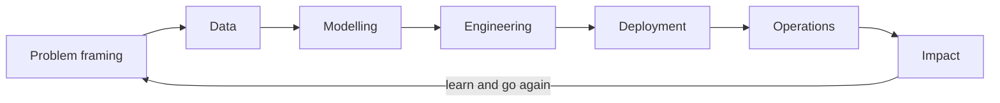
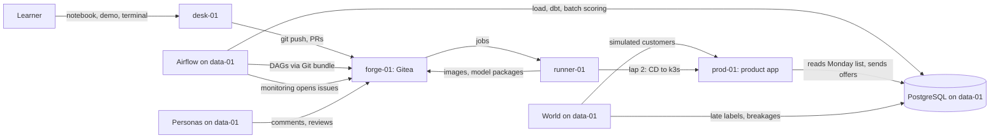

# Design to Deployment: a full-stack data science lab (discussion draft)

## The experience to build

Someone starts one iximiuz Labs playground and opens three tabs: a Gitea forge, a notebook on their own workstation VM, and a Grafana dashboard. Inside the playground, a small fictional subscription business is already running. Simulated customers log in, place orders, raise support tickets, and some of them cancel. A product manager has opened an issue in the forge: *"Churn is up. Can we get an AI model that predicts it with 95% accuracy?"*

The learner takes that vague request through the whole journey that the source article calls full-stack data science: **problem framing, data, modelling, engineering, deployment, operations, and impact**, then round again. They ask the product manager questions before proposing anything, and push back on a target that makes no sense for an imbalanced problem. They find where the data is generated and where it breaks, and build a model. Within the first hour they show the product manager a Streamlit demo, and the reply adds a new constraint. They then turn the model into a production pipeline they own, with dbt, Airflow, and a batch scoring job in a tested container. The pipeline feeds the retention team's weekly offers. The learner monitors it, catches failures, and finally measures whether anyone was actually kept. The answer is often "less than the AUC suggested", which starts a second lap: reframe, rebuild, and, as the stakes rise, ship a business-critical real-time service that a platform engineer must review.

Every step is a real action on a real tool, recorded in source control. The aim is to **test whether each stage of the article's journey can be recreated faithfully inside one playground**. Faithful means the real tool, the real artifact, and the real way the stage goes wrong, compressed in time and scale but not faked. Training the model was the first thing to prove, and the measurements below show it is not the hard part.

This is a discussion draft, not an implementation specification. Items under **Decisions so far** come from the brief, the article, and earlier plan preferences, and are settled. Anything marked **Proposed** is the current direction and remains open.

## The article

[*Why I Hire Full-Stack Data Scientists in the Age of AI*](https://medium.com/@thedatapragmatist/why-i-hire-full-stack-data-scientists-in-the-age-of-ai-7c30e706303c?postPublishedType=repub), by Asia, published on Medium in November 2026 (a five-minute read, tagged Leadership, Hiring, AI, and Data Science). The author hires data scientists who "can sit down with stakeholders, turn a vague request into a clear problem statement, and take it from raw data all the way to a solution running in production." The argument is that AI makes this more important, not less. Its three diagrams carry the framework this lab is built on.

**"What I mean by full-stack: the whole journey from a problem to a result."** Seven stages, with an arrow from the last back to the first labelled *learn and go again*:

| Stage | The article's question |
| --- | --- |
| Problem framing | Is data science the right tool? |
| Data | How it's generated and where it breaks |
| Modelling | The right statistical, ML or optimisation method |
| Engineering | Tested, maintainable, reproducible code |
| Deployment | Plugged into real processes |
| Operations | Monitor, catch failures, iterate |
| Impact | Is it used? Did it deliver the outcome? |

The author does not expect an expert in every layer, but "someone no layer can block".

**"From demo to production: data scientists move independently on the left. Specialists join as the stakes rise."**

| Level | Built with | Purpose | Who owns it |
| --- | --- | --- | --- |
| Demo | Streamlit app | Test assumptions and show stakeholders the idea early | The data scientist, end to end |
| Production pipelines | Dataform, dbt, Airflow, batch model jobs | Serve business users directly and reliably | The data scientist, end to end |
| Business-critical service | Platform engineering, architecture review | Production standards for systems the business runs on | The data scientist with engineers |

**"How AI shifts what a data scientist is worth":** implementation gets cheaper (code, pipelines, and prototypes in hours), so more ideas get tested (feedback arrives sooner), so choosing what to build matters more (cheap to build doesn't mean worth building), and so end-to-end ownership decides the impact (the right solution, in production, used). AI "widens the gap between people who understand their work and people who don't."

**The foundations it values most:** statistics and experimental design; evaluation (whether a model is good enough for its purpose); software engineering habits (testing, version control, readable code); how data gets generated and where it breaks; and enough business knowledge to tell a useful answer from a merely correct one.

**The judgment it asks for:** Is the model leaking information it won't have in production? Is it judged on the right metric? Will the gain hold up? Accuracy on an imbalanced dataset, or an offline score with no link to the business outcome, "can look impressive and mean very little". And "the model said so" isn't a reason.

**How it interviews:** walk through something taken from idea to production; explain the engineering decisions and what you'd do differently; say how it was monitored and maintained once live; tell a technically successful model from a successful business outcome; and say where specialist help was needed and how it was got. It also uses a **role play**: the interviewer acts as a stakeholder with a vague request, challenges the candidate, and adds a new constraint. Do they ask for context before proposing anything, take feedback without getting defensive, adjust, and push back when something doesn't make sense?

**Who it hires:** people who "take responsibility for impact. They know which number their work should move, measure whether it did, and drop projects that aren't paying off. They can explain a result to a commercial leader in one sentence and get them to act on it."

## How the lab represents the article

| Article element | In the lab |
| --- | --- |
| The seven stages | The lab's seven stages, in the same order and with the same questions (see **The seven stages**) |
| *Learn and go again* | Two laps. Lap 1 ends with a measured impact that reveals what to change, and lap 2 starts from it. |
| Demo level (Streamlit) | The learner builds a Streamlit demo in stage 3 and shows it to the scripted product manager, who answers with a new constraint |
| Production-pipeline level (dbt, Airflow, batch model jobs) | Lap 1's deployment: an Airflow DAG the learner owns, read from Gitea, running dbt and a batch scoring container that feeds the retention team's weekly process |
| Business-critical level (platform engineering, architecture review) | Lap 2's deployment: a real-time scoring service on k3s. A scripted platform engineer must approve its architecture review and deploy pull requests. |
| Role play with a vague request | The product manager's opening issue. Context is revealed only when asked, one request deserves push-back, and a constraint arrives after the demo. |
| "Is data science the right tool?" | The business already targets offers with a simple rule. The learner must beat it, and on some seeds the right call is to keep the rule. |
| "How it's generated and where it breaks" | A world with known generation and planted breakages: late-arriving data, duplicates, a renamed plan, test accounts, and a leaky column |
| Leakage, the right metric, will the gain hold up | The lab knows the best possible score, so it can prove leakage. Churn is imbalanced, so accuracy is a trap. Evaluation is on a later time window, and the gain is then measured by experiment. |
| "Tested, maintainable, reproducible code" | Package layout, tests, a lockfile, CI in Gitea Actions, and a Dockerfile the learner writes and must understand |
| "Plugged into real processes" | The scores matter only if the retention team's Monday process consumes them, and the lab logs whether it did |
| "Monitor, catch failures, iterate" | Pipeline failures, data freshness, drift, and delayed-label performance, with alerts that open Gitea issues |
| "Is it used? Did it deliver the outcome?" | A randomized holdout designed in stage 1 and analysed in stage 7. Usage is measured, and so is the outcome. |
| Drop projects that aren't paying off | On some seeds the offer barely works. The right decision is to stop or redirect, and the inspector grades that decision. |
| Explain a result to a commercial leader in one sentence | Stage 7's deliverable: one sentence with the number, plus a decision |
| AI makes implementation cheap, and judgment matters more | Assistants are welcome. The checks grade decisions, and one exercise is a plausible generated pull request that only review can catch (see **AI in the loop**). |
| The five interview questions | The final debrief, a report built from the learner's own forge history (see **The debrief**) |

### Tools the article names, and what the playground uses

| Named in the article | In the playground |
| --- | --- |
| Streamlit | Streamlit 1.67, for real |
| dbt | dbt-core 1.12 with the `dbt-postgres` adapter, for real |
| Dataform | dbt. Dataform is tied to Google BigQuery, and dbt is the article's other named option. |
| Airflow | Airflow 3.4, for real. It was measured to fit (see **Measurements**). |
| Batch model jobs | Airflow tasks that run the CI-built scoring image, pinned by digest |
| Docker, CI/CD | Docker and Gitea Actions |
| Version control | Gitea 1.27 |
| Platform engineering, architecture review | A scripted platform-engineer reviewer, an architecture-review issue template, CODEOWNERS on the deploy repository, and k3s |

Tools a team would use but the article does not name have stand-ins. The warehouse (BigQuery, Snowflake) is a `warehouse` database in PostgreSQL 18. The container registry is Gitea's. Kubernetes is single-node k3s. Monitoring is Prometheus and Grafana. There is no GPU.

## Decisions so far

- **One premium iximiuz playground.** This is the overriding principle from earlier plans. A second playground is a last resort, and **Topology** says what would trigger it.
- **Gitea is the source control,** and the spine of the whole flow. Every stage leaves an issue, a pull request, a CI run, or a registry entry behind.
- **The article's seven stages, with the loop, are the lab's structure,** and its three delivery levels are the lab's progression.
- **The tools the article names are used for real:** Streamlit, dbt, Airflow, Docker, and CI/CD.
- **Impact is a core stage,** not an extension. The article's thesis is responsibility for impact.
- **Training a model is the first step to prove,** and the model is kept small enough to fit one VM.
- **The lab tests fidelity.** For each stage, the question is whether the playground recreates it accurately, and what is compressed or missing.
- **Lean languages for the lab's own services.** The simulated world, the product app, the inspector, and the scripted personas are Go. The learner's code is Python, because that is the role's tool.
- **No cost modelling.** Resources matter only because the playground has limits. The business outcome is counted in customers retained, not money.
- **Current versions, with LTS lines where they exist** (see **Versions checked on 2026-11-22**).

## What "accurately recreated" means

Every stage gets three fidelity tests and one compression note:

1. **Real tool:** the step uses the software the article names, or that a working team would use.
2. **Real artifact:** the step produces the same evidence it does at work, such as a merged design document, a dbt model with tests, a DAG run, an image digest, an alert, or an experiment readout.
3. **Real failure mode:** the step can go wrong the way it goes wrong at work, and the lab can make that happen on purpose. The article's own list is the guide: leakage, the wrong metric, a gain that does not hold up, a pipeline that breaks, and a model nobody uses.
4. **Compression:** what is shrunk (time, data scale, team size) and what that hides.

**Proposed: a world with a known truth.** The data comes from a seeded generator whose churn process and offer effect are known exactly. That turns the article's judgment questions into measurements:

- **An oracle score.** For any test set, the lab can compute the AUC of the *true* churn probabilities. No honest model can beat it beyond sampling noise. A model that scores above the oracle by more than about three bootstrap standard errors is leaking information it won't have in production.
- **Recovered effects.** The planted drivers should rank at the top of the model's importances, and the planted noise columns should not.
- **A true offer effect.** The world knows how much an offer changes each customer's churn probability. Stage 7's experiment can therefore be graded on whether its confidence interval contains the truth, and the learner's continue-or-drop decision on whether it was right.
- **Known breakage and drift.** The seed schedules when and how the world changes, so the lab knows when monitoring *should* fire.

## Measurements

These were measured on 2026-11-22 on a laptop, not on the platform. The CPU is a 2019 Intel i5-8365U, pinned with `taskset` to two logical CPUs (four for one row). Most platform vCPUs will be faster, so treat these as a conservative upper bound to confirm in the spike. Memory is the whole process, or the whole process tree for services.

### Training

The stack was Python 3.14.9, scikit-learn 1.9.1, LightGBM 4.7.0, pandas 3.1.1, NumPy 2.5.5, and PyTorch 2.15.0 (CPU). The data was a churn-like table with 7 real columns (3 categorical) and 20 noise columns, an 80/20 split, and a known data-generating process.

| Model | Rows | CPUs | Fit time | Peak memory | Test AUC | Oracle AUC | One-row predict |
| --- | ---: | ---: | ---: | ---: | ---: | ---: | ---: |
| Logistic regression (scaled, one-hot) | 200k | 2 | 1.0 s | 400 MiB | 0.778 | 0.779 | 3.4 ms |
| LightGBM, 400 trees | 200k | 2 | 4.7 s | 381 MiB | 0.775 | 0.779 | 1.8 ms |
| Logistic regression | 1M | 2 | 5.8 s | 1,351 MiB | 0.781 | 0.783 | 3.5 ms |
| LightGBM, 400 trees | 1M | 2 | 21.1 s | 1,007 MiB | 0.783 | 0.783 | 2.4 ms |
| LightGBM, 400 trees | 1M | 4 | 17.0 s | 1,014 MiB | 0.783 | 0.783 | 2.2 ms |
| LightGBM random search, 20 configs × 3 folds | 200k | 2 | 297 s | 430 MiB | 0.777 | 0.779 | 2.1 ms |
| PyTorch MLP 64-32 (4,929 parameters), 10 epochs | 200k | 2 | 2.0 s | 614 MiB | 0.775 | 0.779 | 0.03 ms |
| PyTorch MLP 64-32, 5 epochs | 1M | 2 | 4.9 s | 1,272 MiB | 0.781 | 0.783 | 0.03 ms |

### The article's tools

| Component | Setup | Ready in | Memory (PSS) | Installed size |
| --- | --- | ---: | ---: | ---: |
| Airflow 3.4.0, Python 3.14 | `airflow standalone`, SQLite, no DAGs, `parallelism` 2 | 17 s | 1,229 MiB in total: triggerer 269, scheduler 232, API server 225, standalone wrapper 171, log server 171, DAG processor 147 | 231 MB |
| Airflow 3.3.2, Python 3.13 | Same, `parallelism` 2 | 14 s | 840 MiB | 224 MB |
| Airflow 3.3.2, Python 3.13 | Same, `parallelism` 4 | 18 s | 848 MiB (1,798 MiB if RSS is summed, which double-counts memory shared by forked workers) | — |
| Streamlit 1.67.0 | A small demo app, idle before any viewer connects | 2 s | 69 MiB | — |

### What the numbers say

- **Training is not the constraint.** A million-row model trains in about 20 seconds in about 1 GiB. Even a 60-fit hyperparameter search finishes inside a five-minute CI job on two cores. A small neural network is just as cheap.
- **Airflow fits, if it is trimmed.** Run as separate systemd units, it has no standalone wrapper, and the triggerer is needed only for deferrable operators. That leaves about 0.8 GiB idle, before tasks run. Each running task adds a process, about 150 MiB by user reports, plus whatever the task itself needs. Its default `parallelism` of 32 would fork 32 workers, so it must be set low.
- **Environments and images are the next constraint.** The scikit-learn and LightGBM environment is about 300 MB on disk, and adding CPU-only PyTorch takes it to 1.2 GB, of which `torch` alone is 766 MB. Airflow's is about 230 MB. CI image size, layer caching, and cold-start pulls matter more than training compute. **Proposed:** PyTorch is an optional extension, not part of the core image.
- **The first draft of the world was too linear.** Logistic regression came within about 0.002 AUC of the oracle, and beat LightGBM at 200k rows. The planted threshold effect (fewer than 4 logins a month) touched only about 0.2% of customers, so it carried almost no signal. If model choice is to matter, the world must plant stronger interactions and thresholds that affect a real share of customers. A seed where the simple approach wins is still worth keeping, because the article praises "plain approaches" that "earn their keep because someone deployed them".
- **Importances mislead on small data.** At 200k rows a pure-noise column entered LightGBM's top five by gain. At 1M rows it dropped out.
- **The serving path costs more than the model.** A one-row prediction through scikit-learn and pandas took 2–3.5 ms, mostly in DataFrame and wrapper overhead. The same score from a raw tensor took 0.03 ms. This matters only in lap 2's real-time service.

## The business and its data

**Proposed:** a fictional meal-kit subscription, *Larkspur Meals*, with about 20,000 customers and two years of history at boot. About 6% of customers churn in any 30 days, so a model that predicts "nobody churns" scores 94% accuracy. That is the trap behind the product manager's opening request.

**What the business does today:** the retention team sends a discount offer every Monday to customers whose contract renews in the next two weeks, up to a budget of offers per week. This rule is the baseline the learner must beat, and it is what "Is data science the right tool?" is measured against.

**The world** is a Go service on `data-01` that writes to the product database in PostgreSQL 18:

- **Source tables:** `customers`, `subscriptions` (plan, contract, price, renewal date), `orders`, `support_tickets`, `logins` (daily counts per customer and platform), `payments`, `offers`, and `cancellations`. Every row has both an event time and an `ingested_at` time.
- **A hidden churn process** with known coefficients, real interactions (support tickets matter more on monthly contracts), thresholds that affect a real share of customers, and seasonality. The seed and coefficients live only in the world's private configuration.
- **A heterogeneous offer effect.** A discount sharply lowers churn for price-sensitive customers, such as those on monthly contracts after a price rise. It barely moves customers who are leaving because of bad service, who have many tickets. Ranking by churn risk therefore puts many offers where they do little. Lap 1's experiment can reveal this, and lap 2 acts on it.
- **Planted breakages,** for "where it breaks":
  - **Late data:** mobile apps upload login counts up to two days late. A feature built on event time looks complete in training and is short at scoring time, unless it is built on what was *known* then.
  - **Duplicates:** the payment provider retries, so some `payments` rows are duplicated.
  - **A renamed category:** plans were renamed partway through history (`basic`/`plus` became `starter`/`standard`/`premium`).
  - **Test accounts:** staff test accounts behave unlike any customer.
  - **A leak:** `subscriptions.cancel_reason_code` is filled in when a customer opens the cancel flow, a few days before the cancellation is recorded. Joined naively, it gives a spectacular and impossible AUC.
- **Time compression:** **Proposed** one simulated day per 10 real seconds. A simulated week is then 70 seconds, and a 30-day churn label arrives five minutes after the prediction it judges. History is generated in bulk at boot with `COPY`, and the world then runs live.
- **Live behaviour:** simulated customers log in through the product app on `prod-01`. On Mondays, the app's retention process reads that week's target list and sends offers, and the world reacts to the offers it receives.
- **Scheduled events:** each seed picks one or two, timed after the first deployment:
  - an upstream column rename that breaks the pipeline's extract (repair);
  - a price rise in one segment, which is real drift (retrain);
  - an app release that logs zero logins for one platform, which is a data bug (repair, and retraining would make it worse);
  - customer growth that pushes the scoring job past its memory limit (engineering).

A **real-data path** is possible as an alternative: a public CC BY dataset, such as UCI's Bank Marketing set, loaded into PostgreSQL. It gains realism, but loses the oracle, the true offer effect, planted breakage, and live labels, so it is not proposed as the default.

## Two laps and three levels

- **Lap 1: "Who is about to leave?"** A churn-risk model goes from a Streamlit demo (level 1) to a weekly production pipeline the learner owns (level 2). The pipeline runs Airflow, dbt, and a batch scoring container, and it feeds the retention team's Monday offers. A randomized holdout measures the outcome.
- **Lap 2: "Whom does the offer actually help?"** Lap 1's experiment shows the offer works for some customers and not others. The learner reframes the problem. The answer may be targeting by expected uplift rather than risk, or routing service-driven churners to support instead of a discount. The product manager then wants offers shown in the app at login, in real time. That makes it a business-critical service (level 3): the learner writes an architecture review, a scripted platform engineer must approve it, and the service ships through shadow and canary on k3s.

**Proposed MVP:** lap 1 in full, all seven stages through level 2. Lap 2 is the fifth chapter.

## The seven stages

Each stage gives the article's question, what the learner does, the tools, what lands in Gitea, how the lab checks it, and the judgment it tests. **Proposed:** each stage is one Gitea issue in a milestone per lap, closed by a pull request, so the forge's history becomes the record of the whole journey.

### 1. Problem framing: "Is data science the right tool?"

- **Does:** turns the product manager's vague request into a decision, a label, a number to move, a metric, a baseline, constraints, and a plan for measuring impact. This happens through the role play in the request issue.
- **The role play:** the scripted product manager reveals context only when asked. The learner can ask what decision the model would drive, what happens today, the offer budget, how churn is defined, and the timeline. The request for "95% accuracy" deserves push-back, because the base rate makes accuracy meaningless. Once the learner explains why, the product manager accepts a better metric. A proposal made before any questions gets a comment back: "That's not quite the problem I have."
- **Tools:** the request issue, a design-document template, and the scripted product manager.
- **Lands as:** `docs/design.md`, merged by pull request, closing the issue. It must state the decision, the label (for example, cancelled within 30 days of a scoring date), the scoring time, the number to move (customers retained), the metric at the weekly budget, the current rule as the baseline, and the experiment plan (a randomized holdout and its size).
- **Check:** before the design pull request opened, the learner asked about at least four of the five context topics. The push-back on accuracy happened, and the design does not use accuracy. The required sections are present. The experiment plan's holdout is large enough to detect the effect size the learner assumed (see stage 7).
- **Judgment:** whether a model is needed at all. On most seeds the model clearly beats the renewal-date rule at the budget. On one seed it barely does, and the right lap 1 is to ship an improved rule through the same pipeline.

### 2. Data: "How it's generated and where it breaks"

- **Does:** learns how each source table is produced, loads it into the warehouse, finds the breakages, and builds tested staging models.
- **Tools:** `psql`, a load step that copies product tables into the `warehouse` database (run by hand at first, and by Airflow in stage 5), dbt with tests (unique keys, not-null, accepted values, freshness), and a notebook for exploration. **Proposed:** [marimo](https://marimo.io) notebooks, which are plain `.py` files, so they diff and review cleanly. JupyterLab is the alternative, and Gitea 1.27 is reported to render `.ipynb` files with their outputs. DuckDB is available on `desk-01` for exploring Parquet snapshots.
- **Lands as:** `dbt/models/staging/` with tests, `notebooks/explore.py`, a "data notes" section in the design document, and a snapshot manifest in `data/snapshots/<name>.json`. The manifest holds the query, the cutoff, row counts, and the sha256 of a Parquet file. **Proposed:** the Parquet file goes to Gitea's generic package registry, so "which data trained this model" is answered from git.
- **Check:** dbt tests pass in CI. The staging models deduplicate payments, map old plan names, and exclude test accounts. The snapshot contains nothing ingested after its cutoff.
- **Judgment:** trusting the data because it loaded. Every planted breakage passes a naive `SELECT`.

### 3. Modelling: "The right statistical, ML or optimisation method"

- **Does:** builds a point-in-time training set, compares the current rule, logistic regression, and LightGBM on a later time window at the weekly budget, checks calibration and slices, and chooses the method. Then the learner builds a Streamlit demo and shows it to the product manager.
- **Point-in-time features:** one row per customer per weekly scoring date, using only data *ingested* by that date. **Proposed:** the learner writes this as-of join, rather than toggling a setting, because building the control teaches the concept.
- **Optimisation:** with a fixed weekly budget, choosing whom to target is itself an optimisation. In lap 1 it is the top *k* by risk. In lap 2 it becomes the top *k* by expected benefit.
- **The demo (level 1):** a Streamlit app on `desk-01` that shows the risk distribution, the customers the budget would reach, and how they differ from the current rule's list. The learner posts the link on the issue. The product manager replies with a constraint the learner must absorb: **Proposed** "Retention can only handle 300 offers a week, sent on Mondays, and legal says offers can't be targeted by region."
- **Tools:** Python 3.14, scikit-learn 1.9, LightGBM 4.7, Streamlit 1.67, and `uv` with a committed `uv.lock`. MLflow is optional on `desk-01` with a local store, for learners who want experiment tracking (see **Decisions to leave open**).
- **Lands as:** `dbt/models/training_set.sql`, `src/churn/train.py`, `reports/evaluation.md`, `MODEL_CARD.md`, and `demo/app.py`.
- **Check:**
  - The inspector recomputes sampled training rows from the source tables as of each row's date, and they match. `cancel_reason_code` and its derivatives are absent.
  - Evaluation is on a window strictly after training.
  - The candidate's AUC is below the oracle bound.
  - Recall at 300 offers beats the current rule.
  - Region is not a feature after the constraint arrived.
- **Judgment:** leakage, a random split on time-ordered data, and a metric with no link to the decision. These are the article's examples, almost word for word.

### 4. Engineering: "Tested, maintainable, reproducible code"

- **Does:** turns the notebook work into a package with tests, a lockfile, a container, and CI. Every change then goes through review.
- **The Dockerfile:** the article says a data scientist "who's never written a Dockerfile can get one working in an afternoon, as long as they understand what it does." The learner writes the scoring image's Dockerfile, with an assistant if they like, and the checks test understanding. The base image must be pinned by digest, dependencies installed with `uv sync --frozen`, the process run as a non-root user, no credentials left in any layer, the image under a size limit, and a dry run of the entry point must succeed.
- **CI in Gitea Actions:** lint, unit tests, `dbt build` against a CI schema and a small fixture snapshot, and retraining from the pinned snapshot. A quality gate compares the candidate with the production model on the same window at the budget, and a comment on the pull request reports the metrics. On merge, CI builds and pushes the image by digest and publishes the model to Gitea's generic package registry, with its git SHA, snapshot hash, lockfile hash, and metrics. **Proposed:** the learner writes the quality gate.
- **Review:** branch protection with required checks, CODEOWNERS, and a pull-request template that embeds the model card. A learner cannot approve their own pull request in Gitea, so a scripted team lead approves once the checks pass, and leaves scripted comments at a few points.
- **The assistant pull request (proposed exercise):** a bot account opens a plausible pull request titled "Improve AUC by 9 points". It adds a cleverly named feature derived from `cancel_reason_code`. CI passes, because the learner's CI does not know the oracle. Only review can catch it, and the inspector checks that it was not merged.
- **Lands as:** `src/`, `tests/`, `Dockerfile`, `uv.lock`, `.gitea/workflows/ci.yml`, a merged pull request with its metrics comment, an image digest, and a model package.
- **Check:** a clean checkout reproduces the published metrics within a small tolerance. The Dockerfile checks pass, and the package's git SHA equals the merge commit.

### 5. Deployment: "Plugged into real processes"

- **Does:** ships the model as a production pipeline the learner owns, which is the article's level 2. The retention team must actually use the output.
- **The DAG:** `dags/weekly_retention.py` loads the week's product data into the warehouse, runs `dbt build`, and scores customers with the CI-built image, pinned by digest. It then assigns the randomized holdout from the stage 1 plan, and publishes `warehouse.retention_targets` for the week.
- **Deploying it:** Airflow 3 reads DAGs straight from Gitea through a **Git DAG bundle** tracking `main`, and records which commit each run used. Merging a pull request therefore *is* the deployment, which is the article's point about validating an idea "without waiting for a slot in another team's backlog". The image a run uses comes from `release.json` in the same repository, which a release pull request updates.
- **The real process:** every simulated Monday, the product app's retention process reads that week's list and sends offers. It logs what it consumed. If the list is missing, late, or has the wrong columns, it sends nothing that week.
- **Tools:** Airflow 3.4 with the LocalExecutor and a low `parallelism`, the Git and Docker providers, dbt, and the scoring image.
- **Lands as:** the DAG, `release.json`, a merged release pull request, and DAG runs tagged with their commits.
- **Check:** the list for each Monday landed before the retention process read it, and was consumed. Holdout customers received no offers. Each run used the commit and image digest its release named.
- **Judgment:** a model that is "deployed" but plugged into nothing. The natural first mistake is a DAG that uses Airflow's own dates. Those follow the wall clock while the business runs on simulated time, so the list lands in the wrong week's partition, and the retention process finds nothing on Monday (see **Platform, Gitea, and Airflow rules**).

### 6. Operations: "Monitor, catch failures, iterate"

- **Does:** watches the pipeline (task failures, retries, freshness against Monday's deadline), the data (dbt tests in production, input drift), the model (score distribution, and performance once labels arrive), and usage (lists consumed, offers sent). Alerts become issues, and the learner works them.
- **Tools:** a monitoring DAG that writes a `model_health` table. **Proposed:** the learner writes the drift check (population stability index per feature) and the step that opens a Gitea issue when a threshold is crossed. Grafana reads `model_health` and Airflow's metadata database directly from PostgreSQL, and service metrics from Prometheus. Evidently is the off-the-shelf comparison for drift.
- **Lands as:** the monitoring DAG, a dashboard exported to `monitoring/`, the issues it opens, and the pull requests that close them.
- **Check:** each scheduled event led to an issue within a set number of simulated days, and the issue was closed by the right kind of fix. A broken extract needs a repair to the load step. A price rise needs a retrain merged through stage 4. A logging bug needs a dbt fix and a test that would have caught it, *before* any retraining. A memory failure needs a scoring job that processes customers in chunks.
- **Judgment:** retraining as a reflex. A subtler one is retraining on labels the model's own offers changed, which the holdout exists to prevent.

### 7. Impact: "Is it used? Did it deliver the outcome?"

- **Does:** analyses the holdout experiment, separates usage from outcome, compares technical success with business success, and recommends what to do next, in one sentence a commercial leader can act on.
- **The numbers:** of the customers the model targeted, how many more stayed than in the holdout, with a confidence interval. It also reports how many lists were consumed and offers sent, against what was planned, and sets the model's AUC beside the measured gain.
- **Statistics and experimental design:** the stage 1 plan already sized the holdout. **Rough estimate, to confirm in the spike:** with 300 offers a week, a 20% holdout, about 30% churn among targeted customers, and an offer that cuts that by a quarter, eight simulated weeks give an effect of about three standard errors. Eight simulated weeks plus the 30-day label delay is about 15 real minutes.
- **Lands as:** `reports/impact.md`, generated from the warehouse, and a comment on the lap's milestone issue with the one-sentence summary and a decision label: `decision/continue`, `decision/iterate`, or `decision/drop`.
- **Check:** the confidence interval contains the world's true effect. The sentence contains the number. The decision fits the truth: *drop* or *iterate* where the offer barely works, and *continue* or *iterate* where it clearly does.
- **Judgment:** a good AUC is not a good outcome. On most seeds the risk model ranks well but targets many customers the offer cannot help, which is the thread that starts lap 2.

### Lap 2: learn and go again

The chapter repeats the seven stages at a higher level of stakes:

- **Framing:** the lap 1 segment results reframe the question to "whom does the offer help?" The product manager adds a new request: in-app offers at login, in real time.
- **Modelling:** an uplift approach, such as two LightGBM models (treated and holdout) or a transformed outcome. It is trained on lap 1's randomized data, which is the only unbiased data the business has. Service-driven churners may be better routed to support than to a discount, and that recommendation is a valid answer.
- **Engineering and deployment (level 3):** a FastAPI service with the model loaded at startup, a typed contract, health and metrics endpoints, and the model version in every response. It ships through the `deploy` repository, whose CODEOWNERS names the scripted platform engineer. That bot approves only when the architecture review issue and the deploy pull request are complete. They need SLOs, resource requests and limits, readiness probes, a digest pin, a load-test result, and a fallback for when the service is down (the weekly list). Traefik, which k3s ships, mirrors live login traffic to the shadow version and splits traffic for the canary. A revert pull request is the rollback.
- **A failure to practise:** one seed ships a candidate whose memory grows under load, and the learner must see it in Grafana and roll back.
- **Training/serving skew check:** a contract test replays 1,000 rows from the training set through the service and compares scores with the offline ones.
- **Variant to measure:** the same model exported to ONNX and served from ONNX Runtime in Python, or from a small Go binary. The laptop measurement suggests most of the 2–3.5 ms is wrapper overhead, and a Go server's memory should be a fraction of Python's.
- **Impact:** a new experiment against lap 1's approach, and another one-sentence decision.

## The cast: stakeholders and specialists

The article's team is people, and here they are scripted Gitea accounts. **Proposed:** a Go service listens to Gitea webhooks and drives all of them deterministically.

| Persona | Represents | Behaviour |
| --- | --- | --- |
| Product manager | The stakeholder in the article's role play | Opens the vague request, answers questions by topic, accepts well-argued push-back, and adds a constraint after the demo |
| Retention team | The "real process" the model plugs into | The product app's Monday job. It consumes the list, logs usage, and comments on the issue when a list is missing. |
| Team lead | Code review | Approves pull requests whose checks pass, and leaves scripted review comments |
| Platform engineer | Specialists who join as stakes rise | CODEOWNER of `deploy`. Reviews lap 2's architecture issue against a checklist. |
| Commercial leader | The person a result must persuade | Reads stage 7's sentence and decision, and replies with the business consequence |
| A teammate's assistant | AI-generated code | Opens the plausible but leaky pull request in stage 4 |

**The role play is the hardest part to recreate faithfully.** A scripted product manager matching questions by topic keywords is deterministic, needs no API key, and is gradable. But it is brittle against free-form phrasing, and the article's interviewer *challenges* the candidate conversationally. **Proposed:** keyword topics with a generous synonym list, a clarifying reply when nothing matches, and a visible list of "things you might ask about" for learners who stall. An LLM-backed product manager is an optional mode, off by default and labelled, because it is non-deterministic and needs a key.

## AI in the loop

The article's claim is that AI makes implementation cheap, so the value moves to choosing what to build, judging whether it is right, and owning it until it delivers. The lab is built around that:

- **Assistants are welcome.** The learner may use their own coding assistant on `desk-01`, with their own credentials. Nothing in the playground calls an LLM unless the optional product-manager mode is on.
- **The checks grade judgment, not typing.** An assistant can write the DAG, the training script, the Dockerfile, and the demo, as the article says. The inspector grades what the article says humans must own. Was the right question asked? Is there leakage? Is the metric right for an imbalanced problem? Does the gain hold up out of time? Is the pipeline plugged into the real process? Was a breakage repaired rather than retrained around? Did it deliver the outcome, and was the continue-or-drop decision right?
- **"Cheap to build doesn't mean worth building"** is graded twice: in stage 1, where the rule may be enough, and in stage 7, where a working pipeline may not be worth continuing.
- **"Same confidence whether it's right or wrong":** the assistant pull request in stage 4 is plausible, passes CI, and is wrong.
- **"The model said so isn't a reason":** stage 7's sentence must state the measured outcome, not the model's score.

## The debrief: the interview, answered from the forge

The article's five interview questions become the lab's closing report. **Proposed:** the inspector generates it from the learner's own Gitea history, warehouse, and DAG runs:

1. **"Walk me through something you took from idea to production":** a timeline from the request issue to the last deploy, linking each stage's pull request.
2. **"Explain the engineering decisions, and what you'd do differently":** the design document's decisions with links, plus a short `docs/retro.md` the learner writes.
3. **"How did you monitor and maintain it once it was live?":** each alert, how long it took to notice and fix, and whether the fix was the right kind.
4. **"Tell a technically successful model from a successful business outcome":** offline AUC (and its distance from the oracle) beside measured retention and usage.
5. **"Where did you need specialist help, and how did you get it?":** the platform engineer's review thread from lap 2.

The report also scores the role play: questions asked before proposing, the push-back, and how the constraint was absorbed. It is a portfolio page as much as a grade.

## Source control as the spine

**Proposed repositories in one Gitea organization:**

| Repository | Holds | Who writes |
| --- | --- | --- |
| `churn` | Design document, dbt project, notebooks, training and evaluation code, the Streamlit demo, DAGs, `release.json`, Dockerfile, CI workflows, snapshot manifests, model card, and reports | The learner, plus the bot's assistant pull request |
| `deploy` | k3s manifests pinned by digest, and the CD workflow (lap 2) | The learner, by pull request. The platform engineer is CODEOWNER. |
| `lab-actions` | Mirrors of the actions the workflows use (`checkout`, `setup-uv`, an artifact fork) | Baked at build time |

The world, the product app, the personas, and the inspector are not in the learner's forge. They are the environment, not the learner's work.

**Forge features the journey uses:** issues, a milestone per lap, issue templates for requests and architecture reviews, a project board with one column per stage, branch protection with required checks, CODEOWNERS, pull-request templates, the container registry, the generic package registry, webhooks for the personas, and the API for the monitoring DAG.

**What lives where:**

- **Git:** code, SQL, DAGs, configuration, the lockfile, snapshot manifests, `release.json`, the model card, reports, and deploy manifests.
- **Gitea packages:** Parquet snapshots and model files (generic registry), and images (container registry).
- **Airflow:** run history, each run tied to the commit it executed.
- **PostgreSQL:** the product data, the warehouse, `model_health`, and Airflow's metadata.

**Proposed: no MLflow server in the core.** The article does not mention experiment tracking. The forge and Airflow already record lineage, and the playground needs the memory for Airflow. A model is "in production" because a merged pull request pins it, not because a registry says so.

## Language split

- **Learner-written code is Python 3.14:** training, dbt's Python bits, DAGs, the demo, and lap 2's service. This is the role's language, and Airflow DAGs and Streamlit apps can only be Python. scikit-learn 1.9 supports Python 3.11 to 3.14, which rules out 3.15 for now. Airflow 3.3 and later is tested on Python 3.10 to 3.14.
- **The lab's own services are Go 1.27:** the world, the product app with its retention process, the personas, and the inspector. They run all the time, so their footprint counts.

## Topology

Five VMs in one `flexbox` playground, using the premium budget of 10 vCPU and 16 GiB.

| VM | vCPU | Memory | Runs | Why separate |
| --- | ---: | ---: | --- | --- |
| `forge-01` | 1 | 1.5 GiB | Gitea 1.27 on SQLite, with its container and package registries | The forge must stay responsive while CI trains and builds |
| `runner-01` | 2 | 3.5 GiB | Gitea runner with Docker, and CI jobs (tests, training, image builds) | CI is the bursty load. Training peaked at 1.0–1.4 GiB. |
| `desk-01` | 2 | 3 GiB | The learner's workstation: notebooks, the Streamlit demo, `uv`, `git`, `psql`, DuckDB, `kubectl` | The learner experiments here, and gets full sudo |
| `data-01` | 3 | 5 GiB | PostgreSQL 18 (product, warehouse, Airflow metadata), the world, Airflow 3.4 and its batch tasks (Docker), Prometheus, Grafana, the personas, and the inspector | The data platform and the level 2 pipeline, kept off the VMs the learner changes |
| `prod-01` | 2 | 3 GiB | Single-node k3s: the product app and its retention process, plus lap 2's model service (stable, canary, shadow) and Traefik | The business, and the level 3 service the platform engineer reviews |

**Trust model, proposed:** prevent accidental spoilers rather than stop a determined learner, as in Break Team. The world's seed and coefficients, the oracle, and the true offer effect sit on `data-01`, readable only by the world's own user. **Proposed:** `data-01` is `noSSH`. The learner reaches PostgreSQL, the Airflow UI, and Grafana over the network. CI jobs and DAG tasks run code the learner controls, so the inspector's API needs a token that neither can read. This is spoiler prevention, not security. DAG code runs as Airflow's user, which can drive Docker on `data-01`, so a determined learner could reach the world's files.

**A second playground only if measurement forces it.** The likely trigger is `data-01` during a Monday run: the world writing, Airflow scoring 20,000 customers, dbt building, and Grafana viewers, all at once. The cures, in order, are to keep Airflow's `parallelism` at 2, chunk the scoring job, move Prometheus and Grafana to `forge-01`, and lower world traffic. A split would cost the self-serve, single-start experience.

### Chapters and checkpoints

The whole journey takes hours, which fits the premium session's 480 minutes. **Proposed:** it is still split into five chapters, each startable from a checkpoint:

1. **Framing and data** (stages 1–2)
2. **Modelling and the demo** (stage 3)
3. **Engineering and the pipeline** (stages 4–5)
4. **Operations and impact** (stages 6–7)
5. **Learn and go again** (lap 2, level 3)

A checkpoint is a git bundle at a tag, a PostgreSQL dump (product, warehouse, and Airflow metadata), the world's seed, and its simulated day, all baked into the root filesystem. A systemd unit restores the chosen checkpoint once at first boot and records that it did, because init tasks retry forever.

## What is faithful and what is compressed

| Faithful | Compressed | Absent |
| --- | --- | --- |
| Git workflow, review, branch protection, CI, registries, digests | Time: one simulated day per 10 s, so a week is 70 s and a 30-day label arrives in 5 minutes | Real users, PII, and governance review |
| SQL, dbt, Airflow, point-in-time joins, leakage, data that breaks | Data: about 20,000 customers and 1M training rows, not billions | GPUs and distributed training |
| Real training algorithms on realistic volumes | Stakeholders: scripted personas instead of people, so the role play is narrower than a real conversation | Organizational politics and competing priorities |
| A real downstream process that consumes the output, and a real experiment | The outcome: a simulated offer effect with a known truth | The real customer psychology behind it |
| Container builds, k3s, shadow, canary, rollback (lap 2) | Infrastructure: one node per role, CPU-only | Cloud IAM, quotas, and multi-region serving |

## Resource plan

Estimates for the spike to measure, except where marked as measured.

| Component | VM | CPU | Memory |
| --- | --- | --- | --- |
| Gitea 1.27 with SQLite | `forge-01` | 0.1–0.3 | 200–300 MiB |
| Gitea runner and Docker, idle | `runner-01` | <0.1 | ~200 MiB |
| CI training job, 1M rows | `runner-01` | Capped at 2 | Measured 1.0–1.4 GiB |
| CI hyperparameter search, 60 fits at 200k rows | `runner-01` | Capped at 2 | Measured 430 MiB, about 5 minutes |
| Image build with BuildKit | `runner-01` | 1–2, bursty | ~500 MiB |
| marimo with a 1M-row frame loaded | `desk-01` | Bursty | 0.5–1.5 GiB |
| Streamlit demo | `desk-01` | Bursty | Measured 69 MiB idle. 150–300 MiB with a viewer, unmeasured. |
| PostgreSQL 18 | `data-01` | 0.3–0.6 | 0.75–1.25 GiB |
| World, personas, and inspector (Go) | `data-01` | <0.3 | ~100 MiB |
| Airflow 3.4: API server, scheduler, DAG processor, log server | `data-01` | 0.2–0.4 idle | ~0.8 GiB (measured 1.2 GiB with the standalone wrapper and triggerer) |
| Airflow task processes, `parallelism` 2 | `data-01` | Bursty | ~150 MiB each, by user reports |
| Batch scoring container, 20,000 customers | `data-01` | 1, bursty | 300–600 MiB, unmeasured |
| Docker engine | `data-01` | <0.1 | ~100 MiB |
| Prometheus 3.13 and Grafana 13 | `data-01` | ~0.2 | ~450 MiB |
| k3s server and agent, with Traefik | `prod-01` | 0.2–0.4 | ~600 MiB |
| Product app with retention process (Go) | `prod-01` | ~0.1 | ~30 MiB |
| Lap 2 model service, per replica (Python) | `prod-01` | 0.25–0.5 at 80 req/s | 250–400 MiB, mostly the environment |

The tightest VM is `data-01` during a Monday run, at an estimated 3.5–4 GiB of its 5 GiB. In lap 2, `prod-01` runs three model-service replicas during shadow plus canary. If they do not fit in 3 GiB, the Go and ONNX variant becomes the default for lap 2.

## Platform, Gitea, and Airflow rules

Carried over from earlier iximiuz plans and measurements:

- **No init tasks for one-shot work.** A failing init task retries every second forever. Checkpoint restore, seeding, and persona setup are systemd units with state files.
- **Root filesystem images must come from a public registry, pinned by digest,** because the platform caches by tag across sessions. New ghcr packages start private.
- **Standalone `kubectl`,** not the one built into k3s, and no manifests in k3s's auto-deploy directory, which re-applies files on restart and would undo the learner's deploys.
- **Run `chmod -R go-w` on build sources,** because a build machine's umask reaches the image through `COPY`.
- **Testing from a laptop** uses `labctl port-forward -L 127.0.0.1:LOCAL:127.0.0.1:REMOTE`, with idle connections replaced after 60 s. The finished lab must not depend on `labctl`.
- **Graders fail closed.** An empty or malformed response is never a pass. The GraphQL lab learned this the hard way with `jq -e` on empty input.

New for this lab, from searches and measurements on 2026-11-22, to confirm in the spike:

- **The official `actions/upload-artifact@v4` does not run on Gitea,** because it detects Gitea as GitHub Enterprise Server and aborts. Use the Gitea fork, or push outputs to the package registry instead.
- **Mirror the actions the workflows use into the forge,** and point `DEFAULT_ACTIONS_URL` at the forge itself. A run should not depend on github.com being reachable or unchanged.
- **Gitea's scheduled workflows run only on the default branch, and on wall-clock time.** Nothing time-driven in the business runs on Gitea schedules (see the simulated clock below).
- **Gitea 1.27's newer Actions features, such as job summaries, need runner 2.0 or later.** The runner's naming and versioning changed during 2026 (`act_runner` binaries became `gitea-runner`), so pin the release at build time.
- **The registry is plain HTTP inside the playground.** Docker on `runner-01` and `data-01` needs `insecure-registries`, and k3s needs a `registries.yaml` mirror entry. Pull credentials, or public packages, must be settled.
- **Airflow's LocalExecutor forks `parallelism` workers at start, 32 by default,** each about 150 MiB. Set it to 2. Run the API server, scheduler, DAG processor, and log server as separate systemd units, never `airflow standalone`. Leave out the triggerer unless a DAG uses deferrable operators.
- **Airflow's Git DAG bundle needs repository credentials in an Airflow connection,** not embedded in the URL, as its documentation warns. The git provider's changelog also asks for an up-to-date `git` on the DAG processor.
- **The simulated clock versus the scheduler.** Airflow schedules and data intervals run on wall-clock time, and the business runs on simulated time. **Proposed:** the world triggers each DAG run through Airflow's REST API, passing the simulated date in the run's configuration, and DAGs never read the wall clock. The lab does not hide this from the learner. A DAG that ignores it fails visibly in stage 5, which teaches the rule.
- **LightGBM and PyTorch read the visible core count, not the container's CPU quota.** Set thread counts explicitly in CI, in batch jobs, and in the service.
- **Bake the CI and scoring base images** into each VM's Docker store, so a cold first job does not pull hundreds of megabytes.

## Build order and decision gates

1. **Spike and calibration.** Work through the checklist below. Gates: the topology starts as sized, a CI training job at 1M rows finishes in under 3 minutes on `runner-01`, and a Monday run fits in `data-01`'s 5 GiB.
2. **The world.** The generator, PostgreSQL, the oracle, the offer effect, the breakages, and the product app's retention process. Gates: the current rule, logistic regression, LightGBM, and the oracle are separated by meaningful gaps on the default seed. The stage 7 experiment is detectable within about 15 real minutes. Each scheduled event is visible within 5 simulated days.
3. **The forge path.** Seeded repositories, the runner, mirrored actions, the CI training job with its quality gate and metrics comment, the team lead, and model packages. Gate: a pull request goes from push to published model with no manual steps outside Gitea.
4. **The pipeline.** Airflow with the Git DAG bundle, the simulated-clock trigger, dbt, the scoring container, the retention process, and the holdout. Gate: eight simulated weeks of lists published and consumed with no manual steps.
5. **Operations and impact.** The monitoring DAG, issue creation, each event's correct repair path, and the impact report. Gate: on each event seed, the issue opens in time, and the correct response restores the pipeline or the model.
6. **The people.** The product manager's role play, the commercial leader, the assistant pull request, the stage checks, the debrief report, and checkpoints. Gates: an independent tester completes lap 1, and every check fails before its step and passes after. **This is the MVP.**
7. **Lap 2.** The uplift model, the FastAPI service, the architecture review and platform engineer, Traefik shadow and canary, and the second experiment.
8. **Extensions.** The ONNX and Go serving variant, PyTorch, the LLM-backed product manager, the real-data path, and Feast, each only on demand.

## Spike checklist

1. Do five VMs at 1/2/2/3/2 vCPU and 1.5/3.5/3/5/3 GiB start as requested on this account? What do `nproc` and `MemTotal` report on each, and does the preflight refuse a smaller allocation?
2. How long does Gitea 1.27 take to start on SQLite on 1 vCPU, and what is its idle and under-CI memory?
3. Does the Gitea runner on Docker run a job on the baked CI image with no network pulls? How long is a cold first job, and how long a warm one?
4. Do mirrored `checkout` and `setup-uv` actions work with `DEFAULT_ACTIONS_URL` pointed at the forge? Does the `gitea-upload-artifact` fork work, or should the workflows avoid artifacts?
5. Can CI push to Gitea's container registry over plain HTTP, and can Docker on `data-01` and k3s on `prod-01` pull from it by digest? Can the Actions token push packages, or does that need a separate token?
6. Which build method works best on `runner-01`: the Docker socket, rootless BuildKit, or Buildah? How long do a cold build and a cached rebuild take?
7. Reproduce the laptop training table on `runner-01` inside a job container capped at two CPUs. Does LightGBM respect the cap when `n_jobs` is set, and what happens when it is not?
8. Tune the world. What interaction and threshold strengths give clear gaps between the current rule, logistic regression, LightGBM, and the oracle at 1M rows? What bootstrap margin over the oracle reliably flags the planted leak without false alarms?
9. Size the experiment. With the proposed budget, holdout, base rates, and offer effect, how many simulated weeks give a reliably detectable effect? Does that fit a chapter in real minutes, including the label delay?
10. Measure Airflow 3.4 as systemd units with a PostgreSQL metadata database and `parallelism` 2, idle and during a Monday run with dbt and the scoring container. Does a Monday run fit in `data-01`'s 5 GiB alongside PostgreSQL and the world?
11. Does the Git DAG bundle read DAGs from Gitea over HTTP with credentials from a connection? How quickly does a merged DAG change appear, and does each run record its commit?
12. Can the world trigger DAG runs through the REST API with the simulated date in the configuration, at one run every 70 seconds, without the scheduler or the UI misbehaving? How should `logical_date` be set?
13. Does the Docker operator run the scoring image by digest from the plain-HTTP registry, with memory and CPU limits?
14. Does `dbt-postgres` 1.11 work with dbt-core 1.12, and how long does `dbt build` take on the warehouse at full history?
15. Do Streamlit and marimo work in `http-port` tabs through the platform's proxy, including their websockets? Does Gitea 1.27 render `.ipynb` outputs as reported?
16. Does keyword matching give a believable product manager across 20 or so phrasings of each context question? What is the clarifying reply's hit rate on test transcripts?
17. Lap 2: what does the Python model service use per replica, and what is its p95 latency at 80 req/s with the pandas path, a NumPy path, and ONNX Runtime? Do Traefik's mirroring and weighted services in k3s v1.37 give a clean shadow and canary without dropped requests?
18. How long does a checkpoint restore take at boot, and how large are the checkpoint images? What are first-boot and cached cold-start times?
19. Could a single chapter run on the free tier (5 vCPU, 8 GiB, 60 minutes, destroyed after 20 idle minutes) with VMs merged? Or is the lab premium-only?

## Decisions to leave open

- **Gitea or Forgejo.** The brief says Gitea, and it is the default. Gitea has no LTS line, while [Forgejo 15 is an LTS release](https://forgejo.org/docs/latest/admin/release-schedule/) supported until July 2027. Forgejo's Actions and runner have diverged slightly from Gitea's. Switch only if an LTS forge matters more than following the brief.
- **MLflow.** It is left out of the core because the article does not name it, and Airflow needs the memory. It can return as a server on `forge-01` if learners expect experiment tracking (MLflow 3.18, about 300–500 MiB).
- **Data snapshots:** Gitea's generic package registry (proposed, no extra component), Git LFS (built into Gitea), or DVC with a remote on `data-01` (common practice, one more tool to learn).
- **The warehouse:** a `warehouse` database in PostgreSQL (proposed, because it handles concurrent use by Airflow, dbt, Streamlit, and the learner), or DuckDB 2.0 LTS (closer to a columnar warehouse, but one writer at a time).
- **Scripted or LLM product manager,** and how much of the role play is graded.
- **What the learner sees of the oracle and the true offer effect:** nothing until each chapter's debrief (proposed), or a live "distance from the best possible" gauge.
- **How far lap 2 goes:** uplift modelling and the real-time service, or the real-time service with the lap 1 model, which is simpler.
- **The real-data path.** A UCI dataset as an alternative chapter set, or synthetic only.
- **Premium only, or free-tier chapters** (spike item 19).

## Versions checked on 2026-11-22

PyPI versions were read from the PyPI JSON API on 2026-11-22. "Measured" means installed and run for this plan.

| Component | Version | Note |
| --- | --- | --- |
| Base image | Ubuntu 26.04 LTS | `flexbox` default, checked for Growing Pains on 2026-11-10 |
| Forge | [Gitea 1.27](https://linuxiac.com/gitea-1-27-released-with-actions-improvements-and-45-cve-fixes/) | 1.27.1 confirmed. 1.27.3 is referenced by Gitea Enterprise. Gitea has no LTS line. Pin the latest patch at build time. |
| Forge, LTS alternative | [Forgejo 15 LTS](https://forgejo.org/docs/latest/admin/release-schedule/) | Released 2026-04-16 and supported until 2027-07-15. Forgejo 17 is the current non-LTS release. |
| CI runner | [Gitea runner](https://gitea.com/gitea/act_runner/releases) | 2.0 or later for 1.27's job summaries. Release numbering is inconsistent across the `act_runner` and `runner` repositories, so confirm on gitea.com. |
| Pipelines | [Apache Airflow 3.4.0](https://pypi.org/project/apache-airflow/) | Released 2026-11-06, and measured on Python 3.14. 3.3.2 was also measured. |
| Airflow providers | [git 1.0.1](https://pypi.org/project/apache-airflow-providers-git/), [docker 4.6.1](https://pypi.org/project/apache-airflow-providers-docker/) | Both released 2026-10-13 |
| Transformations | [dbt-core 1.12.7](https://pypi.org/project/dbt-core/), [dbt-postgres 1.11.0](https://pypi.org/project/dbt-postgres/) | Released 2026-11-12 and 2026-07-16. Confirm the pairing (spike item 14). |
| Demo | [Streamlit 1.67.0](https://pypi.org/project/streamlit/) | Released 2026-11-05, measured |
| Data science runtime | Python 3.14 | 3.14.9 measured. scikit-learn 1.9 does not support 3.15. |
| Environment manager | uv 0.13 | 0.13.5 measured locally |
| Models | [scikit-learn 1.9](https://scikit-learn.org/stable/whats_new/v1.9.html), [LightGBM 4.7](https://pypi.org/project/lightgbm/) | 1.9.1 and 4.7.0 measured |
| Data frames | pandas 3.1, NumPy 2.5 | 3.1.1 and 2.5.5 measured |
| Neural network (optional) | PyTorch 2.15 (CPU) | 2.15.0+cpu measured. `torch` is 766 MB installed. |
| Notebooks | [marimo 0.25.2](https://pypi.org/project/marimo/) | Released 2026-10-19 |
| Data validation | [pandera 0.36.0](https://pypi.org/project/pandera/) | Released 2026-11-10 |
| Drift reports (comparison) | [Evidently 0.7.23](https://pypi.org/project/evidently/) | Released 2026-09-11. Recent releases focus on LLM evaluation, and the drift presets remain. |
| Lap 2 service | [FastAPI 0.165.0](https://pypi.org/project/fastapi/) | Released 2026-11-18 |
| Lap 2 portable model format | [ONNX Runtime 1.32.0](https://pypi.org/project/onnxruntime/) | Released 2026-11-13 |
| Experiment tracking (optional) | [MLflow 3.18.0](https://pypi.org/project/mlflow/) | Released 2026-11-03 |
| Exploration engine (optional) | [DuckDB 2.0.1 LTS](https://duckdb.org/2026/10/21/announcing-duckdb-200) | 2.0 is an LTS line supported until at least October 2027. 2.0.1 was released 2026-11-20. |
| Product database and warehouse | PostgreSQL 18 | No LTS line. Latest minor at build time. |
| Kubernetes | k3s v1.37 | Checked for Growing Pains on 2026-11-10 |
| Metrics and dashboards | Prometheus 3.13 LTS, Grafana 13 | Checked for Growing Pains on 2026-11-10 |
| Lab services | Go 1.27 | Checked for Growing Pains on 2026-11-10 |
