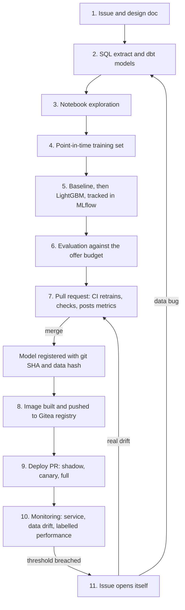
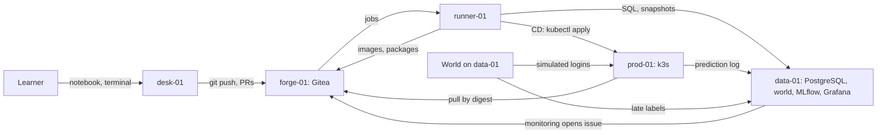

# Design to Deployment: a full-stack data science lab (discussion draft)

## The experience to build

Someone starts one iximiuz Labs playground and opens three tabs: a Gitea forge, a notebook on their own workstation VM, and a Grafana dashboard. Inside the playground, a small fictional subscription business is already running. Simulated customers log in, place orders, raise support tickets, and some of them cancel. The business has a question: *which customers are about to leave, and which of them should get a retention offer?*

The learner answers it the way a full-stack data scientist would, from the first design note to a model that serves live traffic and is watched in production. Every step is a real action on a real tool, and it is recorded in source control. They frame the problem in a Gitea issue and a design document, pull data with SQL, explore it in a notebook, build a point-in-time training set, train a baseline and then a better model, and evaluate it against the business decision rather than an abstract score. A pull request triggers CI that retrains the model, checks it, and posts its metrics. Merging registers the model, a second pull request deploys it to a k3s cluster, and traffic moves from shadow to canary to full. Then the world changes: prices rise in one region, or an upstream change silently breaks a feature. Monitoring notices, an issue opens itself, and the learner has to decide whether to retrain or to fix the pipeline.

The aim is to **test whether every step of the lifecycle can be recreated faithfully inside one playground**. Faithful means the real tool, the real artifact, and the real way the step fails, compressed in time and scale but not faked. Training the model is the first thing to prove, and the measurements below show it is not the hard part.

This is a discussion draft, not an implementation specification. Items under **Decisions so far** come from the brief and earlier plan preferences, and are settled. Anything marked **Proposed** is the current direction and remains open.

## The article, and what this draft could not read

The brief asks this lab to represent the flow from [*Why I Hire Full-Stack Data Scientists in the Age of AI*](https://medium.com/@thedatapragmatist/why-i-hire-full-stack-data-scientists-in-the-age-of-ai-7c30e706303c?postPublishedType=repub). **Medium refused the automated fetch with HTTP 403, and searches found no other copy,** so this draft has not seen the article's text. It does not claim anything about what the article says.

The stages below are the common design-to-deployment lifecycle that "full-stack data scientist" usually means: problem framing, data, exploration, features, training, evaluation, review, packaging, deployment, monitoring, and iteration. The first job once the text is available is to fill the **Article's step** column in the stage table, and to add a row for any step the article describes that this list lacks. If the article names specific products, the stand-in table below gives each one a playground equivalent.

| Stage in this plan | Article's step |
| --- | --- |
| 1. Frame the problem | *to fill from the article* |
| 2. Find and extract the data | *to fill* |
| 3. Explore | *to fill* |
| 4. Build features and the training set | *to fill* |
| 5. Train a baseline, then a better model | *to fill* |
| 6. Evaluate against the decision | *to fill* |
| 7. Review and register through a pull request | *to fill* |
| 8. Package as a service | *to fill* |
| 9. Deploy progressively | *to fill* |
| 10. Monitor the model, not just the service | *to fill* |
| 11. Retrain or repair, and close the loop | *to fill* |
| 12. Measure business impact (extension) | *to fill* |
| Where AI assistance fits | *to fill: the title's "age of AI" angle* |

### Stand-ins for cloud products

| If the article names | The playground uses | What is lost |
| --- | --- | --- |
| GitHub or GitLab | Gitea 1.27 | Nothing the flow needs. Gitea has issues, pull requests, reviews, branch protection, CODEOWNERS, project boards, a container registry, a generic package registry, and LFS. |
| GitHub Actions | Gitea Actions | Mostly the same workflow syntax. Some marketplace actions need Gitea forks (see **Platform and Gitea rules**). |
| Snowflake, BigQuery, Redshift | DuckDB 2.0 LTS, reading PostgreSQL through its `postgres` extension, with dbt on top | Scale and concurrency only |
| S3 or GCS | Gitea's generic package registry, or Garage if an S3 API is needed | Lifecycle policies and scale |
| Airflow, Dagster, Prefect | Gitea Actions `schedule` and `workflow_dispatch` | A DAG UI and backfills. Airflow is about 1.5–2 GiB, so it would be a measured extension, not the default. |
| SageMaker, Vertex AI, Databricks Model Serving | A FastAPI container on k3s | Autoscaling across machines, managed endpoints |
| MLflow, Weights & Biases | MLflow 3.17 | Nothing for tracking. W&B's hosted UI has no equivalent here. |
| A feature store (Feast, Tecton) | dbt tables with point-in-time joins | An online store. Feast could be an extension if the article leans on it. |
| ECR, GCR, Artifact Registry | Gitea's container registry | Vulnerability scanning |
| EKS, GKE, AKS | Single-node k3s v1.37 | Multi-node scheduling, which the flow does not need |
| Datadog, Arize, WhyLabs | Prometheus 3.13 LTS and Grafana 13, plus a model-health table in PostgreSQL | Hosted model-observability UIs |
| A GPU | None. Everything is CPU. | Deep-learning training at any real size |
| An LLM API or coding assistant | The learner's own assistant, optional (see **AI in the loop**) | Nothing is built into the playground |

## Decisions so far

- **One premium iximiuz playground.** This is the overriding principle from earlier plans. A second playground is a last resort, and **Topology** says what would trigger it.
- **Gitea is the source control,** and it is the spine of the whole flow. Every stage leaves an issue, a pull request, a CI run, or a registry entry behind.
- **The whole flow, from design to deployment,** is in scope, as the brief asks.
- **Training a model is the first step to prove,** and the model is kept small enough to fit one VM.
- **The lab tests fidelity.** For each stage, the question is whether the playground recreates it accurately, and what is compressed or missing.
- **Lean languages for the lab's own services.** The simulated world, the product app, and the stage inspector are Go. The data scientist's code is Python, because that is the tool the role uses (see **Language split**).
- **No cost modelling.** Resources matter only because the playground has limits.
- **Current versions, with LTS lines where they exist** (see **Versions checked on 2026-11-22**).

## What "accurately recreated" means

Every stage gets three fidelity tests and one compression note:

1. **Real tool:** the step uses the software a working team would use, or the closest open equivalent from the stand-in table.
2. **Real artifact:** the step produces the same kind of evidence it does at work, such as a merged design document, a dbt model with tests, an MLflow run, an image digest, or a Grafana alert.
3. **Real failure mode:** the step can go wrong in the way it goes wrong at work, such as leakage, a random split on time-ordered data, an unpinned dependency, a bad canary, or a silent upstream schema change. The lab can reproduce that failure on purpose.
4. **Compression:** what is shrunk (time, data scale, team size) and what that hides.

**Proposed: a world with a known truth.** The data comes from a seeded generator whose churn process is known exactly. That turns "is the model right?" from opinion into measurement:

- **An oracle score.** For any test set, the lab can compute the AUC of the *true* churn probabilities. No honest model can beat it beyond sampling noise. A model that scores above the oracle by more than about three bootstrap standard errors is leaking the label. This is the single most useful check in the lab.
- **Recovered effects.** The planted drivers (contract type, support tickets, tenure, price) should rank at the top of the model's importances, and the planted noise columns should not.
- **Known drift.** The seed schedules when and how the world changes, so the lab knows when monitoring *should* fire and can grade how fast it did.

## Training fits easily: measurements

These were measured on 2026-11-22 on a laptop, not on the platform. The CPU is a 2019 Intel i5-8365U, pinned with `taskset` to two logical CPUs (four for one row). Most platform vCPUs will be faster, so treat these as a conservative upper bound to confirm in the spike. The stack was Python 3.14.9, scikit-learn 1.9.1, LightGBM 4.7.0, pandas 3.1.1, NumPy 2.5.5, and PyTorch 2.15.0 (CPU). The data was a churn-like table with 7 real columns (3 categorical) and 20 noise columns, an 80/20 split, and a known data-generating process. Peak memory is the whole process, including data generation.

| Model | Rows | CPUs | Fit time | Peak memory | Test AUC | Oracle AUC | One-row predict |
| --- | ---: | ---: | ---: | ---: | ---: | ---: | ---: |
| Logistic regression (scaled, one-hot) | 200k | 2 | 1.0 s | 400 MiB | 0.778 | 0.779 | 3.4 ms |
| LightGBM, 400 trees | 200k | 2 | 4.7 s | 381 MiB | 0.775 | 0.779 | 1.8 ms |
| Logistic regression | 1M | 2 | 5.8 s | 1,351 MiB | 0.781 | 0.783 | 3.5 ms |
| LightGBM, 400 trees | 1M | 2 | 21.1 s | 1,007 MiB | 0.783 | 0.783 | 2.4 ms |
| LightGBM, 400 trees | 1M | 4 | 17.0 s | 1,014 MiB | 0.783 | 0.783 | 2.2 ms |
| LightGBM random search, 20 configs × 3 folds | 200k | 2 | 297 s | 430 MiB | 0.777 | 0.779 | 2.1 ms |
| PyTorch MLP 64-32 (4,929 parameters), 10 epochs | 200k | 2 | 2.0 s | 614 MiB | 0.775 | 0.779 | 0.03 ms |
| PyTorch MLP 64-32, 5 epochs | 1M | 2 | 4.9 s | 1,272 MiB | 0.781 | 0.783 | 0.03 ms |

What the numbers say:

- **Training is not the constraint.** A million-row model trains in about 20 seconds in about 1 GiB. Even a 60-fit hyperparameter search finishes inside a five-minute CI job on two cores. A small neural network is just as cheap.
- **Environments and images are the constraint.** The scikit-learn and LightGBM environment is about 300 MB on disk. Adding CPU-only PyTorch takes it to 1.2 GB, of which `torch` alone is 766 MB. CI image size, layer caching, and cold-start pulls matter far more than training compute. **Proposed:** PyTorch is an optional extension, not part of the core image.
- **The first draft of the world was too linear.** Logistic regression came within 0.002 AUC of the oracle, and beat LightGBM at 200k rows. The planted threshold effect (fewer than 4 logins a month) touched only about 0.2% of customers, so it carried almost no signal. If model choice is to matter, the world must plant stronger interactions and thresholds that affect a real share of customers. A seed where the simple baseline wins is still worth keeping as a lesson.
- **Importances mislead on small data.** At 200k rows a pure-noise column entered LightGBM's top five by gain. At 1M rows it dropped out.
- **The serving path costs more than the model.** A one-row prediction through scikit-learn and pandas took 2–3.5 ms, mostly in DataFrame and wrapper overhead. The same score from a raw tensor took 0.03 ms. Stage 8 makes this a measured choice.

## The business and its data

**Proposed:** a fictional meal-kit subscription, *Larkspur Meals*, with about 20,000 customers and two years of history at boot.

**The decision:** every time a customer logs in, the product app asks the model for a churn-risk score. Customers above a threshold see a retention offer, within a fixed budget of offers per simulated week. This choice makes the design stage concrete. The metric that matters is how many churners the budget reaches, not AUC, and the latency budget is set by a login page, not by a batch job.

**The world** is a Go service on `data-01` that writes to PostgreSQL 18:

- **Source tables:** `customers`, `subscriptions` (plan, contract, price), `orders`, `support_tickets`, `logins` (daily counts per customer, to keep row counts sane), `payments`, and `cancellations`.
- **A hidden churn process** with known coefficients, interactions (support tickets matter more on monthly contracts), thresholds that affect a real share of customers, and seasonality. The seed and coefficients live only in the world's private configuration.
- **A planted leak:** `subscriptions.cancel_reason_code` is filled in when a customer starts the cancel flow, a few days before the cancellation is recorded. Joined naively, it gives a spectacular and impossible AUC.
- **Time compression:** **Proposed** one simulated day per 10 real seconds. A 30-day churn label then arrives five minutes after the prediction it judges. History is generated in bulk at boot with `COPY`, and the world then runs live.
- **Live traffic:** simulated customers log in through the product app on `prod-01`, so the model serves real HTTP requests. **Proposed** 20–80 logins per second, set in the spike.
- **Treatment effect:** an offer lowers a customer's true churn probability by a seeded amount. This creates the classic feedback loop, in which a deployed model changes the labels it will later be retrained on. Stage 12 measures the effect, and stage 11 shows why it needs a holdout group.
- **Scheduled change:** each seed picks one or more events after the first deployment, such as a price rise in one region (real drift, retraining helps), a competitor launch (concept drift), or an app release that starts logging `logins` as zero for one platform (a data bug, where retraining makes things worse).

A **real-data path** is possible as an alternative: a public CC BY dataset such as UCI's Bank Marketing set, loaded into PostgreSQL. It gains realism, but loses the oracle, the planted drift, and live labels, so it is not proposed as the default.

## The lifecycle, stage by stage

Each stage below names what the data scientist does, the tools, what lands in Gitea, how the lab checks it, and the failure mode it can reproduce. **Proposed:** each stage is one Gitea issue in a milestone named for the model version, and is closed by a pull request. The forge's history then *is* the record of the whole flow.

### 1. Frame the problem

- **Does:** turns "customers are leaving" into a decision, a label, a metric, a baseline, and constraints.
- **Tools:** a Gitea issue opened by a simulated product manager, with the offer budget and latency limit stated in it, and a design document template.
- **Lands as:** `docs/design.md`, merged by pull request, closing the issue. It must state the decision, the label (for example, cancelled within 30 days of a login), the prediction time, the metric at the budget, the baseline to beat, the latency budget, and the known risks.
- **Check:** the file exists on `main` with the required sections, and the pull request that merged it references the issue.
- **Failure mode:** defining the label from data that is only known after the prediction time. This is the same leak that stage 4 makes concrete.

### 2. Find and extract the data

- **Does:** writes SQL against the product database, defines the extraction cutoff, and turns raw tables into tested models.
- **Tools:** `psql`, DuckDB 2.0 LTS attached to PostgreSQL, and dbt with the `dbt-duckdb` adapter. dbt tests cover keys, nulls, and accepted values.
- **Lands as:** `dbt/` models and tests, plus a snapshot manifest in `data/snapshots/<name>.json` holding the query, cutoff, row counts, and the sha256 of a Parquet file. **Proposed:** the Parquet file goes to Gitea's generic package registry, so "which data trained this model" is answered from git, without another storage service. Git LFS and DVC are alternatives (see **Decisions to leave open**).
- **Check:** dbt tests pass in CI, and the snapshot contains no rows after its cutoff.
- **Failure mode:** an unpinned extract. Re-running a query after new data arrives silently changes the training set.

### 3. Explore

- **Does:** looks at distributions, label balance, missingness, and time trends, and writes down findings that change the plan.
- **Tools:** **Proposed:** [marimo](https://marimo.io) notebooks, which are stored as plain `.py` files, so they diff and review cleanly in a pull request. JupyterLab is the alternative. Gitea 1.27 is reported to render `.ipynb` files with their outputs.
- **Lands as:** `notebooks/explore.py` and a short findings section in the design document.
- **Check:** the notebook runs headless in CI against the pinned snapshot.
- **Failure mode:** a notebook that only runs on the author's machine, because of hidden state or out-of-order cells. marimo's dependency-ordered cells prevent much of this.

### 4. Build features and the training set

- **Does:** builds one row per customer per prediction date, using only data known at that date, and splits by time.
- **Tools:** dbt models with as-of joins. **Proposed:** the learner writes the point-in-time join, not a toggle, because building the control teaches the concept.
- **Lands as:** `dbt/models/training_set.sql` and its tests, and a new snapshot.
- **Check:** the inspector samples training rows, recomputes their features from the source tables as of each row's prediction date, and compares them. It also checks that `cancel_reason_code` and anything derived from it are absent.
- **Failure mode:** leakage through `cancel_reason_code`, or a random split that lets the model see the future. The oracle catches both later, because the model's score exceeds what is possible.

### 5. Train a baseline, then a better model

- **Does:** trains logistic regression first, then LightGBM, tracks every run, and keeps the environment reproducible.
- **Tools:** Python 3.14, scikit-learn 1.9, LightGBM 4.7, `uv` with a committed `uv.lock`, and MLflow 3.17 tracking. Seeds are fixed. PyTorch is an optional extension.
- **Lands as:** `train.py` and its configuration, with MLflow runs tagged with the git SHA, the snapshot hash, and the lockfile hash.
- **Check:** a baseline run and a candidate run exist with those tags. CI reproduces the candidate's metrics from a clean checkout within a small tolerance.
- **Failure mode:** an unpinned dependency, a missing seed, or a model trained on a laptop's uncommitted changes. The SHA tag carries a dirty-tree flag.

### 6. Evaluate against the decision

- **Does:** evaluates on a later time window, at the operating point the budget implies, and checks calibration and slices.
- **Tools:** scikit-learn metrics and plots logged to MLflow, and a model card template.
- **Lands as:** `reports/evaluation.md` (generated) and `MODEL_CARD.md`, covering intended use, data window, metric at budget, slices by region and contract, calibration, and known limits.
- **Check:** the evaluation window is strictly after the training window. Recall at the weekly offer budget beats the baseline. The candidate's AUC is below the oracle bound. The model card has its required sections.
- **Failure mode:** reporting AUC on a random split, which looks better than reality. Reporting a metric the business cannot act on is another.

### 7. Review and register through a pull request

- **Does:** opens a pull request. CI retrains from the pinned snapshot, runs unit tests, data validation, and a quality gate, and posts a metric comparison as a comment. A reviewer approves, and merging registers the model.
- **Tools:** Gitea Actions on a self-hosted runner, branch protection with required checks, CODEOWNERS, and a pull-request template that embeds the model card. Data validation uses pandera. **Proposed:** the learner writes the quality gate, which compares the candidate with the production model on the same window and fails the check if it is not better at the budget.
- **Lands as:** `.gitea/workflows/ci.yml`, a merged pull request with the metrics comment, and a registered model version whose MLflow alias points at the run, tagged with the merge commit.
- **Check:** the merged pull request has passing required checks and a metrics comment. The registered version's git SHA equals the merge commit.
- **Failure mode:** a model registered from a branch that was never reviewed. Branch protection blocks it.
- **The assistant pull request (proposed exercise):** a bot account opens a plausible pull request titled "Improve AUC by 9 points". It adds a cleverly named feature derived from `cancel_reason_code`. CI passes, because the learner's CI does not know the oracle. The learner has to catch it in review, comment, and close it. The inspector checks that it was not merged.

### 8. Package as a service

- **Does:** wraps the model in an HTTP service with a typed contract, health and metrics endpoints, and the model version in every response. CI builds the image and pushes it to the forge's registry.
- **Tools:** FastAPI 0.163 serving a model loaded at startup, plus a Dockerfile and a CI job that builds and pushes to Gitea's container registry.
- **Lands as:** `serve/`, its contract tests, and an image referenced by digest.
- **Check:** `/predict` matches the contract, `/healthz` and `/metrics` respond, and the reported model version equals the registered version. Single-request latency is inside the design budget.
- **Failure mode:** training/serving skew, where the service builds a feature differently from the training pipeline. **Proposed:** a contract test replays 1,000 rows from the training set through the service and compares scores with the offline ones.
- **Variant to measure:** export the model to ONNX and serve it from Python with ONNX Runtime, or from a small Go binary. The laptop measurement suggests most of the 2–3.5 ms is wrapper overhead, and a Go server's memory should be a fraction of Python's. Measure both, then decide whether the variant is a lesson or a footnote.

### 9. Deploy progressively

- **Does:** deploys by pull request to a separate deploy repository, first in shadow, then as a canary, then to all traffic, and practises a rollback.
- **Tools:** a `deploy` repository holding the k3s manifests, with the image pinned by digest, and a CD workflow that applies a manifest on merge. **Proposed:** Traefik, which k3s ships, does both jobs. Its mirroring sends a copy of live requests to the shadow model, and its weighted routing splits traffic for the canary. The product app logs which model version answered each request.
- **Lands as:** three small merged pull requests (shadow, canary at 10%, full), each with its CD run.
- **Check:** shadow predictions are logged but never served. During the canary, both versions answer requests in about the right ratio. A revert pull request restores the previous digest.
- **Failure mode:** a bad canary. **Proposed:** one seed ships a candidate whose image runs out of memory under load, and the learner must notice it in Grafana and roll back.

### 10. Monitor the model, not just the service

- **Does:** watches the service (latency, errors, saturation), the inputs (feature drift), the outputs (score distribution and offer rate), and, once labels arrive, the model's actual performance.
- **Tools:** Prometheus and Grafana for the service. Predictions are logged to PostgreSQL. A scheduled job joins labels as they arrive and writes drift and performance to a `model_health` table, which Grafana reads directly. **Proposed:** the learner writes the drift check (population stability index per feature) and the step that opens a Gitea issue when a threshold is crossed. Evidently is the off-the-shelf comparison.
- **Lands as:** the monitoring job in the repository, a dashboard exported to `monitoring/`, and the issues it opens.
- **Check:** after the seeded event, an issue opens within a set number of simulated days, and it names the right features.
- **Failure mode:** a dashboard that is all green while the model quietly degrades, because only service health was watched.

### 11. Retrain or repair, and close the loop

- **Does:** reads the alert and decides what it means. Real drift calls for retraining on a fresh window, which a scheduled or manually triggered workflow does by opening a pull request with the metric comparison. A data bug calls for fixing the pipeline, and retraining would teach the model the bug.
- **Tools:** Gitea Actions `schedule` and `workflow_dispatch`, plus the same review, registration, and deploy path as stages 7–9.
- **Lands as:** either a retraining pull request merged and deployed, or a dbt fix merged with a test that would have caught the bug.
- **Check:** labelled performance recovers toward the oracle within a set number of simulated days. On data-bug seeds, the inspector checks that the fix came before any retraining.
- **Failure mode:** retraining as a reflex. A second, subtler one is retraining on labels the model's own offers changed. Without a holdout group, the treated customers look less risky than they are.

### 12. Measure business impact (extension)

- **Does:** sets up a randomized holdout that never receives offers, and estimates how many customers the model plus the offer actually kept.
- **Check:** the estimate's confidence interval contains the world's true treatment effect.
- **Why it is an extension:** it needs the longest simulated run, and it moves from engineering into experiment design. It is also the clearest answer to whether the model was worth deploying.

## Source control as the spine

**Proposed repositories in one Gitea organization:**

| Repository | Holds | Who writes |
| --- | --- | --- |
| `churn-model` | Design doc, dbt project, notebooks, training, evaluation, serving code, CI workflows, snapshot manifests, model card | The learner, plus the bot's assistant pull request |
| `deploy` | k3s manifests pinned by digest, CD workflow | The learner, by pull request only |
| `lab-actions` | Mirrors of the actions the workflows use (`checkout`, `setup-uv`, an artifact fork) | Baked at build time |

The world, the product app, and the inspector are not in the learner's forge. They are the environment, not the learner's work.

**Forge features each stage uses:** issues and a milestone per model version, issue templates for the product manager's request, a project board with one column per stage, branch protection with required checks, CODEOWNERS for `deploy/`, pull-request templates, the container registry, the generic package registry for data snapshots, and webhooks or API calls from the monitoring job.

**What lives where:**

- **Git:** code, SQL, configuration, the lockfile, snapshot manifests, the model card, and deploy manifests.
- **Gitea packages:** Parquet snapshots (generic registry) and service images (container registry).
- **MLflow:** runs, parameters, metrics, plots, and model files. **Proposed split:** MLflow records experiments, and the forge controls promotion. A model is "in production" because a merged pull request in `deploy` pins its image, not because someone clicked a button in a registry UI.

**Reviewers:** a learner cannot approve their own pull request in Gitea. **Proposed:** a reviewer bot account, acting as the team lead, approves once required checks pass, and leaves scripted review comments at a few points (for example, asking for the model card's slice table). Its comments are deterministic, so no LLM is needed.

## AI in the loop

The article's title puts AI in the frame, and this section must be reconciled with what the article actually argues. Until then, the proposal is:

- **The lab works with or without an assistant.** The learner may use their own coding assistant on `desk-01` with their own credentials. Nothing in the playground calls an LLM, so there are no keys to manage and runs stay deterministic.
- **The checks focus on judgment.** These are the places where a fluent but wrong answer is easy to produce: the label definition and prediction time, the leak, the time-based split, the metric at the budget, calibration, telling drift from a data bug, and the feedback loop in retraining. An assistant can write the code for every stage. The inspector grades whether the *decisions* were right.
- **The assistant pull request** (stage 7) is the explicit exercise. Plausible generated code passes CI, and only review catches it.
- **Optional logging:** the learner can tag commits or pull requests as assistant-written, and the run report can show which stages used help. This is for reflection, not scoring.

## Language split

- **Learner-written code is Python 3.14,** because the role uses it and the libraries live there. scikit-learn 1.9 supports Python 3.11 to 3.14, which rules out 3.15 for now.
- **The lab's own services are Go 1.27:** the world, the product app, the inspector, and the bot accounts' scripted actions. They run all the time, so their footprint counts.
- **The model server starts in Python,** because the lab's premise is a data scientist shipping their own model. The Go and ONNX variant in stage 8 measures what a leaner path saves.

## Topology

Five VMs in one `flexbox` playground, using the premium budget of 10 vCPU and 16 GiB.

| VM | vCPU | Memory | Runs | Why separate |
| --- | ---: | ---: | --- | --- |
| `forge-01` | 1 | 2 GiB | Gitea 1.27 on SQLite, with its container and package registries | The forge must stay responsive while CI trains and builds |
| `runner-01` | 3 | 5 GiB | Gitea runner with Docker, CI jobs (training, tests, image builds) | Training and builds are the bursty load, so they get the biggest VM |
| `desk-01` | 2 | 3 GiB | The learner's workstation: notebooks, `uv`, `git`, `psql`, DuckDB, `kubectl` | The learner works and experiments here, and gets full sudo |
| `data-01` | 2 | 3 GiB | PostgreSQL 18 (product data, MLflow backend, prediction log), the world, MLflow, Prometheus, Grafana, the inspector | Shared data and observation, kept off the VMs the learner changes |
| `prod-01` | 2 | 3 GiB | Single-node k3s: the product app, model server Deployments (stable, canary, shadow), Traefik | Production is a separate place the learner deploys to, not logs into |

**Trust model, proposed:** prevent accidental spoilers rather than stop a determined learner, as in Break Team. The world's seed and coefficients and the oracle sit on `data-01`, readable only by the world's own user. **Proposed:** `data-01` is `noSSH`, and the learner reaches PostgreSQL, MLflow, and Grafana over the network. CI jobs run code the learner controls, so the inspector's API needs a token that is not on `runner-01`.

**A second playground only if measurement forces it.** The likely trigger is `runner-01` training and building at the same moment that `prod-01` serves a canary, starving `data-01` of CPU. The cures, in order, are to cap CI job containers, serialize builds, and lower world traffic. A split would cost the self-serve, single-start experience.

### Chapters and checkpoints

The whole flow takes hours, which fits the premium session's 480 minutes. **Proposed:** it is still split into four chapters, each startable from a checkpoint:

1. **Frame and data** (stages 1–4)
2. **Train and evaluate** (stages 5–7)
3. **Ship** (stages 8–9)
4. **Operate** (stages 10–12)

A checkpoint is a git bundle at a tag, a PostgreSQL dump, the MLflow state, the world's seed, and its simulated day, all baked into the root filesystem. A systemd unit restores the chosen checkpoint once at first boot and records that it did, because init tasks retry forever. A learner can do the whole flow in one sitting, or start Chapter 3 with stages 1–7 already done.

## What is faithful and what is compressed

| Faithful | Compressed | Absent |
| --- | --- | --- |
| Git workflow, review, branch protection, CI, registries, digests | Time: one simulated day per 10 s, so a 30-day label arrives in 5 minutes | Real users, PII, and governance review |
| SQL, dbt, point-in-time joins, leakage | Data: about 20,000 customers and 1M training rows, not billions | GPUs and distributed training |
| Real training algorithms on realistic volumes | The team: one learner, a scripted product manager, a reviewer bot | Cross-team handoffs and negotiation |
| Container builds, k3s deployment, shadow, canary, rollback | Business impact: a simulated treatment effect with a known truth | Multi-region serving and real autoscaling |
| Service metrics, drift, delayed labels, alert-driven issues | Infrastructure: one node per role, CPU-only | Cloud IAM, cost, and quotas |

## Resource plan

These are estimates for the spike to measure, except where marked as measured.

| Component | VM | CPU | Memory |
| --- | --- | --- | --- |
| Gitea 1.27 with SQLite | `forge-01` | 0.1–0.3 | 200–300 MiB |
| Gitea runner and Docker, idle | `runner-01` | <0.1 | ~200 MiB |
| CI training job, 1M rows | `runner-01` | Capped at 2 | Measured 1.0–1.4 GiB on the laptop |
| CI hyperparameter search, 60 fits at 200k rows | `runner-01` | Capped at 2 | Measured 430 MiB, about 5 minutes |
| Image build with BuildKit | `runner-01` | 1–2, bursty | ~500 MiB |
| PostgreSQL 18 | `data-01` | 0.3–0.5 | 512 MiB–1 GiB |
| World (Go) | `data-01` | <0.2 | ~50 MiB |
| MLflow 3.17 server | `data-01` | ~0.1 | 300–500 MiB, unmeasured |
| Prometheus 3.13 and Grafana 13 | `data-01` | ~0.2 | ~450 MiB |
| Inspector (Go) | `data-01` | <0.1 | ~30 MiB |
| marimo with a 1M-row frame loaded | `desk-01` | Bursty | 0.5–1.5 GiB |
| k3s server and agent, with Traefik | `prod-01` | 0.2–0.4 | ~600 MiB |
| Product app (Go) | `prod-01` | ~0.1 | ~30 MiB |
| Python model server, per replica | `prod-01` | 0.25–0.5 at 80 req/s | 250–400 MiB, mostly the environment |

The tightest VM is `prod-01` during a canary with shadow, which runs three model-server replicas at once. If that does not fit in 3 GiB, the Go and ONNX variant becomes the default rather than an extension.

## Platform and Gitea rules

Carried over from earlier iximiuz plans and measurements:

- **No init tasks for one-shot work.** A failing init task retries every second forever. Checkpoint restore, seeding, and bot setup are systemd units with state files.
- **Root filesystem images must come from a public registry, pinned by digest,** because the platform caches by tag across sessions. New ghcr packages start private.
- **Standalone `kubectl`,** not the one built into k3s, and no shop manifests in k3s's auto-deploy directory, which re-applies files on restart and would undo the learner's deploys.
- **Run `chmod -R go-w` on build sources,** because a build machine's umask reaches the image through `COPY`.
- **Testing from a laptop** uses `labctl port-forward -L 127.0.0.1:LOCAL:127.0.0.1:REMOTE`, with idle connections replaced after 60 s. The finished lab must not depend on `labctl`.
- **Graders fail closed.** An empty or malformed response is never a pass. The GraphQL lab learned this the hard way with `jq -e` on empty input.

New for this lab, from searches on 2026-11-22, to confirm in the spike:

- **The official `actions/upload-artifact@v4` does not run on Gitea,** because it detects Gitea as GitHub Enterprise Server and aborts. Use the Gitea fork, or avoid workflow artifacts and push to the package registry or MLflow instead.
- **Mirror the actions the workflows use into the forge,** and point `DEFAULT_ACTIONS_URL` at the forge itself. A run should not depend on github.com being reachable or unchanged.
- **Scheduled workflows run only on the default branch.** A 1.25.5 bug left `github.event.schedule` empty, and a fix was merged later. Confirm it is in 1.27.
- **Gitea 1.27's newer Actions features, such as job summaries, need runner 2.0 or later.** The runner's naming and versioning changed during 2026 (`act_runner` binaries became `gitea-runner`), so pin the release at build time.
- **The registry is plain HTTP inside the playground.** Docker on `runner-01` needs `insecure-registries`, and k3s needs a `registries.yaml` mirror entry. Pull credentials, or public packages, must be settled for k3s.
- **LightGBM and PyTorch read the visible core count, not the container's CPU quota.** Set thread counts explicitly in CI and in the model server, or a two-core job oversubscribes a three-vCPU VM.
- **Bake the CI image** (Python 3.14, `uv`, Node for JavaScript actions, the locked environment) into `runner-01`'s Docker store, so a cold first job does not pull hundreds of megabytes.

## Build order and decision gates

1. **Spike and calibration.** Work through the checklist below. Gate: the topology starts as sized, and a CI training job at 1M rows finishes in under 3 minutes on `runner-01`.
2. **The world.** Generator, PostgreSQL, the oracle, and the live login loop. Gate: logistic regression, LightGBM, and the oracle are separated by meaningful AUC gaps on the default seed. Each scheduled event moves its target features enough to detect within 5 simulated days at the chosen traffic.
3. **The forge path.** Seeded repositories, runner, mirrored actions, the CI training job, the metrics comment, the reviewer bot, and registration. Gate: a pull request goes from push to registered model with no manual steps outside Gitea.
4. **Ship.** Model server, image build, registry pull from k3s, shadow, canary, and rollback through the deploy repository. Gate: zero failed product-app requests during canary promotion and rollback.
5. **Operate.** Prediction log, label join, drift and performance jobs, issue creation, and the retrain and repair paths. Gate: on each event seed, the issue opens in time and the correct response restores performance.
6. **The lab around it.** Stage text, the inspector's checks, checkpoints, the assistant pull request, and a run report. Gate: an independent tester completes the flow, and every inspector check fails before its step and passes after.
7. **Extensions.** Business-impact measurement, the Go and ONNX serving variant, PyTorch, batch scoring, Feast, and an Airflow comparison, each added only where the article calls for it.

## Spike checklist

1. Do five VMs at 1/3/2/2/2 vCPU and 2/5/3/3/3 GiB start as requested on this account? What do `nproc` and `MemTotal` report on each, and does the preflight refuse a smaller allocation?
2. How long does Gitea 1.27 take to start on SQLite on 1 vCPU, and what is its idle and under-CI memory?
3. Does the Gitea runner on Docker run a job on the baked CI image with no network pulls? How long is a cold first job, and how long a warm one?
4. Do mirrored `checkout` and `setup-uv` actions work with `DEFAULT_ACTIONS_URL` pointed at the forge? Does the `gitea-upload-artifact` fork work, or should the workflows avoid artifacts?
5. Can a CI job push to Gitea's container registry over plain HTTP, and can k3s pull from it by digest through `registries.yaml`? Can the Actions token push packages, or does that need a separate token?
6. Which build method works best on `runner-01`: the Docker socket, rootless BuildKit, or Buildah? How long do a cold build and a cached rebuild of the model server image take?
7. Reproduce the laptop training table on `runner-01` inside a job container capped at two CPUs. Does LightGBM respect the cap when `n_jobs` is set, and what happens when it is not?
8. Tune the world's churn process. What interaction and threshold strengths give clear gaps between logistic regression, LightGBM, and the oracle at 1M rows? What bootstrap margin over the oracle reliably flags the planted leak without false alarms?
9. Does `dbt-duckdb` support dbt-core 1.11 or 1.12 with DuckDB 2.0 LTS? Does DuckDB's `postgres` extension read PostgreSQL 18 efficiently enough for the training-set build?
10. What does MLflow 3.17 use in memory with a PostgreSQL backend and served artifacts? How long does it take to start, and how long does a checkpoint restore of its state take?
11. Does marimo work in an `http-port` tab through the platform's proxy, including its websocket? Does JupyterLab, as the fallback? Does Gitea 1.27 render `.ipynb` outputs as reported?
12. In Gitea 1.27, what is the shortest `schedule` interval that fires reliably, and is the `github.event.schedule` fix present? Does `workflow_dispatch` work from the API, for the monitoring job's retrain trigger?
13. What does the Python model server use per replica, and what is its p95 latency at 80 req/s with the pandas path, a NumPy path, and ONNX Runtime? What does a Go server with ONNX Runtime use? Does shadow plus canary plus stable fit in `prod-01`'s 3 GiB?
14. Do Traefik's mirroring and weighted services in k3s v1.37 give a clean shadow and canary? How quickly does a weight change take effect, and does promotion or rollback drop any requests?
15. At 1 simulated day per 10 s, do the seeded events show up in PSI within 5 simulated days? Does the 30-day label delay leave enough labelled data for a performance check within a 20-minute chapter?
16. How long does a checkpoint restore take at boot (git bundles, PostgreSQL dump, MLflow state), and how large are the checkpoint images? What are first-boot and cached cold-start times?
17. Could a single chapter run on the free tier (5 vCPU, 8 GiB, 60 minutes, destroyed after 20 idle minutes) with VMs merged? Or is the lab premium-only?

## Decisions to leave open

- **Gitea or Forgejo.** The brief says Gitea, and it is the default here. Gitea has no LTS line, while [Forgejo 15 is an LTS release](https://forgejo.org/docs/latest/admin/release-schedule/) supported until July 2027. Forgejo's Actions and runner have diverged slightly from Gitea's. Switch only if an LTS forge matters more than following the brief.
- **Data snapshots:** Gitea's generic package registry (proposed, no extra component), Git LFS (the most "source control" option, built into Gitea), or DVC with a remote on `data-01` (the most common practice, one more tool to learn).
- **MLflow, or the forge alone.** Dropping MLflow saves a service and about 400 MiB. Runs would become CI logs, and models would become Gitea packages. That is leaner, but less like what most teams use.
- **Online or batch scoring.** The proposal is online, at login. A weekly batch job is simpler and arguably right for an offer budget. Choosing between them could itself be part of stage 1.
- **What the learner sees of the oracle:** nothing until each chapter's debrief (proposed), or a live "distance from the best possible" gauge.
- **Reviewer bot or self-merge.** The bot makes review real. Self-merge with required checks is simpler.
- **The real-data path.** A UCI dataset as an alternative chapter set, or synthetic only.
- **Premium only, or free-tier chapters** (spike item 17).
- **How much the article reshapes this.** Once its text is mapped, any tool it emphasizes, such as Airflow, a feature store, or a particular cloud, either gets a stand-in or becomes an extension.

## Versions checked on 2026-11-22

| Component | Version | Note |
| --- | --- | --- |
| Base image | Ubuntu 26.04 LTS | `flexbox` default, checked for Growing Pains on 2026-11-10 |
| Forge | [Gitea 1.27](https://linuxiac.com/gitea-1-27-released-with-actions-improvements-and-45-cve-fixes/) | 1.27.1 confirmed. 1.27.3 is referenced by Gitea Enterprise. Gitea has no LTS line. Pin the latest patch at build time. |
| Forge, LTS alternative | [Forgejo 15 LTS](https://forgejo.org/docs/latest/admin/release-schedule/) | Released 2026-04-16 and supported until 2027-07-15. Forgejo 17 is the current non-LTS release. |
| CI runner | [Gitea runner](https://gitea.com/gitea/act_runner/releases) | 2.0 or later for 1.27's job summaries. Release numbering is inconsistent across the `act_runner` and `runner` repositories, so confirm on gitea.com. |
| Data science runtime | Python 3.14 | 3.14.9 measured. scikit-learn 1.9 does not support 3.15. |
| Environment manager | uv 0.13 | 0.13.5 measured locally |
| Models | [scikit-learn 1.9](https://scikit-learn.org/stable/whats_new/v1.9.html), [LightGBM 4.7](https://pypi.org/project/lightgbm/) | 1.9.1 and 4.7.0 measured |
| Data frames | pandas 3.1, NumPy 2.5 | 3.1.1 and 2.5.5 measured |
| Neural network (optional) | PyTorch 2.15 (CPU) | 2.15.0+cpu measured. `torch` is 766 MB installed. |
| Analytical engine | [DuckDB 2.0 LTS](https://duckdb.org/2026/10/21/announcing-duckdb-200) | Released 2026-10-21 and supported until at least October 2027 |
| Transformations | [dbt-core 1.11](https://docs.getdbt.com/docs/dbt-versions/core-upgrade/upgrading-to-v1.11) with `dbt-duckdb` | 1.12 appeared in August 2026. `dbt-duckdb` support for either version with DuckDB 2.0 is unconfirmed (spike item 9). |
| Notebooks | [marimo](https://pypi.org/project/marimo/) | 0.25.2 reported on PyPI, unverified |
| Experiment tracking | [MLflow 3.17](https://raw.githubusercontent.com/mlflow/mlflow/master/CHANGELOG.md) | 3.17.0 released 2026-10-06, and 3.17.1 reported |
| Data validation | [pandera](https://pypi.org/project/pandera/) | 0.32.0 confirmed (2026-06-19). A later 0.36.0 appears on PyPI, undated. |
| Drift reports (comparison) | [Evidently 0.7](https://pypi.org/project/evidently/) | 0.7.21 confirmed. Recent releases focus on LLM evaluation, and the drift presets remain. |
| Model server | [FastAPI 0.163](https://fastapi.tiangolo.com/release-notes/) | 0.163.0 released 2026-11-14 |
| Portable model format | [ONNX Runtime 1.26](https://pypi.org/project/onnxruntime/) | Python 3.14 wheels since 1.24. Confirm the 1.26 wheel list. |
| Product database | PostgreSQL 18 | No LTS line. Latest minor at build time. |
| Kubernetes | k3s v1.37 | Checked for Growing Pains on 2026-11-10 |
| Metrics and dashboards | Prometheus 3.13 LTS, Grafana 13 | Checked for Growing Pains on 2026-11-10 |
| Lab services | Go 1.27 | Checked for Growing Pains on 2026-11-10 |
