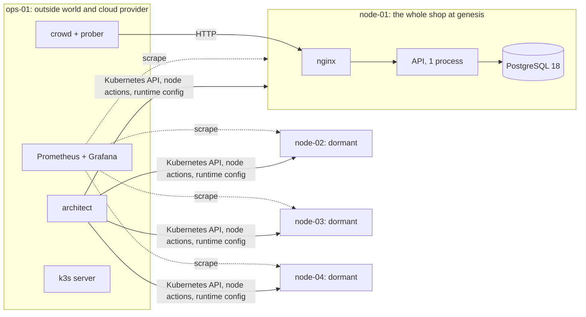
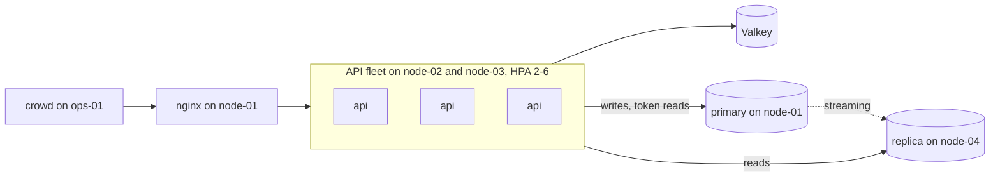

# Growing Pains: a system that grows itself under load (discussion draft)

## The experience to build

Someone starts one iximiuz Labs playground and opens a Grafana tab. Inside, a tiny web shop runs on a single VM: nginx in front of one API process, backed by one PostgreSQL database. Four more VMs sit idle, like cloud capacity nobody has bought yet. When the run starts, a load generator begins acting as the shop's customers and sellers. They browse, search, create products, rewrite descriptions, delete listings, and place orders. All of it is real traffic that changes real state, and there is steadily more of it.

About every five minutes, the growing traffic puts a new kind of strain on the shop. An autonomous controller, the **architect**, watches the system's telemetry, works out what kind of pressure the shop is under, and applies the change an experienced engineer would make. It turns the single process into an autoscaled fleet of containers, adds a read replica when reads dominate the database, puts a cache in front of hot data, moves slow work onto a queue, moves a hot path from Python to a leaner binary, and so on. Each change uses zero-downtime techniques and must keep the shop inside its SLOs. The observer watches traffic, errors, latency, and SLO compliance in Grafana and sees each change annotated on every graph. For each change, the architect also writes a short decision record with the evidence, the alternatives it rejected, and the measured result, and a written narration explains in plain words which changes in the traffic led to it.

Every run starts from a seed. The seed shapes how the traffic grows, so one run might grow a cache and a search engine while another grows a queue, object storage, and shards. The system side has no script: the architect sees only telemetry, never the seed.

The aim is to make distributed-system patterns feel **earned**. Each pattern appears only after the pressure that justifies it is visible, and the dashboard then shows whether it helped.

This is a discussion draft, not an implementation specification. Items under **Decisions so far** come from the brief and its follow-ups and are settled. Anything marked **Proposed** is the current direction and remains open. The MVP is one storyline that produces three architecture changes in fifteen minutes. Seeded branching, the larger catalog, and the richer visuals follow once that run is reliable.

## Decisions so far

- **One premium iximiuz playground built from VMs,** following the [Break Team plan](BREAK_TEAM_PLAN.md).
- **Genesis is one small three-tier web app:** nginx, an API, and a database.
- **Load is real and changes state.** The environment is disposable, so the load generator adds products, changes descriptions, deletes things, and places orders.
- **Load increases steadily,** and about five minutes of growth drives each architecture change.
- **Changes follow best-practice distributed design, chosen from the shape of the load.** For example, when one process cannot keep up, the system switches to horizontal autoscaling. When reads take most of the database's load, it adds a read replica.
- **Changes ideally cause no interruption.** At minimum, the service stays within SLOs. The SLOs are defined on a Grafana dashboard where an observer can follow traffic, error rate, and latency over time.
- **MVP: at least three distinct architecture changes within 15 minutes.**
- **Fuller version: more kinds of change, and seeds that vary how traffic evolves,** so different runs grow differently. The process is autonomous and deterministic, so the options are constrained.
- **Building blocks for the branches:** caches, object storage, queues, search (for example OpenSearch), sharding, containers, and read replicas. Any technology is allowed within the playground's resources.
- **Everything fits in one playground.** This is the overriding principle. A second playground is a last resort, used only if measurement proves one cannot hold the run (see **One playground first**).
- **The shop starts on systemd and migrates to k3s.** Genesis runs nginx, the API, and PostgreSQL as systemd services, and the first move carries the API into an autoscaled k3s fleet. If the spike shows that handover cannot be made without errors, genesis instead starts the API as a single-replica k3s Deployment.
- **PostgreSQL 18 runs as systemd units** for the primary, replicas, and shards.
- **Sharding uses Citus.**
- **Search has a range of engines, chosen by the shape of search traffic.** PostgreSQL's own search comes first. Meilisearch is the default dedicated engine, because it is the lightest. Typesense and OpenSearch are chosen when the traffic needs what Meilisearch lacks, such as near-instant updates or sharding (see **Search: an engine for each traffic shape**).
- **Language is an evolution branch.** The shop's API and workers start in Python, like many young products. When traffic pushes a Python service into a resource ceiling that scaling out cannot fix within the playground, the architect moves that hot path to a Go binary. The lab's own machinery (crowd, prober, architect, twin, and narrator) is Go from the start, to keep its overhead low.
- **Written narration explains each decision.** Alongside the Grafana annotations, the narrator writes which aspects of the traffic pushed the system to grow the way it did.
- **Traffic alone chooses the branches.** Every growth branch must be reachable purely through how traffic and load grow, with nothing outside acting on the system (see **Can traffic alone choose every branch?**).
- **No cost modelling.** The plan is purely about architectural change driven by traffic and load. Resources matter only because the playground has limits.
- **A high-resolution README graphic shows the possible growth paths,** as a tree or graph that looks good on desktop and phone screens and entices readers to try the project. No logo or favicon is needed (see **The README graphic: a growth tree**).

## What carries over from Break Team, and what changes

| Break Team element | In Growing Pains |
| --- | --- |
| Five-VM `flexbox` playground with operations on `ops-01` | Kept. `ops-01` also hosts the k3s control plane (like a managed control plane) and the load generator (the outside world). |
| Lab machinery kept outside the system under test | Kept, for a different reason. Monitoring and decisions must not share fate with the thing that is changing. |
| k3s with optional add-ons off, manifests applied once, standalone `kubectl` | Mostly kept. metrics-server and the local-path provisioner come back, because autoscaling and stateful growth need them. The architect applies every shop object, and none goes in the auto-deploy directory, which would overwrite the architect's changes when k3s restarts. |
| Prometheus on `ops-01` scrapes pods through the Kubernetes API | Kept. The scrape interval drops to 5 s, because a move happens within about a minute. |
| Images baked into the root filesystem and pinned by digest | Kept. Container images ship as k3s air-gap tarballs, so pods start without a registry pull. |
| SSE spectator page | Becomes the **narrator** page: the run clock, Start, the written narration, a living architecture diagram, and the decision records. |
| Fault contracts with a healthy baseline, injected change, checks, and reset | Become **move contracts**: trigger, preconditions, footprint, steps, guards, verification, and rollback. |
| Seeds recorded privately for replay | Kept, but they drive the traffic rather than faults. |
| "Unknown is never healthy" and fail-closed checks | Kept for SLO evaluation and for every move's checks. |
| Humans investigate and repair | Removed. Nobody operates the system, and observers watch. |
| Free-tier limits of 5 vCPU and 8 GiB | Replaced by the premium limits below. |

## The platform's resource limits, checked with `labctl`

These facts were checked with `labctl` on 2026-11-10:

- **Premium sessions run for 480 minutes and also tolerate 480 idle minutes.** A play this account started today reports `tier: premium`, `maxPlayTime: 480m`, and `maxIdleTime: 480m`. A 15-minute run, or a 40-minute fuller run, fits easily, and the free tier's 20-minute idle destruction does not apply. `labctl api /auth/me` reports `effectiveTier: free` for the same account. That discrepancy is worth one question to the platform during the spike.
- **One playground gets 10 vCPU and 16 GiB across up to five VMs.** An earlier four-VM premium play ran 4 + 2 + 2 + 2 vCPU with 4 GB each, and single-VM premium plays ran 4 vCPU with 8 and 10 GiB. This matches the documented paid limits of 4 vCPU and 10 GiB per VM and 10 vCPU and 16 GiB per playground. `labctl playground catalog` still describes `flexbox` as having **up to five VMs**, and its default image is `ubuntu-26-04`.
- **Requests over the limits are scaled down proportionally,** so the free tier would quietly halve every capacity unit. **Proposed:** a preflight reads `nproc` and `MemTotal` on every VM. If they are under the plan, it refuses to start, or runs a half-scale profile where all rates and caps are halved. CPU caps make this scale almost linearly.

### Exploratory SQL throughput, not shop capacity

A separate `labctl` exploration in November 2026 ran PostgreSQL 18.6 for about 15 seconds per case, with warmed data, prepared statements, and local Unix sockets. Each database VM was independent. The figures are observed aggregate rates for those runs, not a sustained ceiling for one coherent database or for the HTTP shop.

| Allocation tested | Trivial `SELECT 1`/s | Indexed prepared reads/s | `pgbench -N` write transactions/s |
| --- | ---: | ---: | ---: |
| Free: 5 vCPU, 8 GiB, three independent database VMs | ~610,000 | ~376,000 | ~50,000 |
| Premium: one 10-vCPU playground, three to five independent database VMs | ~650,000 | ~490,000 | ~68,000 |
| Premium: five concurrent playgrounds, ~50 vCPU and 15 independent database VMs | ~2,710,000 | ~1,750,000 | ~258,000 |

The free allocation did not reach one million SQL operations/s in these tests. The one-million mark was exceeded only by aggregating independent databases across several premium playgrounds; that result is not the capacity of one playground or one database. None of these tests included HTTP, the shop's joins and aggregates, stock-row contention, the 1.5-core `db.medium` cap, replication, or the plan's correctness and latency checks. Establish the actual ceiling as the highest *sustained offered request rate* that still meets those checks, with generator saturation and dropped arrivals reported separately. Never use `SELECT 1` as the capacity estimate for the shop.

CPU, not memory, is the binding constraint. Ten vCPU must cover the load generator, observability, the control plane, and every component the shop can grow. The design therefore keeps every capacity unit small and explicitly capped (see **Instance sizes** below).

## One playground first

Everything runs in one playground. That keeps the run self-serve: one start, one lifetime, one teardown, and no address to paste between sessions. The layout below fits the shop, the crowd, and observability into 10 vCPU with room to spare, because the lab's own machinery is lean Go binaries and every capacity unit is small.

**Observers watch from the same playground.** Grafana and the narrator page are `http-port` tabs on `ops-01`. The owner sees them at once, and the owner's **Expose Port** click with public access shares them with anyone. Grafana runs with an anonymous viewer role, so observers need no login. Many viewers are the main risk to `ops-01`, because each Grafana viewer re-runs every panel's query at every refresh. **Proposed:** the narrator page is the view for large audiences. It runs one set of queries per tick and fans the result out over SSE, so its load does not grow with the number of viewers. Grafana is for the few who want to dig in, and its public dashboard can use a 10 s refresh.

**A second playground only if measurement forces it.** The spike tests whether `ops-01` can hold the crowd, Prometheus, Grafana with viewers, the k3s server, and the architect without distorting client-side latency. If it cannot, parts that are not intrinsic to the shop move out, in this order:

| Order | What moves | What it frees | Trade-off |
| --- | --- | --- | --- |
| 1 | The crowd and the prober | About 0.5 core on `ops-01`, and the contention between load generation and monitoring | Traffic must reach the shop through a public exposed port or proven cross-playground networking. Client-side latency then includes the platform's proxy, so baselines and SLO targets must be measured again. |
| 2 | Grafana and the narrator page | Viewer load | Metrics must cross playgrounds, for example by Prometheus remote-write through an exposed port. Prometheus and the architect stay with the shop, because the architect needs local, low-latency signals. |

Either split couples two sessions. Both must start together, find each other, and last as long as each other, which the Break Team plan also flagged as unproven. A split is worth considering only if `ops-01` contention distorts client-side p95 latency by more than about 10 ms, or if a storyline worth keeping needs more than about 8 vCPU for the shop alone.

## Cast

| Actor | What it is | What it may see | What it must not see |
| --- | --- | --- | --- |
| **The shop** | The system that grows: edge, API, data stores, and workers | Its own configuration | Anything about the run |
| **The crowd** | Seeded load generator acting as shoppers, sellers, and bots | The shop's public HTTP interface only | Architecture, metrics |
| **The prober** | Low, constant synthetic checks for each journey and for data freshness | The public interface | Architecture |
| **The autoscalers** | Kubernetes HPA (and later KEDA): the fast loop, adjusting replica counts within one architecture | Pod metrics | — |
| **The architect** | The slow loop: diagnoses pressure and changes the architecture | System telemetry and aggregated SLO burn | The seed, the storyline, crowd persona metrics |
| **The judge** | Prometheus recording rules that turn client-side measurements into SLIs, error budgets, and burn rates | Crowd and prober metrics | — |
| **The narrator** | Written narration of the traffic and each decision, Grafana annotations, decision records, the narrator page, and the run report | The architect's signals during the run | The storyline, until the run report |

The separation keeps the growth honest. The architect's PromQL comes from a fixed allowlist of signal definitions, and a lint test fails the build if any of them reads `crowd_storyline_*` or a persona label. The crowd never adapts to the system. It records failures and keeps going.

Two control loops at different speeds is the central idea. The HPA answers "how many copies of this do we need right now?" in seconds. The architect answers "is this still the right shape of system?" in minutes. Observers should see both: pods come and go continuously, while the architecture changes in discrete, annotated steps.

## Topology

**Proposed VM layout,** totalling 10 vCPU and 16 GiB:

| VM | vCPU | RAM | At genesis | As the shop grows |
| --- | --- | --- | --- | --- |
| `ops-01` | 2 | 4 GiB | k3s server (tainted, no shop pods), Prometheus, Grafana, architect, narrator, runtime configuration, crowd, prober | Unchanged. The crowd runs in its own systemd slice with a CPU quota. |
| `node-01` | 2 | 3 GiB | **The whole shop:** nginx, one API process under systemd, PostgreSQL 18 primary. k3s agent, tainted for data. | Becomes the edge and database host once the API moves out. |
| `node-02` | 2 | 3 GiB | k3s agent, **dormant** | API pods, cache, workers |
| `node-03` | 2 | 3 GiB | k3s agent, **dormant** | API pods, queue, object storage |
| `node-04` | 2 | 3 GiB | k3s agent, **dormant** | Read replica, search, or a shard, depending on the run |

All four nodes boot from one root filesystem image, which helps the platform's image cache. A dormant node runs only its k3s agent and `node_exporter`, and carries a `growing-pains/dormant=true:NoSchedule` taint. Removing the taint is how the architect **acquires** a node, the playground's stand-in for adding an instance, and the Grafana map shows it. **Proposed:** a later stage could start dormant agents unjoined, so acquiring a node includes a real `k3s agent` join. A free-tier VM was measured Ready in about 7 s, which is short enough to show.



### Where grown components live

**Rule:** stateless and disposable components run in k3s, and PostgreSQL runs as systemd **database instances** on nodes. The PostgreSQL half is decided, and the rest is proposed.

- **k3s:** API pods, workers, Valkey, NATS, Garage, the search engines, and PgBouncer. Stateful ones use the local-path provisioner and are pinned to a node.
- **systemd:** the PostgreSQL primary, replicas, and shards. Replication, promotion, slots, and sharding are the mechanics several moves exist to show. Running them directly keeps every step visible in logs and annotations, instead of inside an operator.
- **Reservation pods:** when the architect starts a database instance on a node, it also creates a pause container whose requests match that instance's CPU and memory caps. The Kubernetes scheduler then accounts for the database and does not pack API pods on top of it.
- **nginx stays on `node-01` as a host service** for the whole run. It is the stable front door that every migration shifts traffic behind.

CloudNativePG was considered and set aside. It would make replicas and switchover easier to automate, but it would hide the mechanism the moves exist to show.

### Instance sizes and the capacity ledger

Every unit of capacity has an explicit size, so the point where a threshold is crossed depends on the load rather than on scheduling noise. **Proposed sizes, to be calibrated in the spike:**

| Unit | Size | How it is enforced |
| --- | --- | --- |
| API instance (Python) | One Python process with one worker. The GIL in the standard build gives it a natural ceiling of one core. | Pod request of 700m and limit of 1000m. The genesis systemd unit has `CPUQuota=100%`. |
| API instance (Go, after the language move) | One Go process limited to half a core. Go 1.25 and later set `GOMAXPROCS` from the cgroup limit, so the process schedules for the size it has. | Pod request and limit of 500m, with a 10 ms quota period so the small cap throttles smoothly instead of in 100 ms stalls |
| Database instance (`db.medium`) | 1.5 cores, 1.5 GiB, `shared_buffers` 512 MiB | systemd `CPUQuota=150%` and `MemoryMax`. Both can be raised live with `systemctl set-property`, which a vertical-scaling move uses. |
| Cache instance | Valkey with 256 MiB `maxmemory`, 0.25 core | Pod limits |
| Worker | 0.5 core | Pod limits |
| Search instance | Meilisearch: 0.5 core, with indexing memory capped at 256 MiB and one indexing thread. Typesense: 0.5 core and 512 MiB. OpenSearch: 1 core and a 768 MiB heap, about 1.3 GiB in all. | Pod limits, plus each engine's memory settings, such as Meilisearch's `--max-indexing-memory` and `--max-indexing-threads` |

The architect keeps a **capacity ledger**: each node's allocatable CPU and memory, what is placed where, and what remains. A move whose footprint does not fit cannot be chosen, so the playground's limits are real and force trade-offs. In a long run, the architect sometimes has to retire something it built earlier to make room. The sum of all caps on a node must stay below its physical CPU, so capped units do not distort each other's measurements.

## The shop

A small marketplace: sellers list products with variants, and shoppers browse, search, view, review, and buy. **Proposed:** the API starts as Python 3.15 (3.14 if a dependency's wheels lag) with Starlette, uvicorn, and psycopg 3, and the workers start as Python with Pillow. The same build runs as a systemd unit at genesis and as a container later. Python is a realistic first choice for a young product, and it makes "one process cannot keep up" real, because the standard build's GIL holds one process to about one core. Requests do realistic work, such as rendering pages and ranking related products, so a read costs about 4 ms of CPU in Python and about 1 ms in Go, to be calibrated.

A Go implementation of the hot paths waits in the image for the language move: the read endpoints (home, listings, details, and search) and the image worker. It is built against the same API contract and passes the same conformance suite as the Python code in CI, so the move is a rollout, not a rewrite. Writes stay in Python. They are a small share of requests, and two implementations of every write path would double the work for little gain.

Rust, Java, and C++ are also possible implementations of the shop's hot paths if the measured Go version reaches a per-core limit. Rust and C++ invite a comparison of per-request CPU and memory at the cost of more implementation and maintenance work; Java invites a comparison of mature HTTP/database tooling against JVM warm-up and footprint in a short, memory-limited lab. None has a measured advantage for this shop. Any language trial must return identical responses, retain the write and read-your-writes contract, and report throughput **at the same CPU quota and SLO**, rather than raw requests/s from a different service.

The lab's own machinery (crowd, prober, architect, twin, and narrator) is Go. Each part needs only tens of MB of memory, and the architect and the twin can share code.

| Endpoint | Kind | Notes |
| --- | --- | --- |
| `GET /` | Read | Featured products and categories. Cacheable, often anonymous. |
| `GET /products?category&sort&page` | Read, expensive | Filtered and sorted listing over the whole catalog, the main source of database read load |
| `GET /products/{id}` | Read | Detail with variants, review summary, and related products. Hot keys concentrate here. At genesis it loads variants and reviews with one query each, an N+1 pattern. |
| `GET /search?q&filters` | Read, expensive | Naive `ILIKE` over title and description at genesis. Some traffic types a query one keystroke at a time, and some filters by price, stock, and category. |
| `POST /products` | Write | Create with description and optional image. Synchronous thumbnailing and follower notifications at genesis. |
| `POST /products/batch` | Write, heavy | Bulk import of up to 100 products with variants and long descriptions |
| `PUT /products/{id}/variants` | Write, heavy | Replaces a product's variants, options, and prices in one transaction, touching dozens of rows across several tables |
| `PATCH /products/{id}` | Write | Edit description, price, or stock |
| `DELETE /products/{id}` | Write | Hard delete. Caches, replicas, search, and objects must all follow. |
| `POST /products/{id}/reviews` | Write | Append |
| `POST /orders` | Write, heavy | One to fifty line items. Each decrements a variant's stock, and the order, items, and reservations are written in one transaction. The hot row during a flash sale. |
| `DELETE /sellers/{id}` | Write, heavy | Closes a shop. At genesis, foreign keys cascade synchronously through products, variants, images, and reviews. |
| `GET /media/{key}` | Read, bytes | Image bytes. Served from PostgreSQL `bytea` at genesis. |

### Seeds of pain

The genesis shop makes the choices a small startup really makes. Each one works at low load and becomes the reason for a later move.

| Genesis choice | Pressure it creates later | Move that answers it |
| --- | --- | --- |
| One API process | `api-compute` | Autoscaled fleet |
| Every read hits the primary | `db-read` | Read replica, cache, or edge microcache |
| Images stored as `bytea` in PostgreSQL | Table growth, slow backups, bytes through the API | Object storage |
| Thumbnails and notifications inside the request | Slow writes, API CPU spent on side effects | Outbox and queue |
| `ILIKE '%term%'` search | Sequential scans and CPU | Trigram index, then a search engine |
| Stock decremented in one row per product | Lock waits in a flash sale | Split counters or a reservation queue |
| One database for all sellers | Write volume past one instance | Shard by seller |
| Detail page loads variants and reviews with one query each | Many statements per request on the hottest page | Batched queries, then a read model |
| Closing a shop cascades synchronously through foreign keys | Long transactions and lock waits behind one delete | Soft delete with an asynchronous purge |
| API and workers written in Python | CPU and memory per request, once scaling out reaches the playground's limits | Move the hot path to Go |

One concession is deliberate: tenant-scoped tables use `seller_id` in their primary key from the start, so sharding stays possible later without rekeying the whole schema. The decision record for the sharding move says that the founders chose a tenant key early.

### PostgreSQL capacity choices to test

The MVP peak is a proposed 700 HTTP req/s with 10–15% writes, or roughly 70–105 write requests/s. HTTP requests can execute multiple SQL statements, and the expensive listing and detail queries are intentionally unlike point lookups. The database's proposed 1.5-core quota may become the first hard limit. The earlier lab SQL rates above do not predict this workload's throughput.

| Candidate | Expected benefit and condition | Cost or guard |
| --- | --- | --- |
| Reuse connections; prepare repeated parameterized SQL | Less connection setup and repeated parse work. In one synthetic single-VM run, prepared `pgbench -S` rose from ~115,000 to ~175,000 reads/s at eight clients. | This was a protocol/statement benchmark, not an HTTP-shop result. With PgBouncer transaction pooling, configure and test [`max_prepared_statements`](https://www.pgbouncer.org/faq.html). |
| Fix N+1 detail reads, batch importer inserts, add selective indexes, and examine listing plans | Reduce statements, scans, and round trips while preserving the shop's response contract. | Each extra index also costs memory and write work; prove a gain on the actual query mix. |
| Keep frequently changed stock and price data lean; consider table `fillfactor` | [HOT updates](https://www.postgresql.org/docs/18/storage-hot.html) avoid new index entries when indexed columns stay unchanged and a page has free space. | An update to an indexed price cannot use HOT. This does not remove the flash-sale stock-row lock. Track `n_tup_hot_upd` against all updates. |
| Tune autovacuum and analyze per hot table | Avoid dead-row buildup and stale plans during repricing and deletes. The default vacuum scale factor is [20% of table size](https://www.postgresql.org/docs/18/runtime-config-vacuum.html), which may be late for a large churning table. | Keep autovacuum on; tighter thresholds spend CPU and I/O. Measure bloat, dead tuples, and vacuum time. |
| Size memory for the cgroup, then tune costly queries | The proposed 512 MiB `shared_buffers` is already about one-third of 1.5 GiB. Set `effective_cache_size` to a plausible cache *estimate*; increase `work_mem` only for measured spills or chosen query classes. | [`work_mem` can be consumed by each sort or hash in each concurrent query](https://www.postgresql.org/docs/18/runtime-config-resource.html). More shared buffers leave less room for the OS cache and backends. |
| Allow more WAL between checkpoints if checkpoints are too frequent | Larger `max_wal_size`, and possibly `checkpoint_timeout`, can smooth write bursts while preserving durability. | More WAL disk use and potentially longer crash recovery. Keep the default 0.9 checkpoint completion target unless evidence says otherwise. [WAL settings](https://www.postgresql.org/docs/18/runtime-config-wal.html). |
| Precompute expensive listing aggregates or build a read model | Spend background write work and some freshness to save repeated aggregate reads. | The plan permits listing staleness p99 ≤15 s and detail staleness p99 ≤2 s; token-carrying read-your-writes paths still bypass stale copies. |

Use `pg_stat_statements`, `EXPLAIN (ANALYZE, BUFFERS, WAL)` on representative queries, `pg_stat_io`, table HOT/vacuum counters, and checkpoint and replication metrics to pick candidates. A global JIT or parallel-query change is lower priority for short OLTP statements; test it only when plans show those features running. The high-value experiments keep order, stock, idempotency, and outbox semantics intact.

The tempting durability shortcuts change the promise. [`synchronous_commit=off`](https://www.postgresql.org/docs/18/runtime-config-wal.html) can lose recently acknowledged commits after a crash. `fsync=off` or `full_page_writes=off` can cause unrecoverable corruption. [Unlogged tables](https://www.postgresql.org/docs/18/sql-createtable.html) are truncated after an unclean shutdown and are absent from standbys; use them only for rebuildable scratch data. `wal_level=minimal` prevents the streaming read replica and WAL-based migration paths. A separately labelled disposable-throughput run may measure these settings, but the normal shop run retains its zero-acknowledged-write-loss goal. PostgreSQL's [non-durable settings guide](https://www.postgresql.org/docs/18/non-durability.html) lays out the trade.

### Other SQL database roles to revisit

The requirement is relational, transactional shop data, not a particular brand of SQL. Compare alternatives against multi-row order transactions, foreign keys, point reads, frequent product edits and deletes, replication/failover, read-your-writes, memory footprint, and the 10-vCPU playground budget. No alternative has a measured win for this shop yet.

| Option | Where it might help | Why it is not the current primary choice |
| --- | --- | --- |
| [PostgreSQL 18](https://www.postgresql.org/docs/18/) plus read replicas, read models, and Citus | Keeps the existing schema, drivers, WAL-token design, and planned online growth path. | A single primary still has a write ceiling and a hot row still serializes. Tune and measure before replacing it. |
| [MySQL/InnoDB](https://dev.mysql.com/doc/refman/8.4/en/innodb-transaction-model.html) or MariaDB | A credible row-store OLTP comparison on one VM. | Changes SQL, driver, replication and cutover work without evidence of higher shop throughput. Benchmark the same transactions and SLOs if PostgreSQL reaches its limit. |
| Distributed SQL: [CockroachDB](https://www.cockroachlabs.com/docs/stable/developer-basics.html), [YugabyteDB YSQL](https://docs.yugabyte.com/stable/faq/compatibility/), or [TiDB](https://docs.pingcap.com/tidb/stable/tidb-faq/) | Relational transactions with horizontal data distribution; relevant if writes spread across many sellers and one primary is exhausted. | Coordination, retries, compatibility differences, and multi-node CPU/memory cost must be measured; none removes contention on one stock row. TiDB also changes the shop to a MySQL-compatible dialect. |
| [ClickHouse](https://clickhouse.com/resources/engineering/oltp-vs-olap) | A SQL analytical read store for large aggregates, event history, or dashboards fed from the outbox. Recent [lightweight updates](https://clickhouse.com/blog/updates-in-clickhouse-2-sql-style-updates) broaden its uses. | It is optimized for analytical access. The shop's multi-table order/stock transaction and frequent small writes need a separate, explicit conformance test before considering it as the source of truth. Its best first role is a derived read store, if those queries justify its footprint. |

### Mechanisms the shop supports from genesis

These are built in from the start, so moves only change configuration.

- **Runtime configuration.** Each API instance polls a versioned document from the architect on `ops-01` every 2 s, with an ETag. It keeps the last good version if `ops-01` is unreachable, and exports the version it is running as a metric. The document holds percentages and switches such as `read_routing.replica_pct`, `cache.read_pct`, `search.backend`, `media.backend`, and `outbox.enabled`. The architect waits until every instance reports a new version before taking the next step: a **convergence barrier**.
- **Read-your-writes tokens.** After a write, the API returns the primary's WAL position, `pg_current_wal_lsn()`, in a short-lived cookie. A read carrying a token goes to a replica only if the replica's `pg_last_wal_replay_lsn()` has passed it, and the API checks that value at most every 100 ms. Otherwise the read goes to the primary. Token-carrying reads also bypass caches.
- **Idempotency keys** on writes, stored for 10 minutes. A client can retry a write safely across a cutover.
- **Telemetry:** RED metrics by endpoint, queue time (now minus the `X-Request-Start` header nginx sets), time per span class (database, cache, side effects), a key-repetition sketch for cacheable reads, a per-client top-k counter, and the writes-per-seller distribution. Also statements and rows per request by route, CPU and memory per request by route and implementation, and search features: keystroke prefixes, zero-result and re-query rates, and the use of filters and facets.

## The crowd

**Proposed:** a small Go program rather than k6, because the run needs things k6 makes awkward: exact replay from a seed, logical IDs for state-changing operations, a ledger to check durability against, and a low CPU cost on a shared VM. k6 2.3 remains useful for calibrating single-unit capacity during the spike.

Go remains the default for the integrated crowd, but generator overhead should be measured before assuming it is the limit. Rust with an async HTTP runtime such as [Tokio](https://tokio.rs/tokio/tutorial) could reduce per-client overhead at the cost of more implementation work; Java's [asynchronous HTTP client](https://docs.oracle.com/en/java/javase/25/docs/api/java.net.http/java/net/http/HttpClient.html) or virtual threads offer mature tooling but require JVM warm-up and memory measurement; C++ with [libcurl's multi interface](https://curl.se/libcurl/c/libcurl-multi.html) offers tight control at the cost of a more complex event loop and resource lifetime management. A generator comparison must reuse the **same** arrival schedule, journeys, request bytes, timeouts, ledger, and error accounting. Measure scheduled versus actual send times, client CPU and memory, maximum sustainable offered rate, and whether the shop's p95 changes when the generator moves to another node. Keep k6 for simple calibration, not as a substitute for the stateful crowd.

| Persona | Behavior | Pressure it can create |
| --- | --- | --- |
| Shopper | Home, listing, detail, search, sometimes review or order. Holds a session cookie. Some type searches one keystroke at a time and make typos at a seeded rate. | Reads, hot keys, search behavior, orders |
| Anonymous visitor | Home and listing pages without a session | Identical anonymous GETs, the edge cache's target |
| Seller | Creates products with descriptions and images, edits descriptions, prices, and variants, deletes listings, re-reads their own edits, and now and then closes the shop | Writes, blobs, side effects, heavy transactions, read-your-writes |
| B2B buyer | Orders with many line items, and reorders | Heavy write transactions, row contention |
| Catalog importer | Bulk-imports products with variants and long descriptions | Data growth, index growth, heavy writes |
| Repricing bot | A seller's tool that rewrites prices and stock across many products every few seconds | Churn in searchable and filterable fields |
| Flash-sale mob | Bursts on a few products and their checkout | Hot keys and the hot stock row |
| Crawler | Walks listing pages, requests deleted IDs, ignores caching hints | Abusive client and negative lookups |

- **Open-loop session starts.** Sessions start on a seeded Poisson schedule independent of responses. At a constant rate λ sessions/s, counts in an interval of length t have mean λt and standard deviation √(λt), and the mean gap is 1/λ. The ramps use a time-varying λ(t), with scheduled times computed ahead of responses. Each session still runs a short journey with seeded think times, so its later HTTP requests depend on earlier responses: Poisson session starts do **not** make HTTP requests a Poisson process or guarantee a fixed HTTP req/s when the shop slows. Calibrate the session start rate against healthy requests per session to reach the storyline's HTTP rate targets. Schedule independent anonymous and crawler requests directly when a fixed offered HTTP rate is needed; keep stateful journeys and count their foregone steps separately.
- **Offered-load accounting.** Record scheduled session starts, actual send time and schedule lag, attempted HTTP requests, completed responses, timeouts, and sessions refused or later journey steps suppressed by the in-flight cap. Chart these alongside achieved HTTP req/s; a falling completion rate or disappearing journey steps must not look like success. The prober stays independent. For intuition, if *HTTP requests themselves* were Poisson at 700/s, one-second counts would average 700 with standard deviation about 26, and 100 ms counts would average 70 with standard deviation about 8. Flash-sale key skew and correlated bursts are additional workload dimensions, not consequences of a Poisson rate. At 700 req/s and 100 ms mean time in flight, Little's law gives about 70 concurrent requests on average: throughput and simultaneous concurrency are separate limits.
- **Determinism.** Each session draws from its own PRNG stream, derived from the seed and the session's index, so concurrency does not reorder random choices.
- **The ledger.** The crowd records every product it creates, edits, and deletes under a logical ID, along with the latest description version it saw acknowledged. Reads and edits of its own products go through the ledger. A 404 for something the ledger says exists, or an old description after a confirmed edit in the same session, counts as a **correctness error**, never as a cache miss.
- **Client behavior.** Reads have a 2 s timeout and no retries. Writes retry once with the same idempotency key. Both the first attempt and the final outcome are recorded.
- **Self-protection.** The crowd caps its in-flight requests. Arrivals dropped at the cap are counted and shown, never silently omitted, so the generator cannot hide a failure.

The **prober** runs separately at a fixed low rate: one canary per journey, plus a freshness probe that edits a canary product and polls for the change from the same session and from a new one. Its rate never changes, so its SLIs stay comparable across the whole run.

## SLOs and the Grafana dashboard

The Grafana SLO app is a Grafana Cloud product, so **proposed:** define SLIs and error budgets as Prometheus recording rules, then draw targets as panel thresholds on the dashboard. Measurements come from the client side, from both the crowd and the prober, because that is what users experience.

| SLI | Proposed target | Why |
| --- | --- | --- |
| Availability per journey (browse, view, search, sell, buy) | ≥ 99.5% non-5xx and non-timeout over a rolling 5 minutes | The headline promise |
| Read latency | p95 ≤ 250 ms, p99 ≤ 800 ms | Keeps "within SLO" stricter than "not down" |
| Write latency | p95 ≤ 400 ms | Writes cross more components |
| Read-your-writes | 0 violations | Keeps replicas and caches honest |
| Cross-session staleness | p99 ≤ 2 s for details, ≤ 15 s for listings | States how stale each read path may be |
| Acknowledged writes lost | 0, checked against the crowd's ledger at the end of each chapter | Growth must never lose data |
| Errors during a change window | Target 0, with at most 0.1% of the window's requests | The zero-downtime promise, measured per move |

At 99.5%, a 15-minute run with about 400,000 requests has an error budget of about 2,000 failed requests. Proposed targets must be replaced with numbers from a measured healthy baseline during the spike.

**Proposed dashboard rows,** refreshing every 5 s:

1. **Run bar:** run clock, seed, architecture stage number, move in progress, and error budget remaining.
2. **SLO tiles:** one per SLI, green or red against target, plus the burn rate.
3. **Traffic:** requests per second by operation, the read/write split, and sessions.
4. **Latency:** p50, p95, and p99 by journey, plus a latency heatmap.
5. **Errors:** errors by journey and status, and correctness errors on their own panel.
6. **Architecture:** a Canvas panel with every possible component drawn in place. Dormant ones are ghost outlines, active ones solid, and migrating ones pulse, driven by a `gp_component_state` metric. Beside it, a state timeline of components and a table of moves.
7. **Pressure gauges:** each signal the architect watches, with its threshold and an **armed** marker while its sustain timer runs, so an observer can see a decision coming.
8. **Capacity:** CPU and memory by node and component, and API replicas desired against current.
9. **Data tier:** database CPU against its cap, read share, connections, replication lag, cache hit ratio, queue lag, and search indexing lag. Each panel stays empty until its component exists.
10. **Narration:** an annotation list panel showing the narrator's written notes as they appear, newest first (see **Narration: what the traffic made the system do**).

The architect writes **region annotations** through the Grafana HTTP API for every move, from proposal through cutover and verification to completion or rollback, tagged `move` and the move's name, so every graph shows when each move happened. Narration notes are annotations too, tagged `narration`. The graphs show only `move` annotations so they stay readable, and the narration panel lists the notes.

## The architect

### The loop

Every 5 seconds, the architect:

1. **Measures** each signal through its allowlisted PromQL.
2. **Arms** a pressure when its signal stays over threshold for a sustain window, usually 30 to 45 s, with hysteresis so it does not flap.
3. **Diagnoses** an armed pressure by reading the shape signals that distinguish its possible cures (see **Same symptom, different cure**).
4. **Ranks** the eligible moves by predicted relief, after filtering on preconditions and the capacity ledger. When reliefs are close, the move that adds fewer new components wins, and any remaining tie breaks by a fixed order of move names.
5. **Executes** the chosen move as a persisted step machine.
6. **Verifies** the relief, measured against the prediction.
7. **Records** an event, an annotation, a decision record, and the traffic facts the narrator needs to explain the decision.

### Principles it follows

These are the best-practice rules, made explicit so observers can check them against what they see.

1. **Act on saturation, not on pain.** Trigger on utilization and queueing, which are leading indicators, so the move finishes before latency breaches the SLO.
2. **Simplest effective fix first.** Prefer tuning over configuration, configuration over a new component, and a new component over re-partitioning data, because each step adds moving parts and failure modes. Concretely: index, then pooler, then cache, then replica, then queue, then a new data system, then shards. For compute, moving a hot path to another language comes last, after scaling out, caching, offloading, and rate limiting.
3. **Diagnose the shape, not just the symptom.** The same database CPU can call for a cache, a replica, an index, or a shard, depending on how the load is distributed.
4. **One change at a time,** followed by a 60 s cooldown, so effects can be attributed.
5. **Expand, migrate, contract.** Add the new path, move traffic to it gradually, and remove the old path only after verification. Rollback is cheap until the contract step.
6. **Let SLO burn gate change.** A fast burn pauses a move, and a sustained one rolls it back. With less than 25% of the error budget left, only protective moves are allowed (scale-out and load shedding).
7. **Allow for lead time.** For components that are slow to become useful, such as a search index that must be backfilled, trigger on the signal forecast `lead_time` ahead, using a linear fit over the last 2 minutes.
8. **Verify, and admit failure.** If measured relief is under half the prediction, the decision record says so, and the next candidate becomes eligible.

### Signals

| Signal | Source | Distinguishes |
| --- | --- | --- |
| `api.cpu_ratio` | cgroup CPU of the API process or pods against its ceiling | `api-compute` |
| `api.queue_time_p95` | API histogram of time since nginx accepted the request | `api-compute`, as a leading signal |
| `api.side_effect_share` | API CPU time in thumbnailing and notification spans | Offload to a queue rather than scale out |
| `api.top_client_share` | Share of requests from the busiest client key | Rate-limit rather than scale |
| `db.cpu_ratio` | cgroup CPU of each PostgreSQL unit against its quota | `db-read` and `db-write` |
| `db.read_share` | `pg_stat_statements` execution time deltas, classed by a fixed map of the API's statements | Reads against writes, the brief's "majority of the load" |
| `db.seqscan_hotspot` | `pg_stat_user_tables` sequential reads on large tables | Index first |
| `db.search_share` | Execution time share of search statements | Search path |
| `db.connections_ratio` | Backends against `max_connections` | Pooler |
| `db.lock_wait_share` | Sampled `pg_stat_activity` lock waits | Hot row rather than shards |
| `writes.seller_spread` | Top-1% sellers' share of writes | Shards against a hot tenant |
| `db.blob_bytes_rate` | Bytes written to `bytea` columns | Object storage |
| `reads.repeat_ratio` | 1 − distinct keys ÷ reads over 60 s, for cacheable endpoints | Cache against replica |
| `reads.anonymous_share` | Cacheable GETs without a session | Edge microcache |
| `api.cpu_per_request` | API CPU by route and implementation, divided by requests | How much the language move would save |
| `api.fleet_headroom` | HPA at its maximum, or no room in the ledger for another pod | Whether scaling out has run out |
| `api.statements_per_request` | Statements per request by route | Batched queries or a read model, for N+1 patterns |
| `db.rows_per_txn`, `db.wal_bytes_per_txn` | `pg_stat_statements` rows and WAL bytes by statement class | Heavy writes: deferred cascades, shorter transactions |
| `search.prefix_share` | Share of searches that extend the session's previous query within a second | Search-as-you-type, which favors Meilisearch |
| `search.zero_result_rate`, `search.requery_rate` | Searches with no results, and searches repeated with a different spelling within 5 s | Typos that PostgreSQL search cannot forgive |
| `search.facet_share` | Searches with filters, facets, or aggregations | Aggregation-heavy search, which favors OpenSearch |
| `search.indexed_churn` | Updates per second to searchable or filterable fields | Index freshness, which favors Typesense |
| `search.index_bytes_forecast` | Index size trend against one search instance's memory limit | Sharded search, which favors OpenSearch |
| `search.cpu_ratio` | cgroup CPU of each search instance against its limit | Scaling the search engine out |
| `db.repl_lag`, `queue.lag`, `search.index_lag` | Replication, NATS consumer, indexer | Guards, verification, and batched indexing |
| `slo.burn_1m`, `slo.burn_5m` | Judge's recording rules | Pause, rollback, and freeze |

### Move contracts

Each move is a YAML contract shipped in the architect's image. The twin simulator uses the same contracts (see **Seeds, storylines, and determinism**).

| Field | Content |
| --- | --- |
| Class | `architecture`, `tuning`, `protective`, or `contract`. Only architecture moves count toward the MVP's three. |
| Answers | The pressure, plus the shape conditions that make this move the right cure |
| Preconditions | Required architecture state, for example "replica exists" or "outbox enabled" |
| Footprint | CPU, memory, and node placement rule |
| Predicted relief | A small formula, for example `repeat_ratio × cacheable_share × db_read_cpu` |
| Steps | Expand, migrate, and contract steps, each with an action, a check, and a timeout |
| Guards | SLO burn plus move-specific limits such as replication lag or one backend's error rate |
| Verification | Target signal values after a settle window |
| Rollback | An undo for every step before contract |
| Narration | Templates for the annotation and the decision record |

### Actuators

The architect changes the shop through four narrow paths, all from `ops-01`:

- **Kubernetes API:** server-side apply of rendered manifests, node taints and labels, and reservation pods. It uses a service account limited to the shop's namespaces and the node fields it needs.
- **Node actions:** SSH with a dedicated key whose `authorized_keys` entry forces a dispatcher. The dispatcher runs only allowlisted, idempotent scripts baked into the image, such as `pg-replica-create`, `pg-cap`, and `nginx-apply`. There are no humans to protect against here, but the allowlist keeps every action logged and testable.
- **Runtime configuration:** the versioned document the API instances poll.
- **SQL:** an administrative role for slots, publications, `CREATE INDEX CONCURRENTLY`, and Citus functions.

Step state is persisted in SQLite on `ops-01`, and every step is idempotent, so a restarted architect resumes mid-move instead of starting the move again.

### Decision records

Each move produces a short record on the narrator page, in the style of an architecture decision record. For example:

```text
ADR-002  Add a read replica                                  t+07:41 → t+09:38
Context   Primary CPU 1.13/1.5 cores (75%) for 45 s. Reads are 86% of database time.
          Read-key repeat ratio 0.22: reads are spread across the catalog.
Options   Cache: predicted relief 0.19 cores (low repetition)
          Replica: predicted relief 0.82 cores        ← chosen
          Vertical scale: node-01 has no spare CPU
Steps     Acquired node-04 · basebackup 14 s · streaming, lag 40 ms
          Reads routed 10% → 50% → 100%
Result    Primary CPU 75% → 31%. Replica 44%. Read-your-writes violations 0.
          Staleness p99 0.6 s. Errors during change: 0 of 41,220 requests.
```

## Narration: what the traffic made the system do

Annotations show **when** a move happened. Narration says **why**, in plain words, naming the features of the traffic that led to it. **Proposed:** the narrator writes four kinds of note from the same allowlisted signals the architect reads, so it never says anything the system could not have known.

| Note | When it is written | What it says |
| --- | --- | --- |
| Traffic | When a traffic feature moves by more than a set amount over 2 minutes, or every 2 minutes if nothing does | What changed in the traffic: rate, read/write split, endpoint mix, request heaviness, key distribution, search behavior |
| Pressure | When a pressure arms | Which component is under strain, and which feature of the traffic is causing it |
| Decision | When a move starts | The move, the traffic features that made it the right cure, and why each alternative lost |
| Outcome | When a move is verified or rolled back | What changed, measured against the prediction |

For example:

```text
t+05:40  Traffic   Listing pages are now 52% of requests, up from 40% two minutes ago. They spread
                   across 38 categories, 4 sort orders, and up to page 12, so only 21% of listing
                   requests repeat an earlier one.
t+07:05  Pressure  The primary database is at 72% of its CPU limit. Reads take 86% of its time,
                   nearly all of it on listing queries.
t+07:41  Decision  Adding a read replica. A cache would catch about one listing request in five,
                   because few repeat. A replica can serve any of them. Writes are 9% of database
                   time, so sharding is not needed.
t+09:38  Outcome   Primary CPU fell from 75% to 31%. Sellers saw their own edits every time.
```

These rules keep the narration trustworthy:

- **Every claim carries a number,** and every number links to its dashboard panel at that moment.
- **Templates, not free text.** Notes come from deterministic templates, so the same signals always produce the same words. A test checks every quoted number against Prometheus.
- **Causes are traffic features, not guesses about people.** The narrator writes "listing requests rarely repeat", not "shoppers are exploring". The storyline's intent appears only in the run report.
- **The end of the run retells the story.** The run report goes chapter by chapter and only then reveals the seed's storyline beside what the system inferred. For example: "The crowd started a flash sale at 10:12. The system saw repetition rising at 10:40 and added a cache at 12:03."

The notes appear in four places: a live feed on the narrator page, the narration panel in Grafana, the decision records, and the run report.

## The zero-downtime toolkit

Most moves are built from the same few techniques:

| Technique | Used by |
| --- | --- |
| Weighted upstream shift in nginx with graceful reloads, from old to new in steps | Fleet migration, splitting out a service, the language move |
| Mirrored reads (nginx `mirror`), with responses compared by a small diff service | The language move, switching search engines |
| Readiness probes, a `preStop` sleep, graceful shutdown, a PodDisruptionBudget, and slow HPA scale-down | Every pod-based component |
| nginx `resolve` on a headless Service, so nginx balances across pod IPs and keeps keepalive (open-source nginx since 1.27.3) | The API fleet. This avoids Break Team's measured problem of keepalive connections pinning to one pod behind a NodePort. |
| Percentage rollout through runtime configuration, with convergence barriers | Replica routing, cache, search backend, media backend |
| Read-your-writes tokens and a lag circuit breaker | Replicas, caches, search |
| Dual write, backfill, dual read, then contract | Object storage, search, shards |
| Shadow reads that compare results before cutover | Search engine, shards |
| Transactional outbox | Queue, search indexing, object deletion |
| Idempotency keys and one client retry | Every cutover that might briefly fail writes |
| PgBouncer `PAUSE` and `RESUME` around a switchover | Promoting a replica, Citus cutover |

## MVP: three moves in fifteen minutes

### The "Word gets out" storyline

The MVP runs one storyline, with seeded jitter of ±15% on rates, ±30 s on chapter boundaries, and the choice of which products become hot. Each chapter lasts five minutes, matching the brief's five-minute growth period. All numbers below are **proposed** and must be calibrated in the spike.

| Time | Chapter | Demand | Change in mix | Expected pressure | Expected move |
| --- | --- | --- | --- | --- | --- |
| Before Start | Genesis | 20 req/s | 85% reads, uniform keys | None | None |
| 0:00–5:00 | **Word gets out** | 20 → 320 req/s, roughly exponential | Steady | The Python process over 75% of its core near 190 req/s, around 3:00 | **Move 1: autoscaled fleet,** about 3:30–5:00 |
| 5:00–10:00 | **Browsing season** | 320 → 520 req/s | Listing pages grow from 40% to 65% of requests, spread across categories, sorts, and pages | Primary over 70% of its cap with reads over 80% of database time, around 7:30 | **Move 2: read replica,** about 7:45–9:45 |
| 10:00–15:00 | **Flash sale** | 520 → 700 req/s | Half of all detail and listing views go to 20 sale products and the sale category. Their sellers edit them often. | Database read capacity over 70% again, with a repeat ratio over 0.6, around 11:30 | **Move 3: cache,** about 12:00–13:30 |
| 15:00–17:00 | Plateau | Hold 700 req/s | — | — | Run report |

The writes (product creation, edits, deletes, reviews, and orders) stay at 10 to 15% of requests throughout. The flash sale's hot listing pages and deal pages must be **expensive** reads, with aggregates and related products, so repetition really does load the database. A primary-key lookup would not. The storyline also keeps the Python fleet below its ceiling, so the language move does not arise in the MVP, and the twin checks that it does not.

### Move 1: from one process to an autoscaled fleet

- **Pressure:** `api-compute`. Over 30 s, `api.cpu_ratio` stays at or above 0.75, or `api.queue_time_p95` at or above 25 ms, while `db.cpu_ratio` stays under 0.5, so the API, not the database, is the bottleneck.
- **Options considered:** adding worker processes on `node-01` is rejected by the ledger, because it would starve the database on the same 2-vCPU box. The decision record names "scale up first" and why it lost. The fleet is chosen. This move covers both the brief's **containers** and its **horizontal autoscaling**.
- **Steps:**
  1. Acquire `node-02` and `node-03`.
  2. Apply the `api` Deployment with 2 replicas from the preloaded image, a headless Service, a PodDisruptionBudget, and topology spread across nodes. Add an HPA with a minimum of 2 and a maximum of 6, a CPU target of 70% of the request, immediate scale-up, and a 5-minute scale-down stabilization window.
  3. Barrier: both pods Ready, configuration converged, and a smoke request answered through each pod IP.
  4. Add a `fleet` upstream in nginx and shift weights from the legacy process to the fleet: 90:10, then 50:50, then 0:100, 15 s apart. Before each step, check SLO burn and the fleet's own error rate.
  5. Remove the legacy upstream, wait 20 s for in-flight requests, then stop and disable the systemd unit.
- **Verification after 60 s:** queue time p95 under 10 ms and the HPA tracking load.
- **Rollback:** before step 5, shift the weights back and delete the fleet objects.
- **Observers see:** the pod count jump from zero to two, then grow on its own through the next chapter as the HPA responds.
- **About 2 minutes.**
- **Fallback genesis:** if the spike shows the handover from systemd cannot be made error-free, genesis runs the API as a single-replica Deployment on `node-01` instead. This move then acquires nodes, adds the HPA, and spreads replicas across them. It answers the same pressure but loses the step from process to container.

### Move 2: a read replica with read-your-writes routing

- **Pressure:** `db-read`. Over 45 s, `db.cpu_ratio` stays at or above 0.7 with `db.read_share` at or above 0.6, which is the brief's majority. The shape: `reads.repeat_ratio` under 0.4 and no sequential-scan hotspot. Otherwise a cache or an index would rank higher.
- **Steps:**
  1. Acquire `node-04` and place a reservation pod for 1.5 cores and 1.5 GiB.
  2. On the primary, ensure a replication role and a physical slot.
  3. On `node-04`, run `pg_basebackup -R -X stream` using the slot. Start the replica under the same caps, with `hot_standby_feedback` on.
  4. Barrier: streaming, with replay lag under 200 ms for 20 s.
  5. Route eligible reads (listings, details, search) to the replica: 10%, then 50%, then 100%, 20 s apart. Reads with tokens follow the read-your-writes rule, and lag over 1 s sends all reads back to the primary.
- **Verification after 60 s:** primary CPU down at least 30%, zero read-your-writes violations, and staleness p99 under 2 s.
- **Rollback:** set the routing back to 0%, stop the replica, and **drop the slot.** An abandoned slot keeps WAL on the primary until its disk fills, so the contract test checks this explicitly.
- **About 2 minutes.**

### Move 3: a cache for hot reads

- **Pressure:** `db-read` again. Read CPU across the primary and replica stays at or above 70% of their combined read capacity for 45 s. The shape: `reads.repeat_ratio` at or above 0.6 on cacheable endpoints, with most hot traffic in sessions, which rules out the edge microcache.
- **Options considered:** a second replica would need 1.5 cores and 1.5 GiB on a node that has neither spare, and it would be predicted to relieve less than the cache, because the load is concentrated. A cache that removes repeated reads beats another copy of every row.
- **Steps:**
  1. Deploy one Valkey pod with 256 MiB `maxmemory`, `allkeys-lru`, and no persistence.
  2. Enable caching at 10%, then 50%, then 100% of requests. Detail keys get a 60 s TTL with ±10% jitter and are deleted when written, followed by a second delete after the replica-lag bound. Listing keys get a 10 s TTL. Each pod coalesces concurrent misses for the same key into one fill (single-flight). Cache calls time out after 20 ms and fail open behind a circuit breaker, so a cache outage only slows things down.
- **Verification:** hit ratio at least 50% and database read CPU down at least 30%. API CPU per request also falls, so the HPA may scale the fleet in, and the decision record notes that as a second benefit.
- **Rollback:** set caching to 0% and delete Valkey.
- **About 90 seconds.**

### Stretch fourth move

**Proposed:** a PgBouncer pooler in transaction mode, with `max_prepared_statements`, so psycopg's prepared statements keep working. It triggers when `db.connections_ratio` passes 0.7. Six pods with two pools each push towards that limit. It counts as a fourth move only if the calibrated pool sizes make it arise naturally. It must never be forced.

### MVP end state



### MVP success criteria

1. From **Start**, three architecture moves complete within 15 minutes on the storyline. Each is triggered by a measured signal, with no timers, and each has a decision record.
2. Availability stays at or above 99.5% per journey in every rolling 5-minute window. Latency stays within target in at least 95% of 1-minute windows. Read-your-writes violations are zero, and no acknowledged write is lost.
3. Each move's change window stays within its error allowance, and the dashboard shows the count.
4. Without help, an observer can tell from Grafana when each move happened and why.
5. **Determinism:** ten runs of the same seed produce the same sequence of moves in at least nine, with a median timing spread of 60 s or less.
6. **Control run:** with the architect disabled, the same storyline breaches the SLOs, proving the pressure is real. A second control delays every move by 90 s and shows that timing matters.
7. **Narration:** for each move, the narration names the traffic changes that led to it, and every number it quotes matches the dashboard at that moment.

## The fuller catalog

| Move | Class | Pressure and shape | Mechanism | How it stays up | Stage |
| --- | --- | --- | --- | --- | --- |
| Autoscaled fleet | Architecture | `api-compute`, spread across endpoints | Containers, Deployment, HPA | Weighted shift | MVP |
| Read replica, then a second one | Architecture | `db-read` with a long tail | Streaming replication, routing with tokens | Percentage rollout and lag breaker | MVP |
| Cache | Architecture | `db-read` or `api-compute` with high repetition | Valkey, cache-aside | Percentage rollout, fail open | MVP |
| Connection pooler | Architecture | `db-connections` | PgBouncer in transaction mode | Rolling restart onto the new connection string | MVP stretch |
| Edge microcache | Architecture | Anonymous, bursty, identical GETs | nginx `proxy_cache` with a 1 s validity, `proxy_cache_lock`, and stale-while-updating | Graceful reload | 2 |
| Index | Tuning | A sequential-scan hotspot | `CREATE INDEX CONCURRENTLY` | Online by construction | 2 |
| Batched queries | Tuning | Many statements per request on a hot route | Switch the route from N+1 queries to one joined query through runtime configuration | Percentage rollout | 2 |
| Scale the database up | Tuning | `db-*` with spare CPU on its node | Live `systemctl set-property` raising the quota | No restart. Real clouds usually need a restart or failover here, and the record says so. | 2 |
| Offload side effects | Architecture | Slow writes, high `api.side_effect_share` | Transactional outbox, relay, NATS JetStream, worker Deployment scaled by KEDA on consumer lag | Outbox first, then workers, then synchronous code switched off | 2 |
| Media to object storage | Architecture | `db.blob_bytes_rate`, table growth | Garage with an S3 API. New uploads go there, a backfill copies old ones, reads check both, then the old column is dropped. | Dual read until the backfill completes | 2 |
| Search, step 1 | Tuning | `db.search_share` from `ILIKE` | `pg_trgm` GIN index | Online | 2 |
| Dedicated search engine | Architecture | Search still heavy, or its shape needs a dedicated engine | Meilisearch, Typesense, or OpenSearch, chosen by the shape of search traffic and fed from the outbox through the queue | Backfill, shadow queries comparing top-10 overlap, then cutover with PostgreSQL as fallback | 3 |
| Search scale-out | Architecture | Search instance CPU high as search traffic grows | Meilisearch: another instance with its own consumer. Typesense: grow the Raft cluster from one node to three. OpenSearch: add a node and replicas. | A new instance joins only after it catches up | 3 |
| Switch search engine | Architecture | The search traffic's shape outgrows the current engine | Add the new engine as another consumer of the same stream, backfill, shadow, cut over, then retire the old engine | Shadow comparison, then cutover | 4 |
| Move a hot path to Go | Architecture | `api-compute` with the fleet at its ceiling and high CPU per request | The Go read service takes the hottest endpoint family by nginx route | Mirrored reads compared first, then a weighted shift | 3 |
| Move the image worker to Go | Architecture | Queue lag growing with the worker fleet at its ceiling | Go workers join the same consumer group | Both consume, then the Python workers drain and stop | 3 |
| Defer heavy cascades | Architecture | Long delete transactions, high rows per transaction, lock waits behind deletes | Soft delete at once, then purge asynchronously in small batches through the queue | Reads hide soft-deleted rows before the purge starts | 3 |
| Split the hot row | Architecture | `db.lock_wait_share` on one product's stock | Stock split across N counter rows, or reservations serialized through the queue | Dual write, then flip | 3 |
| Rate limit or shed load | Protective | High `api.top_client_share`, or the error budget burning | nginx `limit_req` per client key, and priority shedding of crawler traffic | Immediate and reversible | 2 |
| Split out a service | Architecture | One endpoint family interfering with core journeys | Search or media as its own Deployment and HPA (a bulkhead) | Weighted shift on its route | 3 |
| Read model | Architecture | Expensive aggregates such as facets and top sellers | Denormalized table maintained by queue consumers | Shadow comparison, then switch | 3 |
| Shard by seller | Architecture | `db-write`, spread evenly across sellers, after scaling up is exhausted | Citus 14 on PostgreSQL 18: the primary becomes coordinator, plus two worker instances | `create_distributed_table_concurrently` lets writes continue, then `citus_rebalance_start` | 4 |
| Retire or consolidate | Contract | Utilization under 15% for 3 minutes, or the ledger needs room | Remove a replica, cache, or node, and let the HPA scale in | The reverse of the move's expansion | 3 |

### Notes on the larger moves

**Queue and outbox.** The simplest first step is a PostgreSQL table drained with `SKIP LOCKED`. NATS JetStream becomes worthwhile once queue traffic itself loads the database, so the catalog can use both steps on a long run. Writes insert an outbox row in the same transaction as the product change. A relay publishes the rows, consumers are idempotent by event ID, and a dead-letter subject catches poison messages. The API's contract barely changes: a product appears at once with `thumbnail: pending`, and the prober measures time to thumbnail as its own SLI. NATS needs only about 100 MiB, and KEDA's NATS JetStream scaler scales the workers.

**Object storage.** MinIO's community edition was archived in February 2026, so **proposed:** Garage, which is small, written in Rust, and has had a single-node mode since 2.3. Images move in four steps: new uploads go to Garage while the database stores the key, a worker backfills old `bytea` images, reads check Garage and then the database, and finally the column is dropped. nginx then serves images from Garage directly, taking those bytes off both the API and the database. Deletes publish an outbox event so objects do not leak.

**Moving a hot path to Go.** Rewriting is the last resort for compute, so this move becomes eligible only when the alternatives are spent. The fleet must be at its maximum, or the ledger must have no room for another Python pod. `api.cpu_per_request` on the hottest route family must be high. Caching, offloading, and rate limiting must be done already or not apply. The Go read service is built and tested ahead of time against the same contract, so the move is a rollout:

1. Deploy the Go read service with two pods and its own HPA.
2. Mirror a share of read traffic to it with nginx's `mirror` directive, and compare normalized responses in a small diff service. Only reads are mirrored, because mirrored writes would apply twice. Mismatches must stay under 0.1% for a minute.
3. Shift the read routes by weight (10%, then 50%, then 100%) while the Python HPA scales the old pods down. Python keeps the writes.

The decision record compares CPU and memory per request before and after. In a storyline with heavy uploads, the image worker makes the same move when the queue lags while the worker fleet is at its ceiling. Both implementations must handle read-your-writes tokens, cache keys, and runtime configuration identically, which the conformance suite tests.

**Heavy writes.** How heavy each request is drives its own branch. A variant rewrite touches dozens of rows across several tables, a 50-line order locks 50 stock rows, and closing a shop cascades through thousands. `pg_stat_statements` records rows and WAL bytes per statement, and lock waits show which transactions block which. The cure depends on the shape. Many small statements per page call for batched queries, then a read model. Long cascading deletes call for a soft delete followed by an asynchronous purge in small batches. Contention on the same rows calls for the hot-row split. Heavy writes spread evenly across sellers eventually call for shards.

### Search: an engine for each traffic shape

Search grows in steps, and the engine follows the shape of the search traffic. Every dedicated engine is fed from the same outbox stream, so adding or replacing one means another consumer, a backfill, and a shadow comparison.

| Engine | Strengths | Limits that matter here | Traffic that selects it | How it scales out |
| --- | --- | --- | --- | --- |
| PostgreSQL (`pg_trgm`, `tsvector`) | No new component, transactional freshness, scales with read replicas | Weak typo tolerance and ranking. It spends database CPU. | Search is a small share of traffic, and queries are spelled correctly | Read replicas |
| **Meilisearch** (default) | Search-as-you-type with typo tolerance and prefix matching out of the box, and the smallest footprint | Batch-oriented indexing struggles with constant updates. The Community Edition has no replication or sharding. | Keystroke prefixes, typos, zero results on PostgreSQL, a modest update rate, and a catalog that fits one instance | Copies, each with its own consumer |
| **Typesense** | Indexed fields held in memory, with each update searchable almost at once. Raft clustering in the open-source edition. | Memory grows with the indexed fields, there is no sharding, and high availability needs three nodes | Constant changes to searchable or filterable fields, such as prices and stock, against a tight freshness SLO | A Raft cluster grown from one node to three |
| **OpenSearch** | Native shards and replicas, heavy aggregations, and an index larger than memory | The JVM needs about 1 GiB of heap per node and 30 to 60 s to start. At most two nodes fit the playground. | An index forecast to outgrow one instance's memory, or queries dominated by facets and aggregations | Another node, with shards and replicas |

The architect picks the lightest engine whose limits the traffic does not hit:

- **PostgreSQL first.** Move on when `db.search_share` keeps the database hot after the trigram index, or when `search.zero_result_rate` and `search.requery_rate` show typos the database cannot forgive.
- **Meilisearch by default.** Choose **Typesense** instead when `search.indexed_churn` would push Meilisearch's index lag past the staleness SLO, which the twin predicts from the indexing rate measured in the spike. Choose **OpenSearch** when `search.index_bytes_forecast` crosses one instance's memory limit within the lead time, or when `search.facet_share` makes aggregations the main cost. OpenSearch fits only in storylines that leave it room, which the ledger decides.
- **Switching engines.** When the traffic changes shape after an engine is in place, the **switch search engine** move takes over. For example, a catalog explosion can follow a Meilisearch choice made for keystroke search. The move adds the new engine as another consumer, backfills, shadows, cuts over, and retires the old engine. This is the case where Meilisearch's lack of sharding sends a growing index to OpenSearch.

**Meilisearch in detail.** It is a single Rust binary that keeps its index in memory-mapped files, so it idles at tens of MB, and its memory follows the working set rather than the whole index. Indexing is the expensive part. Meilisearch can cap it with `--max-indexing-memory` and `--max-indexing-threads`, which keeps searches responsive while an index builds. It responds to growing load in two visible ways: more search traffic shows up as CPU on the search instance, and more edits show up as indexing lag.

- **More search traffic leads to copies.** Replication and sharding are Enterprise Edition features under BUSL, so the shop uses the MIT-licensed Community Edition and replicates at the application level. Every instance has its own durable consumer on the search event stream and holds the whole index. A new instance backfills, catches up to the head of the stream, and only then joins the API's query pool. This is a common pattern for engines without built-in replication, and the decision record says so.
- **More edits lead to batched indexing.** When `search.index_lag` approaches the staleness SLO, the indexer coalesces each product's updates over a short window before sending them. Meilisearch also batches queued tasks on its own, so fewer, larger batches cost less indexing work. If batching is not enough, the churn has outgrown Meilisearch, and the switch to Typesense becomes eligible.

Every dedicated engine needs the outbox, so in a search-heavy run the architect first takes the queue move as a prerequisite and says so in the decision record. Shadow reads must reach the required overlap before any cutover, and deletes must reach every instance within the staleness SLO. PostgreSQL full-text search is the floor: if a dedicated engine cannot clearly beat it on the measured traffic, the search move does not justify a new component.

**Sharding.** **Decided:** Citus. Citus 14 supports PostgreSQL 18, and its online distribution and rebalancing functions make it the most realistic way to shard without downtime. Application-level hash routing was the alternative, but it needs online resharding code, a much larger and riskier project. Sharding adds two database instances, about 2 GiB, so the ledger usually forces the architect to retire the read replica first, since Citus workers take over much of its role. That shows how architecture gets traded, not just stacked. Citus packages for Ubuntu 26.04 are a spike question.

**Retiring.** Growth without pruning teaches the wrong lesson. When a later move makes an earlier one redundant (a cache that leaves the replica idle, for example) or the ledger needs room, a contract move removes the component with the same care it was added with. It shifts traffic away, waits, verifies, then deletes.

## Same symptom, different cure

The branching comes from here. The architect reads the shape of the load to choose between cures for the same pressure.

| Pressure | Shape of the load | Cure the architect picks | Why it beats the alternatives |
| --- | --- | --- | --- |
| API CPU | Spread across endpoints | Autoscaled fleet | Stateless, the simplest tier to scale |
| API CPU | Mostly thumbnailing in writes | Offload to a queue | Also fixes write latency, and workers scale separately |
| API CPU | Mostly one client | Rate limit | Do not scale for abusive traffic |
| API CPU | Fleet at its ceiling, high CPU per request | Move the hot path to Go | The same work at a fraction of the CPU and memory, once adding copies is no longer possible |
| Database reads | High repetition | Cache | Removes reads instead of copying them |
| Database reads | Long tail | Read replica | Unique reads need more database capacity |
| Database reads | One sequential scan | Index | Fix the query before adding components |
| Database reads | Many statements per request | Batched queries, then a read model | Fewer round trips before more capacity |
| Database reads | Anonymous and identical | Edge microcache | Never reaches the API |
| Database reads | Search statements | Trigram index, then a search engine | Use what you have first |
| Search on PostgreSQL | Keystroke prefixes and typos, with zero results rising | Meilisearch | Typo tolerance and prefix search out of the box, with the smallest footprint |
| Search on PostgreSQL or Meilisearch | Searchable fields changing constantly | Typesense | Each update is searchable almost at once |
| Search on PostgreSQL or Meilisearch | Index outgrowing one instance, or heavy facets | OpenSearch | Shards the index and handles aggregations |
| Search CPU | Search traffic rising on the engine | Scale the search engine out | Each copy or node adds query capacity |
| Database writes | Spread across sellers | Shards | Only partitioning adds write capacity |
| Database writes | One hot row | Split the counter or serialize reservations | Shards do not help a single row |
| Database writes | Heavy transactions from cascades | Soft delete and asynchronous purge | Short transactions keep locks brief |
| Database writes | Large blobs | Object storage | Bytes do not belong in the transaction log |
| Slow writes | Synchronous side effects | Outbox and queue | Respond first, then do the work |
| Connections | Many pods with pools | Pooler | Multiplexes many clients onto a few server connections |

## Can traffic alone choose every branch?

**Yes, for every growth branch in the catalog,** provided three things hold:

1. **"Traffic" means more than requests per second.** It covers everything about the requests the crowd sends. Rate, read/write split, endpoint mix, and how heavy each request is form the core, and the table below adds the dimensions needed to separate the rest of the branches.
2. **The shop measures the shape, not just the volume.** Several branches are told apart by derived features, such as key repetition, keystroke prefixes, zero-result searches, or rows touched per transaction. The shop and its exporters must measure these, because the architect never reads the crowd's own metrics.
3. **Everything else stays fixed across seeds:** the genesis code, schema, and base dataset, the resource limits, and the architect's rules. Then the traffic is the only difference between two runs, so the traffic is what chose the branch.

| Dimension | What the crowd varies | How the shop sees it | Branches it drives |
| --- | --- | --- | --- |
| Volume over time | Requests per second, bursts, decline | Rate, queue time, CPU, burstiness | Fleet, microcache, language move, retirement |
| Read/write split | From 90:10 to 60:40 | `db.read_share` | Replica, against queue and shards |
| Endpoint mix | Listings, details, search, checkout, uploads | Requests and CPU by route | Which path is cached, split out, or moved to Go |
| Request heaviness | A single-row GET, against a 50-line order, a variant rewrite touching dozens of rows across foreign keys, or a shop closure cascading through thousands | Statements, rows, and WAL bytes per request and per transaction, plus lock waits | Batched queries, read model, deferred cascades, hot-row split, shards |
| Key distribution | Uniform, long tail, or a few hot products | Repeat ratio, top-k share | Cache against replica |
| Who is asking | Anonymous visitors, sessions, one aggressive crawler, many or few sellers | Anonymous share, top-client share, writes per seller | Microcache, rate limit, shards against a hot tenant |
| Contention | Many buyers on one SKU | Lock waits by row | Hot-row split |
| Payload | Image uploads and their size | Blob bytes | Object storage |
| Work behind a request | Uploads that need thumbnails, notifications to followers | Side-effect share | Queue, moving the worker to Go |
| Search behavior | Keystroke typing, typos, filters and facets, query length | Prefix share, zero-result and re-query rates, facet share | Which search engine |
| Churn in searchable fields | Repricing bots | Indexed-field update rate, index lag | Typesense |
| Data growth | Bulk imports with long descriptions | Table and index growth | Sharded search, archival |
| Consistency behavior | Sellers re-reading their own edits | Share of reads carrying a token | How reads are routed and cached |
| Connection behavior | Many short sessions | Connections and churn | Pooler |

The language move is traffic-driven too. The Python fleet reaches its ceiling only when the volume on its hottest routes is high enough, so the move happens in high-volume storylines and never in one where the database is the bottleneck.

Two caveats apply:

- **History matters.** The same chapter of traffic can lead to different moves depending on what the system already has. Search pressure in a run that already has a queue goes straight to an engine; in a run without one, the queue comes first. That is still traffic-driven, because earlier traffic built the history, but the branch depends on the whole storyline, not just the current chapter. The twin simulates the full sequence for that reason.
- **Margins, not just traffic.** Traffic selects a branch reliably only when each deciding feature is clearly on one side of its boundary. A seed whose features fall near a boundary could go either way, so the twin rejects it. Not every possible seed is allowed.

Traffic cannot cause two kinds of change:

- **Growth in response to failure.** Adding a standby after losing a node, or spreading replicas across failure domains, answers a failure, not load. These branches need an external environment event, such as the resilience chapter in **Ideas beyond the catalog**. They are optional, recorded with the seed, and labelled as non-traffic in the narration.
- **Architect personality.** This is a configuration choice. Runs that are purely traffic-driven use the default rules.

**Audit.** Every run records the architect's input signals. Replaying them through the same rules must reproduce every decision, which shows that nothing outside the measured traffic chose the branch.

## Seeds, storylines, and determinism

### Storylines

A seed picks a **storyline**, a sequence of five-minute chapters. Each chapter turns one or two dials: volume, read/write mix, key skew (a Zipf exponent), share of listing and search traffic, request heaviness (line items per order, variants per edit, cascade size), search behavior (keystrokes, typos, filters and facets), churn in searchable fields, upload share and image size, side-effect weight, seller concentration, anonymous share, crawler share, and flash-sale timing. The seed also draws the jitter, the hot products, and the generated text.

**Proposed** storyline families, with the growth path each is expected to produce:

| Storyline | Chapters | Expected path |
| --- | --- | --- |
| **Word gets out** (MVP) | Volume, then long-tail browsing, then a flash sale | Fleet, replica, cache |
| **Marketplace** | Seller sign-ups with uploads, then notification fan-out, then many sellers writing | Fleet, queue, object storage, pooler, shards (with the replica retired) |
| **Search-as-you-type** | Growing search share, then keystroke search with typos, then more searchers | Fleet, trigram index, queue, Meilisearch, a second Meilisearch copy |
| **Live prices** | Repricing bots, then shoppers filtering by price and stock | Fleet, queue, Typesense, a three-node Typesense cluster |
| **Catalog explosion** | Bulk imports with long descriptions, then faceted browsing | Fleet, queue, object storage, Meilisearch, then a switch to OpenSearch with two shards |
| **Viral launch** | Very high volume on a few cheap read endpoints | Fleet, edge microcache, cache, moving the read path to Go |
| **Heavy orders** | Business baskets with many lines, shop closures, bulk variant edits | Fleet, batched queries, deferred cascades, hot-row split, read model |
| **Flash-sale mania** | Anonymous bursts, then checkout on one product, then scrapers | Edge microcache, fleet, hot-row split, rate limit, cache |
| **Long tail** | Broad, even growth | Fleet, replica, second replica, pooler, database scale-up |
| **Boom and quiet night** | Growth, then decline | Any growth path, then HPA scale-in and retirements |

Storylines are built from a grammar, not stored as fixed lists. Chapters have preconditions (an upload chapter needs uploads enabled in the crowd), and the generator can splice chapters from different families, so the number of distinct runs is much larger than the ten families listed. The run report reveals the storyline after the run, next to the path the system actually took.

### The twin

**Proposed:** a fast simulator that models each component as a capacity with a utilization and a simple queueing latency curve. It runs the storyline against **the same architect code and contracts**, with the signal source swapped, at about a hundred times real speed. It has three jobs:

- **Validating seeds.** Sweep thousands of seeds and reject the degenerate ones: no move for over seven minutes, the ledger exhausted before the end, or a shape parameter too close to a decision boundary.
- **Predicting.** Each seed carries a predicted path, and the run report compares it with reality. Where they differ, the explanation is itself interesting.
- **Testing in CI.** Rule and contract changes are checked across many seeds in seconds before any playground starts.

### The determinism contract

| Fixed by the seed | Fixed by the code | Not fixed |
| --- | --- | --- |
| The storyline, rates, mix, key distributions, content, chapter timing, and every crowd decision | Rules, thresholds, sustain windows, ranking and tie-breaks, placement, step timing | The exact second a threshold is crossed, latency noise, kernel scheduling |

Two design rules keep organic decisions reproducible:

1. **Decisive pressure.** By the end of its chapter, each pressure overshoots its threshold by at least 40%, so the decision never rests on a marginal crossing.
2. **Margins around decision boundaries.** Shape parameters that choose between cures stay well away from their boundaries. For example, the repeat ratio stays below 0.3 or above 0.7 and never between 0.45 and 0.55. The twin rejects seeds that come too close.

The target is the same growth path for the same seed in at least 9 of 10 real runs, with timing varying by seconds rather than minutes. A run that diverges is not a failure of the experience, because the system really reacted to what it measured. The run report flags it, and the harness counts it.

## Visualization

- **Grafana (MVP):** the dashboard described above, including the Canvas architecture map with ghost components.
- **Narrator page (MVP):** Start (with an optional seed field), the run clock, the live narration feed, the decision records as they are written, and the run report at the end. It serves SSE on the same exposed port, like Break Team's spectator app. Because it computes one update per tick and fans it out, it is also the view for large audiences. **Proposed:** the run waits for Start, so observers see genesis, and starts on its own after 3 minutes of readiness if nobody presses it.
- **Living diagram (stage 3):** an SVG on the narrator page built from the architect's architecture model, a JSON graph of components, placements, and edges. Request rates animate the edges, nodes light up as they are acquired, and each move plays as a short transition.
- **Run report:** the narration retold chapter by chapter, the storyline revealed beside what the system inferred, the path taken against the twin's prediction, SLO compliance per window, the error budget each move spent, and peak capacity used.
- **Shop tab:** the storefront itself, so an observer can browse products the crowd is creating, editing, and deleting while the architecture shifts underneath.

## The README graphic: a growth tree

The README opens with one high-resolution picture of the ways the shop can grow. A reader should see at a glance that runs differ, and want to find out which way their own seed will go. It is not a logo or a favicon. It is generated from the same move contracts and twin that drive the system, so it cannot promise a branch the architect cannot take.

### What it shows

**Proposed:** a growth tree.

- **The root is genesis:** one node running nginx, the Python API, and PostgreSQL at 20 req/s, drawn at the base like a seedling.
- **Each branch point is a move,** and each path from the root is a sequence of moves that validated seeds actually took. The tree is a prefix tree of move sequences, not a graph of states that merges paths. History matters, so the same move (a cache, say) appears on several branches with different histories behind it, and merging those would hide the point.
- **Distance from the root is traffic.** Each node sits at the median request rate at which its move fired, on a log scale. Faint concentric rings at 100, 300, and 1,000 req/s read as growth rings.
- **Branch thickness is popularity.** It follows the share of validated seeds that pass through the branch, so common paths become limbs and rare ones become twigs.
- **Branch colour is the kind of traffic that drove the move.** The dimensions from **Can traffic alone choose every branch?** group into six families. Each move contract names its family. A move that can answer more than one pressure, such as scaling the database up, takes the colour of the pressure that fired on that branch. Retirement is drawn in neutral grey, as a pruned stub.

| Family | Traffic dimensions | Typical moves |
| --- | --- | --- |
| Volume | Rate, bursts, CPU per request | Autoscaled fleet, move a hot path to Go, split out a service |
| Read pattern | Read/write split, key distribution, anonymous share | Read replica, cache, edge microcache, index |
| Write weight | Request heaviness, contention, writes per seller | Batched queries, read model, deferred cascades, hot-row split, shards |
| Hidden work and payload | Side effects, blob bytes | Queue, object storage, move the image worker to Go |
| Search shape | Search behaviour, churn in searchable fields, data growth | Trigram index, each search engine, search scale-out, switch engine |
| Clients and connections | Who is asking, connection behaviour | Rate limit, pooler |

- **Each node has a small glyph and a short label,** such as "Read replica". On the wide variant, a second line gives the traffic that triggered the move in plain words, such as "reads 86%, long tail". The glyphs are drawn for the project rather than taken from product logos, which keeps the picture clean and free of trademarks.
- **Tips name storylines.** Each outer tip names the storyline family that most often ends there, such as Viral launch, Catalog explosion, or Live prices. The names invite the reader to try one.
- **The MVP path stands out.** "Word gets out" has a brighter stroke and the label "the 15-minute MVP".
- **Simulated branches look different from live ones.** A branch that no playground run has taken yet is dashed and faded, like the ghost components on the dashboard. As moves ship and real runs take them, they turn solid, so the README graphic grows with the project.
- **A headline and a provenance line.** **Proposed copy:** "Growing Pains", then "One tiny shop. The traffic decides how it grows.", then "Which way will your seed grow?" Small type at the foot gives the provenance: "Generated from N validated seeds and M playground runs", the catalog hash, and the date.

The full prefix tree is too dense to read, so the generator prunes it:

1. Keep the most common path for each storyline family.
2. Keep at least one path through every move in the catalog, so the picture shows the whole range.
3. Add the next most common paths up to the tip budget: 16 tips on the wide variant and 10 on the tall one. The budget is a ceiling, and the legibility checks below have the last word.
4. Fold whatever remains into a "+N more paths" tip on its parent branch.

### Two compositions from one tree

A wide image shrunk onto a phone has unreadable labels, and a tall image on a desktop fills the whole screen. So the generator draws two compositions from the same pruned tree, and the README switches between them by screen width.

| Variant | Canvas | Shown on | Layout |
| --- | --- | --- | --- |
| **Wide ("canopy")** | 1600 × 1000 | Screens 700 px and wider. GitHub's README column is roughly 800 to 1,000 px wide on a desktop, which shows the image about 520 px tall. | Genesis at the bottom centre, with the tree fanning upward over about 170° like a crown. The title sits to the left of the trunk and the colour legend to the right, along the ground line. |
| **Tall ("sapling")** | 900 × 1600 | Phones, where the image is about 343 to 400 px wide and fits on one screen | The same tree with fewer tips, growing straight up. The rings flatten into horizontal bands, labels sit beside their nodes, the trigger lines are dropped, and the legend moves below. |

Each variant has a light and a dark theme, so there are four SVGs. The README embeds them with a `<picture>` element. GitHub documents the colour-scheme media query, but not the width query, which is a spike item:

```html
<picture>
  <source media="(max-width: 699px) and (prefers-color-scheme: dark)" srcset="docs/art/growth-tall-dark.svg">
  <source media="(max-width: 699px)" srcset="docs/art/growth-tall-light.svg">
  <source media="(prefers-color-scheme: dark)" srcset="docs/art/growth-wide-dark.svg">
  
</picture>
```

If GitHub ignores the width query, a third, square composition replaces both. It must meet the phone text minimum on its own, so it labels fewer tips.

**High resolution.** The SVGs are vectors, so they stay sharp at any size and pixel density. PNGs are exported for places that do not accept SVG:

- the wide variant at 3200 × 2000
- the tall variant at 1800 × 3200
- a 1280 × 640 crop of the dark wide variant as the repository's social preview, which appears whenever the link is shared

**Accessible text.** The generator writes the alt text from the tree data: the root, the families, and the storylines. Below the image, the README carries a generated list of the paths, so readers using a screen reader or a text browser get the same content.

### How it is generated

**Proposed:** a small Go command, `growthtree`, next to the twin. Go keeps it with the rest of the lab's machinery and lets it share the contract types.

1. **Sweep.** The twin runs every storyline family across a large seed sweep, starting at about 2,000 validated seeds. For each seed it writes the move sequence, with the request rate and the deciding traffic features at each decision.
2. **Mark live branches.** Decision records from real playground runs mark which branches have been seen live.
3. **Build and prune** the prefix tree to each variant's budget.
4. **Lay out.** A tidy-tree layout spaces the siblings: Walker's algorithm in its linear-time form (Buchheim, Jünger, and Leipert), the same one `d3.tree` uses. The canopy uses polar coordinates and the sapling uses Cartesian ones. Branches are cubic Bézier curves that taper from parent to child. Labels are placed using font metrics and nudged until none overlap.
5. **Render the SVG.** Every piece of text is converted to outlines from the font file the renderer measured with. The image then needs no fonts at all, neither the viewer's nor embedded ones that an image sandbox might block. Each glyph is defined once and reused, which keeps files small. The SVG carries `<title>`, `<desc>`, and a `<metadata>` block with the provenance.
6. **Rasterize** the PNGs with resvg, which needs no browser and renders identically every time.

**Look.** **Proposed:** IBM Plex Sans Condensed for labels, because a condensed face fits more words on the phone layout, and IBM Plex Mono for numbers. Both are under the SIL Open Font License. The dark theme sets softly glowing branches on deep ink, and the light theme sets them on warm paper. Both use one colourblind-safe categorical palette, starting from the Okabe–Ito set, with lightness tuned separately for each theme.

### Checks that keep it legible and honest

The generator fails the build when any of these happens:

- **Text is too small.** A label renders smaller than 11 CSS px at the narrowest width where its variant appears: about 670 px for the wide variant and 343 px for the tall one. The renderer knows the canvas and the target width, so this is arithmetic.
- **Labels collide** with each other or sit on top of a branch.
- **Contrast is weak.** Text falls below 4.5:1, or a branch or glyph below 3:1, against the background in either theme. These are WCAG's text and non-text contrast thresholds.
- **Families blur together.** The colour distance between any two families falls below a set minimum under simulated protanopia, deuteranopia, or tritanopia. Glyphs and labels also carry the meaning, so colour is never the only cue.
- **The art is stale.** CI regenerates the files from the current contracts, twin, and run records, and fails if they differ from the committed ones. For the same inputs the output is identical byte for byte, so a diff always means something real changed.
- **Files are heavy:** an SVG over 300 KB or a PNG over 1.5 MB.

A design review backs up the checks. A preview page reproduces the `<picture>` block at GitHub's README widths, and headless Chromium screenshots it at 375, 430, 768, 1280, and 1920 px in both themes. A person approves the screenshots before new art reaches the README. A final check views the README on a GitHub branch in a desktop browser, a phone browser, and the GitHub mobile app.

### When it appears, and where else

- **v0, at any time:** drawn from the expected paths in the **Storylines** table instead of the twin. Everything beyond the MVP is a ghost, and the provenance line says "planned". The README then has a picture before the system exists.
- **v1, at the branching stage:** generated from the twin's sweep, once seeds and their validation exist.
- **Later stages** regenerate it as moves ship and real runs turn ghost branches solid.
- **The run report reuses it.** At the end of a run, the report draws the same tree with this run's path lit and its tip marked, and exports a PNG the observer can share. Every shared run then advertises the project the same way the README does.
- **Stretch: a growing animation.** CSS keyframes inside the SVG draw the branches outward ring by ring, then light one storyline's path at a time. The fully drawn tree is the default state, so a viewer whose browser does not animate SVG images, or who prefers reduced motion, sees the finished picture.

## What compresses and what does not

Real systems take months to need these changes. This one takes minutes, so it compresses **demand growth, not provisioning.** Image pulls, JVM start, base backups, and backfills take their real time, so every move must finish within about two minutes on a dataset sized to allow it. A catalog of 50,000 to 200,000 products fits, at a few hundred MB.

The narrator should be honest about the differences from production:

- Raising a database CPU quota live is easier than resizing a cloud instance.
- Single-node Garage has no redundancy. Meilisearch copies are fed from one stream rather than forming a consensus cluster, and OpenSearch runs at most two small nodes.
- All the VMs share one platform, so CPU steal is possible. The spike measures it.
- Nothing causes network partitions.
- Caches warm in seconds because the dataset is small.

## Resource plan

These are rough estimates for the spike to measure. They are not commitments.

| Component | Where | CPU | Memory |
| --- | --- | --- | --- |
| k3s server | `ops-01` | 0.2–0.4 | ~500 MiB |
| Prometheus 3.13 (5 s scrape, about 30,000 series, 8 h retention) | `ops-01` | 0.2–0.3 | 400–600 MiB |
| Grafana 13 | `ops-01` | 0.1 | ~250 MiB |
| Architect, narrator, configuration | `ops-01` | <0.1 | ~50 MiB |
| Crowd and prober | `ops-01` | Capped at 0.75 | ~100 MiB |
| k3s agent and `node_exporter` | Each node | ~0.1 | ~250 MiB |
| nginx | `node-01` | 0.1–0.2 | ~30 MiB |
| Python API pod (up to 6) | Compute nodes | 0.7 request, 1.0 limit | ~150 MiB each |
| Go read-path pod, after the language move | Compute nodes | 0.5 request and limit | ~30 MiB each |
| PostgreSQL instance (primary, replica, or Citus worker) | Data role | 1.5 cap | 1.5 GiB |
| Valkey | Compute | 0.25 | ~300 MiB |
| PgBouncer | `node-01` | 0.1 | ~30 MiB |
| NATS JetStream | Any | 0.25 | ~100 MiB |
| Workers | Compute | 0.5 each | ~120 MiB in Python, ~30 MiB in Go |
| Garage | Any | 0.25 | ~100 MiB |
| Meilisearch, per instance | Any | 0.5 | 100–400 MiB, with indexing capped at 256 MiB |
| Typesense, per node | Any | 0.5 | 300–600 MiB, with indexed fields held in RAM |
| OpenSearch, per node (at most two) | Any | 1.0 | ~1.3 GiB |

At the MVP's peak of about 700 req/s with roughly 4 ms of Python CPU per read, the fleet needs about 2.8 cores before the cache and about 2 after it. With the database pair at about 2 cores and everything else at about 1.5, the total is about 6 of 10 vCPU, which leaves room for noise. Higher-volume storylines reach the Python fleet's ceiling, which is what makes the language move arise: the Go read path serves the same traffic with about a quarter of the CPU and a fifth of the memory. No run can hold every component at once. The twin checks each storyline's peak against the limits, and the ledger enforces them during the run.

## Platform rules carried over from Break Team

- **No init tasks for one-shot work.** A failing init task retries every second forever. The architect, crowd, and preflight are systemd services with state files.
- **The architect applies shop manifests,** never the k3s auto-deploy directory, which re-applies its files on restart.
- **Standalone `kubectl`,** not the one built into k3s.
- **Images are pinned by digest,** because the platform caches by tag across sessions, and rootfs images must come from a public registry. New ghcr packages start private.
- **Upstream keepalive in front of NodePorts pins connections to one pod,** so nginx resolves pod IPs from a headless Service instead.
- **Grafana and the narrator are `http-port` tabs on `ops-01`.** Sharing with other observers needs the owner's **Expose Port** click, because no manifest field makes a port public.
- **Testing from a laptop** uses `labctl port-forward -L 127.0.0.1:LOCAL:127.0.0.1:REMOTE`, with idle connections replaced after 60 s. The finished lab must not depend on `labctl`.
- **Cold start:** Break Team measured about 90 s for 11.5 GiB of images on first pull and 20 s once cached. Sharing one node image across four VMs should help. The Go images are a few MB each, and the OpenSearch image is the large one.

## Build order and decision gates

1. **Spike and calibration.** Work through the checklist below. The gate is that measured capacity units allow the MVP storyline at 6 vCPU or less.
2. **Pain without a cure.** Genesis, the crowd, the prober, the judge, and the dashboard, with no architect. Gate: the storyline breaches the SLOs at about the predicted times. Without that, the moves have nothing to prove.
3. **Architect core, twin, and Move 1.** Gate: zero-error fleet migration in 10 of 10 runs.
4. **Moves 2 and 3, plus narration: the MVP.** Gates: the success criteria above, including the determinism, control, and narration checks.
5. **Branching.** Shape-based diagnosis, the second and third storylines, the seed generator with twin validation, and the pooler, microcache, index, batched-query, queue, object storage, and rate-limit moves. The `growthtree` generator replaces the hand-drawn v0 README graphic with v1, built from the twin's sweep.
6. **Heavier moves.** Search engines (Meilisearch first, then Typesense and OpenSearch, and the switch between them), the language move, the hot row, deferred cascades, splitting out a service, the read model, and retirement, plus the living diagram and the run report, with its shareable growth-tree PNG.
7. **Sharding.** Gated on Citus packaging and on online distribution finishing within about two minutes under load.
8. **Extras.** See **Ideas beyond the catalog**.

## Spike checklist

1. Do five VMs at 2 vCPU and 3 to 4 GiB start as requested on this account? What does the preflight see, and what explains `effectiveTier: free` alongside premium plays?
2. How many requests per second does one Python process serve on the classic mix, and how many does one half-core Go instance serve? Does a 10 ms CPU quota period work on both k3s and systemd? What does a listing query cost in database CPU at 50,000 and 200,000 products?
3. Can `ops-01` hold the crowd at 1,200 req/s, Prometheus scraping every 5 s, the k3s server, the architect, and Grafana with ten viewers, without distorting client-side p95 latency by more than about 10 ms? This is the test of the one-playground principle.
4. How long does the HPA take from a load step to a new pod serving traffic, with images preloaded? Target: 30 s or less.
5. Does nginx `resolve` against a headless Service work from a node's host network, how quickly does it see pods added and removed, and does scale-in cause zero errors with a `preStop` sleep?
6. Does the weighted shift from the systemd process to the fleet cause zero errors at 250 req/s? This decides whether genesis starts on systemd or as a single-replica Deployment.
7. How long do `pg_basebackup` and catch-up take at genesis data size, and what latency does the read-your-writes check add?
8. What hit ratios does the cache reach at the flash sale's Zipf exponent, and what is Valkey's real footprint?
9. Calibrate the search engines on the shop's catalog: Meilisearch's Community Edition, Typesense, and OpenSearch on two nodes, with PostgreSQL full-text search as the floor. Measure memory at rest and while indexing, CPU per query, index lag at the Live prices churn rate, prefix and typo handling, the cost of facets, backfill time for 100,000 products, and how long each takes to scale out. The results set the thresholds in the engine-selection rules.
10. Are there Citus 14 packages for PostgreSQL 18 on Ubuntu 26.04, and how long does `create_distributed_table_concurrently` take under load?
11. Does single-node Garage work with the API's S3 client, and what is its footprint?
12. Can a Canvas panel be driven by `gp_component_state`? Does annotation through the API work, and how does a 5 s refresh behave with several viewers?
13. Across ten runs of one seed, how widely do decision times spread, and how much CPU steal shows up?
14. What are the cold-start times with the container image tarballs, first boot and cached?
15. Do the Python and Go read paths return identical responses on mirrored traffic, and how much CPU and memory per request does the Go path save?
16. Does each storyline's distinguishing traffic feature (repeat ratio, prefix share, churn, rows per transaction, and so on) land clearly on one side of its boundary in real runs, as the twin predicts?
17. Does a README `<picture>` on GitHub honour a `max-width` media query alongside `prefers-color-scheme`, in desktop browsers, phone browsers, and the GitHub mobile app? Do outlined SVGs, and CSS animation if the stretch is pursued, render there as they do in the local preview?
18. At each offered rate, how many sessions were scheduled, started, refused at the cap, and completed? How many HTTP attempts, timeouts, and later journey steps were suppressed? Does a fixed Poisson session schedule still expose overload when the shop's responses slow? Calibrate session starts to the proposed HTTP req/s chapters without using achieved throughput as the demand signal.
19. On the real catalog and request mix, what do prepared statements and pooling, query/index changes, HOT-friendly schema choices, per-table autovacuum, a listing read model, and checkpoint sizing buy under the 1.5-core database cap? Compare sustained offered HTTP rate, p95/p99, SQL calls and WAL per request, data correctness, and replica lag. Keep durable settings for the normal run.
20. Does the integrated Go crowd saturate before the shop or distort `ops-01`? If so, compare Rust, Java, and C++ generators using identical seeded schedules and request bodies, including warm-up, memory, and schedule lag. Move the generator or select another implementation only on measured benefit.
21. If the shop outgrows a tuned PostgreSQL primary, do MySQL/InnoDB, distributed SQL, or a PostgreSQL-plus-ClickHouse read store improve the *same* shop workload per playground CPU and GiB? Include order/stock correctness and cutover cost, not only trivial SELECT or ingest rates. The 15-second multi-VM SQL figures above are leads for experiments, not the answer.
22. On free, one premium playground, and any separately labelled multi-playground configuration, what sustained database-directed HTTP rate survives a full ramp and plateau while meeting the same latency and correctness SLOs? Report offered and achieved rates, all CPU and memory used, duration, and whether the databases share one logical shop. This is the experiment that could turn exploratory SQL rates into a defensible tier ceiling.

## Ideas beyond the catalog

- **Architect personalities, chosen by seed:** eager (acts at lower thresholds and keeps more headroom), just-in-time (acts late and risks the SLO), and purist (always the simplest fix). The same storyline then produces different paths and SLO records. A personality is a non-traffic input, so runs that use one are labelled.
- **A resilience chapter:** the storyline ends a node's life, as a spot interruption would. The architect's response is growth of a different kind: a standby, replicas across nodes, and PodDisruptionBudgets that hold. This is the one kind of growth traffic cannot cause, so the event is labelled as external.
- **Predict the next move:** observers on the narrator page guess the next move before it is proposed, scored when the decision record appears.
- **A model-assisted architect, as an experiment:** a language model proposes among the eligible moves, while the rule engine keeps preconditions, the ledger, and guards. It is non-deterministic and needs an API key, so it stays off by default and its runs are labelled.
- **Two architects:** two playgrounds run one seed with different rule sets, and a page compares their paths and SLO records. This is a separate experiment, not a reason to split a normal run.
- **Time-lapse:** the narrator records architecture snapshots and key metrics for a 60-second replay of a run.

## Decisions to leave open

- **What the architect may read:** proposed, aggregated SLO burn but no crowd persona metrics. Real teams do read user-facing SLOs, so this seems fair.
- **Chapter names during the run:** show them to observers live, or only in the run report.
- **Start button or autostart,** and whether a run can be repeated in the same playground by a reset to genesis. A reset would itself be a nice shrinking demonstration, but a fresh playground is simpler.
- **Concurrent moves in long runs:** one at a time keeps effects attributable but caps the pace at about one move per three minutes.
- **A half-scale profile for smaller resource limits,** or premium only.
- **How many ghost components the map shows:** all possible components, or only those the current storyline could reach.
- **Whether writes ever move to Go,** or only the read path and the image worker.
- **Environment events:** whether node loss and similar non-traffic events may appear in normal runs, or only in labelled resilience runs.
- **Polishing the narration:** keep it template-only, or let a language model rewrite the run report's prose for readability afterwards, never during the run and never the numbers.
- **The README graphic:** still or animated, and whether branches the twin predicts but no live run has taken appear as ghosts or stay hidden until they are real.

## Versions checked on 2026-11-10

| Component | Version | Note |
| --- | --- | --- |
| Base image | Ubuntu 26.04 LTS | `flexbox` default from `labctl playground manifest flexbox` |
| Kubernetes distribution | [k3s v1.37](https://docs.k3s.io/blog/2026/09/10/K3s-1.37-release) | 1.37.1 reported as the latest patch |
| Database | [PostgreSQL 18](https://www.postgresql.org/support/versioning) | Latest minor at build time. PostgreSQL has no LTS line, and 18.4 was the latest confirmed minor in these searches ([18.4 notes](https://postgresql.org/about/news/postgresql-184-1710-1614-1518-and-1423-released-3297)). |
| Sharding | [Citus 14](https://www.citusdata.com/updates/v14-0/) | First release with PostgreSQL 18 support |
| Pooler | [PgBouncer 1.26](https://pgbouncer.org) | 1.26.1 released 2026-10-14 |
| Edge | [nginx 1.30 stable](https://nginx.org/2026.html) | 1.30.6 is the latest stable patch per nginx.org |
| Cache | [Valkey 9.1](https://valkey.io/download/) | 9.1.2 reported |
| Queue | [NATS Server 2.14](https://newreleases.io/project/github/nats-io/nats-server/release/v2.12.14) | 2.14.4 reported, with 2.12 still maintained. Confirm on GitHub. |
| Search | [Meilisearch v1.56](https://www.meilisearch.com/docs/changelog.md) | Community Edition (MIT), released 2026-10-26. [Replication and sharding are Enterprise Edition features](https://www.meilisearch.com/docs/resources/self_hosting/sharding/overview) under BUSL. |
| Search, for churning fields | [Typesense v30](https://railway.com/deploy/typesense-ha) | 30.2 reported, with Raft clustering in the open-source edition. Confirm on GitHub. |
| Search, for sharding and aggregations | [OpenSearch 3.x](https://docs.opensearch.org/3.5/install-and-configure/install-opensearch/index/) | 3.9 reported but unconfirmed. The default heap is 1 GiB. |
| Object storage | [Garage 2.3](https://glukhov.org/tags/garage/) | Single-node mode. Chosen because [MinIO's community edition was archived](https://sumguy.pages.dev/minio-archived-garage-alternative). |
| Metrics | [Prometheus 3.13 LTS](https://prometheus.io/docs/introduction/release-cycle/) | The 3.5 LTS line ended on 2026-07-31 |
| Dashboards | [Grafana 13](https://endoflife.date/grafana) | 13.2.x |
| Shop at genesis | [Python 3.15](https://www.python.org/downloads/) | Released 2026-10-09. Use 3.14 (latest 3.14.9) if a dependency lags. |
| Lab machinery and the Go hot paths | [Go 1.27](https://groups.google.com/g/golang-dev/c/pndhKUdIEVI) | Released 2026-08-19 |
| Calibration | [k6 2.3](https://grafana.com/docs/k6/v2.3.x/release-notes/) | Spike only |
| Queue-driven autoscaling | KEDA | Not checked yet. Pin the current release at build time. |
| README graphic rasterizer | [resvg 0.48](https://github.com/linebender/resvg) | 0.48.1 per the [Arch](https://archlinux.org/packages/extra-testing/x86_64/resvg/) and [Debian](https://tracker.debian.org/pkg/src:resvg) packages. Confirm upstream. |
| README graphic typeface | IBM Plex Sans Condensed and IBM Plex Mono | SIL Open Font License. Not checked yet. Pin the release at build time. |
