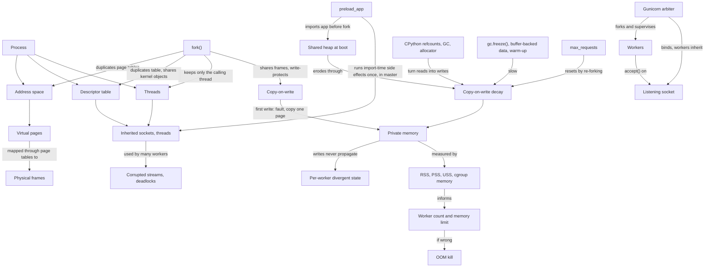

# Forkscape: A Browser-Based three.js Lab for `fork()`, Copy-on-Write, and Gunicorn Workers — Plan

## 1. Product Summary

Build a browser-based, three.js-powered learning experience that shows what happens inside a Linux machine when a process forks, and then uses that foundation to explain the most common production deployment of a Django application: a Gunicorn master process that forks a pool of worker processes.

The MVP is deliberately narrow. It starts with one process, one `fork()`, and one page of memory, then builds up to a Gunicorn master with `preload_app` enabled, eight workers serving real requests, CPython quietly un-sharing memory as it reads, and a container memory limit that eventually fires the OOM killer. Every step answers a question an on-call engineer actually faces.

The learner sees four connected things at once:

- a **3D scene** in which processes are glass decks floating above a floor of physical memory, joined by filaments that represent page-table mappings;
- a **memory ledger** that shows the same moment as the numbers Linux reports (`RSS`, `PSS`, `USS`, cgroup `memory.current`);
- a **timeline** of forks, requests, garbage collections, copy-on-write faults, and worker restarts; and
- a **replayed terminal and code pane** showing the real `ps`, `/proc/<pid>/smaps_rollup`, Gunicorn log lines, and `gunicorn.conf.py` that correspond to what is on screen.

The core promise is:

> Change one setting in a Django + Gunicorn deployment, watch where every page of memory goes and why, and leave able to predict, measure, and explain the same behavior on a production host.

The scene must be visually striking, but the spectacle serves a conceptual model: each visual element maps to a real kernel or runtime structure, is labeled as either **modeled** or **measured**, and has a "ladder" down to the command an engineer would run to see it on a real machine.

## 2. Why This Matters to an Engineer Supporting Production

Most Python web services in production run under a pre-fork server (Gunicorn, uWSGI) and often alongside a pre-fork task runner (Celery's default prefork pool). Many incidents that look mysterious — memory that creeps up for hours without a leak, dashboards that report three times more memory than the node is using, SSL errors that appear only after a "harmless" performance setting, cache clears that do not stick — are direct, predictable consequences of `fork()`.

An engineer who understands this topic can make decisions that would otherwise be guesswork:

- how many workers fit in a container memory limit, and how much headroom to leave for growth over time;
- whether `preload_app` is worth its tradeoffs for a particular service;
- which memory metric to alert on and which to ignore;
- what must never happen at import time in a preloaded application;
- why restarting workers (`max_requests`) reduces memory, and when that is a workaround rather than a fix; and
- how to triage a fork-related incident from logs and `/proc` evidence rather than by trial and error.

### 2.1 Production symptom map

This table is the backbone of the "On call" cards that close each module and of the incident drills.

| Production symptom | Fork mechanism behind it | Evidence to collect | Levers | Covered in |
| --- | --- | --- | --- | --- |
| Container memory climbs for hours, then the pod is OOMKilled; `tracemalloc` shows no leak | Copy-on-write decay: CPython reference counts, GC bookkeeping, and allocator reuse write to pages shared with the master | Per-worker `Private_Dirty` vs `Shared_*` over time in `smaps_rollup`; minor-fault rate; growth that saturates rather than grows without bound | `gc.freeze()` before forking, buffer-backed data for large read-only structures, warm caches in the master, `max_requests` with jitter, fewer workers, a larger limit | Modules 8–9, Drill D1 |
| Dashboard shows 8 workers × 400 MB but the node reports far less | `RSS` counts every shared page in every process that maps it | `Pss` from `smaps_rollup`; cgroup `memory.current`; `smem` | Size and alert on PSS sums or cgroup memory, not on ΣRSS | Module 9 |
| Intermittent `SSL error: decryption failed or bad record mac`, `server closed the connection unexpectedly`, or protocol desync after enabling `preload_app` | A database connection opened at import time in the master is inherited by every worker; several processes now read and write one TCP/TLS stream | The same socket inode under several PIDs in `/proc/<pid>/fd` or `ss -tnp`; an import-time or `AppConfig.ready()` query | No I/O at import time; close connections in the master before forking; initialize clients after fork | Modules 5 and 7, Drill D2 |
| Cache clears "do not work"; feature flags flap; in-memory rate limits are inconsistent | After fork, each worker's memory is private; writes never propagate (`LocMemCache`, module-level dictionaries) | Tag responses with the worker PID; repeat a request and group outcomes by PID | Move shared state to Redis, Memcached, or the database; treat process memory as per-worker | Module 4, Drill D3 |
| Prometheus counters go backward or jump between scrapes | Each worker has its own counter; a scrape lands on whichever worker accepts it | `/metrics` output grouped by worker PID | `prometheus_client` multiprocess mode with a `child_exit` hook, or per-worker scraping | Drill D3 |
| Workers hang at boot, or a tracing/metrics SDK silently stops exporting from workers | Only the forking thread survives `fork()`; background threads started in the master do not exist in workers, and locks they held stay locked | `py-spy dump` of a stuck worker; thread counts in `/proc/<pid>/task`; CPython's warning about forking a multi-threaded process | Start SDKs and threads in `post_fork`; never start threads before forking | Module 5 (concept), post-MVP drill |
| `kill -HUP` "reloads" but old code keeps running | With preload, new workers fork from a master that still holds the old imported code | A per-worker version endpoint; worker start times | Full restart or `USR2` binary upgrade; avoid preload where hot code reload matters | Module 7 (concept), post-MVP drill |
| A traffic spike causes `WORKER TIMEOUT`, 502s, and slow recovery | The arbiter aborts and respawns unresponsive workers; respawn cost depends on whether the app must be imported after fork | Gunicorn logs; worker boot duration with and without preload | Preload to make respawns cheap; `worker_tmp_dir=/dev/shm` in containers; right-size `timeout` | Module 6, post-MVP drill |
| Different "random" outputs turn out identical across workers | Random-number generator state is copied by fork (CPython's `random` reseeds after fork; NumPy's legacy global generator does not) | Compare values grouped by worker PID | Reseed or create generators in `post_fork` | Post-MVP drill |

### 2.2 What a learner should be able to do on call afterwards

- Look at `ps --forest` output and immediately know which process is the arbiter, which are workers, and which process the kernel will probably kill on OOM.
- Read one `smaps_rollup` per process and compute an honest memory total for the fleet.
- Explain to a teammate, in two sentences, why turning on `preload_app` can both save memory and break database connections.
- Distinguish copy-on-write decay from a leak by the shape of the memory curve.
- Name the four post-fork questions (Section 5.2) and use them to structure an investigation.

## 3. Reframing "Workers Get a Read-Only Copy of the Master"

The phrase is a useful first approximation, and the course should start from it rather than dismiss it. It then needs to be refined, because the inaccurate parts are exactly where production incidents come from.

**What is true:**

- Immediately after `fork()`, the worker's view of memory is identical to the master's, and both processes' page-table entries point to the same physical pages.
- For private writable memory, the kernel marks those mappings read-only in the hardware page tables of **both** processes. In that narrow sense the shared copy is read-only.

**What needs refining:**

1. **The program sees ordinary writable memory.** A worker can write anywhere it could write before. The read-only marking is a kernel trick, not a permission the program experiences.
2. **The first write to a shared page triggers a page fault.** The kernel allocates a new physical page, copies the old contents, and maps the copy writable in the process that wrote. The other processes keep the original. If the faulting process is by then the only one mapping the page, the kernel can skip the copy and simply make the page writable again.
3. **The master is not exempt.** Writes by the master after forking also break sharing for the master.
4. **Copies are whole pages.** Changing 8 bytes copies 4 KiB on typical x86-64 systems (the capture manifest records the page size, which differs on some arm64 systems).
5. **Writes never propagate.** A worker's private copy is invisible to the master and to every sibling. This is why per-process caches and counters diverge.
6. **In CPython, reading is often writing.** Every Python object carries a reference count in its header; simply referencing an object increments it. The cyclic garbage collector writes bookkeeping into tracked container objects when it runs. So "read-only data" in Python steadily becomes private memory at the page level.
7. **Not everything is memory.** File descriptors are copied, but the kernel objects they point to — listening sockets, open files, database connections — are **shared**, not copied. A listening socket shared by all workers is the foundation of the pre-fork model; a database connection shared by all workers is a bug.
8. **Preload does not share everything.** Shared libraries and the interpreter binary are file-backed and shared through the page cache regardless of preloading. What `preload_app` adds is the **anonymous heap**: imported modules, code objects, settings, models, and any data created at import time. Anything Django imports lazily (for example, the URLconf and views on the first request) is created after the fork and is private to each worker unless deliberately warmed in the master.

The refined statement the course builds toward:

> Each worker gets its own logically private, writable copy of the master's memory. Physically, the pages are shared and write-protected until someone writes to them, at which point the writer receives its own copy of that page. Kernel objects reached through file descriptors are not copied at all; they are shared.

An illustrative capacity formula, introduced in Module 9 and filled in with measured values:

```text
container memory ≈ master private
                 + memory still shared after boot
                 + Σ over workers (private at boot + private growth over time)
                 + page tables + page cache charged to the container
```

A naive estimate of `workers × RSS` double-counts the shared term once per worker. Conversely, if every worker eventually copies every page, preload can cost **more** than no preload, because the master still holds its original template copy. That edge case is an important counterexample to "preload always saves memory".

## 4. Audience, Prerequisites, and Learning Outcomes

### 4.1 Audience

- Backend developers who deploy Django (or Flask/FastAPI under Gunicorn) and want to understand the runtime they ship into.
- SREs, platform engineers, and on-call engineers supporting Python services in containers or Kubernetes.
- Intermediate computer science students who know what a process is but have not connected operating-system concepts to web-server operations.

### 4.2 Prerequisites

- Reading basic Python; knowing what `wsgi.py`, `settings.py`, and a Django view are.
- Running simple shell commands (`ps`, `cat`, `curl`).
- A general idea that a web server handles concurrent requests.
- No C, kernel, or CPython-internals knowledge is required. The course introduces only the internals it uses.

### 4.3 Learning outcomes

After completing the MVP, a learner should be able to:

1. Describe a process as an address space, a file-descriptor table, one or more threads, and a kernel-managed identity, and draw the Gunicorn process tree.
2. Explain `fork()`'s two return values and classify what a child inherits, what it shares, and what it loses.
3. Explain virtual-to-physical mapping at page granularity and why the same virtual address in two processes need not refer to the same memory.
4. Explain copy-on-write precisely: write protection, the fault, page-sized copying, and reuse when a page becomes exclusive.
5. Distinguish lazily copied memory from shared kernel objects reached through inherited descriptors, and predict the consequences of each.
6. Describe the Gunicorn arbiter lifecycle: bind, optional preload, fork, accept, heartbeat, timeout, reap, respawn, and `max_requests` recycling.
7. Predict what `preload_app` moves into shared memory, what remains private, and which import-time side effects become dangerous.
8. Explain why CPython reads cause page writes, and evaluate mitigations (`gc.freeze()`, data representation, warm-up, worker recycling) and their costs.
9. Read `smaps_rollup` and cgroup memory figures, compute an honest total for a Gunicorn fleet, and explain why ΣRSS overcounts.
10. Choose a worker count and memory limit from measured shared memory and per-worker growth.
11. Diagnose three production incidents from evidence: copy-on-write-decay OOM, an inherited database connection, and per-worker divergent state.
12. Apply the four post-fork questions to an unfamiliar pre-fork system such as Celery's prefork pool or Redis background snapshots.

## 5. Conceptual Framework

The course is designed around a small, explicit mental model that the learner assembles piece by piece, sees rendered in 3D, and finally reconstructs themselves in a concept map.

### 5.1 The anchor idea

Every module returns to one sentence:

> After `fork()`, the child gets its own copy of the parent's memory and its own table of references to the parent's kernel objects. Memory is copied lazily, page by page, when someone writes. Kernel objects are not copied at all.

### 5.2 The four post-fork questions

The anchor idea unfolds into four diagnostic questions. They are the framework a learner should carry into any incident involving a pre-fork system, and each corresponds to a visual layer in the scene.

| Question | Lens | Scene layer | Typical production consequence |
| --- | --- | --- | --- |
| **Pages:** who writes to which pages, and when? | Memory | Decks, filaments, physical-memory floor | Memory sizing, copy-on-write decay, OOM |
| **Handles:** which kernel objects are shared through inherited descriptors, and who uses them? | Resources | Descriptor ports, cables, kernel buoys | Shared listening socket (good), shared DB connection (bad), shared file offsets |
| **Threads and locks:** what was running or locked at the instant of the fork? | Execution | Thread spindles on each deck | Missing background threads, deadlocks after fork |
| **Lifecycle:** who creates, watches, and replaces this process? | Supervision | Arbiter deck, heartbeat pulses, signal envelopes | Timeouts, respawns, reloads, graceful shutdown |

A fifth, cross-cutting lens — **evidence: how would I see this on a real host?** — is attached to every scene element through the measurement ladder (Section 5.6).

### 5.3 Threshold concepts

These are the ideas that, once grasped, transform how the learner sees the rest. Each gets a dedicated "aha" moment in the curriculum and extra assessment attention.

1. **An address is a name, not a location.** Two processes can hold the same virtual address and mean different physical memory (Module 3).
2. **A copy can be logical before it is physical.** Copy-on-write separates "you have your own copy" from "the bytes were duplicated" (Module 4).
3. **Descriptors are references, not resources.** Copying a descriptor table shares the underlying socket or file (Module 5).
4. **In CPython, reading writes.** Reference counting and garbage collection turn reads into page writes (Module 8).
5. **Memory metrics are accounting choices.** RSS, PSS, USS, and cgroup memory answer different questions about shared resources (Module 9).

### 5.4 Concept map

This is the expert map the learner's own concept map is compared against. It is rendered in the app as an interactive, progressively revealed graph; each node unlocks in the module that introduces it.



### 5.5 Misconception inventory

Each misconception is deliberately triggered by a prediction prompt and then confronted by something the learner sees. The prediction comes first so the confrontation registers as surprise, not as a lecture.

| Misconception | Why it is plausible | Confronting moment | Replacement statement |
| --- | --- | --- | --- |
| `fork()` copies all memory immediately | "Copy of the process" sounds literal | Module 4: the physical-memory counter barely moves after fork; only thin page-table sheets appear | Fork copies page tables; data pages are shared and copied one page at a time on first write |
| Workers share memory with the master, so changes are visible everywhere | "Shared memory" sounds like shared state | Module 4 and Drill D3: `/counter` returns different values per PID; a filament snaps away on write | Workers share physical pages, not state |
| The workers' copy is read-only | The common phrase says so | Module 4: a worker writes successfully; the fault is visible only in the kernel layer | Write-protected in hardware until first write; ordinary writable memory to the program |
| Only workers pay for copy-on-write | The master "owns" the memory | Module 4: a master write copies a page for the master | Any writer to a shared page gets the copy |
| Code that only reads data keeps memory shared | In most languages reading does not mutate | Module 8: `/scan` un-shares most of the catalog | CPython writes reference counts and GC headers during reads |
| A tiny write costs a tiny amount of memory | Intuition is byte-proportional | Module 4: an 8-byte change copies 4 KiB | Copying is page-granular |
| Total memory is workers × RSS | RSS is the most visible number | Module 9: ledger shows ΣRSS far above cgroup memory | ΣPSS (or cgroup memory) approximates real use |
| `preload_app` shares everything Django needs | "Preload the app" sounds complete | Module 7: URLconf and views appear in private memory after the first request; shared libraries were shared even without preload | Preload shares the anonymous heap created at import time; lazy imports land after the fork |
| `preload_app` always saves memory | Usually true at boot | Module 8 time-lapse: under total decay, the master's template is an extra copy | Savings depend on how much stays shared over time |
| Each worker gets its own copy of open connections | Memory gets copied, so why not connections? | Module 5 and Drill D2: one buoy, many cables | Descriptors are copied; the sockets they reference are shared |
| Background threads keep running in workers | The worker "is a copy" of the master | Module 5: only one thread spindle survives the fork | Only the forking thread exists in the child |
| Memory that keeps growing is a leak | Common rule of thumb | Module 8: decay saturates at the shared size; `/alloc` grows without bound | Decay is bounded by shared memory; leaks are not |
| Workers are threads | Both "handle requests concurrently" | Module 1 and Module 6: separate PIDs, separate decks | Gunicorn sync workers are separate processes |
| Restarting a worker is expensive and wasteful | Restarts sound disruptive | Module 6: a respawned worker re-shares the master's pages and boots quickly with preload | Recycling re-forks from a clean template |

### 5.6 Representation ladder: metaphor → mechanism → measurement

The course uses concreteness fading. Every visual element starts as an intuitive object, is then annotated with the structure it represents, and is finally linked to the real evidence an engineer can collect. The inspector panel always shows all three rungs for whatever is selected.

| Metaphor (scene) | Mechanism (labeled) | Measurement (real host) |
| --- | --- | --- |
| Glass deck | Process and its address space | `ps -o pid,ppid,rss,cmd --forest` |
| Zoned strips on a deck | Virtual memory areas (code, libraries, heap, stack) | `/proc/<pid>/maps` |
| Tile on a deck | Virtual page | A `/proc/<pid>/pagemap` entry |
| Tile on the floor | Physical frame | Page frame number (privileged) |
| Filament from deck to floor | Page-table entry | `pagemap` present bit and frame number |
| Floor tile with stacked rings | Page mapped by several processes | `pagemap` "exclusively mapped" bit clear; `/proc/kpagecount` (privileged) |
| Filament snapping, membrane ripple | Copy-on-write page fault | Minor-fault count in `/proc/<pid>/stat`; soft-dirty bits |
| Worker-tinted floor tile | Private, dirty page | `Private_Dirty` in `smaps_rollup` |
| Sheet under a deck | Page tables | `VmPTE` in `/proc/<pid>/status` |
| Cable from deck port to a buoy | Descriptor referencing a shared kernel object | `/proc/<pid>/fd`, `ss -tnp`, `lsof` |
| Fence around the floor | Container memory limit | cgroup `memory.max`, `memory.current` |

The scene never shows a metaphor without making the next rung one click away.

### 5.7 Instructional loop

Each lesson step follows the same five-beat loop so the learner's attention goes to the content rather than to the interface:

1. **Predict.** Commit to an answer (slider, choice, sketch a curve, or drag tiles) before anything moves. Predictions are recorded and later overlaid on the result.
2. **Act.** Trigger one change: fork, write, send requests, toggle a setting, kill a worker.
3. **Observe.** The scene, ledger, timeline, and terminal update together. The camera frames only what changed; at most three new visual elements are introduced per step.
4. **Explain.** Answer a short self-explanation prompt ("Why did the copy exceed the change?"), then compare against a model explanation and a rubric checklist.
5. **Connect.** An "On call" card names where this appears in production, the evidence to collect, and the lever to pull.

Steps change one variable at a time (variation theory): for example, Module 7 runs the same boot with only `preload_app` toggled, and Module 8 runs the same catalog with only the data representation changed.

### 5.8 Scaffolding, fading, and the learner-built concept map

- **Early modules** use guided camera shots, narration, and a single highlighted action.
- **Middle modules** add sandbox toggles with suggested experiments; the learner chooses the order.
- **Drills** remove guidance: the learner gets symptoms, tools, and evidence, and must form and test a hypothesis.
- **Concept map builder.** After each module the learner drags newly unlocked concept nodes into a personal map and connects them with labeled relations from a fixed vocabulary (`causes`, `prevents`, `measured by`, `is a kind of`, `shares`, `copies`). Feedback is based on a short list of critical edges (for example, "CPython reference counts → copy-on-write decay") rather than an exact match with the expert map. The completed map is exportable as an image and JSON.
- **Retrieval.** Each module opens with two quick questions from earlier modules, chosen from the learner's weakest predictions.

### 5.9 Language guide for content authors

The visuals can be accurate while the narration teaches a misconception. Authors follow these rules:

- Say "shares physical pages" rather than "shares memory" when talking about workers.
- Never say "fork copies memory" without "lazily" or "page by page on first write".
- Say "write-protected until first write" rather than "read-only".
- Say "the descriptor refers to the same socket" rather than "the connection is copied".
- Say "modeled" or "measured" whenever a number appears.
- Avoid "always" for every mitigation; each lever has a stated cost.

## 6. MVP Scope

### 6.1 Included

- A static, browser-only web app built on three.js, with no learner installation and no backend.
- A deterministic **model engine** that simulates processes, page tables, physical frames, copy-on-write, descriptors, threads, a simplified CPython heap, and the Gunicorn arbiter.
- **Recorded runs** of a real Django + Gunicorn + PostgreSQL deployment, captured on a reference Linux host with a purpose-built capture harness, and replayed in the same renderer.
- Modules 0–10 as described in Section 7, including three incident drills.
- Linked panels: memory ledger, timeline, replayed terminal, and code pane showing `gunicorn.conf.py` and `wsgi.py`.
- A sandbox mode with the main Gunicorn settings exposed, running on the model engine calibrated to the recorded runs.
- Prediction capture, self-explanation with rubrics, a concept map builder, and a pre/post concept inventory.
- A first-class 2D "flat mode" that renders the same world state without WebGL, for accessibility and low-power devices.
- Progress stored locally in the browser, with export and import.

### 6.2 Deferred extension tracks

- **Live lab mode:** connect the browser to a learner-run Docker Compose stack and visualize a live Gunicorn deployment.
- **Threads and locks drill:** a background thread started at import time deadlocks or silently disappears in workers.
- **Deploy and reload drill:** `HUP` versus `USR2` versus a full restart, with and without preload.
- **Timeouts and respawn drill:** heartbeat files, `worker_tmp_dir`, and boot cost under load.
- **Random-number generator drill.**
- **Other worker classes:** `gthread`, `gevent`, and ASGI workers under Gunicorn.
- **Celery prefork pool:** the same four questions applied to `worker_max_tasks_per_child` and broker/database connections.
- **Transfer gallery:** Redis `BGSAVE`, the PostgreSQL postmaster, PHP-FPM, Ruby's Puma/Unicorn, and Python `multiprocessing` start methods (`fork`, `spawn`, `forkserver`).
- **Kernel extensions:** transparent huge pages and copy-on-write, kernel same-page merging, overcommit policy, and fork latency for very large processes.
- **Free-threaded CPython**, whose reference-counting scheme changes the copy-on-write story.
- Optional AI-assisted feedback on free-text explanations.

### 6.3 Non-goals

- Teaching general Linux administration or a complete operating-systems course.
- Showing kernel source code or requiring C.
- Benchmarking Gunicorn or recommending one universal worker count.
- Pretending a laptop-scale capture predicts production numbers; captures teach mechanisms and the shape of curves.
- Animations that are not backed by either the stated model or a recorded measurement.
- Running untrusted learner code on shared infrastructure.

## 7. Curriculum

The MVP is roughly two to three hours of material in 10–20 minute modules. Each module lists its objective, the key scene, the central prediction, the interactions, and its "On call" card.

### Module 0: Paged at 3 a.m. (hook and pre-assessment)

- **Objective:** establish relevance and record the learner's starting mental model.
- **Scene:** a recorded run seen from far away. A container's memory line climbs over a compressed four-hour window until a fence on the floor glows and a worker deck vanishes. The replayed Gunicorn log shows a worker being killed with a suggestion that it may have run out of memory.
- **Prediction:** "What do you think is happening?" (free text plus a choice of leak, traffic spike, configuration change, or unknown).
- **Interaction:** none beyond the prediction; the learner takes the concept inventory pre-test.
- **On call:** "By the end you will be able to explain this graph, prove it from `/proc`, and choose a fix."

### Module 1: A process is more than code

- **Objective:** a process has an address space, a descriptor table, threads, and an identity.
- **Scene:** one deck with zoned regions, a few descriptor ports with cables to kernel buoys, and a single thread spindle. The replayed terminal shows `ps` for the same process.
- **Prediction:** "Which of these belong to the process and which belong to the kernel?" (drag labels).
- **Interaction:** hover regions to see their names and sizes; open the descriptor list.
- **On call:** where to see each of these on a host (`/proc/<pid>/maps`, `/proc/<pid>/fd`, `/proc/<pid>/task`).

### Module 2: `fork()` — one call, two returns

- **Objective:** understand return values, parent/child identity, and reaping.
- **Scene:** a code pane with `pid = os.fork()`; the deck duplicates and both decks continue from the same line. The child shows `pid == 0`; the parent shows the child's PID.
- **Prediction:** "How many times does the `print()` after `fork()` run?"
- **Interaction:** step through the code; let the child exit without being waited for and see it linger as a zombie until the parent reaps it.
- **On call:** the Gunicorn master reaps its workers; a supervisor that never reaps leaves zombies.

### Module 3: Addresses are names — virtual memory and pages

- **Objective:** virtual addresses map to physical frames through page tables, one page at a time.
- **Scene:** filaments drop from each deck tile through the translucent kernel membrane to the floor. Zooming in reveals the page as a 4 KiB unit.
- **Prediction:** "After `fork()`, parent and child print the same `id()` for an object, then the child modifies it. Are they still using the same memory?"
- **Interaction:** follow a single virtual page to its frame in both processes before and after a write.
- **On call:** the same address in two processes says nothing about sharing; only page-level evidence does.

### Module 4: Copy-on-write

- **Objective:** the central mechanism, precisely.
- **Scene:** at fork, the master's tile grid is printed onto a new deck; every new filament lands on an existing frame. The physical-memory counter barely moves; a thin page-table sheet appears under the new deck. Shared frames grow sharer rings and take on a frosted, write-protected glaze. The child writes one integer: the membrane ripples under the child's deck, a frame clones and slides into the child's district, and the child's filament reattaches to the copy.
- **Predictions:** "How much extra RAM does forking a 200 MiB process use?" (slider) and "The child changes 8 bytes. How many bytes are copied?" (slider with a logarithmic scale).
- **Interactions:** write from the child, then from the parent; fork a second child; let one process exit and watch a formerly shared page become exclusive and get reused without a copy; increment a module-level counter in each process and compare values.
- **On call:** small writes scattered across a large heap become large private memory; in-process state never propagates between workers.

### Module 5: What else crosses the fork

- **Objective:** separate lazily copied memory from shared kernel objects and lost threads.
- **Scene:** descriptor ports are copied on the new deck, but their cables run to the **same** buoys. The master's three thread spindles become one spindle on the child.
- **Prediction:** "The parent opened a file and read 10 bytes with `os.read()`. The child reads 10 more. Where does the parent's next read start?" (The demo uses raw descriptors because Python's buffered file objects read ahead into private memory and would hide the shared offset.)
- **Interactions:** demonstrate a shared file offset; show a listening socket accepting connections in either process; show an inherited database socket used by two processes and the resulting corrupted exchange; show a lock held by a background thread at the moment of the fork remaining locked in the child.
- **Summary table built by the learner:** copied lazily (memory), shared (kernel objects behind descriptors), not inherited (other threads, pending signals, timers), and adjusted by the runtime (CPython's after-fork hooks reseed `random` and reinitialize some standard-library locks).
- **On call:** "Handles" and "threads and locks" are two of the four post-fork questions.

### Module 6: Gunicorn's arbiter and its workers

- **Objective:** the pre-fork lifecycle.
- **Scene:** the arbiter deck at the center, workers in a ring, and the listening-socket well below. Requests arrive as particles, queue in the well, and are pulled in by whichever worker calls `accept()`. Workers emit heartbeat pulses; each has a timeout ring that fills when heartbeats stop.
- **Prediction:** "A worker is killed with `SIGKILL`. What happens to total memory a minute later?"
- **Interactions:** boot the server and watch bind → fork × N → accept; send `TTIN` and `TTOU` to add and remove workers; kill a worker and watch the arbiter reap and replace it; call a slow endpoint until a worker misses its heartbeat and is aborted; set a low `max_requests` with jitter and watch staggered recycling.
- **On call:** recognize the Gunicorn log lines for booting, timeouts, and signal-killed workers; know that the arbiter respawns from its own template.

### Module 7: `preload_app` — what is actually shared

- **Objective:** know exactly what preload moves into shared memory, what it does not, and what it changes about import-time code.
- **Scene:** two boots side by side with only `preload_app` changed. Without preload, each worker's heap fills with its own copy of Django after the fork; file-backed library frames in the page-cache area of the floor are shared in both boots. With preload, workers fork with the heap already shared. After the first request, URLconf and view modules appear as new private pages in each worker.
- **Predictions:** "Which parts of the application are in shared memory after a preloaded boot?" (sort cards: settings, models, middleware, URLconf, views, templates, shared libraries) and "How does boot time change?"
- **Interactions:** toggle preload; add a warm-up step in the master that imports the URLconf; toggle an import-time database query and watch a single buoy acquire cables from every worker (foreshadowing Drill D2).
- **On call:** preload trades code-reload convenience and import-time safety for memory and faster respawns; import-time code now runs once, in a process that will fork.

### Module 8: Reading is writing — CPython and copy-on-write decay

- **Objective:** explain and quantify how CPython erodes sharing, and weigh mitigations.
- **Scene:** zoom into a single page and see the objects packed inside, each with a header containing a reference count. A "read" of an object increments its count; the page faults and is copied. A garbage-collection pass sweeps across tracked containers, writing to their headers. Zoom back out and play a compressed multi-hour time-lapse of per-worker private memory.
- **Predictions:** "A request only reads the catalog. How much shared memory does it un-share?" and "Sketch per-worker private memory over four hours" (the learner draws a curve that is later overlaid on the recorded one).
- **Interactions:** compare `/lookup` (one record), `/scan` (all records as Python objects), and `/scan-columnar` (the same values in a buffer-backed array); run `gc.collect()` with and without `gc.freeze()` before forking; compare decay with recycling enabled; compare bounded decay against an unbounded `/alloc` leak.
- **On call:** a mitigation menu with costs — `gc.freeze()` (objects created before the freeze are never collected), buffer-backed data (changes how code accesses data), warm-up in the master (longer boot), `max_requests` (periodic re-fork cost and lost in-process caches), fewer workers (less concurrency).

### Module 9: Measuring memory honestly

- **Objective:** read real memory numbers and size a deployment.
- **Scene:** the ledger becomes the main view. Each process shows `Private`, `Shared_Clean`, and `Shared_Dirty` bars; toggles switch between RSS, PSS, and USS. ΣRSS, ΣPSS, and cgroup `memory.current` are shown side by side, and the gap is animated back to the shared frames on the floor that are being counted repeatedly.
- **Prediction:** "Eight workers each report 400 MiB RSS. How much memory is the container using?"
- **Interactions:** inspect replayed `smaps_rollup` and `smem` output; read cgroup files; use a sizing calculator fed by measured shared memory and per-worker growth from Module 8 to choose a worker count for a 1 GiB limit with headroom; see which process is chosen by the OOM killer and how a container-wide OOM group changes the blast radius.
- **Transfer task:** compute ΣPSS and headroom from unseen `smaps_rollup` snapshots.
- **On call:** alert on cgroup memory and size with PSS; treat ΣRSS as an upper bound that double-counts.

### Module 10: Incident drills (capstone)

Each drill provides symptoms (graphs, logs, a ticket), a replayed terminal with a fixed set of allowed commands, the 3D scene, and the code pane. The learner records a hypothesis, collects evidence, chooses a lever, predicts its effect, and then replays the recorded "after" run to verify it. Scoring rewards the evidence chosen and the predicted effect, not only the final answer.

- **D1 — Creeping memory, then OOMKilled.** Preloaded app with a large Python-object catalog and periodic full garbage collection. Evidence: private dirty growth that saturates, minor-fault bursts aligned with collection, no `tracemalloc` growth. Levers: freeze before fork, columnar catalog, recycling, worker count. The drill closes the loop with the learner's Module 0 hypothesis.
- **D2 — Intermittent SSL and protocol errors after enabling preload.** An `AppConfig.ready()` method runs a query at import time. Evidence: the same socket inode under every worker PID, errors that correlate with concurrency. Levers: remove import-time I/O, close connections in the master before forking.
- **D3 — Cache clears that do not stick and counters that go backward.** `LocMemCache` and an in-process Prometheus counter. Evidence: responses grouped by worker PID. Levers: a shared cache backend; Prometheus multiprocess mode.

The course ends with a short written postmortem for D1 and completion of the personal concept map.

## 8. Learner Experience

### 8.1 Layout

```text
┌──────────────────────────────────────────────────────────────────────────────┐
│ Module 4 · Copy-on-write     [MODEL]  [RECORDED]     ⏮  ⏯  ⏭   1×   ⚙  ◐     │
├────────────────┬─────────────────────────────────────────────┬───────────────┤
│ Lesson rail    │                                             │ Inspector     │
│  narration     │            three.js scene                   │  metaphor     │
│  prediction    │   decks · kernel membrane · memory floor    │  mechanism    │
│  explanation   │                                             │  measurement  │
│  On call card  │                                             │               │
├────────────────┴─────────────────────────────────────────────┴───────────────┤
│ Timeline   fork ▲   requests ·····   gc ◆   COW faults ▁▂▅▇▅▂   restart ↻     │
├───────────────────────────────┬──────────────────────────────────────────────┤
│ Memory ledger  RSS | PSS | USS │ Terminal (replayed) │ gunicorn.conf.py │ wsgi │
└───────────────────────────────┴──────────────────────────────────────────────┘
```

On narrow screens the scene takes the full width, and the lesson rail, inspector, and bottom panels become a bottom sheet and tabs. The scene is never covered by more than one panel at a time.

### 8.2 Modes

| Mode | Data source | Purpose |
| --- | --- | --- |
| Guided | Model engine and recorded runs, scripted | The modules in Section 7 |
| Sandbox | Model engine calibrated to recorded runs | Free experimentation with Gunicorn settings and workloads |
| Replay | Recorded run bundles | Scrub any recorded run with all panels linked |
| Drill | Recorded runs with hidden labels | Evidence-led incident practice |

### 8.3 Sandbox controls

The sandbox exposes the settings that matter for this topic, rendered as an editable `gunicorn.conf.py` and a small `wsgi.py`, so the learner is editing the same artifacts they would edit in production:

```python
# gunicorn.conf.py (sandbox)
import gc

gc.disable()                  # master: avoid collections that free slots in soon-to-be-shared pages

workers = 4
preload_app = True
max_requests = 2000
max_requests_jitter = 200
timeout = 30

def pre_fork(server, worker):
    from django.db import connections
    connections.close_all()   # never hand an open database socket to a child
    gc.freeze()               # move existing objects out of the collector's reach

def post_fork(server, worker):
    gc.enable()               # workers: collect normally; frozen objects are skipped
```

This mirrors the disable/freeze/enable recipe in the CPython `gc` documentation. The lab measures each line's contribution in recorded runs rather than asserting it.

Workload controls set the request mix (`/lookup`, `/scan`, `/scan-columnar`, `/counter`, `/cache/*`, `/db`, `/slow`), the rate, the simulated duration, and fault toggles (import-time query, background thread at import time). Each line of configuration is linked to the scene: hovering `gc.freeze()` highlights the frozen objects; hovering `preload_app` highlights the shared heap.

### 8.4 Linked views

All panels subscribe to a single selection and time cursor. Selecting a worker deck filters the ledger, highlights that worker's events on the timeline, and switches the replayed terminal to commands for that PID. Scrubbing the timeline moves every view.

### 8.5 Prediction and assessment UX

- Predictions are made with sliders, card sorts, multiple choice, or a hand-drawn curve on a small chart. The submit button is the only way forward; there is no "skip to answer" in guided mode, but there is a "I don't know yet" option that counts as a prediction.
- Results overlay the prediction on the outcome rather than replacing it.
- Self-explanations are compared with a model answer and a three-to-five item rubric checklist that the learner ticks honestly.
- Learners optionally rate confidence; the summary highlights confident-but-wrong predictions as the most valuable review targets.
- The concept inventory (Section 14.5) runs before Module 1 and after Module 10.

## 9. Visual Design North Star: Glass Decks over a Memory Floor

### 9.1 Scene composition

```text
                 ┌──────────── arbiter (master) deck ────────────┐
                 │ code │ libs │ heap: catalog ░░░░░░░ │ stack   │
                 └──────────────────────┬────────────────────────┘
      worker 1 deck  ╲                  │                  ╱  worker 2 deck
      ▓▓░░░░░░░░░░    ╲                 │                 ╱   ░░░▓░░░░░░░
 ~~~~~~~~~~~~~~~~~~~~~~~~ kernel membrane: page tables, descriptors ~~~~~~~~~~~~~~~~~~~~
         ╲  ╲  │  ╱  ╱        ◎ listening-socket well        ⊙ database socket buoy
 ═════════════════════ memory floor: physical frames ═════════════════╡ memory.max fence
  [ shared ░░░░░░░░░░░░░ ]  [ w1 private ▓▓ ]  [ w2 private ▓ ]   [ page cache: .so ▒▒▒ ]
```

- **User space** is the upper level. Each process is a translucent deck with zoned regions. The arbiter is elevated and centered with a distinct hexagonal outline; workers sit in a ring around it.
- **The kernel** is a translucent membrane between the decks and the floor. Page-table sheets accumulate on it under each deck; buoys representing sockets and open files float in it; descriptor cables run from deck ports to buoys.
- **Hardware** is the floor: a grid of physical frames. A page-cache area holds file-backed frames (interpreter and shared libraries). The container's memory limit is a fence around the floor; the fill level is always visible.
- **Filaments** connect deck tiles to floor frames through the membrane. Shared frames receive filaments from several decks and grow stacked rings, one per sharer.
- Physical layout on the floor is schematic. Shared frames cluster beneath the arbiter and private copies settle into districts beneath each worker so that ownership is legible. A legend states that real frame numbers have no spatial meaning.

### 9.2 Key moments and choreography

| Moment | Choreography (default) | Reduced-motion version |
| --- | --- | --- |
| `fork()` | The arbiter's tile grid is printed onto a new deck that slides out to its ring position; filaments light up from the new deck onto existing frames; a thin page-table sheet appears; the physical counter ticks only slightly | New deck appears in place with filaments; counter delta highlighted |
| Copy-on-write fault | A write pulse travels down a filament, hits the frosted endpoint, the membrane ripples, the frame clones and slides into the writer's district, and the filament reattaches | Old and new frame both outlined; text note "page copied" |
| Exclusive reuse | The last remaining filament on a frosted frame clears its frost without cloning | Frost removed; note "no copy needed" |
| Garbage-collection pass | A scanline sweeps across a deck's heap; touched pages flash and, where shared, fault; frozen objects are greyed and skipped | Touched pages outlined; counts shown |
| Request | A particle enters the socket well, waits in the accept queue, and is pulled up a cable by one worker | Queue count and worker highlight |
| Heartbeat and timeout | Small pulses travel from each worker to the arbiter; a timeout ring fills when they stop; an abort envelope flies from the arbiter | Ring fill shown as a percentage |
| Worker recycle or respawn | The deck dissolves, its private floor tiles are released, and a fresh deck is printed from the arbiter | Deck replaced; released memory highlighted |
| OOM kill | The fence glows, a strike removes the chosen deck or the whole container, and the floor drains | Fence and victim outlined; log line shown |

Default durations are short (roughly half a second to one and a half seconds), every animation can be paused mid-way, and the step-by-step control advances a single kernel event at a time.

### 9.3 Zoom levels and level of detail

| Level | Content | Typical instance count |
| --- | --- | --- |
| Z0 Fleet | All decks as region bars, filament bundles sized by shared and private page counts, socket well, fence, ledger summary | Hundreds |
| Z1 Process | One deck's regions with shared/private fractions; bundles into the floor | Low thousands |
| Z2 Pages | Per-page tiles for a selected region of a selected deck plus the arbiter; individual filaments for that selection only | Up to roughly 250,000 tiles |
| Z3 Page interior | Objects packed inside one page with headers, reference counts, and GC bookkeeping; always labeled **MODEL** | Tens |

At Z0–Z1 a tile may represent many pages; the legend always states the current scale ("1 tile = 64 pages").

### 9.4 Encoding rules

- **Color:** shared frames are neutral slate; the arbiter is amber; each worker has a hue from a color-vision-deficiency-safe categorical palette of at most eight hues. Fault and danger states use motion and shape as well as color.
- **Redundant encoding:** sharer count is shown by stacked rings; private pages use a solid fill and shared pages a hatched pattern generated in the shader; write protection is a frosted glaze plus a lock glyph at Z2 and closer.
- **Restraint:** bloom is reserved for fault sparks and the OOM strike; ambient motion is limited to slow heartbeat pulses. The scene must stay readable as a still frame.
- **Themes:** a dark default, a light theme, and a high-contrast theme, all generated from the same design tokens used by the 2D panels.
- **Labels:** essential labels are HTML overlays (accessible, crisp, translatable); decorative or secondary labels may be rendered as 3D text.

### 9.5 Honesty markers

- Every view carries a **MODEL**, **RECORDED**, or **INFERRED** badge, and the inspector says which fields come from which source.
- Recorded views show the capture's host, kernel, Python, Django, and Gunicorn versions, and the sample time of the data on screen.
- When a recorded run lacks per-frame data (an unprivileged capture), filaments are drawn from the shared/exclusive state of each page and labeled **INFERRED**.
- Time-lapse playback shows the compression factor.
- The scene freezes and shows a "data gap" marker rather than interpolating across missing samples.

## 10. Fidelity Contract: Model, Recorded, and Live

| Source | What it can show | What it must not claim | Used for |
| --- | --- | --- | --- |
| **Model engine** | Exact page-table, frame, and copy-on-write semantics for a small simplified system; a simplified CPython heap; the arbiter state machine | Real sizes, real timings, exact CPython object layout | Modules 1–5, Z3 page interior, sandbox |
| **Recorded run** | Real per-process memory figures, per-page shared/exclusive state at keyframes, minor-fault counts, Gunicorn events, request outcomes, replayed command output | Behavior on other kernels, Python versions, or hardware; causality not supported by the evidence | Modules 0 and 6–10, drills, calibration |
| **Live lab** (post-MVP) | The learner's own deployment in real time | More precision than its sampling rate | Extension track |

The model engine is calibrated against recorded runs: its parameters (shared pages after boot, pages dirtied per request type, the fraction of heap pages touched by a full collection) are fitted to captures, and CI checks that the model stays within tolerance of the recorded results (Section 14.2).

## 11. Technical Architecture

### 11.1 Overview

```text
┌──────────────────────────── Browser (static site) ────────────────────────────┐
│                                                                               │
│  Lesson runner ──► Scene director ──► three.js renderer (3D)                  │
│       │                  ▲          └► flat renderer (2D canvas/SVG)          │
│       ▼                  │ typed world state + events                         │
│  Prediction,      ┌──────┴───────────┐                                        │
│  assessment,      │ World source API │◄── Model engine (TypeScript, seeded)   │
│  concept map      │                  │◄── Replay engine (capture bundles)     │
│                   └──────────────────┘◄── Live adapter (post-MVP, WebSocket)  │
│  Panels: ledger · timeline · replayed terminal · code · inspector             │
└───────────────────────────────────────────────────────────────────────────────┘

Offline, on a reference Linux host:
  capture harness ── Django + Gunicorn + PostgreSQL + load driver + /proc sampler
                  └─► versioned capture bundles ──► published with the static site
```

The renderers never know whether data came from the model or a recording. Both engines produce the same normalized world state and event stream, each item tagged with its source.

### 11.2 World state and events

- **World state:** processes (PID, parent PID, role, start time, thread count), regions (name, kind, page range, anonymous or file-backed), per-page state arrays, frames (model engine and privileged captures only), descriptors and the kernel objects they reference, memory figures per process, and container-level figures.
- **Per-page state** is a compact typed array per process and region: not present, present and exclusive, present and shared, file-backed shared; plus an optional sharer count when known.
- **Events:** `fork`, `exit`, `reap`, `signal`, `cow_fault` (model) or `minor_fault_delta` (recorded), `page_state_snapshot`, `request_start`, `request_end`, `gc_collect`, `gc_freeze`, `heartbeat`, `timeout_abort`, `worker_recycle`, `oom_kill`, and `config_change`. Each event carries `source: "model" | "recorded" | "inferred"`.

### 11.3 Model engine

Pure TypeScript with no rendering dependencies, deterministic for a given seed, running in a Web Worker so the scene stays smooth.

- **Kernel model:** a frame pool with a capacity (the container limit); per-process page tables as typed arrays mapping virtual page numbers to frames; per-frame sharer counts; write-protect flags. Operations: `fork`, `read`, `write` (copy when shared and protected; reuse when exclusive), `exit`, `mmap`/`munmap` for regions, file-backed regions in a shared page cache, and a simple OOM victim choice.
- **Descriptor model:** per-process descriptor tables referencing shared kernel objects with offsets and reference counts; a shared stream object that detects interleaved use by multiple processes.
- **Thread model:** threads per process; locks with owners; `fork` keeps only the calling thread and preserves lock state.
- **CPython model:** heap pages containing objects grouped by size class; objects have a reference-count field, an optional GC-tracked flag and generation, and a frozen flag. Accessing an object writes its reference count; a collection writes the bookkeeping of tracked, unfrozen objects in the collected generations; allocations can reuse free slots in shared pages; lazy imports allocate after fork.
- **Gunicorn model:** an arbiter state machine (boot, optional preload, spawn, run loop with accept, heartbeat checks, timeout abort, reap, maintain worker count, recycling) plus signal handling for `TERM`, `TTIN`, `TTOU`, `HUP`, and `KILL` to workers.
- **Time:** simulated time is decoupled from wall time; the time-lapse compresses hours into a minute without changing the event order.

### 11.4 Renderer

- **Stack:** TypeScript, Vite, three.js composed with React-Three-Fiber and drei, matching the Live Linux Lab visualization plan. Hot paths (instance attribute updates, filament buffers) are imperative three.js code fed directly by the world store, outside React's render cycle. Pin an exact three.js release and upgrade deliberately.
- **Tiles:** `InstancedMesh` for deck tiles and floor frames, with per-instance attributes (state, owner hue index, sharer count, highlight). A custom shader draws hatching, frost, and pulses from a time uniform, so steady-state animation needs no per-frame CPU work. Only changed instance ranges are uploaded.
- **Filaments:** individual line segments only for the current selection and for transient fault animations; bundled ribbons with width proportional to page count elsewhere. Curves are rebuilt only when layout changes.
- **Interaction:** instance-level picking via raycasting; preset camera shots per lesson step with smooth transitions; free orbit in sandbox and replay modes.
- **Effects:** selective bloom for fault sparks and the OOM strike, disabled in reduced-motion and low-power modes.
- **Adaptive quality:** monitor frame time and reduce instance counts, filament detail, and effects before dropping frames; show a "simplified view" indicator when this happens.
- **Baseline:** WebGL2. Evaluate three.js's WebGPU renderer after the MVP.
- **Flat renderer:** a 2D canvas/SVG view that renders the same world state as a process tree, region bars, and a page grid. It is used when WebGL is unavailable, in accessibility mode, and for printable exports, and every lesson step must be completable in it.

### 11.5 Lesson content format

Lessons are declarative files that reference world presets, camera shots, and scene commands, so authors can write and revise content without touching rendering code.

```yaml
id: m4-first-write
module: copy-on-write
title: The first write
world:
  source: model
  seed: 4
  preset: fork-one-child-small-heap
camera: shot.deck-pair-close
steps:
  - narrate: >
      The child has just been forked. Every filament from both decks lands on the
      same frames, and each of those frames is write-protected.
  - predict:
      kind: slider
      prompt: The child changes one 8-byte integer. How many bytes does the kernel copy?
      range: { min: 0, max: 8192, unit: bytes, scale: log }
      answer: { value: 4096, note: "one page on this host" }
  - act:
      command: process.write
      args: { pid: child, symbol: counter }
  - observe:
      highlight: [fault.latest, frame.new]
      ledger: { view: pss }
  - explain:
      prompt: In one sentence, why is the copy larger than the change?
      rubric: rubric.cow-granularity
  - on_call:
      text: Small writes scattered across a large heap become large private memory.
      evidence: ["/proc/<pid>/smaps_rollup: Private_Dirty"]
```

A content linter checks that every step's presets, commands, shots, and rubrics exist; every prediction has an answer or rubric; and every module has an "On call" card.

### 11.6 Capture harness

A Python project that runs a real deployment on a reference Linux host and produces replayable bundles.

- **`app`:** the reference Django project (Section 12) under Gunicorn with sync workers. Environment toggles control `workers`, `preload_app`, `gc.freeze()` placement, warm-up, `max_requests`, the catalog representation, and lab-only fault injections. An instrumented `gunicorn.conf.py` uses server hooks (`when_ready`, `pre_fork`, `post_fork`, `post_worker_init`, `worker_abort`, `child_exit`, `worker_exit`, `nworkers_changed`) to emit structured events over a Unix datagram socket. Middleware adds the worker PID to every response and emits request events.
- **`db`:** PostgreSQL with TLS enabled, so the inherited-connection drill reproduces realistic error messages.
- **`driver`:** a deterministic, seeded load driver per scenario; requests and responses are logged with worker PIDs.
- **`sampler`:** a separate process that shares the app's PID namespace and reads, per process, `smaps_rollup`, `status`, `stat` (minor and major faults), the process tree, thread counts, and descriptor targets at a configurable rate. At keyframes and after notable events it reads `/proc/<pid>/pagemap` for selected regions to record per-page present/exclusive state. On privileged reference runs it also records frame numbers and `/proc/kpagecount` to draw exact filaments. It reads the container's cgroup `memory.current` and `memory.stat`. Optionally, it clears and reads soft-dirty bits around a single request to show exactly which pages that request wrote.
- **`commands`:** at keyframes the harness also runs the real commands shown in the replayed terminal (`ps --forest`, `cat /proc/<pid>/smaps_rollup`, `smem`, `ss -tnp`) and stores their exact output.
- **`bundler`:** normalizes everything into a bundle, validates it against the schema, and writes a manifest.
- **Observer effect:** the sampler runs outside the workers; instrumentation inside workers is limited to small datagrams; each canonical scenario is also run with the sampler at a low rate to confirm the effects do not depend on observation.
- **Host:** canonical bundles are recorded on a Linux VM with a documented kernel and configuration; Docker Desktop on macOS or Windows is best-effort for contributors.

### 11.7 Capture bundle format

```text
bundle/
  manifest.json          # versions, host, page size, config, seed, scenario, git SHA, privilege level
  events.ndjson          # ordered events with monotonic timestamps and sources
  series.json            # per-process and cgroup memory time series
  pages/<t>/<pid>.bin    # per-page state arrays for selected regions at keyframes
  terminal/<t>.json      # exact command outputs at keyframes
  checks.json            # scenario assertions and results
```

```json
{
  "scenario": "d1-cow-decay-preload-no-freeze",
  "captured_at": "2026-11-15T10:42:00Z",
  "host": { "kernel": "uname -r output", "page_size": 4096, "cgroup": "v2" },
  "runtime": { "python": "x.y.z", "django": "x.y", "gunicorn": "x.y.z", "psycopg": "x.y.z" },
  "config": { "workers": 4, "preload_app": true, "gc_freeze": "none", "max_requests": 0 },
  "privileged_pagemap": true,
  "time_compression_hint": 240
}
```

Bundles target 10 MB or less after compression and are lazy-loaded per module.

### 11.8 Hosting and privacy

- A static build deployable to any static host (for example Netlify or GitHub Pages), with bundles as static assets.
- No accounts and no backend in the MVP. Progress lives in browser storage, wrapped so the app still works when storage is unavailable, with explicit export and import.
- No third-party analytics by default.

## 12. Reference Django Workload

A small Django project whose only job is to make fork behavior visible and repeatable.

- **Catalog:** a deterministic, seeded dataset loaded at import time in two representations: many small Python objects (dictionaries and tuples) and the same values in buffer-backed arrays. Its size is tuned in Phase 0 so that it is a large share of the master's anonymous memory and effects are clear on a 1–2 GiB lab VM.
- **Lab-only endpoints** behind a setting that cannot be enabled in a production configuration:

| Endpoint | Behavior | Teaches |
| --- | --- | --- |
| `/whoami` | PID, parent PID, worker age, requests served | Which worker answered; per-worker identity |
| `/lookup/<id>` | Reads one catalog record | Small, localized un-sharing |
| `/scan` | Aggregates over every catalog object | Reads that un-share most of the catalog |
| `/scan-columnar` | Same aggregate over buffer-backed arrays | Representation that stays shared |
| `/gc` | Runs a full collection | Collector writes to tracked objects; effect of `gc.freeze()` |
| `/counter` | Increments a module-level counter | Divergent per-worker state |
| `/cache/set`, `/cache/get` | `LocMemCache` set and get | Per-process caches |
| `/db` | A simple query | Normal per-worker connections, or inherited ones under fault injection |
| `/slow?ms=` | Sleeps | Sync worker occupancy, heartbeats, timeouts |
| `/alloc?mb=` | Allocates and retains memory | A true leak for contrast with decay |
| `/metrics` | Default or multiprocess Prometheus exposition | Counters that go backward |

- **Fault injections:** an `AppConfig.ready()` query (inherited connection), a background thread started at import (post-MVP drill), and a lazily imported URLconf with and without warm-up.

### 12.1 Canonical recorded scenarios for the MVP

About a dozen runs, each a few minutes long with optional long-run variants for the time-lapse:

1. Single fork demonstration script (non-Django) for Modules 2–4 calibration.
2. Boot without preload, four workers.
3. Boot with preload, four workers; first requests showing lazy imports.
4. Boot with preload and master warm-up.
5. `/lookup` workload versus `/scan` workload versus `/scan-columnar` workload.
6. Periodic full collection, without and with `gc.freeze()` before forking.
7. Long run with decay, without recycling and with `max_requests` plus jitter.
8. `/alloc` leak versus decay.
9. Worker kill, `TTIN`/`TTOU`, and a timeout abort.
10. OOM under a container limit (D1 "before"), and the fixed configuration (D1 "after").
11. Inherited database connection (D2 "before" and "after").
12. `LocMemCache` and Prometheus counters (D3 "before" and "after").

Every scenario carries machine-checkable assertions (for example, "after preload, more than half of each worker's anonymous memory is shared at boot" or "after `/scan` × N, private dirty memory exceeds the `/lookup` case by a stated factor"), with thresholds set from repeated runs during Phase 0.

## 13. Accessibility and Performance

### 13.1 Accessibility

- Flat mode parity: every lesson, prediction, and drill is completable without WebGL.
- Keyboard navigation for selection, camera presets, time controls, and all panels; visible focus.
- A live text narration region describes each event as it happens ("Worker 3 wrote to a shared page in the catalog region; one page copied").
- `prefers-reduced-motion` respected by default, with a manual override.
- Color is never the only channel (Section 9.4); contrast meets WCAG AA in all themes.
- Captions for any optional audio; sound off by default.

### 13.2 Performance budgets

- First meaningful scene (Module 1) interactive in under five seconds on a mid-range laptop with a cold cache.
- 60 fps target on a reference integrated GPU at Z0–Z2 with up to roughly 250,000 visible tiles; adaptive quality before dropping below 30 fps.
- Draw calls under 100 in typical shots.
- Initial JavaScript under a stated budget; three.js, the engine, and bundles loaded per route.

## 14. Testing and Validation

### 14.1 Engine tests

- Unit tests for every kernel, descriptor, thread, CPython, and arbiter operation.
- Property-based tests for invariants:
  - every frame's sharer count equals the number of page-table entries that reference it;
  - frames with zero sharers are free, and no frame is leaked after all processes exit;
  - a process that has written to a page maps it exclusively afterwards;
  - the sum of proportional shares across processes equals the frames in use;
  - descriptor reference counts match the processes holding them;
  - the same seed always produces the same event stream.

### 14.2 Calibration tests

For each canonical recorded scenario, run the calibrated model and assert that key outcomes (shared fraction at boot, private growth per request type, decay saturation level, ΣPSS against cgroup memory) fall within a tolerance band derived from capture variance. CI fails when a model change drifts outside the band.

### 14.3 Bundle and replay tests

- Schema validation for every bundle.
- Replay determinism: replaying a bundle produces the same sequence of world-state hashes.
- Capture reproducibility: canonical scenarios are re-run several times on the reference host; lessons only claim effects larger than the observed variance.

### 14.4 Interface tests

- Playwright end-to-end tests that complete every module in both 3D and flat modes.
- Screenshot tests for key camera shots in all themes and in reduced-motion mode.
- Automated accessibility checks on the 2D interface, plus a manual screen-reader pass per release.
- Renderer budget checks using renderer statistics (instance counts, draw calls) in CI, and manual frame-time checks on reference devices.

### 14.5 Learning validation

- **Concept inventory:** 12–15 items targeting the misconceptions in Section 5.5, used before and after. Example items:
  - "Immediately after a 300 MiB process forks, roughly how much additional physical memory is in use?"
  - "A worker increments a module-level dictionary entry. Which processes see the new value?"
  - "Eight workers each show 350 MiB RSS and 90 MiB PSS. Which number better estimates their combined memory use, and why?"
  - "Why can a request that only reads a large Python list increase a worker's private memory?"
  - "The master opened a PostgreSQL connection before forking. What do the workers have?"
- **Think-aloud sessions** with five to eight engineers of mixed experience during Phases 0 and 4.
- **Transfer task:** from unseen `smaps_rollup` output for one master and four workers, estimate total memory within 15% and recommend a worker count for a stated limit.
- **Targets for the pilot:** at least 80% correct on the post-test items for threshold concepts 2–5; at least 75% complete the transfer task within tolerance; learners can name the four post-fork questions without prompting.

## 15. Delivery Phases and Exit Gates

Indicative durations assume one three.js/frontend engineer, one Python/Linux engineer, a part-time learning designer, and a reviewer with kernel and CPython expertise.

### Phase 0 — Discovery spikes (about 2 weeks)

- **S1 Capture feasibility:** on the reference VM, confirm `smaps_rollup`, per-page present/exclusive state from `pagemap` without full privilege, privileged frame numbers and `kpagecount`, soft-dirty tracking, and sampler overhead.
- **S2 Effect size:** confirm that preload on/off, `/scan` versus `/scan-columnar`, and `gc.freeze()` on/off produce large, repeatable differences; choose catalog size and VM memory.
- **S3 Renderer budget:** nine decks, 250,000 tiles, filament bundles, and fault animations at 60 fps on a reference integrated GPU; flat-mode prototype.
- **S4 Metaphor test:** a clickable prototype of Modules 3–4 shown to five learners with no narration. Can they explain what a shared frame and a copy-on-write fault are?
- **Exit gate:** effects are measurable and repeatable; the renderer meets budget; at least four of five learners explain the shared frame correctly.

### Phase 1 — Model engine and first vertical slice (about 3–4 weeks)

- Kernel, descriptor, and thread model with property tests.
- Renderer for decks, membrane, floor, filaments, and Z0–Z2.
- Lesson runner, prediction UX, and Modules 1–4 in model mode, plus flat mode for those modules.
- **Exit gate:** Modules 1–4 complete end to end in both modes; invariants pass; a pilot learner completes them unaided.

### Phase 2 — Capture pipeline and replay (about 3–4 weeks)

- Reference Django project, instrumented Gunicorn configuration, sampler, driver, bundler, and scenarios 2–4 and 9.
- Replay engine, memory ledger, timeline, replayed terminal, and code pane.
- Gunicorn and preload model; Modules 5–7.
- **Exit gate:** recorded and modeled views of the same boot agree within tolerance; Modules 5–7 complete.

### Phase 3 — Runtime and measurement (about 3 weeks)

- CPython heap model and Z3 page interior.
- Scenarios 5–8; model calibration and calibration tests.
- Modules 8–9, the sizing calculator, and the sandbox.
- **Exit gate:** decay curves from the calibrated model match recorded runs within tolerance; the transfer task is answerable from the ledger alone.

### Phase 4 — Drills, assessment, and pilot (about 3–4 weeks)

- Scenarios 10–12 and Drills D1–D3.
- Concept map builder, concept inventory, Module 0, and the closing postmortem.
- Accessibility pass, performance tuning, content review by the expert reviewer.
- Pilot with eight to twelve engineers; revise based on concept-inventory gains and think-aloud findings.
- **Exit gate:** pilot targets in Section 14.5 met, or a documented plan to address gaps.

### Phase 5 — Extensions

Live lab mode first (it reuses the sampler and world-state contract), then the deferred drills, Celery prefork, and the transfer gallery, one track at a time.

## 16. Risks and Mitigations

| Risk | Mitigation |
| --- | --- |
| Visual spectacle overwhelms the concept | At most three new elements per step; still-frame readability rule; a "quiet" view with effects off |
| The model teaches a cartoon | Fidelity contract and badges; calibration tests against recorded runs; expert review; explicit "model" labels at Z3 |
| Per-page capture needs privileges that are hard to obtain | Unprivileged present/exclusive state as the default; privileged runs only on the reference VM for exact filaments |
| Kernel, CPython, Django, or Gunicorn behavior changes between versions | Every bundle records versions; a re-verification checklist (Section 18); a scripted recapture pipeline |
| Effects are too small or noisy on real hardware | Phase 0 effect-size spike; dataset tuning; lessons claim only effects larger than measured variance |
| Low-end devices cannot render the scene | Level of detail, adaptive quality, and full flat-mode parity |
| Tiles representing many pages mislead about scale | Persistent scale legend; Z2 shows one tile per page for the selection |
| Learners over-generalize ("preload is always good", "`gc.freeze()` fixes everything") | Counterexamples in Modules 7–8; every lever has a stated cost; drills include a case where the obvious lever is wrong |
| Scope creep into a general operating-systems course | MVP limited to the four post-fork questions in a Gunicorn context; extensions are separate tracks |
| Lab-only endpoints are copied into real projects | Endpoints gated behind a lab setting, clearly named, and absent from any production template |

## 17. Decisions to Close

1. React-Three-Fiber with imperative hot paths (recommended, consistent with the Live Linux Lab plan) or vanilla three.js.
2. Whether unprivileged present/exclusive page state is sufficient for every MVP lesson, or whether exact filaments from privileged captures are required in Modules 6–8.
3. Catalog size, record shape, and buffer-backed representation (NumPy versus the standard-library `array` module).
4. Sync workers only in the MVP (recommended), with other worker classes deferred.
5. Which CPython version(s) to capture; whether to include a side-by-side comparison of two versions.
6. Placement of `gc.freeze()` in the recommended configuration (end of preloaded `wsgi.py` versus `pre_fork`), decided from measurements.
7. Whether the concept map builder ships in the MVP in full or as a lighter "connect the key edges" exercise.
8. Self-assessed rubrics only (recommended for the MVP) versus optional AI-assisted feedback on explanations.

## 18. Facts to Re-verify Against Current Versions

These claims are central to the lessons and must be checked against the exact versions captured, with results recorded in the bundle manifests and lesson notes:

- **Linux:** the conditions under which a write fault reuses an exclusively mapped anonymous page instead of copying it; `pagemap` flag semantics (present, exclusively mapped, soft-dirty) and their behavior with large folios on the captured kernel; privilege rules for frame numbers and `kpagecount`; `smaps_rollup` fields; cgroup v2 charging of shared pages; OOM victim selection.
- **CPython:** `gc.freeze()` semantics and the documented disable/freeze/enable recipe; which objects are immortal; garbage-collector generation layout; at-fork behavior of `random`, `logging`, and other standard-library modules; the warning emitted when forking a multi-threaded process; free-threaded build differences.
- **Django:** what `get_wsgi_application()` imports eagerly versus lazily (URLconf, views, templates); guidance against database access in `AppConfig.ready()`; `LocMemCache` per-process behavior.
- **Gunicorn:** setting names and defaults (`preload_app`, `max_requests`, `max_requests_jitter`, `timeout`, `worker_tmp_dir`); server-hook names and signatures; signal handling (`HUP`, `USR2`, `TTIN`, `TTOU`); exact log lines for timeouts and signal-killed workers.
- **Libraries:** fork-safety guidance for psycopg, redis-py, the OpenTelemetry SDK, and `prometheus_client` multiprocess mode.
- **Kubernetes:** whether the target versions kill the whole container on OOM under cgroup v2 and how that is configured; the definition of the working-set metric.

## 19. Definition of Done for the MVP

The MVP is complete when:

- the static site loads in a current desktop browser and reaches the first interactive scene within budget;
- Modules 0–10 and Drills D1–D3 are complete in both 3D and flat modes;
- every visual element has a metaphor, mechanism, and measurement entry in the inspector;
- every view carries an accurate model, recorded, or inferred badge;
- the twelve canonical scenarios are captured on the reference host with manifests, assertions, and replayed terminal output;
- the model engine passes its invariants and stays within calibration tolerance of every canonical scenario;
- the concept inventory, transfer task, and concept map run end to end, and progress can be exported;
- accessibility checks pass and a manual screen-reader pass is complete;
- the facts in Section 18 are verified for the captured versions; and
- a pilot cohort has completed the course and its results are documented.

## 20. Immediate Next Actions

1. Stand up the reference VM and run the Phase 0 capture and effect-size spikes with a throwaway Django project.
2. Build the renderer budget spike with synthetic page data at Z2 scale.
3. Draft Modules 3–4 as a clickable prototype and run the metaphor test with five learners.
4. Write the world-state and event schema shared by the model engine, replay engine, and renderers.
5. Draft the concept inventory and the misconception-to-moment mapping before writing lesson narration.
6. Schedule an expert review of Sections 3, 5, and 18 before Phase 1 content work begins.
