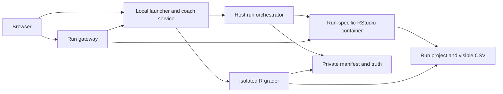

# RStudio Wrapped: learning lab plan

**Assessment date:** 19 November 2026  
**Recommendation:** Build a local, single-learner prototype. A useful RStudio lab is feasible with the same scenario, coaching, replay, and evidence principles as ELK Guide. The exact in-page coach and automatic demonstration need a short integration spike before we promise feature parity.

## 1. What “similar to ELK Guide” means

The reference is the working [ELK Guide](../ELK-guide/README.md), especially its [scenario pack contract](../ELK-guide/docs/SCENARIO_PACK_GUIDE.md), [semantic action model](../ELK-guide/docs/SEMANTIC_ACTIONS.md), and [local verification plan](../ELK-guide/LOCAL_TEST_PLAN.md). Its reusable lesson is the system shape, not Elasticsearch or Kibana code:

| ELK Guide mechanism | RStudio Wrapped equivalent |
| --- | --- |
| Browser launcher, scenario key, run manifest | Local launcher selects a data-analysis assignment and mode. The key deterministically generates a dataset; each attempt gets a new run ID. |
| Kibana Space and run-specific evidence | Fresh RStudio project and container per run, with a run-specific CSV and clean R session. |
| Kibana coach with Demonstration, Guided, and Challenge | Companion coach in the RStudio tab if the gateway spike passes; otherwise a separate companion pane. One goal graph and dataset power all three modes. |
| Semantic observations and truth assertions | Checks of submitted R functions, generated outputs, and written interpretation. UI events help with guidance but do not prove the analysis is correct. |
| Readiness and reset checks | Confirm the IDE opens, project files exist, R packages load, and the generated dataset satisfies its truth constraints before marking a run ready. Reset creates a fresh project and R session. |
| Live scenario and browser audits | Run the real RStudio workflow in a browser; independently execute learner code against visible and held-out fixtures. |

ELK Guide's learner work is read-only investigation. RStudio work changes scripts, objects, files, and package state. That makes **execution and clean reset** the central design problem here. Reusing ELK's JSON ideas and UI patterns is sensible; copying its Kibana adapters, Elasticsearch validators, or Space model is not.

## 2. Evidence that the approach is possible

- The [Rocker RStudio image](https://rocker-project.org/images/versioned/rstudio) runs RStudio Server in a container on port 8787. It supports a configured password. Versioned image tags supply a fixed R version, and the chosen image should also be pinned by digest after verification.
- RStudio's [Tutorial pane](https://docs.posit.co/ide/user/ide/guide/ui/ui-panes.html) and [`learnr`](https://rstudio.github.io/learnr/articles/learnr.html) provide native interactive lessons, executable R exercises, hints, and checks. [`gradethis`](https://rstudio.github.io/gradethis/articles/gradethis.html) provides custom exercise feedback. These are a useful fallback or optional practice surface, although embedded exercise editors do not by themselves assess work in the normal Source pane and project files.
- [RStudio addins](https://docs.posit.co/ide/user/ide/guide/productivity/add-ins.html) can inspect or change open documents. [`rstudioapi::navigateToFile()`](https://rstudio.github.io/rstudioapi/reference/navigateToFile.html) can open a source file, and [`rstudioapi::sendToConsole()`](https://rstudio.github.io/rstudioapi/reference/sendToConsole.html) can show and run code in the real console. This is a plausible basis for a visible, stepwise demonstration; its timing and behavior in the chosen server image still need to be proven.
- Posit's [proxy guidance](https://docs.posit.co/ide/server-pro/admin/access_and_security/running_with_a_proxy.html) documents reverse proxying and the need to forward WebSockets and long-lived connections. The cited page covers Workbench; verify the behavior against the open-source RStudio Server image selected for this lab. ELK Guide's HTML injection approach is a candidate, not an assumed RStudio API.
- [`renv`](https://rstudio.github.io/renv/articles/renv.html) records R package versions, while the container image fixes R and system dependencies. The image plus lockfile is the reproducibility unit; a lockfile alone does not pin R or OS libraries.

**Conclusion:** The lab itself is feasible. Native RStudio, a run-specific project, R execution, behavioral grading, and replay have supported building blocks. The degree of ELK-style live UI automation is unverified until the gateway and `rstudioapi` spike succeeds.

## 3. Lessons from ELK Guide's Git history

The commit sequence shows which parts of the lab needed correction after the first implementation. Apply these lessons while building the first RStudio slice; they do **not** replace the RStudio gateway and demonstration spike above. Commit links refer to the [ELK Guide repository](https://github.com/lpmi-13/ELK-guide); each can also be inspected locally with `git show <hash>`.

| ELK history | What changed there | Action for RStudio Wrapped |
| --- | --- | --- |
| [`077d5a0`](https://github.com/lpmi-13/ELK-guide/commit/077d5a0), [`cd0ad4f`](https://github.com/lpmi-13/ELK-guide/commit/cd0ad4f) | The browser extension gave way to a same-origin gateway. Later, the gateway loaded only a small bootstrap until a tab actually had a coach session. | Spike proxying, login, cookies, reload, and coach injection before building the full overlay. If it works, remove the handoff token from the URL before the IDE loads, scope it to one tab/run, and load observers only for a real learning session. |
| [`f9b8e87`](https://github.com/lpmi-13/ELK-guide/commit/f9b8e87), [`48d1baf`](https://github.com/lpmi-13/ELK-guide/commit/48d1baf) | Local ports were bound to loopback, and scenarios relying on paid Kibana features were removed. | Keep every prototype port local. Test against open-source RStudio Server and the exact packages in the pinned image; do not design a core exercise around Workbench-only features or an uninstalled package. |
| [`9e6bd89`](https://github.com/lpmi-13/ELK-guide/commit/9e6bd89), [`4f2129b`](https://github.com/lpmi-13/ELK-guide/commit/4f2129b) | The MVP narrowed to one repeatable investigation pattern, then later work added more variation and checked that demonstrated values had appeared on screen first. | Keep the first release to `regional-revenue`, but make runs vary the leading region and the data conditions. In a demo, inspect a visible value before using it in the next action; test that the brief, CSV, reference code, and answer all resolve from one manifest. |
| [`26ff690`](https://github.com/lpmi-13/ELK-guide/commit/26ff690), [`0366dd3`](https://github.com/lpmi-13/ELK-guide/commit/0366dd3) | A prefilled query and revealing UI copy weakened the investigation. | Give `analysis.R` a function stub and public rules, without prefilled solution logic or the winning region. Audit launcher cards, hints, filenames, starter comments, and Challenge payloads for answer leakage across several seeds. |
| [`a2af8d5`](https://github.com/lpmi-13/ELK-guide/commit/a2af8d5), [`1e3f0e5`](https://github.com/lpmi-13/ELK-guide/commit/1e3f0e5) | A query mentioning the right fields could pass despite an empty result. Guided recovery and later real-surface fixes separated attempted actions from settled evidence. | A saved script, `Check work` click, or successful R process exit cannot complete a goal by itself. Require the expected table from the current run and held-out cases. If code errors or returns an empty/wrong table, explain the observed problem and keep the learner's file intact; make reset an explicit action. |
| [`19e64e7`](https://github.com/lpmi-13/ELK-guide/commit/19e64e7), [`ec00f4a`](https://github.com/lpmi-13/ELK-guide/commit/ec00f4a) | Guided cards could wait for a missing UI anchor; Advance and highlights needed state fixes. | Show the next instruction immediately, then attach a highlight only when its RStudio target is present. Make Advance, Show me, Stop, reload, and a rerendered Source/Console pane idempotent; do not count coach actions as learner actions. |
| [`c134126`](https://github.com/lpmi-13/ELK-guide/commit/c134126), [`947d1fe`](https://github.com/lpmi-13/ELK-guide/commit/947d1fe), [`cd0ad4f`](https://github.com/lpmi-13/ELK-guide/commit/cd0ad4f) | Preparation later gained prewarming, then its animation and hidden-tab handoff needed CPU and state fixes. | Make readiness a backend fact independent of animation. Open the preparation tab immediately with a manual fallback link, survive reload and a hidden tab, and stop motion when hidden. Measure any prewarming; do not start a second RStudio session merely to warm assets. |
| [`168409e`](https://github.com/lpmi-13/ELK-guide/commit/168409e), [`7575320`](https://github.com/lpmi-13/ELK-guide/commit/7575320) | A one-command build waited for service health; seed ingestion needed its own reliable state. | The launcher should say ready only after RStudio login, project files, installed packages, the dataset, and a reference R check pass. Separate container health from scenario readiness and surface a specific setup failure. |
| [`4cff385`](https://github.com/lpmi-13/ELK-guide/commit/4cff385), [`8a0e1bc`](https://github.com/lpmi-13/ELK-guide/commit/8a0e1bc) | Logs and indices grew without bounds; completed and abandoned runs needed cleanup even after controller restarts. Replay validation was moved before stopping the old run. | Set limits for logs, projects, manifests, and feedback; reclaim only clearly owned orphan run directories/containers on startup. Validate a replay key and capacity before touching the active run, so a rejected replay leaves it usable. |
| [`d593945`](https://github.com/lpmi-13/ELK-guide/commit/d593945), [`a26d53c`](https://github.com/lpmi-13/ELK-guide/commit/a26d53c) | Generated saved objects gained a checked source script, and learner-facing wording gained plain-language tests. | Generate starter projects and CSVs from versioned source with a check mode. Review all learner copy, including errors and debriefs, for short sentences; explain R terms when first used while keeping actual RStudio labels. |

These are design evidence from ELK Guide, not proof that identical mechanisms work in RStudio. The spike still decides whether the coach can live in the IDE tab and whether `rstudioapi` can drive a reliable automatic demonstration.

## 4. First learner experience

Start with one scenario family: **find the trustworthy regional revenue from a messy orders export**. It teaches a repeatable analysis habit: inspect → clean → summarize → validate → explain. Keep the first release on one RStudio surface: Source, Console, Environment, and Files. Plots and report rendering can follow after this path works.

The launcher shows a short business brief: a colleague needs completed-order revenue by region, but the export contains exact duplicate rows, cancelled orders, and missing amounts. The learner opens a prepared RStudio Project containing `README.md`, `data/orders.csv`, and `analysis.R`. The task is to write a function that returns one row per region with completed order count and revenue, then state which region leads and why the exclusions matter.

Use a narrow, public function contract so equivalent solutions are welcome:

```r
summarise_orders <- function(orders) {
  # Return columns: region, order_count, revenue.
  # Count each completed order ID once; exclude rows with missing amount.
}
```

The generator guarantees that duplicate IDs are exact row duplicates, all amounts are nonnegative, and one region leads by a clear margin. The visible CSV varies by run key: row order, counts, amounts, leading region, and distractor mix. The hidden test fixtures have the same documented schema but different values. The grader compares normalized tables and numeric results, so it accepts base R, `dplyr`, or another sound implementation and rejects a hard-coded answer to the visible CSV. The learner's written answer is checked separately against the run's facts; it must cite the leading region and relevant totals or counts.

### Three modes on the same run

| Mode | Learner sees | Completion rule |
| --- | --- | --- |
| **Demonstration** | A run-specific walkthrough opens the project script, visibly runs the reference analysis, explains each exclusion and result, then shows the evidence and conclusion. It is unscored. Automatic steps depend on the `rstudioapi` spike; the fallback asks the learner to advance a reference script one step at a time. | Each displayed step must match the current run's manifest and actual R output. A failed action stops the walkthrough visibly. |
| **Guided** | One outcome at a time, a `Check work` control, and progressive hints: concept, relevant RStudio surface or R operation, partial example, then `Show me`. | The saved function passes behavioral checks for the current goal. Hints and `Show me` are recorded for the debrief; exploration is not penalized. |
| **Challenge** | Only the business brief, function contract, and submission control. Optional hints have an explicit score cost. | On submit, a separate grader runs the function on visible and held-out fixtures, checks the written interpretation, and produces an evidence-based debrief. No reference values are sent to the browser before submission. |

The coach must not infer success from a click, text typed into an unsaved editor, or a console command that merely ran. The first version grades the **saved** `analysis.R`. `Check work` tells the learner to save if the Source pane has unsaved changes; observing unsaved buffers through `rstudioapi` can be added after the core path is reliable. The debrief should say which input case failed, such as duplicate counting or missing amounts, without exposing a held-out fixture before Challenge submission.

### Example run contract

```text
scenario_id: regional-revenue
run_id: fresh unique ID for each attempt
scenario_key: learner-selected 10–40 character key
seed: stable hash of scenario ID + scenario key + generator version
mode: demonstration | guided | challenge
parameters: generated region winner, order mix, amounts, row order
project_path: run-scoped RStudio Project
truth: reference summary and allowed written-answer facts (server side only)
state: CREATED → PROVISIONING → READY → ACTIVE → COMPLETED
terminal branches: FAILED, ABORTED
```

The same key and generator version reproduce the dataset and expected facts, but never reuse the prior container, project, or feedback. Record the image digest, R and RStudio versions, `renv.lock` hash, generator version, and key in the private run manifest. Store public metadata separately from truth. A changed generator or package set requires a new scenario version so old keys remain interpretable.

## 5. Proposed architecture



1. **Host orchestrator.** A local host process creates and removes one run container and project directory at a time for the prototype. It owns Docker access; no browser-facing container and no RStudio container receives the Docker socket. The launcher listens only on loopback. A later multi-user deployment needs a separate orchestration and authorization design.
2. **RStudio runtime.** Build from a verified `rocker/rstudio` digest with required R packages preinstalled, a non-root learner account, a prepared project, and no host home-directory mount. Generate a per-run password, retain RStudio authentication, and give the learner a controlled handoff. Avoid `DISABLE_AUTH=true`: [Rocker limits it to secure environments](https://rocker-project.org/images/versioned/rstudio). Mount only that run's project and writable scratch space. Keep private truth and grader fixtures outside the learner container.
3. **Gateway and coach.** Proxy RStudio on a local path or run-specific loopback address, including cookies, WebSockets, redirects, and long polling. Test whether a version-pinned HTML response can load a coach script on the same origin, as [ELK Guide's gateway](../ELK-guide/kibana-gateway/nginx.conf) does. The script may render instructions, hints, status, and a visible Stop control. It should use RStudio DOM selectors only for presentation or observed navigation, never for grading correctness. If injection is brittle, serve the same coach in a separate browser pane while the learner stays in RStudio; the underlying goal and grading services remain identical.
4. **Run service.** Load scenario descriptors, materialize the dataset and private truth from one seed, expose a narrow run/session protocol, and track goals. Keep demonstration, guided, and challenge as policies over the same goal graph. Session tokens are scoped to one run and expire on reset. Validate replay input and available capacity before stopping the existing run. The service receives only necessary telemetry: goal checks, hints, run state, and optionally coarse IDE navigation; it does not need a keylogger or full source-history recorder.
5. **Grader.** On `Check work` or submit, copy the saved script into a short-lived grader container. Run it in a fresh R process against the visible dataset and at least two held-out fixtures with CPU, memory, process, and time limits and no network. Give the grader only the expected summaries needed for comparison, not the full private run manifest. Normalize row order and types; compare region, count, and revenue with a declared numeric tolerance. Return structured checks, not raw hidden rows. Evaluate the written explanation against the run-specific reference facts. Learner code is arbitrary R, so keep this local-only until the execution boundary is independently reviewed for untrusted users.
6. **Persistence and cleanup.** Keep completed feedback long enough for review. On reset, stop the old RStudio container, discard its writable project and R session, and start a new run. A stopped browser tab must show that its run ended. Bound logs, projects, manifests, and feedback from the first prototype. On startup, identify abandoned resources by a strict run-owned name and reclaim them without touching the active run.

Do not make `learnr` the only workspace for the main scenario: it evaluates code inside tutorial exercises, while this lab promises normal RStudio project work. Use it for a small optional prerequisite lesson or as the in-IDE guidance fallback if the coach overlay fails. Its native checking can inform feedback design, but the challenge grader should check the saved project function in a fresh process.

## 6. Feasibility spike: prove the hard parts first

Time-box the spike before writing a catalog or porting ELK's UI code. Its deliverable is a tiny runnable prototype and a short decision record with the chosen image digest and observed behavior.

| Probe | Concrete check | Pass condition / decision |
| --- | --- | --- |
| RStudio container | Start a pinned Rocker image, log in as the learner, open a prepared `.Rproj`, edit and save `analysis.R`, run R in Console. | Works after a clean container start with no manual package installation. |
| Proxy and coach | Proxy the login, editor, Console, and any WebSocket/long-poll traffic; reload during a session; try inserting a small coach panel. | All RStudio functions still work. If injection or content security rules break, use the separate companion pane for MVP and record that the in-page experience remains unproven. |
| Demonstration control | From a learner-visible action, use an addin/`rstudioapi` to open the script and send a run-specific snippet to the actual Console; verify the output is visible before showing its explanation. | Repeatable across reload and restart. If not, use an explicit stepwise reference script launched from RStudio for MVP; do not describe it as an automatic demo. |
| Saved-code grading | Save a function, run it in a separate process on visible and held-out data, then deliberately leave an unsaved edit in the Source pane. | Saved version is graded consistently and the UI explains the save requirement. |
| Clean replay | Start a new run with the same key, then a different key. | Same key reproduces the dataset/truth; both runs get fresh projects and sessions; changed key changes at least one decisive value. |
| Handoff and preparation | Begin a run, reload and hide its preparation tab, then interrupt provisioning and try an invalid replay key. | Readiness does not depend on animation frames; a failed run offers a return path; the rejected replay leaves the previous run usable. |

The spike should also measure startup time and memory on the intended host. Set the published minimum requirements from those measurements rather than borrowing ELK Guide's roughly 3 GB figure.

## 7. Implementation sequence

### Phase A — one vertical slice

1. Create a new `rstudio-wrapped` repository with `compose.yaml`, `labctl` or an equivalent host launcher, a version-pinned runtime image, and a prepared RStudio Project. Document one-command start/stop and the actual local URL.
2. Implement the `regional-revenue` generator and reference solution, with a check mode for generated starter artifacts. Add generator invariants: exact duplicate IDs only, no negative amounts, enough completed valid orders, unique leading region by a minimum margin, and variation across a fixed set of keys. Keep the starter script and filenames free of the answer.
3. Build a private run manifest and the public scenario descriptor. Validate that dataset, brief, demonstration copy, hints, and expected answers resolve from the same parameters. Never write truth into the learner project or served client bundle.
4. Implement the isolated behavioral grader and structured feedback. Test correct base R and `dplyr` solutions, a hard-coded visible answer, duplicate-counting, including cancelled rows, and mishandling missing amounts.
5. Deliver launcher → ready gate → RStudio project → Guided `Check work` → debrief → same/new-key replay. This establishes the real learning loop before UI automation.

### Phase B — modes and in-IDE experience

6. Add Challenge using the same dataset and grader. Keep intermediate checks generic in Challenge; reveal correctness only at submit. Add the written explanation form and score with separate categories for correct result, tested generality, and evidence-based interpretation.
7. Add Demonstration using the spike's proven method. Show each RStudio action and result before the explanatory card; a backend acknowledgment alone cannot complete a demo step. If the addin route fails, ship the honest stepwise reference script and revisit automatic control as a separate task.
8. Add the coach panel, progressive hints, Show me, Stop, reload recovery, and completed-feedback review. Show instructions without waiting for an optional IDE highlight; attach highlights only after a target appears. Keep the action vocabulary small: `project_opened`, `file_saved`, `check_requested`, `function_passed`, `result_inspected`, `answer_submitted`. The grader owns `function_passed`; source editor selectors do not.

### Phase C — expand only after the first slice passes

9. Add a second scenario family that requires a different RStudio skill, such as investigating an unexpectedly high plotted rate and correcting the denominator. Reuse the run and grading contracts, not a copied click path.
10. Add optional `learnr` prerequisites for new R users, then consider Quarto reports, plots, debugging, and package/environment tasks. Each new family gets its own held-out behavioral checks and fresh-project reset test.
11. If hosted or concurrent use is wanted, design authentication, per-user container isolation, network policy, resource quotas, and a run scheduler first. Open-source RStudio Server is suitable for the local prototype; [Posit documents Workbench as the product with additional multi-session and security features](https://docs.posit.co/ide/server-pro/user/posit-workbench/reference/faq.html). Review the open-source edition's license before redistributing a modified server image or offering a hosted service.

## 8. Acceptance gates

The first release is done when a new learner can start the lab, complete the one scenario in all three modes, read a specific debrief, and replay it without maintainer intervention.

- **Provisioning:** Fail readiness if login, project opening, package loading, dataset generation, or reference checks fail. Never present an unusable run as learner failure.
- **Correctness:** The same grader accepts two materially different valid implementations and rejects representative wrong ones. A script that prints the right visible totals but fails held-out fixtures does not pass. The explanation cites facts visible in the run.
- **Mode integrity:** All modes use the same data and rules. Guided hints do not silently change the task. Challenge reveals no hidden truth or solution code before submit. Demonstration actions and shown results match the run's manifest.
- **Reset and isolation:** Same key recreates the same facts in a fresh R session. A different key varies decisive facts. A stale tab cannot submit to a new run. No learner project contains private truth or held-out fixture data.
- **Replay and retention:** An invalid replay request leaves the current run usable. Startup cleanup removes abandoned run-owned resources and leaves active resources alone. Repeated starts, completions, and resets stay within documented storage limits.
- **Learner copy:** The starter project and Challenge opening do not reveal the winner. Demo narration uses only values already shown in RStudio. Hints, error messages, and debriefs use plain language and the actual RStudio labels.
- **Browser audit:** A test starts from the launcher and lets the real coach run. It checks visible actions, actual R output, failed-action behavior, reload, Stop, and debrief at two common viewport sizes. The test must not call the coach's internal step-completion API to manufacture success.
- **Operational fit:** Start, stop, and cleanup are documented and exercised. The published resource requirement comes from measured cold and warm starts. The runtime and grader have explicit time and resource limits.

## 9. Main risks and decisions

| Risk | Response |
| --- | --- |
| RStudio's DOM or response format changes, breaking injection or selectors | Pin the image digest; limit selectors to coach presentation; keep a separate companion-pane fallback; run a browser compatibility audit before upgrades. |
| Unsaved editor text differs from saved script | State the saved-file grading contract, prompt before checking, and add buffer inspection only if the spike proves it dependable. |
| A learner's R code hangs or accesses unexpected resources | Execute grading in a disposable constrained container with no network or secrets. Keep the first release local and single learner. |
| Random variants yield ambiguous winners or brittle numeric checks | Validate generator invariants at provisioning; use independent reference computation and explicit tolerance; test boundary seeds. |
| A demo shows scripted values that do not match the current run | Materialize script snippets and narration from the same private manifest; verify actual Console output before advancing. |
| R/package versions drift | Pin the image digest and `renv.lock`; record R, RStudio, package, and generator versions in every run manifest. |

The first investment should be the feasibility spike plus the `regional-revenue` vertical slice. That will establish a real RStudio learning lab quickly and give a factual answer on whether the ELK-style coach can live inside the IDE tab.
